# Environment

<div class="view-switch"></div>

<div class="env-view" data-view="web" data-label="Web">

<nav class="toc view-toc"><h2>Contents</h2><ul><li class="l2"><a href="#web-1"><span class="num">1</span> Open Benchmarks</a></li><li class="l2"><a href="#web-2"><span class="num">2</span> Open Data Pipelines</a></li><li class="l2"><a href="#web-3"><span class="num">3</span> In-House Data Pipeline</a></li></ul></nav>

<a class="anchor" id="web-1"></a>

## 1 Open Benchmarks

<a class="anchor" id="web-1-1"></a>

### 1.1 Benchmark

<table class="frontier"><thead><tr><th>Benchmark</th><th>模型</th><th>分数</th><th>来源</th></tr></thead><tbody><tr><td class="bench" rowspan="5"><a href="https://arena.ai/leaderboard/code/webdev">Code Arena · WebDev</a></td><td> GPT-6 Astra</td><td>1793（1st）</td><td><a href="https://arena.ai/leaderboard/code/webdev">Benchmark</a></td></tr><tr><td> Claude Opus 5</td><td>1691（3rd）</td><td><a href="https://arena.ai/leaderboard/code/webdev">Benchmark</a></td></tr><tr><td> Gemini 3.7 Flash</td><td>1588</td><td><a href="https://deepmind.google/models/model-cards/gemini-3-7-flash/">Blog</a></td></tr><tr><td> Kimi K3</td><td>1678（1st，2026-07-23）</td><td><a href="https://github.com/MoonshotAI/Kimi-K3/blob/main/k3_tech_report.pdf">Blog</a></td></tr><tr><td> Seed2.1 Pro</td><td>1539（8th）</td><td><a href="https://lf3-static.bytednsdoc.com/obj/eden-cn/lapzild-tss/ljhwZthlaukjlkulzlp/seed2.1/Seed2_1_Model_Card.pdf">Blog</a></td></tr><tr><td class="bench" rowspan="2"><a href="https://www.vals.ai/benchmarks/vibe-code">Vibe Code Bench v1.1</a></td><td> GPT-6 Astra</td><td>89.59%</td><td><a href="https://www.vals.ai/benchmarks/vibe-code">Benchmark</a></td></tr><tr><td> Claude Fable 5</td><td>90.35%（1st）</td><td><a href="https://www.vals.ai/benchmarks/vibe-code">Benchmark</a></td></tr><tr><td class="bench" rowspan="2"><a href="https://arxiv.org/abs/2603.26648">Vision2Web</a></td><td> GLM-5.3-Flash</td><td>77.8</td><td><a href="https://z.ai/blog/glm-5.3-flash">Blog</a></td></tr><tr><td> Qwen3.8-Max</td><td>69.0</td><td><a href="https://qwen.ai/blog?id=qwen3.8">Blog</a></td></tr><tr><td class="bench" rowspan="1"><a href="https://arxiv.org/abs/2410.03859">SWE-bench Multimodal</a></td><td> Claude Opus 5</td><td>59.4%</td><td><a href="https://www.anthropic.com/claude-opus-5-system-card">Blog</a></td></tr><tr><td class="bench" rowspan="1"><a href="https://arxiv.org/abs/2403.03163">Design2Code</a> / Flame-VLM-Code</td><td> GLM-5V-Turbo</td><td>94.8 / 93.8</td><td><a href="https://docs.z.ai/guides/vlm/glm-5v-turbo">Blog</a></td></tr><tr><td class="bench" rowspan="1"><a href="https://artifactsbenchmark.github.io/leaderboard.html">ArtifactsBench</a></td><td> Seed2.0 Pro</td><td>66.6</td><td><a href="https://arxiv.org/abs/2607.00248">Blog</a></td></tr><tr><td class="bench" rowspan="1">Internal Design Tasks<span class="self-tag">自建</span></td><td> GPT-6 Astra</td><td>50.0%</td><td><a href="https://openai.com/index/gpt-6-astra/">Blog</a></td></tr><tr><td class="bench" rowspan="1">Kimi Webdev Bench<span class="self-tag">自建</span></td><td> Kimi K3</td><td>胜 58.6 / 平 13.8 / 负 27.6</td><td><a href="https://github.com/MoonshotAI/Kimi-K3/blob/main/k3_tech_report.pdf">Blog</a></td></tr><tr><td class="bench" rowspan="1">CC-Frontend（CC-Bench-V2）<span class="self-tag">自建</span></td><td> GLM-5V-Turbo</td><td>68.4</td><td><a href="https://docs.z.ai/guides/vlm/glm-5v-turbo">Blog</a></td></tr><tr><td class="bench" rowspan="1">QwenReactBench / QwenSVGBench<span class="self-tag">自建</span></td><td> Qwen3.8-Max</td><td>1724 / 1713</td><td><a href="https://qwen.ai/blog?id=qwen3.8">Blog</a></td></tr><tr><td class="bench" rowspan="1">Trae Web Bench / Trae Artifacts<span class="self-tag">自建</span></td><td> Seed2.1 Pro</td><td>78.4 / 51.0</td><td><a href="https://lf3-static.bytednsdoc.com/obj/eden-cn/lapzild-tss/ljhwZthlaukjlkulzlp/seed2.1/Seed2_1_Model_Card.pdf">Blog</a></td></tr><tr><td class="bench" rowspan="1">VIBE-V2 / SVG-Bench<span class="self-tag">自建</span></td><td> MiniMax-M3</td><td>50.1 / 63.7</td><td><a href="https://www.minimax.io/blog/minimax-m3">Blog</a></td></tr><tr><td class="bench" rowspan="2">未报告相关分数</td><td> DeepSeek-V4.1-Flash</td><td>未报告</td><td><a href="https://huggingface.co/deepseek-ai/DeepSeek-V4.1-Flash">Blog</a></td></tr><tr><td> Hy4 preview</td><td>未报告</td><td><a href="https://huggingface.co/tencent/Hy4-preview">Blog</a></td></tr></tbody></table>

<a class="anchor" id="web-1-2"></a>

### 1.2 Benchmark Timeline

- **Input**：截图、设计稿、草图、自然语言规格说明、多轮对话、图表图像。
- **Output**：单页 HTML、多文件 Web App、绘图代码或 SVG。
- **Verifier**：
  - Reward Model：美学质量评估 / 视觉相似度（渲染结果和参考图比较）
  - Agent：Browser use agent / Computer use agent，按工作流操作页面，检查功能是否可用。
  - MLLM Checklist：用于审美和设计质量。MLLM checklist 需要先与人工评审对齐。

三个维度对应六种能力：视觉还原、交互实现、功能正确、多轮编辑、审美对齐、图表与矢量精度。

<div class="tbl-tabs">

<div class="tbl-pane" data-label="Screenshot → Code" data-count="23">

<p class="tbl-desc">输入截图 / 设计稿 / 草图，输出网页代码，渲染后和参考图比。</p>

<table class="merged"><thead><tr><th>发布日期</th><th>名称</th><th>类型</th><th>来源</th><th>形态</th><th>规模/题量</th><th>影响力</th><th>说明</th></tr></thead><tbody><tr class="top5"><td>2017/5/22</td><td> <a href="https://arxiv.org/abs/1705.07962">pix2code</a> <span class="org">UIzard</span></td><td><span class="type type-data">数据集</span></td><td><a class="src src-gh" href="https://github.com/tonybeltramelli/pix2code">GitHub</a></td><td>GUI 截图→DSL</td><td>3 平台合成 GUI</td><td><a class="hf" href="https://github.com/tonybeltramelli/pix2code"><span class="hf-b hf-st" title="GitHub stars"><svg class="hf-i" viewBox="0 0 24 24" fill="currentColor"><path d="M12 2.5l2.9 6 6.6.6-5 4.3 1.5 6.5L12 16.9 6 20.9l1.5-6.5-5-4.3 6.6-.6z"/></svg>12.0k</span></a></td><td><strong>最早的配对数据</strong>：随机合成 DSL 再渲染出 GUI，截图与代码天然对齐</td></tr><tr><td>2024/3/5</td><td>  <a href="https://arxiv.org/abs/2403.03163">Design2Code</a> <span class="org">Google DeepMind · Stanford</span></td><td><span class="type type-bench">Benchmark</span></td><td><a class="src src-hf" href="https://huggingface.co/datasets/SALT-NLP/Design2Code">HF</a></td><td>截图→HTML</td><td>484</td><td><a class="hf" href="https://github.com/NoviScl/Design2Code"><span class="hf-b hf-st" title="GitHub stars"><svg class="hf-i" viewBox="0 0 24 24" fill="currentColor"><path d="M12 2.5l2.9 6 6.6.6-5 4.3 1.5 6.5L12 16.9 6 20.9l1.5-6.5-5-4.3 6.6-.6z"/></svg>600</span></a></td><td><strong>真实网页还原</strong>：真实网页截图转 HTML，考元素召回与布局</td></tr><tr><td>2024/3/5</td><td>  <a href="https://arxiv.org/abs/2403.03163">Design2Code</a> <span class="org">Google DeepMind · Stanford</span></td><td><span class="type type-data">数据集</span></td><td><a class="src src-hf" href="https://huggingface.co/datasets/SALT-NLP/Design2Code">HF</a></td><td>截图→HTML</td><td>训练 165K + 测试 484</td><td><a class="hf" href="https://huggingface.co/datasets/SALT-NLP/Design2Code"><span class="hf-b hf-dl" title="downloads"><svg class="hf-i" viewBox="0 0 24 24" fill="none" stroke="currentColor" stroke-width="2.2" stroke-linecap="round" stroke-linejoin="round"><path d="M12 3v11"/><path d="M8 11l4 4 4-4"/><path d="M4 20h16"/></svg>1.8k</span><span class="hf-b hf-lk" title="likes"><svg class="hf-i" viewBox="0 0 24 24" fill="currentColor"><path d="M12 21C7 17.5 3 14 3 9.5 3 7 5 5 7.5 5 9.2 5 10.7 6 12 7.6 13.3 6 14.8 5 16.5 5 19 5 21 7 21 9.5 21 14 17 17.5 12 21z"/></svg>22</span></a></td><td><strong>WebSight 子集微调</strong>：训练取 WebSight 20%，真实网页只当测试集</td></tr><tr class="top5"><td>2024/3/14</td><td> <a href="https://arxiv.org/abs/2403.09029">WebSight</a> <span class="org">HuggingFace</span></td><td><span class="type type-data">数据集</span></td><td><a class="src src-hf" href="https://huggingface.co/datasets/HuggingFaceM4/WebSight">HF</a></td><td>截图→HTML 对</td><td>2M</td><td><a class="hf" href="https://huggingface.co/datasets/HuggingFaceM4/WebSight"><span class="hf-b hf-dl" title="downloads"><svg class="hf-i" viewBox="0 0 24 24" fill="none" stroke="currentColor" stroke-width="2.2" stroke-linecap="round" stroke-linejoin="round"><path d="M12 3v11"/><path d="M8 11l4 4 4-4"/><path d="M4 20h16"/></svg>18.1k</span><span class="hf-b hf-lk" title="likes"><svg class="hf-i" viewBox="0 0 24 24" fill="currentColor"><path d="M12 21C7 17.5 3 14 3 9.5 3 7 5 5 7.5 5 9.2 5 10.7 6 12 7.6 13.3 6 14.8 5 16.5 5 19 5 21 7 21 9.5 21 14 17 17.5 12 21z"/></svg>400</span></a></td><td><strong>纯合成 SFT 底料</strong>：LLM 写主题与 Tailwind HTML 再渲染截图，量大干净</td></tr><tr><td>2024/4/9</td><td>  <a href="https://arxiv.org/abs/2404.06369">WebCode2M</a> <span class="org">Rabbitpre AI · PKU</span></td><td><span class="type type-bench">Benchmark</span></td><td><a class="src src-hf" href="https://huggingface.co/datasets/xcodemind/webcode2m">HF</a></td><td>设计稿→HTML</td><td>2.56M</td><td><a class="hf" href="https://huggingface.co/datasets/xcodemind/webcode2m"><span class="hf-b hf-dl" title="downloads"><svg class="hf-i" viewBox="0 0 24 24" fill="none" stroke="currentColor" stroke-width="2.2" stroke-linecap="round" stroke-linejoin="round"><path d="M12 3v11"/><path d="M8 11l4 4 4-4"/><path d="M4 20h16"/></svg>2.4k</span></a></td><td><strong>设计稿转码数据</strong>：百万级设计图-代码对，TreeBLEU 评 DOM 结构</td></tr><tr><td>2024/4/9</td><td>  <a href="https://arxiv.org/abs/2404.06369">Vision2UI → WebCode2M</a> <span class="org">Rabbitpre AI · PKU</span></td><td><span class="type type-data">数据集</span></td><td><a class="src src-hf" href="https://huggingface.co/datasets/xcodemind/webcode2m">HF</a></td><td>设计图→网页代码</td><td>2.56M</td><td><a class="hf" href="https://huggingface.co/datasets/xcodemind/webcode2m"><span class="hf-b hf-dl" title="downloads"><svg class="hf-i" viewBox="0 0 24 24" fill="none" stroke="currentColor" stroke-width="2.2" stroke-linecap="round" stroke-linejoin="round"><path d="M12 3v11"/><path d="M8 11l4 4 4-4"/><path d="M4 20h16"/></svg>2.4k</span><span class="hf-b hf-lk" title="likes"><svg class="hf-i" viewBox="0 0 24 24" fill="currentColor"><path d="M12 21C7 17.5 3 14 3 9.5 3 7 5 5 7.5 5 9.2 5 10.7 6 12 7.6 13.3 6 14.8 5 16.5 5 19 5 21 7 21 9.5 21 14 17 17.5 12 21z"/></svg>48</span></a></td><td><strong>真实网页大语料</strong>：Common Crawl 网页渲染后按审美打分过滤，带布局信息</td></tr><tr><td>2024/6/28</td><td>  <a href="https://arxiv.org/abs/2406.20098">Web2Code</a> <span class="org">Petuum · CMU</span></td><td><span class="type type-bench">Benchmark</span></td><td><a class="src src-hf" href="https://huggingface.co/datasets/MBZUAI/Web2Code">HF</a></td><td>截图→HTML</td><td>1179.7K</td><td><a class="hf" href="https://github.com/MBZUAI-LLM/web2code"><span class="hf-b hf-st" title="GitHub stars"><svg class="hf-i" viewBox="0 0 24 24" fill="currentColor"><path d="M12 2.5l2.9 6 6.6.6-5 4.3 1.5 6.5L12 16.9 6 20.9l1.5-6.5-5-4.3 6.6-.6z"/></svg>103</span></a></td><td><strong>网页理解+生成</strong>：网页截图 QA 与转 HTML 双评测，补训练数据</td></tr><tr><td>2024/6/28</td><td>  <a href="https://arxiv.org/abs/2406.20098">Web2Code</a> <span class="org">Petuum · CMU</span></td><td><span class="type type-data">数据集</span></td><td><a class="src src-hf" href="https://huggingface.co/datasets/MBZUAI/Web2Code">HF</a></td><td>截图→HTML + 网页 QA</td><td>1,179.7K</td><td><a class="hf" href="https://huggingface.co/datasets/MBZUAI/Web2Code"><span class="hf-b hf-dl" title="downloads"><svg class="hf-i" viewBox="0 0 24 24" fill="none" stroke="currentColor" stroke-width="2.2" stroke-linecap="round" stroke-linejoin="round"><path d="M12 3v11"/><path d="M8 11l4 4 4-4"/><path d="M4 20h16"/></svg>1.3k</span><span class="hf-b hf-lk" title="likes"><svg class="hf-i" viewBox="0 0 24 24" fill="currentColor"><path d="M12 21C7 17.5 3 14 3 9.5 3 7 5 5 7.5 5 9.2 5 10.7 6 12 7.6 13.3 6 14.8 5 16.5 5 19 5 21 7 21 9.5 21 14 17 17.5 12 21z"/></svg>13</span></a></td><td><strong>代码 + 理解双料</strong>：GPT 新造与精修网页代码，外加网页 QA 做指令微调</td></tr><tr><td>2024/10/21</td><td> <a href="https://arxiv.org/abs/2410.16232">Sketch2Code</a> <span class="org">Stanford</span></td><td><span class="type type-bench">Benchmark</span></td><td><a class="src src-hf" href="https://huggingface.co/datasets/SALT-NLP/Sketch2Code">HF</a></td><td>草图→HTML</td><td>731</td><td><a class="hf" href="https://github.com/SALT-NLP/Sketch2Code"><span class="hf-b hf-st" title="GitHub stars"><svg class="hf-i" viewBox="0 0 24 24" fill="currentColor"><path d="M12 2.5l2.9 6 6.6.6-5 4.3 1.5 6.5L12 16.9 6 20.9l1.5-6.5-5-4.3 6.6-.6z"/></svg>41</span></a></td><td><strong>草图理解+多轮交互</strong>：手绘线框转网页，含反馈与主动提问</td></tr><tr><td>2024/10/21</td><td> <a href="https://arxiv.org/abs/2410.16232">Sketch2Code</a> <span class="org">Stanford</span></td><td><span class="type type-data">数据集</span></td><td><a class="src src-hf" href="https://huggingface.co/datasets/SALT-NLP/Sketch2Code">HF</a></td><td>手绘草图→HTML</td><td>731 草图 / 484 网页</td><td><a class="hf" href="https://huggingface.co/datasets/SALT-NLP/Sketch2Code"><span class="hf-b hf-dl" title="downloads"><svg class="hf-i" viewBox="0 0 24 24" fill="none" stroke="currentColor" stroke-width="2.2" stroke-linecap="round" stroke-linejoin="round"><path d="M12 3v11"/><path d="M8 11l4 4 4-4"/><path d="M4 20h16"/></svg>552</span><span class="hf-b hf-lk" title="likes"><svg class="hf-i" viewBox="0 0 24 24" fill="currentColor"><path d="M12 21C7 17.5 3 14 3 9.5 3 7 5 5 7.5 5 9.2 5 10.7 6 12 7.6 13.3 6 14.8 5 16.5 5 19 5 21 7 21 9.5 21 14 17 17.5 12 21z"/></svg>5</span></a></td><td><strong>真人手绘输入</strong>：按线框规范给真实网页画草图，可测多轮交互反馈</td></tr><tr><td>2024/10/29</td><td>  <a href="https://arxiv.org/abs/2410.22456">Image2Struct</a> <span class="org">Hitachi · Stanford</span></td><td><span class="type type-bench">Benchmark</span></td><td><a class="src src-gh" href="https://github.com/stanford-crfm/image2struct">GitHub</a></td><td>图像→结构代码</td><td>2,400</td><td><a class="hf" href="https://github.com/stanford-crfm/image2struct"><span class="hf-b hf-st" title="GitHub stars"><svg class="hf-i" viewBox="0 0 24 24" fill="currentColor"><path d="M12 2.5l2.9 6 6.6.6-5 4.3 1.5 6.5L12 16.9 6 20.9l1.5-6.5-5-4.3 6.6-.6z"/></svg>10</span></a></td><td><strong>图像结构抽取</strong>：网页/LaTeX/乐谱图转代码，渲染回图比对</td></tr><tr><td>2024/11/5</td><td> <a href="https://arxiv.org/abs/2411.03292">Interaction2Code</a> <span class="org">Tsinghua</span></td><td><span class="type type-bench">Benchmark</span></td><td><a class="src src-hf" href="https://huggingface.co/datasets/whale99/Interaction2Code">HF</a></td><td>交互原型→网页</td><td>374</td><td><a class="hf" href="https://github.com/WebPAI/Interaction2Code"><span class="hf-b hf-st" title="GitHub stars"><svg class="hf-i" viewBox="0 0 24 24" fill="currentColor"><path d="M12 2.5l2.9 6 6.6.6-5 4.3 1.5 6.5L12 16.9 6 20.9l1.5-6.5-5-4.3 6.6-.6z"/></svg>62</span></a></td><td><strong>交互行为实现</strong>：按交互原型生成可交互页，对比交互前后效果</td></tr><tr><td>2025/6/6</td><td> <a href="https://arxiv.org/abs/2506.06251">DesignBench</a> <span class="org">CUHK</span></td><td><span class="type type-bench">Benchmark</span></td><td><a class="src src-hf" href="https://huggingface.co/datasets/whale99/DesignBench">HF</a></td><td>设计稿→前端框架代码</td><td>900</td><td><a class="hf" href="https://github.com/WebPAI/DesignBench"><span class="hf-b hf-st" title="GitHub stars"><svg class="hf-i" viewBox="0 0 24 24" fill="currentColor"><path d="M12 2.5l2.9 6 6.6.6-5 4.3 1.5 6.5L12 16.9 6 20.9l1.5-6.5-5-4.3 6.6-.6z"/></svg>57</span></a></td><td><strong>多框架前端工程</strong>：多框架下的生成、编辑、修复三类任务</td></tr><tr><td>2025/6/9</td><td>  <a href="https://arxiv.org/abs/2506.07818">WebUIBench</a> <span class="org">China Telecom TeleAI · NJU</span></td><td><span class="type type-bench">Benchmark</span></td><td><a class="src src-hf" href="https://huggingface.co/datasets/Tele-AI-MAIL/WebUIBench">HF</a></td><td>截图→HTML</td><td>21K</td><td><a class="hf" href="https://github.com/MAIL-Tele-AI/WebUIBench"><span class="hf-b hf-st" title="GitHub stars"><svg class="hf-i" viewBox="0 0 24 24" fill="currentColor"><path d="M12 2.5l2.9 6 6.6.6-5 4.3 1.5 6.5L12 16.9 6 20.9l1.5-6.5-5-4.3 6.6-.6z"/></svg>6</span></a></td><td><strong>子能力拆解</strong>：感知/HTML 编程/UI 理解/UI 转码四维定位短板</td></tr><tr><td>2025/7/30</td><td> <a href="https://arxiv.org/abs/2507.22827">ScreenCoder</a> <span class="org">CUHK</span></td><td><span class="type type-data">数据集</span></td><td><a class="src src-hf" href="https://huggingface.co/datasets/Leigest/ScreenCoder">HF</a></td><td>截图→HTML</td><td>Screen-10K</td><td><a class="hf" href="https://github.com/leigest519/ScreenCoder"><span class="hf-b hf-st" title="GitHub stars"><svg class="hf-i" viewBox="0 0 24 24" fill="currentColor"><path d="M12 2.5l2.9 6 6.6.6-5 4.3 1.5 6.5L12 16.9 6 20.9l1.5-6.5-5-4.3 6.6-.6z"/></svg>3.0k</span></a></td><td><strong>agent 当数据引擎</strong>：grounding→planning→generation 产配对，SFT 后接 RL</td></tr><tr><td>2025/10/5</td><td>  <a href="https://arxiv.org/abs/2510.04097">WebRenderBench / ALISA</a> <span class="org">Huawei Cloud · PKU</span></td><td><span class="type type-data">数据集</span></td><td><a class="src src-hf" href="https://huggingface.co/datasets/aleversn/WebRenderBench">HF</a></td><td>截图→网页代码</td><td>45.1K</td><td><a class="hf" href="https://huggingface.co/datasets/aleversn/WebRenderBench"><span class="hf-b hf-dl" title="downloads"><svg class="hf-i" viewBox="0 0 24 24" fill="none" stroke="currentColor" stroke-width="2.2" stroke-linecap="round" stroke-linejoin="round"><path d="M12 3v11"/><path d="M8 11l4 4 4-4"/><path d="M4 20h16"/></svg>159</span><span class="hf-b hf-lk" title="likes"><svg class="hf-i" viewBox="0 0 24 24" fill="currentColor"><path d="M12 21C7 17.5 3 14 3 9.5 3 7 5 5 7.5 5 9.2 5 10.7 6 12 7.6 13.3 6 14.8 5 16.5 5 19 5 21 7 21 9.5 21 14 17 17.5 12 21z"/></svg>2</span></a></td><td><strong>真实门户 + 渲染奖励</strong>：从渲染结果算布局与样式一致性，直接当 RL reward</td></tr><tr><td>2025/11/11</td><td>  <a href="https://arxiv.org/abs/2511.08195">UI2Code^N</a> <span class="org">Zhipu AI · Tsinghua</span></td><td><span class="type type-data">数据集</span></td><td><span class="src src-paper">论文</span></td><td>截图→HTML 多轮</td><td>CPT 20M / SFT 80K / RL 42K</td><td><a class="hf" href="https://github.com/zai-org/UI2Code_N"><span class="hf-b hf-st" title="GitHub stars"><svg class="hf-i" viewBox="0 0 24 24" fill="currentColor"><path d="M12 2.5l2.9 6 6.6.6-5 4.3 1.5 6.5L12 16.9 6 20.9l1.5-6.5-5-4.3 6.6-.6z"/></svg>87</span></a></td><td><strong>逆向合成打磨任务</strong>：先造复杂 HTML 真值，再倒推待打磨输入，覆盖起草/打磨/编辑</td></tr><tr><td>2025/11/25</td><td> <a href="https://arxiv.org/abs/2511.20737">CANVAS</a> <span class="org">KAIST</span></td><td><span class="type type-bench">Benchmark</span></td><td><span class="src src-paper">论文</span></td><td>设计软件工具调用</td><td>598</td><td>—</td><td><strong>工具化 UI 设计</strong>：VLM 调设计软件工具复刻或局部修改 UI</td></tr><tr><td>2026/3/26</td><td>  <a href="https://arxiv.org/abs/2603.25118">AnyDoc / DocHTML</a> <span class="org">Adobe Research · XJTU</span></td><td><span class="type type-data">数据集</span></td><td><span class="src src-paper">论文</span></td><td>意图/截图/元素→HTML 文档</td><td>265K</td><td>—</td><td><strong>多模型流水线合成</strong>：抽元数据→标意图→写 HTML→配图→过滤溢出，高度比做奖励</td></tr><tr><td>2026/4/15</td><td> <a href="https://arxiv.org/abs/2604.13648">Figma2Code</a> <span class="org">ZJU</span></td><td><span class="type type-bench">Benchmark</span></td><td><a class="src src-hf" href="https://huggingface.co/datasets/xcodemind/Figma2Code">HF</a></td><td>Figma 设计稿→代码</td><td>213</td><td><a class="hf" href="https://huggingface.co/datasets/xcodemind/Figma2Code"><span class="hf-b hf-dl" title="downloads"><svg class="hf-i" viewBox="0 0 24 24" fill="none" stroke="currentColor" stroke-width="2.2" stroke-linecap="round" stroke-linejoin="round"><path d="M12 3v11"/><path d="M8 11l4 4 4-4"/><path d="M4 20h16"/></svg>916</span></a></td><td><strong>真实设计稿转码</strong>：Figma 多模态稿转代码，考响应式与可维护性</td></tr><tr><td>2026/5/29</td><td> <a href="https://arxiv.org/abs/2606.00154">WebIGBench</a> <span class="org">HIT</span></td><td><span class="type type-bench">Benchmark</span></td><td><span class="src src-paper">论文</span></td><td>截图→交互网页</td><td>103</td><td>—</td><td><strong>复杂交互还原</strong>：按预设路径回放交互，评视觉保真与交互一致</td></tr><tr><td>2026/7/7</td><td> <a href="https://arxiv.org/abs/2607.06306">UI2App</a> <span class="org">HKUST</span></td><td><span class="type type-bench">Benchmark</span></td><td><a class="src src-hf" href="https://huggingface.co/datasets/UI2App/UI2App">HF</a></td><td>多页截图→Web App</td><td>327</td><td><a class="hf" href="https://github.com/chenmancm169/UI2App"><span class="hf-b hf-st" title="GitHub stars"><svg class="hf-i" viewBox="0 0 24 24" fill="currentColor"><path d="M12 2.5l2.9 6 6.6.6-5 4.3 1.5 6.5L12 16.9 6 20.9l1.5-6.5-5-4.3 6.6-.6z"/></svg>4</span></a></td><td><strong>跨页交互推断</strong>：从多页截图推断导航与状态，生成可执行应用</td></tr><tr><td>2026/8/4</td><td>  <a href="https://arxiv.org/abs/2608.03474">MT-Web2Code</a> <span class="org">Meituan LongCat · HIT</span></td><td><span class="type type-data">数据集</span></td><td><span class="src src-paper">论文</span></td><td>多轮修复轨迹</td><td>102 页 × 5 轮</td><td>—</td><td><strong>反向腐蚀造轨迹</strong>：往金标页注入缺陷再倒放，得到确定性的逐轮修复过程</td></tr></tbody></table>

</div>

<div class="tbl-pane" data-label="Web App" data-count="23">

<p class="tbl-desc">从规格或对话生成可交互的 Web App，由浏览器 agent 实测功能。</p>

<table class="merged"><thead><tr><th>发布日期</th><th>名称</th><th>类型</th><th>来源</th><th>形态</th><th>规模/题量</th><th>影响力</th><th>说明</th></tr></thead><tbody><tr><td>2024/6/11</td><td>  <a href="https://arxiv.org/abs/2406.07739">UICoder</a> <span class="org">Apple · CMU</span></td><td><span class="type type-data">数据集</span></td><td><span class="src src-paper">论文</span></td><td>文本→SwiftUI 代码</td><td>近 1M</td><td>—</td><td><strong>自生成迭代蒸馏</strong>：编译器 + CLIP 狠滤自产代码再自训，循环 5 轮</td></tr><tr><td>2024/11/5</td><td> <a href="https://arxiv.org/abs/2411.03292">Interaction2Code</a> <span class="org">Tsinghua</span></td><td><span class="type type-data">数据集</span></td><td><a class="src src-gh" href="https://github.com/WebPAI/Interaction2Code">GitHub</a></td><td>交互前后截图→交互代码</td><td>127 页 / 374 交互</td><td><a class="hf" href="https://github.com/WebPAI/Interaction2Code"><span class="hf-b hf-st" title="GitHub stars"><svg class="hf-i" viewBox="0 0 24 24" fill="currentColor"><path d="M12 2.5l2.9 6 6.6.6-5 4.3 1.5 6.5L12 16.9 6 20.9l1.5-6.5-5-4.3 6.6-.6z"/></svg>62</span></a></td><td><strong>交互原型评测</strong>：人工整理真实网页的 31 类交互，考动态行为还原</td></tr><tr><td>2024/12</td><td> <a href="https://arena.ai/blog/webdev-arena">WebDev Arena</a> <span class="org">Arena</span></td><td><span class="type type-bench">Benchmark</span></td><td><a class="src src-hf" href="https://huggingface.co/datasets/lmarena-ai/webdev-arena-preference-10k">HF</a></td><td>指令→Web App</td><td>80K+ 投票</td><td><a class="hf" href="https://huggingface.co/datasets/lmarena-ai/webdev-arena-preference-10k"><span class="hf-b hf-dl" title="downloads"><svg class="hf-i" viewBox="0 0 24 24" fill="none" stroke="currentColor" stroke-width="2.2" stroke-linecap="round" stroke-linejoin="round"><path d="M12 3v11"/><path d="M8 11l4 4 4-4"/><path d="M4 20h16"/></svg>375</span></a></td><td><strong>真实用户偏好</strong>：同 prompt 两模型生成 app，用户试用后投票</td></tr><tr><td>2025/5/6</td><td> <a href="https://arxiv.org/abs/2505.03733">WebGen-Bench</a> <span class="org">CUHK</span></td><td><span class="type type-bench">Benchmark</span></td><td><a class="src src-hf" href="https://huggingface.co/datasets/luzimu/WebGen-Bench">HF</a></td><td>指令→Web App</td><td>647</td><td><a class="hf" href="https://github.com/mnluzimu/WebGen-Bench"><span class="hf-b hf-st" title="GitHub stars"><svg class="hf-i" viewBox="0 0 24 24" fill="currentColor"><path d="M12 2.5l2.9 6 6.6.6-5 4.3 1.5 6.5L12 16.9 6 20.9l1.5-6.5-5-4.3 6.6-.6z"/></svg>60</span></a></td><td><strong>多文件网站功能</strong>：从零生成网站，UI agent 执行测试用例</td></tr><tr><td>2025/5/6</td><td> <a href="https://arxiv.org/abs/2505.03733">WebGen-Bench / WebGen-Instruct</a> <span class="org">CUHK</span></td><td><span class="type type-data">数据集</span></td><td><a class="src src-hf" href="https://huggingface.co/datasets/luzimu/WebGen-Bench_train_data">HF</a></td><td>指令→多文件网站</td><td>训练 6,667 + 测试 101</td><td><a class="hf" href="https://huggingface.co/datasets/luzimu/WebGen-Bench_train_data"><span class="hf-b hf-dl" title="downloads"><svg class="hf-i" viewBox="0 0 24 24" fill="none" stroke="currentColor" stroke-width="2.2" stroke-linecap="round" stroke-linejoin="round"><path d="M12 3v11"/><path d="M8 11l4 4 4-4"/><path d="M4 20h16"/></svg>85</span><span class="hf-b hf-lk" title="likes"><svg class="hf-i" viewBox="0 0 24 24" fill="currentColor"><path d="M12 21C7 17.5 3 14 3 9.5 3 7 5 5 7.5 5 9.2 5 10.7 6 12 7.6 13.3 6 14.8 5 16.5 5 19 5 21 7 21 9.5 21 14 17 17.5 12 21z"/></svg>1</span></a></td><td><strong>带 GUI 用例的指令集</strong>：GPT-4o 写指令和功能用例，Bolt.diy 轨迹可直接 SFT</td></tr><tr><td>2025/5/23</td><td>  <a href="https://arxiv.org/abs/2505.17399">FullFront</a> <span class="org">Microsoft · UW</span></td><td><span class="type type-bench">Benchmark</span></td><td><a class="src src-hf" href="https://huggingface.co/datasets/Mikivis/FullFront">HF</a></td><td>前端全流程</td><td>3 任务</td><td><a class="hf" href="https://github.com/Mikivishy/FullFront"><span class="hf-b hf-st" title="GitHub stars"><svg class="hf-i" viewBox="0 0 24 24" fill="currentColor"><path d="M12 2.5l2.9 6 6.6.6-5 4.3 1.5 6.5L12 16.9 6 20.9l1.5-6.5-5-4.3 6.6-.6z"/></svg>29</span></a></td><td><strong>前端全流程覆盖</strong>：设计、页面感知 QA、代码生成三段评测</td></tr><tr><td>2025/7</td><td>  <a href="https://arxiv.org/abs/2507.04952">ArtifactsBench</a> <span class="org">Tencent Hunyuan · PKU</span></td><td><span class="type type-bench">Benchmark</span></td><td><a class="src src-gh" href="https://github.com/Tencent-Hunyuan/ArtifactsBenchmark">GitHub</a></td><td>指令→可视化/交互代码</td><td>1,825 任务</td><td><a class="hf" href="https://github.com/Tencent-Hunyuan/ArtifactsBenchmark"><span class="hf-b hf-st" title="GitHub stars"><svg class="hf-i" viewBox="0 0 24 24" fill="currentColor"><path d="M12 2.5l2.9 6 6.6.6-5 4.3 1.5 6.5L12 16.9 6 20.9l1.5-6.5-5-4.3 6.6-.6z"/></svg>279</span></a></td><td><strong>时序截图捕动态</strong>：与 WebDev Arena 排名一致 94.4%</td></tr><tr><td>2025/7/7</td><td>  <a href="https://arxiv.org/abs/2507.04952">ArtifactsBench</a> <span class="org">Tencent Hunyuan · PKU</span></td><td><span class="type type-data">数据集</span></td><td><a class="src src-hf" href="https://huggingface.co/datasets/tencent/ArtifactsBenchmark">HF</a></td><td>交互代码+checklist</td><td>1,825 题</td><td><a class="hf" href="https://huggingface.co/datasets/tencent/ArtifactsBenchmark"><span class="hf-b hf-dl" title="downloads"><svg class="hf-i" viewBox="0 0 24 24" fill="none" stroke="currentColor" stroke-width="2.2" stroke-linecap="round" stroke-linejoin="round"><path d="M12 3v11"/><path d="M8 11l4 4 4-4"/><path d="M4 20h16"/></svg>195</span><span class="hf-b hf-lk" title="likes"><svg class="hf-i" viewBox="0 0 24 24" fill="currentColor"><path d="M12 21C7 17.5 3 14 3 9.5 3 7 5 5 7.5 5 9.2 5 10.7 6 12 7.6 13.3 6 14.8 5 16.5 5 19 5 21 7 21 9.5 21 14 17 17.5 12 21z"/></svg>13</span></a></td><td><strong>现成 reward 模板</strong>：时序截图 + 逐题 checklist，MLLM 判官直接打分</td></tr><tr><td>2025/8/28</td><td>  <a href="https://arxiv.org/abs/2508.20410">UI-Bench</a> <span class="org">AfterQuery · UPenn</span></td><td><span class="type type-bench">Benchmark</span></td><td><a class="src src-hf" href="https://huggingface.co/datasets/AfterQuery/ui-bench">HF</a></td><td>指令→Web App</td><td>300</td><td><a class="hf" href="https://huggingface.co/datasets/AfterQuery/ui-bench"><span class="hf-b hf-dl" title="downloads"><svg class="hf-i" viewBox="0 0 24 24" fill="none" stroke="currentColor" stroke-width="2.2" stroke-linecap="round" stroke-linejoin="round"><path d="M12 3v11"/><path d="M8 11l4 4 4-4"/><path d="M4 20h16"/></svg>151</span></a></td><td><strong>视觉设计质量</strong>：专家两两对比 text-to-app 工具的设计</td></tr><tr><td>2025/9/26</td><td><span class="org-mark" title="Ace Robotics">A</span>  <a href="https://arxiv.org/abs/2509.22644">WebGen-Agent</a> <span class="org">Ace Robotics · CUHK</span></td><td><span class="type type-data">数据集</span></td><td><a class="src src-hf" href="https://huggingface.co/datasets/luzimu/webgen-agent_train_sft">HF</a></td><td>多步 agent 轨迹</td><td>700 轨迹 + 500 指令</td><td><a class="hf" href="https://huggingface.co/datasets/luzimu/webgen-agent_train_sft"><span class="hf-b hf-dl" title="downloads"><svg class="hf-i" viewBox="0 0 24 24" fill="none" stroke="currentColor" stroke-width="2.2" stroke-linecap="round" stroke-linejoin="round"><path d="M12 3v11"/><path d="M8 11l4 4 4-4"/><path d="M4 20h16"/></svg>163</span></a></td><td><strong>逐步奖励轨迹</strong>：DeepSeek-V3 跑 agent，截图分 + GUI 测试分当 step reward</td></tr><tr><td>2025/10/13</td><td>  <a href="https://arxiv.org/abs/2510.11498">ReLook</a> <span class="org">Tencent · PKU</span></td><td><span class="type type-data">数据集</span></td><td><span class="src src-paper">论文</span></td><td>生成→诊断→修复轨迹</td><td>3,000 任务</td><td>—</td><td><strong>视觉 critic RL</strong>：72B VLM 看截图打分，渲染失败给 0，只收严格变好的修订</td></tr><tr><td>2025/10/17</td><td>  <a href="https://arxiv.org/abs/2510.15306">WebGen-V Bench</a> <span class="org">Sony · NYCU</span></td><td><span class="type type-bench">Benchmark</span></td><td><a class="src src-gh" href="https://github.com/sony/web_gen_v_bench">GitHub</a></td><td>指令→HTML</td><td>用 agent 爬取的分区块多模态数据</td><td><a class="hf" href="https://github.com/sony/web_gen_v_bench"><span class="hf-b hf-st" title="GitHub stars"><svg class="hf-i" viewBox="0 0 24 24" fill="currentColor"><path d="M12 2.5l2.9 6 6.6.6-5 4.3 1.5 6.5L12 16.9 6 20.9l1.5-6.5-5-4.3 6.6-.6z"/></svg>2</span></a></td><td><strong>分区细粒度评测</strong>：按页面分区对齐文本、布局与视觉打分</td></tr><tr><td>2025/11/9</td><td>  <a href="https://arxiv.org/abs/2511.06251">WebVIA</a> <span class="org">Zhipu AI · Tsinghua</span></td><td><span class="type type-data">数据集</span></td><td><span class="src src-paper">论文</span></td><td>多状态截图→交互 HTML</td><td>11K 页 + 180K 探索</td><td><a class="hf" href="https://github.com/zheny2751-dotcom/WebVIA"><span class="hf-b hf-st" title="GitHub stars"><svg class="hf-i" viewBox="0 0 24 24" fill="currentColor"><path d="M12 2.5l2.9 6 6.6.6-5 4.3 1.5 6.5L12 16.9 6 20.9l1.5-6.5-5-4.3 6.6-.6z"/></svg>39</span></a></td><td><strong>agent 探索造交互数据</strong>：截多状态后生成交互代码，再验证交互确实生效</td></tr><tr><td>2025/12/5</td><td>  <a href="https://arxiv.org/abs/2601.04203">FronTalk</a> <span class="org">Meta Superintelligence Labs · UCLA</span></td><td><span class="type type-bench">Benchmark</span></td><td><a class="src src-hf" href="https://huggingface.co/datasets/xqwu/FronTalk">HF</a></td><td>多轮对话→前端</td><td>100</td><td><a class="hf" href="https://github.com/shirley-wu/frontalk"><span class="hf-b hf-st" title="GitHub stars"><svg class="hf-i" viewBox="0 0 24 24" fill="currentColor"><path d="M12 2.5l2.9 6 6.6.6-5 4.3 1.5 6.5L12 16.9 6 20.9l1.5-6.5-5-4.3 6.6-.6z"/></svg>14</span></a></td><td><strong>多轮需求保持</strong>：模拟用户多轮提需求，考功能不被遗忘覆盖</td></tr><tr><td>2026/1/5</td><td> <a href="https://arxiv.org/abs/2601.02430">WebCoderBench</a> <span class="org">PKU</span></td><td><span class="type type-bench">Benchmark</span></td><td><a class="src src-hf" href="https://huggingface.co/spaces/CompileError/WebCoderBench">HF</a></td><td>指令→Web App</td><td>1,572</td><td>—</td><td><strong>真实需求多维评测</strong>：24 指标按人类偏好加权，可解释打分</td></tr><tr><td>2026/2/20</td><td> <a href="https://arxiv.org/abs/2602.18548">1D-Bench</a> <span class="org">Alibaba Taobao & Tmall</span></td><td><span class="type type-bench">Benchmark</span></td><td><span class="src src-paper">论文</span></td><td>设计稿→UI 代码</td><td>取自真实电商工作流</td><td>—</td><td><strong>迭代视觉反馈</strong>：电商设计稿多轮组件级编辑，带渲染反馈</td></tr><tr><td>2026/3/4</td><td>  <a href="https://arxiv.org/abs/2603.04601">Vibe Code Bench</a> <span class="org">Vals AI · MIT</span></td><td><span class="type type-bench">Benchmark</span></td><td><a class="src src-gh" href="https://github.com/vals-ai/vibe-code-bench-cais-2026-artifacts">GitHub</a></td><td>规格说明→Web App</td><td>100</td><td><a class="hf" href="https://github.com/vals-ai/vibe-code-bench-cais-2026-artifacts"><span class="hf-b hf-st" title="GitHub stars"><svg class="hf-i" viewBox="0 0 24 24" fill="currentColor"><path d="M12 2.5l2.9 6 6.6.6-5 4.3 1.5 6.5L12 16.9 6 20.9l1.5-6.5-5-4.3 6.6-.6z"/></svg>1</span></a></td><td><strong>端到端应用交付</strong>：按规格构建部署完整 app，浏览器 agent 走查</td></tr><tr><td>2026/4/20</td><td>  <a href="https://arxiv.org/abs/2604.18224">WebCompass</a> <span class="org">Kuaishou · NJU</span></td><td><span class="type type-bench">Benchmark</span></td><td><a class="src src-hf" href="https://huggingface.co/datasets/NJU-LINK/WebCompass">HF</a></td><td>多模态→网页</td><td>7 类任务</td><td><a class="hf" href="https://github.com/NJU-LINK/WebCompass"><span class="hf-b hf-st" title="GitHub stars"><svg class="hf-i" viewBox="0 0 24 24" fill="currentColor"><path d="M12 2.5l2.9 6 6.6.6-5 4.3 1.5 6.5L12 16.9 6 20.9l1.5-6.5-5-4.3 6.6-.6z"/></svg>25</span></a></td><td><strong>全生命周期覆盖</strong>：文本/图像/视频输入，生成、编辑、修复分档</td></tr><tr><td>2026/5/6</td><td><a href="https://arxiv.org/abs/2605.06707">The Single-File Test</a> <span class="org">独立作者</span></td><td><span class="type type-bench">Benchmark</span></td><td><a class="src src-gh" href="https://github.com/diegocp01/html_ai_battle">GitHub</a></td><td>指令→单文件 HTML</td><td>68</td><td><a class="hf" href="https://github.com/diegocp01/html_ai_battle"><span class="hf-b hf-st" title="GitHub stars"><svg class="hf-i" viewBox="0 0 24 24" fill="currentColor"><path d="M12 2.5l2.9 6 6.6.6-5 4.3 1.5 6.5L12 16.9 6 20.9l1.5-6.5-5-4.3 6.6-.6z"/></svg>8</span></a></td><td><strong>首发输出质量</strong>：公开实验对比单文件 HTML，人评+模型评</td></tr><tr><td>2026/5/28</td><td> <a href="https://arxiv.org/abs/2605.30000">Cookie-Bench</a> <span class="org">Baidu</span></td><td><span class="type type-bench">Benchmark</span></td><td><a class="src src-hf" href="https://huggingface.co/datasets/Y36521478Y/Cookie-Bench">HF</a></td><td>指令→Web App</td><td>1,000</td><td><a class="hf" href="https://github.com/Haoyue-Yang/Cookie-Bench"><span class="hf-b hf-st" title="GitHub stars"><svg class="hf-i" viewBox="0 0 24 24" fill="currentColor"><path d="M12 2.5l2.9 6 6.6.6-5 4.3 1.5 6.5L12 16.9 6 20.9l1.5-6.5-5-4.3 6.6-.6z"/></svg>16</span></a></td><td><strong>连续交互评测</strong>：静态感知→agent 自主交互→动态打分三阶段</td></tr><tr><td>2026/5/30</td><td> <a href="https://arxiv.org/abs/2606.00750">I-WebGenBench</a> <span class="org">Univ. of Liverpool</span></td><td><span class="type type-bench">Benchmark</span></td><td><a class="src src-gh" href="https://github.com/vast88912-stack/I-WebGenBench">GitHub</a></td><td>论文→交互网页</td><td>19</td><td>—</td><td><strong>科学应用交互性</strong>：论文转交互式网页，区分能编译与真响应</td></tr><tr><td>2026/6/16</td><td> <a href="https://arxiv.org/abs/2606.17727">LongWebBench</a> <span class="org">Tsinghua</span></td><td><span class="type type-bench">Benchmark</span></td><td><a class="src src-gh" href="https://github.com/zheny2751-dotcom/LongWebBench">GitHub</a></td><td>指令→长网页</td><td>490+507</td><td>—</td><td><strong>长程结构一致性</strong>：长页面结构保真+多步交互功能验证</td></tr><tr><td>2026/8/4</td><td>  <a href="https://arxiv.org/abs/2608.03689">LiveEvalBench</a> <span class="org">Ant Group · ZJU</span></td><td><span class="type type-bench">Benchmark</span></td><td><a class="src src-hf" href="https://huggingface.co/datasets/wyysteelhead/LiveEvalBench">HF</a></td><td>开放前端项目</td><td>开放世界前端项目</td><td><a class="hf" href="https://github.com/wyysteelhead/LiveEvalBench"><span class="hf-b hf-st" title="GitHub stars"><svg class="hf-i" viewBox="0 0 24 24" fill="currentColor"><path d="M12 2.5l2.9 6 6.6.6-5 4.3 1.5 6.5L12 16.9 6 20.9l1.5-6.5-5-4.3 6.6-.6z"/></svg>2</span></a></td><td><strong>开放世界评审</strong>：构建/审查/UI 测试三 agent 协作评项目</td></tr></tbody></table>

</div>

<div class="tbl-pane" data-label="Chart / SVG" data-count="33">

<p class="tbl-desc">图表还原与编辑、SVG 生成，输出绘图代码或矢量代码。</p>

<table class="merged"><thead><tr><th>发布日期</th><th>名称</th><th>类型</th><th>来源</th><th>形态</th><th>规模/题量</th><th>影响力</th><th>说明</th></tr></thead><tbody><tr><td>2023/9/30</td><td> <a href="https://arxiv.org/abs/2310.00367">AutomaTikZ / DaTikZ</a> <span class="org">University of Hamburg</span></td><td><span class="type type-data">数据集</span></td><td><a class="src src-hf" href="https://huggingface.co/datasets/nllg/datikz">HF</a></td><td>caption↔TikZ</td><td>120K</td><td><a class="hf" href="https://huggingface.co/datasets/nllg/datikz"><span class="hf-b hf-dl" title="downloads"><svg class="hf-i" viewBox="0 0 24 24" fill="none" stroke="currentColor" stroke-width="2.2" stroke-linecap="round" stroke-linejoin="round"><path d="M12 3v11"/><path d="M8 11l4 4 4-4"/><path d="M4 20h16"/></svg>518</span><span class="hf-b hf-lk" title="likes"><svg class="hf-i" viewBox="0 0 24 24" fill="currentColor"><path d="M12 21C7 17.5 3 14 3 9.5 3 7 5 5 7.5 5 9.2 5 10.7 6 12 7.6 13.3 6 14.8 5 16.5 5 19 5 21 7 21 9.5 21 14 17 17.5 12 21z"/></svg>7</span></a></td><td><strong>真实 TikZ 语料</strong>：从 arXiv、TeX.SE 收集人写 TikZ，并对齐 caption</td></tr><tr class="top5"><td>2023/12/17</td><td>  <a href="https://arxiv.org/abs/2312.11556">SVG-Bench（StarVector）</a> <span class="org">ServiceNow Research · Mila</span></td><td><span class="type type-bench">Benchmark</span></td><td><a class="src src-gh" href="https://github.com/joanrod/star-vector">GitHub</a></td><td>图像/文本→SVG</td><td>10 数据集</td><td><a class="hf" href="https://github.com/joanrod/star-vector"><span class="hf-b hf-st" title="GitHub stars"><svg class="hf-i" viewBox="0 0 24 24" fill="currentColor"><path d="M12 2.5l2.9 6 6.6.6-5 4.3 1.5 6.5L12 16.9 6 20.9l1.5-6.5-5-4.3 6.6-.6z"/></svg>4.6k</span></a></td><td><strong>SVG 矢量化生成</strong>：图像矢量化、文本转 SVG、图表生成三任务</td></tr><tr><td>2023/12/17</td><td>  <a href="https://arxiv.org/abs/2312.11556">StarVector / SVG-Stack</a> <span class="org">ServiceNow Research · Mila</span></td><td><span class="type type-data">数据集</span></td><td><a class="src src-hf" href="https://huggingface.co/datasets/starvector/svg-stack">HF</a></td><td>图像/文本→SVG</td><td>2M</td><td><a class="hf" href="https://huggingface.co/datasets/starvector/svg-stack"><span class="hf-b hf-dl" title="downloads"><svg class="hf-i" viewBox="0 0 24 24" fill="none" stroke="currentColor" stroke-width="2.2" stroke-linecap="round" stroke-linejoin="round"><path d="M12 3v11"/><path d="M8 11l4 4 4-4"/><path d="M4 20h16"/></svg>1.0k</span><span class="hf-b hf-lk" title="likes"><svg class="hf-i" viewBox="0 0 24 24" fill="currentColor"><path d="M12 21C7 17.5 3 14 3 9.5 3 7 5 5 7.5 5 9.2 5 10.7 6 12 7.6 13.3 6 14.8 5 16.5 5 19 5 21 7 21 9.5 21 14 17 17.5 12 21z"/></svg>36</span></a></td><td><strong>大规模 SVG 预训练料</strong>：从 The Stack 抽 SVG 清洗渲染，得到图-码配对</td></tr><tr><td>2024/2/19</td><td> <a href="https://arxiv.org/abs/2402.12185">ChartX</a> <span class="org">Shanghai AI Lab</span></td><td><span class="type type-bench">Benchmark</span></td><td><a class="src src-hf" href="https://huggingface.co/datasets/InternScience/ChartX">HF</a></td><td>图表→绘图代码</td><td>48K</td><td><a class="hf" href="https://github.com/InternScience/ChartVLM"><span class="hf-b hf-st" title="GitHub stars"><svg class="hf-i" viewBox="0 0 24 24" fill="currentColor"><path d="M12 2.5l2.9 6 6.6.6-5 4.3 1.5 6.5L12 16.9 6 20.9l1.5-6.5-5-4.3 6.6-.6z"/></svg>260</span></a></td><td><strong>图表多任务推理</strong>：含重绘代码任务，图/CSV/代码/描述四模态</td></tr><tr><td>2024/5/13</td><td>  <a href="https://arxiv.org/abs/2405.07990">Plot2Code</a> <span class="org">Tencent ARC Lab · HKU</span></td><td><span class="type type-bench">Benchmark</span></td><td><a class="src src-hf" href="https://huggingface.co/datasets/TencentARC/Plot2Code">HF</a></td><td>图表→绘图代码</td><td>132</td><td><a class="hf" href="https://github.com/TencentARC/Plot2Code"><span class="hf-b hf-st" title="GitHub stars"><svg class="hf-i" viewBox="0 0 24 24" fill="currentColor"><path d="M12 2.5l2.9 6 6.6.6-5 4.3 1.5 6.5L12 16.9 6 20.9l1.5-6.5-5-4.3 6.6-.6z"/></svg>24</span></a></td><td><strong>科学图转代码</strong>：matplotlib 图还原，评通过率与整体相似</td></tr><tr><td>2024/5/24</td><td> <a href="https://arxiv.org/abs/2405.15306">DeTikZify / DaTikZv2</a> <span class="org">University of Mannheim</span></td><td><span class="type type-data">数据集</span></td><td><a class="src src-hf" href="https://huggingface.co/datasets/nllg/datikz-v2">HF</a></td><td>科研图/草图→TikZ</td><td>360K+</td><td><a class="hf" href="https://huggingface.co/datasets/nllg/datikz-v2"><span class="hf-b hf-dl" title="downloads"><svg class="hf-i" viewBox="0 0 24 24" fill="none" stroke="currentColor" stroke-width="2.2" stroke-linecap="round" stroke-linejoin="round"><path d="M12 3v11"/><path d="M8 11l4 4 4-4"/><path d="M4 20h16"/></svg>366</span><span class="hf-b hf-lk" title="likes"><svg class="hf-i" viewBox="0 0 24 24" fill="currentColor"><path d="M12 21C7 17.5 3 14 3 9.5 3 7 5 5 7.5 5 9.2 5 10.7 6 12 7.6 13.3 6 14.8 5 16.5 5 19 5 21 7 21 9.5 21 14 17 17.5 12 21z"/></svg>17</span></a></td><td><strong>人写 + 合成草图</strong>：TikZ 配合成草图做输入，推理时可叠 MCTS 精修</td></tr><tr><td>2024/6</td><td>  <a href="https://arxiv.org/abs/2406.09961">ChartMimic</a> <span class="org">Tencent AI Lab · Tsinghua</span></td><td><span class="type type-bench">Benchmark</span></td><td><a class="src src-gh" href="https://github.com/ChartMimic/ChartMimic">GitHub</a></td><td>图→图表代码</td><td>4,800 三元组</td><td><a class="hf" href="https://github.com/ChartMimic/ChartMimic"><span class="hf-b hf-st" title="GitHub stars"><svg class="hf-i" viewBox="0 0 24 24" fill="currentColor"><path d="M12 2.5l2.9 6 6.6.6-5 4.3 1.5 6.5L12 16.9 6 20.9l1.5-6.5-5-4.3 6.6-.6z"/></svg>135</span></a></td><td><strong>图表即代码（静态邻居）</strong>：多层级评代码+渲染图，GPT-4o 仍差距明显</td></tr><tr><td>2024/7/15</td><td> <a href="https://arxiv.org/abs/2407.10972">VGBench</a> <span class="org">UW-Madison</span></td><td><span class="type type-bench">Benchmark</span></td><td><a class="src src-hf" href="https://huggingface.co/datasets/vgbench/VGQA">HF</a></td><td>SVG 理解+生成</td><td>10.1K</td><td><a class="hf" href="https://github.com/vgbench/VGBench"><span class="hf-b hf-st" title="GitHub stars"><svg class="hf-i" viewBox="0 0 24 24" fill="currentColor"><path d="M12 2.5l2.9 6 6.6.6-5 4.3 1.5 6.5L12 16.9 6 20.9l1.5-6.5-5-4.3 6.6-.6z"/></svg>19</span></a></td><td><strong>矢量图多格式</strong>：SVG/TikZ/Graphviz 的理解 QA 与生成</td></tr><tr><td>2024/10/24</td><td>  <a href="https://arxiv.org/abs/2410.18798">ReachQA (CIT)</a> <span class="org">Tencent · Fudan</span></td><td><span class="type type-data">数据集</span></td><td><a class="src src-hf" href="https://huggingface.co/datasets/hewei2001/ReachQA">HF</a></td><td>绘图代码→图表 + QA</td><td>3K 图 / 20K QA</td><td><a class="hf" href="https://huggingface.co/datasets/hewei2001/ReachQA"><span class="hf-b hf-dl" title="downloads"><svg class="hf-i" viewBox="0 0 24 24" fill="none" stroke="currentColor" stroke-width="2.2" stroke-linecap="round" stroke-linejoin="round"><path d="M12 3v11"/><path d="M8 11l4 4 4-4"/><path d="M4 20h16"/></svg>372</span><span class="hf-b hf-lk" title="likes"><svg class="hf-i" viewBox="0 0 24 24" fill="currentColor"><path d="M12 21C7 17.5 3 14 3 9.5 3 7 5 5 7.5 5 9.2 5 10.7 6 12 7.6 13.3 6 14.8 5 16.5 5 19 5 21 7 21 9.5 21 14 17 17.5 12 21z"/></svg>10</span></a></td><td><strong>代码当中介</strong>：LLM 扩写 matplotlib 并渲染，再基于代码出推理 QA</td></tr><tr><td>2024/12/15</td><td> <a href="https://arxiv.org/abs/2412.11102">LLM4SVG / SVGX-SFT</a> <span class="org">HKU</span></td><td><span class="type type-data">数据集</span></td><td><a class="src src-hf" href="https://huggingface.co/datasets/xingxm/SVGX-SFT-1M">HF</a></td><td>文本↔SVG 指令</td><td>580K</td><td><a class="hf" href="https://huggingface.co/datasets/xingxm/SVGX-SFT-1M"><span class="hf-b hf-dl" title="downloads"><svg class="hf-i" viewBox="0 0 24 24" fill="none" stroke="currentColor" stroke-width="2.2" stroke-linecap="round" stroke-linejoin="round"><path d="M12 3v11"/><path d="M8 11l4 4 4-4"/><path d="M4 20h16"/></svg>419</span><span class="hf-b hf-lk" title="likes"><svg class="hf-i" viewBox="0 0 24 24" fill="currentColor"><path d="M12 21C7 17.5 3 14 3 9.5 3 7 5 5 7.5 5 9.2 5 10.7 6 12 7.6 13.3 6 14.8 5 16.5 5 19 5 21 7 21 9.5 21 14 17 17.5 12 21z"/></svg>19</span></a></td><td><strong>理解 + 生成双向指令</strong>：人设计的 SVG 经自动管线转成两类指令数据</td></tr><tr><td>2025/1/11</td><td> <a href="https://arxiv.org/abs/2501.06598">ChartCoder / Chart2Code-160k</a> <span class="org">Tsinghua</span></td><td><span class="type type-data">数据集</span></td><td><a class="src src-hf" href="https://huggingface.co/datasets/xxxllz/Chart2Code-160k">HF</a></td><td>图表→Python 代码</td><td>160K</td><td><a class="hf" href="https://huggingface.co/datasets/xxxllz/Chart2Code-160k"><span class="hf-b hf-dl" title="downloads"><svg class="hf-i" viewBox="0 0 24 24" fill="none" stroke="currentColor" stroke-width="2.2" stroke-linecap="round" stroke-linejoin="round"><path d="M12 3v11"/><path d="M8 11l4 4 4-4"/><path d="M4 20h16"/></svg>148</span><span class="hf-b hf-lk" title="likes"><svg class="hf-i" viewBox="0 0 24 24" fill="currentColor"><path d="M12 21C7 17.5 3 14 3 9.5 3 7 5 5 7.5 5 9.2 5 10.7 6 12 7.6 13.3 6 14.8 5 16.5 5 19 5 21 7 21 9.5 21 14 17 17.5 12 21z"/></svg>11</span></a></td><td><strong>分步生成 CoT</strong>：LLM 合成多类型图表代码并执行，SoT 改写成分步生成</td></tr><tr class="top5"><td>2025/2/20</td><td> <a href="https://arxiv.org/abs/2502.14846">CoSyn-400K</a> <span class="org">AllenAI</span></td><td><span class="type type-data">数据集</span></td><td><a class="src src-hf" href="https://huggingface.co/datasets/allenai/CoSyn-400K">HF</a></td><td>渲染代码→富文本图 + 指令</td><td>400K 图 / 2.7M 指令</td><td><a class="hf" href="https://huggingface.co/datasets/allenai/CoSyn-400K"><span class="hf-b hf-dl" title="downloads"><svg class="hf-i" viewBox="0 0 24 24" fill="none" stroke="currentColor" stroke-width="2.2" stroke-linecap="round" stroke-linejoin="round"><path d="M12 3v11"/><path d="M8 11l4 4 4-4"/><path d="M4 20h16"/></svg>11.0k</span><span class="hf-b hf-lk" title="likes"><svg class="hf-i" viewBox="0 0 24 24" fill="currentColor"><path d="M12 21C7 17.5 3 14 3 9.5 3 7 5 5 7.5 5 9.2 5 10.7 6 12 7.6 13.3 6 14.8 5 16.5 5 19 5 21 7 21 9.5 21 14 17 17.5 12 21z"/></svg>53</span></a></td><td><strong>纯文本 LLM 造图</strong>：按主题写 Python/HTML/LaTeX 渲染代码，再基于代码出 QA</td></tr><tr><td>2025/4/8</td><td>  <a href="https://arxiv.org/abs/2504.06263">OmniSVG / MMSVG-2M</a> <span class="org">StepFun · Fudan</span></td><td><span class="type type-data">数据集</span></td><td><a class="src src-hf" href="https://huggingface.co/datasets/OmniSVG/MMSVG-Icon">HF</a></td><td>文本/图像→SVG</td><td>2M</td><td><a class="hf" href="https://huggingface.co/datasets/OmniSVG/MMSVG-Icon"><span class="hf-b hf-dl" title="downloads"><svg class="hf-i" viewBox="0 0 24 24" fill="none" stroke="currentColor" stroke-width="2.2" stroke-linecap="round" stroke-linejoin="round"><path d="M12 3v11"/><path d="M8 11l4 4 4-4"/><path d="M4 20h16"/></svg>364</span><span class="hf-b hf-lk" title="likes"><svg class="hf-i" viewBox="0 0 24 24" fill="currentColor"><path d="M12 21C7 17.5 3 14 3 9.5 3 7 5 5 7.5 5 9.2 5 10.7 6 12 7.6 13.3 6 14.8 5 16.5 5 19 5 21 7 21 9.5 21 14 17 17.5 12 21z"/></svg>56</span></a></td><td><strong>爬取素材 + 自动标注</strong>：图标站爬 SVG，BLIP-2 写 caption，CLIP 分过滤</td></tr><tr><td>2025/5/17</td><td> <a href="https://arxiv.org/abs/2505.11935">ChartEdit</a> <span class="org">Tsinghua</span></td><td><span class="type type-bench">Benchmark</span></td><td><a class="src src-hf" href="https://huggingface.co/datasets/xxxllz/ChartEdit">HF</a></td><td>图表编辑</td><td>1,405</td><td><a class="hf" href="https://github.com/xxlllz/ChartEdit"><span class="hf-b hf-st" title="GitHub stars"><svg class="hf-i" viewBox="0 0 24 24" fill="currentColor"><path d="M12 2.5l2.9 6 6.6.6-5 4.3 1.5 6.5L12 16.9 6 20.9l1.5-6.5-5-4.3 6.6-.6z"/></svg>12</span></a></td><td><strong>图表编辑</strong>：真实图表按指令改代码，代码层+图表层双评</td></tr><tr class="top5"><td>2025/5/24</td><td> <a href="https://arxiv.org/abs/2505.18668">ChartGalaxy</a> <span class="org">Tsinghua</span></td><td><span class="type type-data">数据集</span></td><td><a class="src src-hf" href="https://huggingface.co/datasets/ChartGalaxy/ChartGalaxy">HF</a></td><td>信息图+数据表+D3</td><td>1.70M + 61.8K</td><td><a class="hf" href="https://huggingface.co/datasets/ChartGalaxy/ChartGalaxy"><span class="hf-b hf-dl" title="downloads"><svg class="hf-i" viewBox="0 0 24 24" fill="none" stroke="currentColor" stroke-width="2.2" stroke-linecap="round" stroke-linejoin="round"><path d="M12 3v11"/><path d="M8 11l4 4 4-4"/><path d="M4 20h16"/></svg>23.0k</span><span class="hf-b hf-lk" title="likes"><svg class="hf-i" viewBox="0 0 24 24" fill="currentColor"><path d="M12 21C7 17.5 3 14 3 9.5 3 7 5 5 7.5 5 9.2 5 10.7 6 12 7.6 13.3 6 14.8 5 16.5 5 19 5 21 7 21 9.5 21 14 17 17.5 12 21z"/></svg>89</span></a></td><td><strong>模板程序化合成</strong>：从真实信息图归纳 75 类模板，用 D3 批量生成</td></tr><tr><td>2025/5/27</td><td>  <a href="https://arxiv.org/abs/2505.20793">RLRF</a> <span class="org">Google Research · Columbia</span></td><td><span class="type type-data">数据集</span></td><td><span class="src src-paper">论文</span></td><td>图像→SVG rollout</td><td>SFT 1.7M / RL 20K</td><td>—</td><td><strong>渲染反馈奖励</strong>：rollout 渲染后比像素与 DreamSim，加长度惩罚做 RL</td></tr><tr><td>2025/5/30</td><td> <a href="https://arxiv.org/abs/2505.24499">Reason-SVG / SVGX-DwT-10k</a> <span class="org">HKU</span></td><td><span class="type type-data">数据集</span></td><td><span class="src src-paper">论文</span></td><td>设计推理 + SVG</td><td>10K</td><td>—</td><td><strong>先推理后画</strong>：每条 SVG 配显式设计推理，GRPO 用结构/语义/视觉混合奖励</td></tr><tr><td>2025/5/31</td><td>  <a href="https://arxiv.org/abs/2507.19492">ChartGen</a> <span class="org">IBM Research · MIT</span></td><td><span class="type type-data">数据集</span></td><td><a class="src src-hf" href="https://huggingface.co/datasets/SD122025/ChartGen-200K">HF</a></td><td>图表↔代码</td><td>222.5K</td><td><a class="hf" href="https://huggingface.co/datasets/SD122025/ChartGen-200K"><span class="hf-b hf-dl" title="downloads"><svg class="hf-i" viewBox="0 0 24 24" fill="none" stroke="currentColor" stroke-width="2.2" stroke-linecap="round" stroke-linejoin="round"><path d="M12 3v11"/><path d="M8 11l4 4 4-4"/><path d="M4 20h16"/></svg>1.7k</span><span class="hf-b hf-lk" title="likes"><svg class="hf-i" viewBox="0 0 24 24" fill="currentColor"><path d="M12 21C7 17.5 3 14 3 9.5 3 7 5 5 7.5 5 9.2 5 10.7 6 12 7.6 13.3 6 14.8 5 16.5 5 19 5 21 7 21 9.5 21 14 17 17.5 12 21z"/></svg>9</span></a></td><td><strong>种子图重建扩增</strong>：VLM 把种子图还原成脚本，代码 LLM 迭代扩出变体</td></tr><tr><td>2025/6/3</td><td> <a href="https://arxiv.org/abs/2506.03139">SVGenius</a> <span class="org">ZJU</span></td><td><span class="type type-bench">Benchmark</span></td><td><a class="src src-hf" href="https://huggingface.co/datasets/xiaoooobai/SVGenius">HF</a></td><td>SVG 理解+生成</td><td>2,377</td><td><a class="hf" href="https://github.com/ZJU-REAL/SVGenius"><span class="hf-b hf-st" title="GitHub stars"><svg class="hf-i" viewBox="0 0 24 24" fill="currentColor"><path d="M12 2.5l2.9 6 6.6.6-5 4.3 1.5 6.5L12 16.9 6 20.9l1.5-6.5-5-4.3 6.6-.6z"/></svg>79</span></a></td><td><strong>SVG 三级递进</strong>：理解→编辑→生成，考复杂度上升后的退化</td></tr><tr><td>2025/6/4</td><td>  <a href="https://arxiv.org/abs/2506.03930">VisCoder / VisCode-200K</a> <span class="org">Netmind.ai · CMU</span></td><td><span class="type type-data">数据集</span></td><td><a class="src src-hf" href="https://huggingface.co/datasets/TIGER-Lab/VisCode-200K">HF</a></td><td>指令→绘图代码+纠错</td><td>200K+</td><td><a class="hf" href="https://huggingface.co/datasets/TIGER-Lab/VisCode-200K"><span class="hf-b hf-dl" title="downloads"><svg class="hf-i" viewBox="0 0 24 24" fill="none" stroke="currentColor" stroke-width="2.2" stroke-linecap="round" stroke-linejoin="round"><path d="M12 3v11"/><path d="M8 11l4 4 4-4"/><path d="M4 20h16"/></svg>111</span><span class="hf-b hf-lk" title="likes"><svg class="hf-i" viewBox="0 0 24 24" fill="currentColor"><path d="M12 21C7 17.5 3 14 3 9.5 3 7 5 5 7.5 5 9.2 5 10.7 6 12 7.6 13.3 6 14.8 5 16.5 5 19 5 21 7 21 9.5 21 14 17 17.5 12 21z"/></svg>9</span></a></td><td><strong>执行验证 + 多轮纠错</strong>：开源仓库抽可跑绘图代码，另含 45K 纠错对话</td></tr><tr><td>2025/7/25</td><td> <a href="https://arxiv.org/abs/2507.21167">ChartM³</a> <span class="org">RUC</span></td><td><span class="type type-bench">Benchmark</span></td><td><a class="src src-hf" href="https://huggingface.co/datasets/Colinyyy/ChartM3">HF</a></td><td>图表编辑</td><td>1,000</td><td><a class="hf" href="https://github.com/MLrollIT/ChartM3"><span class="hf-b hf-st" title="GitHub stars"><svg class="hf-i" viewBox="0 0 24 24" fill="currentColor"><path d="M12 2.5l2.9 6 6.6.6-5 4.3 1.5 6.5L12 16.9 6 20.9l1.5-6.5-5-4.3 6.6-.6z"/></svg>11</span></a></td><td><strong>多模态编辑指令</strong>：文字+视觉标记驱动图表编辑，考标记理解</td></tr><tr><td>2025/8/6</td><td>  <a href="https://arxiv.org/abs/2508.09168">SVGen / SVG-1M</a> <span class="org">China Telecom TeleAI · NWPU</span></td><td><span class="type type-data">数据集</span></td><td><a class="src src-hf" href="https://huggingface.co/datasets/gitcat-404/SVG-1M-Json">HF</a></td><td>文本→SVG</td><td>1M</td><td><a class="hf" href="https://huggingface.co/datasets/gitcat-404/SVG-1M-Json"><span class="hf-b hf-dl" title="downloads"><svg class="hf-i" viewBox="0 0 24 24" fill="none" stroke="currentColor" stroke-width="2.2" stroke-linecap="round" stroke-linejoin="round"><path d="M12 3v11"/><path d="M8 11l4 4 4-4"/><path d="M4 20h16"/></svg>52</span><span class="hf-b hf-lk" title="likes"><svg class="hf-i" viewBox="0 0 24 24" fill="currentColor"><path d="M12 21C7 17.5 3 14 3 9.5 3 7 5 5 7.5 5 9.2 5 10.7 6 12 7.6 13.3 6 14.8 5 16.5 5 19 5 21 7 21 9.5 21 14 17 17.5 12 21z"/></svg>4</span></a></td><td><strong>带 CoT 子集</strong>：增强 + 标注造百万文本-SVG 对，配课程学习与 RL</td></tr><tr><td>2025/8/11</td><td>  <a href="https://arxiv.org/abs/2508.07766">UniSVG</a> <span class="org">Tencent · ZJU</span></td><td><span class="type type-bench">Benchmark</span></td><td><a class="src src-hf" href="https://huggingface.co/datasets/lili24/UniSVG">HF</a></td><td>SVG 理解+生成</td><td>525K</td><td><a class="hf" href="https://huggingface.co/datasets/lili24/UniSVG"><span class="hf-b hf-dl" title="downloads"><svg class="hf-i" viewBox="0 0 24 24" fill="none" stroke="currentColor" stroke-width="2.2" stroke-linecap="round" stroke-linejoin="round"><path d="M12 3v11"/><path d="M8 11l4 4 4-4"/><path d="M4 20h16"/></svg>210</span></a></td><td><strong>SVG 统一数据</strong>：理解与文本/图像转 SVG，补开源训练数据</td></tr><tr><td>2025/8/11</td><td>  <a href="https://arxiv.org/abs/2508.07766">UniSVG</a> <span class="org">Tencent · ZJU</span></td><td><span class="type type-data">数据集</span></td><td><a class="src src-hf" href="https://huggingface.co/datasets/lili24/UniSVG">HF</a></td><td>文本/图像↔SVG</td><td>525K</td><td><a class="hf" href="https://huggingface.co/datasets/lili24/UniSVG"><span class="hf-b hf-dl" title="downloads"><svg class="hf-i" viewBox="0 0 24 24" fill="none" stroke="currentColor" stroke-width="2.2" stroke-linecap="round" stroke-linejoin="round"><path d="M12 3v11"/><path d="M8 11l4 4 4-4"/><path d="M4 20h16"/></svg>210</span><span class="hf-b hf-lk" title="likes"><svg class="hf-i" viewBox="0 0 24 24" fill="currentColor"><path d="M12 21C7 17.5 3 14 3 9.5 3 7 5 5 7.5 5 9.2 5 10.7 6 12 7.6 13.3 6 14.8 5 16.5 5 19 5 21 7 21 9.5 21 14 17 17.5 12 21z"/></svg>11</span></a></td><td><strong>多源统一格式</strong>：整合多源 SVG，统一成生成 + 理解两类任务</td></tr><tr><td>2025/8/25</td><td>  <a href="https://arxiv.org/abs/2508.17608">ChartMaster / ReChartPrompt-240K</a> <span class="org">JD · Wuhan University</span></td><td><span class="type type-data">数据集</span></td><td><a class="src src-hf" href="https://huggingface.co/datasets/TwT-6/ReChartPrompt-240K">HF</a></td><td>真实图表→代码</td><td>240K</td><td><a class="hf" href="https://huggingface.co/datasets/TwT-6/ReChartPrompt-240K"><span class="hf-b hf-dl" title="downloads"><svg class="hf-i" viewBox="0 0 24 24" fill="none" stroke="currentColor" stroke-width="2.2" stroke-linecap="round" stroke-linejoin="round"><path d="M12 3v11"/><path d="M8 11l4 4 4-4"/><path d="M4 20h16"/></svg>7</span><span class="hf-b hf-lk" title="likes"><svg class="hf-i" viewBox="0 0 24 24" fill="currentColor"><path d="M12 21C7 17.5 3 14 3 9.5 3 7 5 5 7.5 5 9.2 5 10.7 6 12 7.6 13.3 6 14.8 5 16.5 5 19 5 21 7 21 9.5 21 14 17 17.5 12 21z"/></svg>2</span></a></td><td><strong>真实 arXiv 图当 prompt</strong>：比纯合成更贴真实分布，配相似度 RL 奖励</td></tr><tr><td>2025/10/13</td><td> <a href="https://arxiv.org/abs/2510.11341">SArena（InternSVG）</a> <span class="org">Shanghai AI Lab</span></td><td><span class="type type-bench">Benchmark</span></td><td><a class="src src-hf" href="https://huggingface.co/datasets/InternSVG/SArena">HF</a></td><td>SVG 理解+生成</td><td>覆盖多领域、多难度档位</td><td><a class="hf" href="https://github.com/hmwang2002/InternSVG"><span class="hf-b hf-st" title="GitHub stars"><svg class="hf-i" viewBox="0 0 24 24" fill="currentColor"><path d="M12 2.5l2.9 6 6.6.6-5 4.3 1.5 6.5L12 16.9 6 20.9l1.5-6.5-5-4.3 6.6-.6z"/></svg>124</span></a></td><td><strong>SVG 统一评测</strong>：多领域多难度的理解、编辑、生成一体评测</td></tr><tr><td>2025/10/13</td><td> <a href="https://arxiv.org/abs/2510.11341">InternSVG / SAgoge</a> <span class="org">Shanghai AI Lab</span></td><td><span class="type type-data">数据集</span></td><td><a class="src src-hf" href="https://huggingface.co/datasets/InternSVG/SAgoge">HF</a></td><td>SVG 理解/编辑/生成</td><td>16M</td><td><a class="hf" href="https://huggingface.co/datasets/InternSVG/SAgoge"><span class="hf-b hf-dl" title="downloads"><svg class="hf-i" viewBox="0 0 24 24" fill="none" stroke="currentColor" stroke-width="2.2" stroke-linecap="round" stroke-linejoin="round"><path d="M12 3v11"/><path d="M8 11l4 4 4-4"/><path d="M4 20h16"/></svg>663</span><span class="hf-b hf-lk" title="likes"><svg class="hf-i" viewBox="0 0 24 24" fill="currentColor"><path d="M12 21C7 17.5 3 14 3 9.5 3 7 5 5 7.5 5 9.2 5 10.7 6 12 7.6 13.3 6 14.8 5 16.5 5 19 5 21 7 21 9.5 21 14 17 17.5 12 21z"/></svg>7</span></a></td><td><strong>全任务 SVG 大库</strong>：爬图标站 + 化学分子转 SVG + 合成动画，多 MLLM 标注</td></tr><tr><td>2025/10/20</td><td> <a href="https://arxiv.org/abs/2510.17932">Chart2Code</a> <span class="org">NUS</span></td><td><span class="type type-bench">Benchmark</span></td><td><a class="src src-hf" href="https://huggingface.co/datasets/CSU-JPG/Chart2Code">HF</a></td><td>图表→绘图代码</td><td>2,023</td><td><a class="hf" href="https://github.com/CSU-JPG/Chart2Code"><span class="hf-b hf-st" title="GitHub stars"><svg class="hf-i" viewBox="0 0 24 24" fill="currentColor"><path d="M12 2.5l2.9 6 6.6.6-5 4.3 1.5 6.5L12 16.9 6 20.9l1.5-6.5-5-4.3 6.6-.6z"/></svg>31</span></a></td><td><strong>分层图表转码</strong>：复现→编辑→长表格转图，逐级加难</td></tr><tr><td>2025/10/24</td><td>  <a href="https://arxiv.org/abs/2510.23642">VisCoder2 / VisCode-Multi-679K</a> <span class="org">Netmind.ai · CMU</span></td><td><span class="type type-data">数据集</span></td><td><a class="src src-hf" href="https://huggingface.co/datasets/TIGER-Lab/VisCode-Multi-679K">HF</a></td><td>12 语言可视化代码</td><td>679K</td><td><a class="hf" href="https://huggingface.co/datasets/TIGER-Lab/VisCode-Multi-679K"><span class="hf-b hf-dl" title="downloads"><svg class="hf-i" viewBox="0 0 24 24" fill="none" stroke="currentColor" stroke-width="2.2" stroke-linecap="round" stroke-linejoin="round"><path d="M12 3v11"/><path d="M8 11l4 4 4-4"/><path d="M4 20h16"/></svg>49</span><span class="hf-b hf-lk" title="likes"><svg class="hf-i" viewBox="0 0 24 24" fill="currentColor"><path d="M12 21C7 17.5 3 14 3 9.5 3 7 5 5 7.5 5 9.2 5 10.7 6 12 7.6 13.3 6 14.8 5 16.5 5 19 5 21 7 21 9.5 21 14 17 17.5 12 21z"/></svg>7</span></a></td><td><strong>多语言执行验证</strong>：the-stack-v2 等抽代码，Jupyter 跑通后 GPT-4.1 写指令</td></tr><tr><td>2025/11/1</td><td>  <a href="https://arxiv.org/abs/2511.00391">VinciCoder</a> <span class="org">Meituan · CASIA</span></td><td><span class="type type-data">数据集</span></td><td><a class="src src-hf" href="https://huggingface.co/datasets/DocTron-Hub/VinciCoder-1.6M-SFT">HF</a></td><td>图→多域代码 + 修正</td><td>1.6M SFT + 42K RL</td><td><a class="hf" href="https://huggingface.co/datasets/DocTron-Hub/VinciCoder-1.6M-SFT"><span class="hf-b hf-dl" title="downloads"><svg class="hf-i" viewBox="0 0 24 24" fill="none" stroke="currentColor" stroke-width="2.2" stroke-linecap="round" stroke-linejoin="round"><path d="M12 3v11"/><path d="M8 11l4 4 4-4"/><path d="M4 20h16"/></svg>829</span><span class="hf-b hf-lk" title="likes"><svg class="hf-i" viewBox="0 0 24 24" fill="currentColor"><path d="M12 21C7 17.5 3 14 3 9.5 3 7 5 5 7.5 5 9.2 5 10.7 6 12 7.6 13.3 6 14.8 5 16.5 5 19 5 21 7 21 9.5 21 14 17 17.5 12 21z"/></svg>2</span></a></td><td><strong>看图修代码对</strong>：汇总各域开源数据，初版模型的不完美输出组成修正对</td></tr><tr><td>2026/2/17</td><td> <a href="https://arxiv.org/abs/2602.15758">ChartEditBench</a> <span class="org">CMU</span></td><td><span class="type type-bench">Benchmark</span></td><td><span class="src src-paper">论文</span></td><td>多轮图表编辑</td><td>5,000</td><td>—</td><td><strong>多轮增量编辑</strong>：多步编辑链，考执行、像素与代码逻辑一致</td></tr><tr><td>2026/2/22</td><td>  <a href="https://arxiv.org/abs/2603.29852">VectorGym</a> <span class="org">ServiceNow Research · Mila</span></td><td><span class="type type-bench">Benchmark</span></td><td><a class="src src-hf" href="https://huggingface.co/datasets/ServiceNow/VectorGym">HF</a></td><td>草图/文本→SVG</td><td>4 任务</td><td><a class="hf" href="https://huggingface.co/datasets/ServiceNow/VectorGym"><span class="hf-b hf-dl" title="downloads"><svg class="hf-i" viewBox="0 0 24 24" fill="none" stroke="currentColor" stroke-width="2.2" stroke-linecap="round" stroke-linejoin="round"><path d="M12 3v11"/><path d="M8 11l4 4 4-4"/><path d="M4 20h16"/></svg>86</span></a></td><td><strong>SVG 多任务生成</strong>：草图转 SVG、编辑、文本转 SVG 与描述</td></tr><tr><td>2026/5/11</td><td> <a href="https://arxiv.org/abs/2605.11307">Vision2Code</a> <span class="org">Duke</span></td><td><span class="type type-bench">Benchmark</span></td><td><a class="src src-gh" href="https://github.com/image2code/vision2code">GitHub</a></td><td>图像→渲染代码</td><td>2,169</td><td><a class="hf" href="https://github.com/image2code/vision2code"><span class="hf-b hf-st" title="GitHub stars"><svg class="hf-i" viewBox="0 0 24 24" fill="currentColor"><path d="M12 2.5l2.9 6 6.6.6-5 4.3 1.5 6.5L12 16.9 6 20.9l1.5-6.5-5-4.3 6.6-.6z"/></svg>5</span></a></td><td><strong>跨领域图转码</strong>：无参考代码，渲染后 VLM 按 rubric 打分</td></tr></tbody></table>

</div>

</div>

<a class="anchor" id="web-1-3"></a>

### 1.3 Evolution

核心发现：评测对象从「输出是否与参考图一致」转向「输出是否可用」。

- **2023 年至 2024 年上半年：截图转代码成为标准任务。** Design2Code 使用 484 个真实网页，按渲染相似度打分。WebCode2M 和 Web2Code 把数据规模扩大到百万级。图表方向的 ChartMimic、Plot2Code 使用同样的评测方法。StarVector 的 SVG-Bench 指出，像素指标无法衡量 SVG 质量。
- **2024 年下半年：评测加入交互。** Sketch2Code 加入多轮用户反馈。Interaction2Code 专门测试交互行为，交互部分的得分低于整页生成。WebDev Arena 由真人试用后投票，平局率为 26%。
- **2025 年：由 agent 执行测试成为主流。** WebGen-Bench 用 UI agent 执行 647 个测试用例，最好的组合为 27.8%。ArtifactsBench 由 MLLM 按逐题 checklist 打分，与 WebDev Arena 排名的一致性为 94.4%。图表方向转向编辑任务，ChartEdit 的最高分为 59.96。
- **2026 年上半年：评测端到端交付和多轮编辑。** Vibe Code Bench 要求从规格说明构建并部署应用。论文中最好的模型为 61.8%，接入外部服务后从 71% 降到 30%；v1.1 榜单上 Claude Fable 5 为 90.35%。FronTalk 发现模型在多轮对话中会覆盖已经实现的功能。Figma2Code 发现闭源模型的视觉还原度高，但响应式布局和代码可维护性差。
- **2026 年中：评测长页面和多页状态。** LongWebBench 显示页面越长，结构保真度越低。UI2App 中一半模型在跨页状态上得 0 分。

结论：单页截图转代码已接近饱和，新的 benchmark 集中在交互、多轮编辑和端到端交付上。

<a class="anchor" id="web-1-4"></a>

### 1.4 Use

单页还原类 benchmark（如 Design2Code）只适合做回归测试。按目标能力选择：

- 交互实现：Interaction2Code、WebIGBench、UI2App
- 功能正确与端到端交付：WebGen-Bench、Vibe Code Bench
- 审美与设计质量：ArtifactsBench（自动评审），UI-Bench 与 WebDev Arena（人工评审）
- 多轮编辑：FronTalk、1D-Bench、ChartEditBench
- 图表与 SVG 精度：ChartMimic、Chart2Code、SVGenius

评测方式决定结果能否作为主指标。执行类和 agent 实测类可以作为主指标；MLLM checklist 需要先与人工评审对齐；纯视觉相似度只作参考。

<a class="anchor" id="web-2"></a>

## 2 Open Data Pipelines

<a class="anchor" id="web-2-1"></a>

### 2.1 Observations

- **真值多由程序合成，真实网页多用于测试。** WebSight（2M）由 LLM 生成网页代码后渲染截图；WebCode2M（2.56M）从 Common Crawl 爬取后过滤。Design2Code 的训练集取自 WebSight 的子集。
- **奖励信号逐步细化。** ScreenCoder 使用像素级 −MSE，WebRenderBench 使用布局与样式一致性，WebGen-Agent 使用 VLM 截图分加 GUI-agent 测试分，UI2Code^N 使用相对排序。
- **交互与修复数据公开得最少。** WebVIA、UI2Code^N 只公开了模型；ReLook、MT-Web2Code 只承诺开源。
- **图表与 SVG 数据最成熟。** 19 条中 16 条可以下载，规模达到百万级（SAgoge 16M、MMSVG-2M、VisCode-Multi-679K），执行并渲染验证是通用做法。

<a class="anchor" id="web-2-2"></a>

### 2.2 Deep Dives

细讲按采用度（下载量或 star 数）排序，重点说明数据如何自动合成。采用度较低、但带可验证奖励或多轮修复轨迹的工作放在最后。

| 候选 | 数据开源 | 规模 | 可验证信号 | 多轮修复轨迹 | 采用度 | 结论 |
|---|---|---|---|---|---|---|
| ChartGalaxy | ✓ | 1.7M | 模板程序化，真值确定 | ✗ | 23.0k 下载 | **细讲** |
| WebSight | ✓ | 2M | 渲染截图配对 | ✗ | 18.1k 下载 | **细讲** |
| pix2code | ✓ | 3 平台合成 GUI | DSL 渲染，真值确定 | ✗ | 12.0k star | **细讲** |
| CoSyn-400K | ✓ | 400K 图 | 代码渲染 | ✗ | 11.0k 下载 | **细讲** |
| ScreenCoder | 部分 | 10K | 像素 −MSE 奖励 | ✗ | 3.0k star | **细讲** |
| WebCode2M | ✓ | 2.56M | 审美打分过滤 | ✗ | 2.4k 下载 | **细讲** |
| VinciCoder | ✓ | 1.6M | DINOv2 渲染相似度 | ✓ 看图修代码 300K | 829 下载 | 细讲（靠后） |
| WebGen-Agent | ✓ | 700 轨迹 + 500 指令 | 截图分 + GUI-agent 测试 | ✓ | 163 下载 | 细讲（靠后） |
| VisCoder2 | ✓ | 679K | Jupyter 执行 + 出图校验 | ✓ 纠错对话 66K | 49 下载 | 细讲（靠后） |
| WebVIA / UI2Code^N | ✗ | 11K / 80K | ✓ | ✓ | 39 / 87 star | 未选：数据没放出 |

<a class="anchor" id="web-2-2-1"></a>

<details class="deep"><summary><span class="deep-title"> 2.2.1 ChartGalaxy（2025-05） <span class="org">Tsinghua</span> <a class="hf" href="https://huggingface.co/datasets/ChartGalaxy/ChartGalaxy"><span class="hf-b hf-dl" title="downloads"><svg class="hf-i" viewBox="0 0 24 24" fill="none" stroke="currentColor" stroke-width="2.2" stroke-linecap="round" stroke-linejoin="round"><path d="M12 3v11"/><path d="M8 11l4 4 4-4"/><path d="M4 20h16"/></svg>23.0k</span><span class="hf-b hf-lk" title="likes"><svg class="hf-i" viewBox="0 0 24 24" fill="currentColor"><path d="M12 21C7 17.5 3 14 3 9.5 3 7 5 5 7.5 5 9.2 5 10.7 6 12 7.6 13.3 6 14.8 5 16.5 5 19 5 21 7 21 9.5 21 14 17 17.5 12 21z"/></svg>89</span></a></span></summary>

- **定位**：百万级「信息图表 + 数据表 + D3.js 代码」数据，给 VLM 补上「设计感强的图表」这一块的理解与 chart-to-code 能力

<figure class="paper-fig">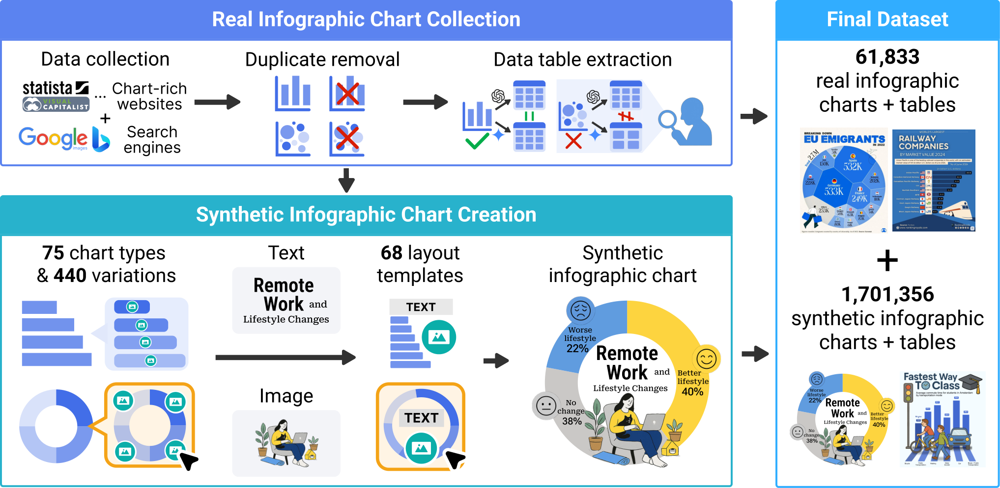<figcaption>ChartGalaxy · Fig. 2：上半部收集真实信息图并抽表，下半部用归纳出的图型、变体和布局模板程序化合成</figcaption></figure>

<div class="ds-demo"><div class="ds-head"><b>数据样例</b> · <a href="https://huggingface.co/datasets/ChartGalaxy/ChartGalaxy">ChartGalaxy/ChartGalaxy</a> · 共 1,880,687 张信息图表（合成 1,818,709 + 真实 61,978），样本取自 2,000 条的 preview split；preview 不含 D3 代码，完整数据以 tar 分片发布 · 展示字段：image、chart_type、data （训练数据每条只有图 png、数据表 data.json、模板元信息 info.json，没有逐条代码；生成用的 D3 模板未开源。代码只出现在 GitHub 的代码生成评测 bench500 里，最后一张卡片即其中一条）</div><div class="ds-grid"><div class="ds-card">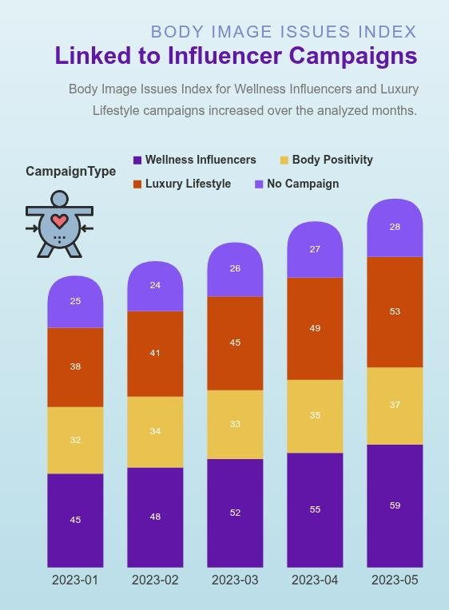<div class="ds-meta">垂直堆叠柱状图（vertical_stacked_bar_chart_2），2023 年 1–5 月四类营销活动的身体形象问题指数，数据源 Social_Media 场景</div><details class="ds-code"><summary>data（配对数据表 JSON）（共 128 行，展示前 60 行）</summary><pre>{&#10;    "data": [&#10;        {&#10;            "Month": "2023-01",&#10;            "BodyImageIssuesIndex": 45.0,&#10;            "CampaignType": "Wellness Influencers"&#10;        },&#10;        {&#10;            "Month": "2023-02",&#10;            "BodyImageIssuesIndex": 48.0,&#10;            "CampaignType": "Wellness Influencers"&#10;        },&#10;        {&#10;            "Month": "2023-03",&#10;            "BodyImageIssuesIndex": 52.0,&#10;            "CampaignType": "Wellness Influencers"&#10;        },&#10;        {&#10;            "Month": "2023-04",&#10;            "BodyImageIssuesIndex": 55.0,&#10;            "CampaignType": "Wellness Influencers"&#10;        },&#10;        {&#10;            "Month": "2023-05",&#10;            "BodyImageIssuesIndex": 59.0,&#10;            "CampaignType": "Wellness Influencers"&#10;        },&#10;        {&#10;            "Month": "2023-01",&#10;            "BodyImageIssuesIndex": 32.0,&#10;            "CampaignType": "Body Positivity"&#10;        },&#10;        {&#10;            "Month": "2023-02",&#10;            "BodyImageIssuesIndex": 34.0,&#10;            "CampaignType": "Body Positivity"&#10;        },&#10;        {&#10;            "Month": "2023-03",&#10;            "BodyImageIssuesIndex": 33.0,&#10;            "CampaignType": "Body Positivity"&#10;        },&#10;        {&#10;            "Month": "2023-04",&#10;            "BodyImageIssuesIndex": 35.0,&#10;            "CampaignType": "Body Positivity"&#10;        },&#10;        {&#10;            "Month": "2023-05",&#10;            "BodyImageIssuesIndex": 37.0,&#10;            "CampaignType": "Body Positivity"&#10;        },&#10;        {&#10;            "Month": "2023-01",&#10;            "BodyImageIssuesIndex": 38.0,&#10;            "CampaignType": "Luxury Lifestyle"&#10;        },&#10;        {&#10;            "Month": "2023-02",&#10;            "BodyImageIssuesIndex": 41.0,&#10;…（截断，原文共 128 行）</pre></details></div><div class="ds-card">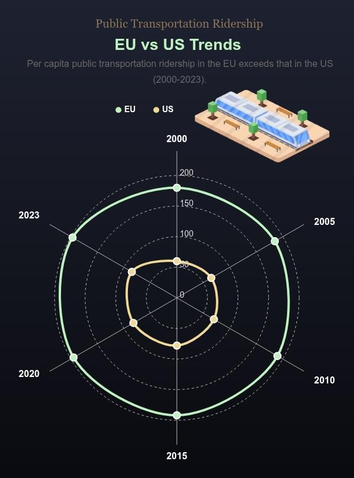<div class="ds-meta">多序列样条雷达图（multiple_radar_spline_chart_02），2000–2023 年欧盟与美国人均公共交通乘坐量，数据源 Transportation 场景</div><details class="ds-code"><summary>data（配对数据表 JSON）（共 88 行，展示前 60 行）</summary><pre>{&#10;    "data": [&#10;        {&#10;            "Year": "2000",&#10;            "Ridership": 60.0,&#10;            "Region": "US"&#10;        },&#10;        {&#10;            "Year": "2000",&#10;            "Ridership": 180.0,&#10;            "Region": "EU"&#10;        },&#10;        {&#10;            "Year": "2005",&#10;            "Ridership": 65.0,&#10;            "Region": "US"&#10;        },&#10;        {&#10;            "Year": "2005",&#10;            "Ridership": 185.0,&#10;            "Region": "EU"&#10;        },&#10;        {&#10;            "Year": "2010",&#10;            "Ridership": 70.0,&#10;            "Region": "US"&#10;        },&#10;        {&#10;            "Year": "2010",&#10;            "Ridership": 190.0,&#10;            "Region": "EU"&#10;        },&#10;        {&#10;            "Year": "2015",&#10;            "Ridership": 78.0,&#10;            "Region": "US"&#10;        },&#10;        {&#10;            "Year": "2015",&#10;            "Ridership": 192.0,&#10;            "Region": "EU"&#10;        },&#10;        {&#10;            "Year": "2020",&#10;            "Ridership": 82.0,&#10;            "Region": "US"&#10;        },&#10;        {&#10;            "Year": "2020",&#10;            "Ridership": 195.0,&#10;            "Region": "EU"&#10;        },&#10;        {&#10;            "Year": "2023",&#10;            "Ridership": 85.0,&#10;            "Region": "US"&#10;        },&#10;        {&#10;            "Year": "2023",&#10;            "Ridership": 197.0,&#10;…（截断，原文共 88 行）</pre></details></div><div class="ds-card">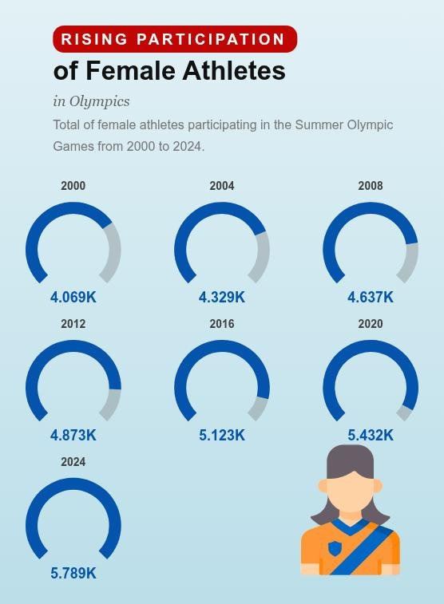<div class="ds-meta">小多图仪表盘（small_multiples_gauge_plain_chart_02），2000–2024 年夏季奥运会女性运动员人数，数据源 Sports 场景</div><details class="ds-code"><summary>data（配对数据表 JSON）（共 49 行）</summary><pre>{&#10;    "data": [&#10;        {&#10;            "Year": "2000",&#10;            "Total": 4069.0&#10;        },&#10;        {&#10;            "Year": "2004",&#10;            "Total": 4329.0&#10;        },&#10;        {&#10;            "Year": "2008",&#10;            "Total": 4637.0&#10;        },&#10;        {&#10;            "Year": "2012",&#10;            "Total": 4873.0&#10;        },&#10;        {&#10;            "Year": "2016",&#10;            "Total": 5123.0&#10;        },&#10;        {&#10;            "Year": "2020",&#10;            "Total": 5432.0&#10;        },&#10;        {&#10;            "Year": "2024",&#10;            "Total": 5789.0&#10;        }&#10;    ],&#10;    "columns": [&#10;        {&#10;            "name": "Year",&#10;            "description": "Year of the Summer Olympic Games (2000-2024)",&#10;            "data_type": "temporal",&#10;            "unit": "",&#10;            "role": "x"&#10;        },&#10;        {&#10;            "name": "Total",&#10;            "description": "Total number of female athletes participating in Summer Olympic sports",&#10;            "data_type": "numerical",&#10;            "unit": "",&#10;            "role": "y"&#10;        }&#10;    ],&#10;    "type_combination": "temporal + numerical"&#10;}</pre></details></div><div class="ds-card">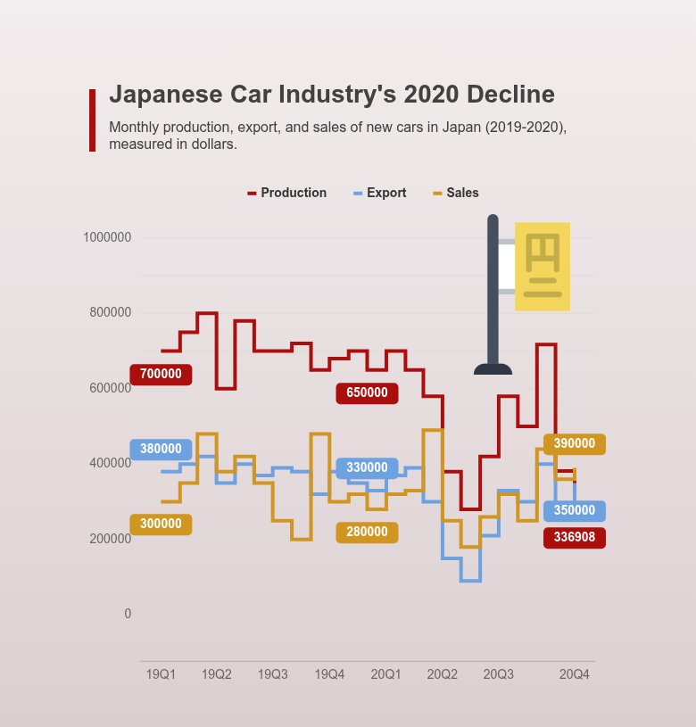<div class="ds-meta"><b>D3.js 代码生成评测 · bench500 #427</b>（按月份的堆叠柱状图，三类业务的美元金额）。一道题 = 输入这张图 + 下面的提示词 → 模型输出单文件 D3.js HTML → 渲染成 SVG 后与真值 chart.svg 比对。数据集不提供「标准 D3 答案」，只提供真值 SVG</div><details class="ds-code"><summary>① 输入提示词（chat_direct_prompt.txt，共 44 行）</summary><pre>You are an expert data‐visualization engineer and front‐end developer.&#10;&#10;Your task is to take a chart image and generate a HTML file that, when loaded in a browser, reproduces the chart exactly. The chart must be centered in the viewport.&#10;&#10;## Constraints:&#10;- No Explanations: Do not include comments, reasoning, or explanatory text. Output only valid HTML with JavaScript code.&#10;&#10;## Technical Requirements&#10;- **Charting library**: Use D3.js to implement the chart. Write the code to be clean, modular, and easy to understand and modify.&#10;- **Single file output**: Provide one standalone HTML file that includes everything needed to render the chart.&#10;- **Chart fidelity**: Replicate all visual elements—shapes, colors, axes, labels, legends, fonts, line weights, markers—exactly as in the original image.&#10;- **No animations**: The chart must render immediately in its final state.&#10;- **Aspect ratio &amp; sizing**: The chart’s content area (including margins, paddings, and plot area) must match the original image’s proportions precisely.&#10;- **Image**: Recreate any icon/image content using SVG &lt;g&gt; and shapes. Do not use &lt;image&gt;, base64 images, or links.&#10;- **Text**: Place all text in &lt;text&gt; leaf nodes. Do not use &lt;tspan&gt; or nested text structures.&#10;&#10;## Grouping Requirements&#10;You should use following `class` names for SVG groups with specific semantics:&#10;- title: The title area (may contain title, subtitle, and shapes)&#10;- image: Each individual icon/image/pictogram (no annotation text, no grouped images)&#10;- legend: Legend area&#10;- axis: Axis area&#10;&#10;## Output Format&#10;Return only the following standalone HTML file:&#10;&#10;```html&#10;&lt;!DOCTYPE html&gt;&#10;&lt;html lang="en"&gt;&#10;    &lt;head&gt;&#10;        &lt;meta charset="UTF-8" /&gt;&#10;        &lt;title&gt;Recreated Chart&lt;/title&gt;&#10;        &lt;!-- &lt;style&gt; --&gt;&#10;    &lt;/head&gt;&#10;    &lt;body&gt;&#10;        &lt;div id="chart-container"&gt;&lt;/div&gt;&#10;        &lt;script src="https://d3js.org/d3.v7.min.js"&gt;&lt;/script&gt;&#10;        &lt;script&gt;&#10;            &lt;!-- Your D3 code here --&gt;&#10;        &lt;/script&gt;&#10;    &lt;/body&gt;&#10;&lt;/html&gt;&#10;```&#10;Only output this file. No comments or explanation. Keep it minimal and strictly within the token limits.</pre></details><details class="ds-code"><summary>② 判分参照：真值 chart.svg（共 25 行，17,871 字符）</summary><pre>&lt;svg xmlns="http://www.w3.org/2000/svg" xmlns:xlink="http://www.w3.org/1999/xlink" width="780" height="815" style="font-family: Arial, 'Liberation Sans', 'DejaVu Sans', sans-serif;"&gt;&#10;        &lt;defs&gt;&#10;    &lt;!-- 背景渐变 --&gt;&#10;    &lt;linearGradient id="gradient_4737" x1="0%" y1="0%" x2="0%" y2="100%"&gt;&#10;        &lt;stop offset="0%" stop-color="#F2EDEE" /&gt;&#10;        &lt;stop offset="100%" stop-color="#dccfd2" /&gt;&#10;    &lt;/linearGradient&gt;&#10;&lt;/defs&gt;&#10;&#10;&lt;!-- 背景矩形 --&gt;&#10;&lt;rect x="0" y="0" width="780" height="815" fill="url(#gradient_4737)" /&gt;&#10;        &lt;g class="chart" transform="translate(100, 207)"&gt;&lt;g xmlns="http://www.w3.org/2000/svg" xmlns:xlink="http://www.w3.org/1999/xlink" transform="translate(-2.8000000000000114, -5.692957746478868)"&gt;             &lt;g xmlns="http://www.w3.org/2000/svg" xmlns:xlink="http://www.w3.org/1999/xlink" trans …（本行原长 8588 字符）&#10;        &lt;g class="text" fill="#414141" transform="translate(100, 100)"&gt;&lt;g xmlns="http://www.w3.org/2000/svg" class="title" transform="translate(22.22, -5)"&gt;&lt;rect x="0" y="0" width="7" height="70" fill="#aa0f0e" transform="translate(-22.22, 5) translate(0, 0)"/&gt;&lt;text dominant-baseline="hanging" text- …（本行原长 898 字符）&#10;        &#10;                &lt;image&#10;                    class="image"&#10;                    x="495"&#10;                    y="240"&#10;                    width="180"&#10;                    height="180"&#10;                    preserveAspectRatio="none"&#10;                    href=" …（本行原长 7581 字符）&#10;                    opacity="1"&#10;                /&gt;&#10;&lt;/svg&gt;</pre></details><details class="ds-code"><summary>③ 判分方式</summary><pre>低层分（逐元素）：把模型代码渲染出的 SVG 和真值 SVG 都拆成叶子元素（文字、形状、图标），&#10;按位置与类型一一配对，然后算：&#10;  - precision / recall / F1：配对上的元素占比&#10;  - color / pos / size：配对元素的颜色、位置、尺寸相似度&#10;  - text：文字内容相似度；image：图标的视觉特征相似度&#10;  - area_matched：配对元素覆盖的面积占比&#10;高层分（整体）：由 VLM（默认 gpt-4o）按 eval_high_level 提示词对比两张渲染图打分&#10;来源：GitHub ChartGalaxy/code_generation_benchmark（utils/utils_eval.py、prompts/）</pre></details><details class="ds-code"><summary>data.json（前 9 条记录）</summary><pre>[&#10; {&#10;  "Month": "2019-01",&#10;  "Dollars": 700000.0,&#10;  "Business Functions": "Production"&#10; },&#10; {&#10;  "Month": "2019-01",&#10;  "Dollars": 380000.0,&#10;  "Business Functions": "Export"&#10; },&#10; {&#10;  "Month": "2019-01",&#10;  "Dollars": 300000.0,&#10;  "Business Functions": "Sales"&#10; },&#10; {&#10;  "Month": "2019-02",&#10;  "Dollars": 750000.0,&#10;  "Business Functions": "Production"&#10; },&#10; {&#10;  "Month": "2019-02",&#10;  "Dollars": 400000.0,&#10;  "Business Functions": "Export"&#10; },&#10; {&#10;  "Month": "2019-02",&#10;  "Dollars": 350000.0,&#10;  "Business Functions": "Sales"&#10; },&#10; {&#10;  "Month": "2019-03",&#10;  "Dollars": 800000.0,&#10;  "Business Functions": "Production"&#10; },&#10; {&#10;  "Month": "2019-03",&#10;  "Dollars": 420000.0,&#10;  "Business Functions": "Export"&#10; },&#10; {&#10;  "Month": "2019-03",&#10;  "Dollars": 480000.0,&#10;  "Business Functions": "Sales"&#10; }&#10;]</pre></details></div></div></div>

- **自动化合成流程**（对照上图，先上排再下排，从左往右读）
  1. **Data collection**：从 18 个允许研究使用的图表网站（Visual Capitalist、Statista 等）爬取，再用 Google / Bing 图片搜索补充，只保留 CC 许可的图；爬虫加平台许可过滤器完成
  2. **Duplicate removal**：用感知哈希加 CLIP 相似度去重（程序）
  3. **Data table extraction**：Gemini-2.0-Flash 和 GPT-4o-mini 并行抽表，两者一致就直接收；不一致时由 GPT-4o 第三票裁决，还不一致才交人工。产出 61,833 张带表的真实图
  4. **75 chart types & 440 variations**：人工参照 Data Viz Project、Datylon 两套分类，归纳出 75 类图型、440 种视觉变体，全部用 D3.js 实现成可参数化的渲染程序
  5. **Text** / **Image**
     - 文字：先检索后生成。Sentence-BERT 按主题和数据事实检索 3 张最相关的真实图作为 in-context 示例，再让 Gemini-2.0-Flash 写标题和副标题
     - 图片：从 Icon645、Noun Project 等来源建图标库，先用启发式规则去掉墨水比低、分辨率差、长宽比极端的图，再由 Gemini-2.0-Flash 给每张图写关键词和描述，剔除过于写实或杂乱的，最后得到 681,459 张。检索时拿 Sentence-BERT 比对关键词和标题
  6. **68 layout templates**：人在环路里扩展模板。3 位作者先在 1,500 张真实图上标框，归纳出 55 个模板 → 用这些模板合成 12 万张带框图，训练 InternImage + DINO 检测器 → 在未标注真实图上检测元素（文字用 PP-OCRv4）→ LTSim 相似度低的布局作为候选 → k-means 聚类后人工看中心，新增 13 个模板，共 68 个
  7. **Synthetic infographic chart**：数据表先按规则映射出候选图型，候选有多个时由 Gemini-2.0-Flash 挑；变体用 adaptive sampling 抽，偏向出现少的变体；配色取自真实图的调色板。布局求解时先滤掉与元素冲突的模板，再对剩下的做网格搜索式紧凑排布（约束问题），选墨水比最高的那个
  - （图外）**数据表来源**：真实表 200,085 张（VizNet、UN data、Our World in Data、Papers with Code），另有 Gemini-2.0-Flash 合成的 98,483 张；每张表都由 Gemini-2.0-Flash 补一个主题和若干数据事实
- **质量控制**
  - 真实图抽表：43.6% 在双模型一致时直接接受；剩下 56.4% 里，GPT-4o 解决了 76.2%。合计 86.6% 全自动完成，13.4% 由人工校正。抽查 200 条完全一致的样本，全部正确
  - 一致性判据：数据点数相同、列名和类别值相同、数值偏差 ≤ 5%
  - 敏感话题：用 Gemini-2.0-Flash 过滤宗教冲突、可识别个人的医疗记录等内容
  - 合成图的配套框标注来自程序本身，不需要人工
- **关键数字**
  - 规模：1,701,356 张合成图 + 61,833 张真实图；75 类图型 / 440 种变体 / 68 个模板
  - 指令集：从 70,248 张图生成 443,455 条 QA
  - 下游：InternVL3-8B 在 InfographicVQA 上 +3.80、ChartQAPro 上 +5.98；Qwen2.5-VL-7B 分别 +4.44、+3.59；在自建评测集上整体 +26.87 / +23.85
  - 消融（InternVL3-8B，自建评测集）：只训真实图 55.74，只训合成图 76.08，两者都训 80.07
  - 代码基准：500 张合成图，测 D3.js 复现；Gemini-2.5-Pro 最高，总分 85.21
- **局限**
  - 只有单图信息图，没有多图叙事（论文自述）
  - 真实图只发布 URL，不发原图
  - 合成图的收益主要体现在自建集上；InternVL3 在 ChartQAPro 上只训真实图（42.58）反而略高于只训合成图（41.76）
  - 模板扩展和抽表的兜底环节仍依赖人工
- **可借鉴**
  - 「归纳 → 程序化」闭环：先从真实数据里抽图型、变体、模板，再用合成数据训检测器反过来挖掘新模板
  - 双模型交叉抽取、第三模型仲裁、最后才人工兜底：把人工比例压到 13.4%
  - 用墨水比加最小间距约束做自动排版，美观度指标可以直接算出来

</details>

<a class="anchor" id="web-2-2-2"></a>

<details class="deep"><summary><span class="deep-title"> 2.2.2 WebSight（2024-03） <span class="org">HuggingFace</span> <a class="hf" href="https://huggingface.co/datasets/HuggingFaceM4/WebSight"><span class="hf-b hf-dl" title="downloads"><svg class="hf-i" viewBox="0 0 24 24" fill="none" stroke="currentColor" stroke-width="2.2" stroke-linecap="round" stroke-linejoin="round"><path d="M12 3v11"/><path d="M8 11l4 4 4-4"/><path d="M4 20h16"/></svg>18.1k</span><span class="hf-b hf-lk" title="likes"><svg class="hf-i" viewBox="0 0 24 24" fill="currentColor"><path d="M12 21C7 17.5 3 14 3 9.5 3 7 5 5 7.5 5 9.2 5 10.7 6 12 7.6 13.3 6 14.8 5 16.5 5 19 5 21 7 21 9.5 21 14 17 17.5 12 21z"/></svg>400</span></a></span></summary>

- **定位**：第一个百万级、完全合成的「截图 → HTML + Tailwind」配对数据，被 Design2Code 等后续工作当作训练集基线

<figure class="paper-fig"><div class="flow"><div class="step"><b>Website concepts</b>Mistral-7B 批量出网站概念</div><span class="arr">→</span><div class="step"><b>Tailwind only</b>规定只用 Tailwind，HTML 自包含</div><span class="arr">→</span><div class="step"><b>Code LLM</b>Deepseek-Coder-33B 写整页 HTML</div><span class="arr">→</span><div class="step"><b>Filtering</b>去掉空泛 / 配图不符的页面</div><span class="arr">→</span><div class="step"><b>Screenshot</b>Playwright 渲染整页截图</div></div><figcaption>WebSight · 自绘流程图（论文无管线图，依据正文描述）</figcaption></figure>

<div class="ds-demo"><div class="ds-head"><b>数据样例</b> · <a href="https://huggingface.co/datasets/HuggingFaceM4/WebSight">HuggingFaceM4/WebSight</a> · v0.2 共 1,922,671 条截图-HTML 对，全部由 LLM 合成 · 展示字段：image、text、llm_generated_idea</div><div class="ds-grid"><div class="ds-card">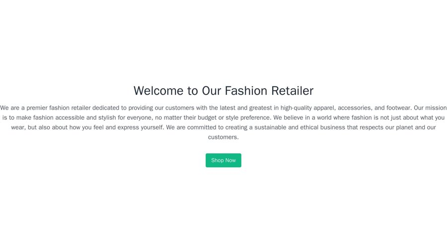<div class="ds-meta">llm_generated_idea：时装零售商，白底商品图网格，顶部色带放品牌 logo 与主按钮。渲染结果只有居中标题、段落与按钮，与构思的网格布局不一致</div><details class="ds-code"><summary>text（HTML + Tailwind）（共 12 行）</summary><pre>&lt;html&gt;&#10;&lt;link href="https://cdn.jsdelivr.net/npm/tailwindcss@2.2.19/dist/tailwind.min.css" rel="stylesheet"&gt;&#10;&lt;body class="bg-white"&gt;&#10;  &lt;div class="flex flex-col items-center justify-center h-screen"&gt;&#10;    &lt;h1 class="text-4xl font-bold text-center text-gray-800"&gt;Welcome to Our Fashion Retailer&lt;/h1&gt;&#10;    &lt;p class="mt-4 text-lg text-center text-gray-600"&gt;&#10;      We are a premier fashion retailer dedicated to providing our customers with the latest and greatest in high-quality apparel, accessories, and footwear. Our mission is to make fashion accessible and stylish for everyone, no matter their budget or style preference. We believe in a world where fa…（本行共 496 字符，截断）&#10;    &lt;/p&gt;&#10;    &lt;button class="mt-8 px-4 py-2 text-white bg-green-500 rounded hover:bg-green-600"&gt;Shop Now&lt;/button&gt;&#10;  &lt;/div&gt;&#10;&lt;/body&gt;&#10;&lt;/html&gt;</pre></details><details class="ds-code"><summary>llm_generated_idea（共 1 行）</summary><pre>Fashion Retailer: A grid layout featuring high-quality product images with a white background. A colored band runs horizontally across the top, showcasing the brand logo and the primary call-to-action.</pre></details></div><div class="ds-card">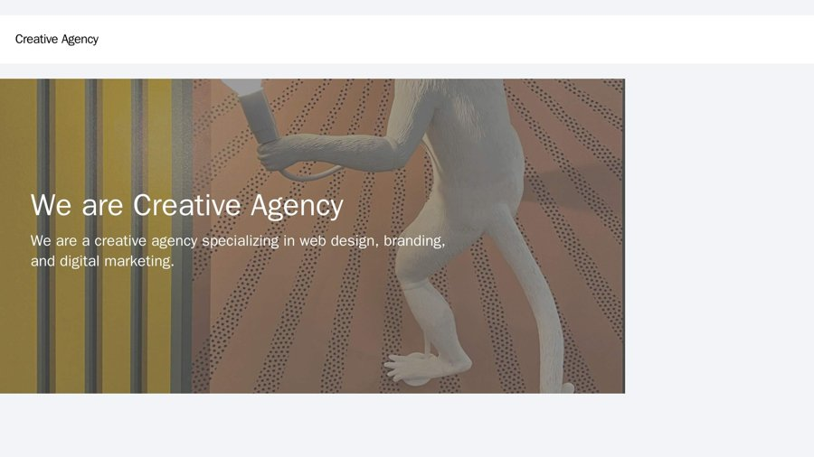<div class="ds-meta">llm_generated_idea：创意机构，全屏视频背景加半透明遮罩，悬停汉堡图标展开侧栏。渲染结果为顶栏加带文字的大图横幅</div><details class="ds-code"><summary>text（HTML + Tailwind）（共 34 行）</summary><pre>&lt;html&gt;&#10;&lt;link href="https://cdn.jsdelivr.net/npm/tailwindcss@2.2.19/dist/tailwind.min.css" rel="stylesheet"&gt;&#10;&lt;body class="bg-gray-100 font-sans leading-normal tracking-normal"&gt;&#10;    &lt;div class="relative flex flex-col min-h-screen overflow-hidden"&gt;&#10;        &lt;div class="relative z-10 flex flex-col flex-1 pt-6 pb-6 md:pb-8"&gt;&#10;            &lt;header class="flex items-center justify-between flex-wrap bg-white p-6"&gt;&#10;                &lt;div class="flex items-center flex-shrink-0 mr-6"&gt;&#10;                    &lt;span class="font-semibold text-xl tracking-tight"&gt;Creative Agency&lt;/span&gt;&#10;                &lt;/div&gt;&#10;                &lt;div class="block md:hidden"&gt;&#10;                    &lt;button id="menu-button" class="flex items-center px-3 py-2 border rounded text-teal-200 border-teal-400 hover:text-white hover:border-white"&gt;&#10;                        &lt;svg class="fill-current h-3 w-3" viewBox="0 0 20 20" xmlns="http://www.w3.org/2000/svg"&gt;&lt;title&gt;Menu&lt;/title&gt;&lt;path d="M0 3h20v2H0V3zm0 6h20v2H0V9zm0 6h20v2H0v-2z"/&gt;&lt;/svg&gt;&#10;                    &lt;/button&gt;&#10;                &lt;/div&gt;&#10;            &lt;/header&gt;&#10;            &lt;main class="flex-1 relative z-0 overflow-y-auto focus:outline-none md:py-6"&gt;&#10;                &lt;div class="opacity-75 fixed pin bg-no-repeat bg-center bg-cover" style="background-image: url('https://source.unsplash.com/random/1600x900/?creative');"&gt;&#10;                    &lt;div class="inset-0 bg-black opacity-50 absolute"&gt;&lt;/div&gt;&#10;                    &lt;div class="container mx-auto px-6 md:px-12 relative z-10 flex items-center py-32 xl:py-40"&gt;&#10;                        &lt;div class="w-full lg:w-3/4"&gt;&#10;                            &lt;h1 class="my-4 text-3xl md:text-5xl text-white leading-tight"&gt;&#10;                                We are Creative Agency&#10;                            &lt;/h1&gt;&#10;                            &lt;p class="leading-normal text-white text-2xl md:text-2xl mb-8"&gt;&#10;                                We are a creative agency specializing in web design, branding, and digital marketing.&#10;                            &lt;/p&gt;&#10;                        &lt;/div&gt;&#10;                    &lt;/div&gt;&#10;                &lt;/div&gt;&#10;            &lt;/main&gt;&#10;        &lt;/div&gt;&#10;    &lt;/div&gt;&#10;&lt;/body&gt;&#10;&lt;/html&gt;</pre></details><details class="ds-code"><summary>llm_generated_idea（共 1 行）</summary><pre>Creative Agency: A full-screen video background with an opaque overlay displaying the company name and tagline. A hidden sidebar menu reveals as you hover over the hamburger icon. The color palette is bright and playful.</pre></details></div><div class="ds-card"><div class="ds-meta">llm_generated_idea：建筑事务所，建筑项目图片网格加文字浮层，全宽头图与极简菜单。渲染结果为头图、三项导航与居中介绍文字</div><details class="ds-code"><summary>text（HTML + Tailwind）（共 33 行）</summary><pre>&lt;html&gt;&#10;&lt;link href="https://cdn.jsdelivr.net/npm/tailwindcss@2.2.19/dist/tailwind.min.css" rel="stylesheet"&gt;&#10;&lt;body class="font-sans leading-normal tracking-normal"&gt;&#10;    &lt;header class="bg-white text-center"&gt;&#10;        &lt;div class="container mx-auto"&gt;&#10;            &lt;img src="https://source.unsplash.com/random/300x200/?architecture" alt="Logo" class="w-1/2 mx-auto"&gt;&#10;            &lt;nav class="flex items-center justify-between flex-wrap p-6"&gt;&#10;                &lt;div class="w-full block flex-grow lg:flex lg:items-center lg:w-auto"&gt;&#10;                    &lt;div class="text-sm lg:flex-grow"&gt;&#10;                        &lt;a href="#responsive-header" class="block mt-4 lg:inline-block lg:mt-0 text-teal-200 hover:text-white mr-4"&gt;&#10;                            Home&#10;                        &lt;/a&gt;&#10;                        &lt;a href="#responsive-header" class="block mt-4 lg:inline-block lg:mt-0 text-teal-200 hover:text-white mr-4"&gt;&#10;                            About&#10;                        &lt;/a&gt;&#10;                        &lt;a href="#responsive-header" class="block mt-4 lg:inline-block lg:mt-0 text-teal-200 hover:text-white"&gt;&#10;                            Contact&#10;                        &lt;/a&gt;&#10;                    &lt;/div&gt;&#10;                &lt;/div&gt;&#10;            &lt;/nav&gt;&#10;        &lt;/div&gt;&#10;    &lt;/header&gt;&#10;    &lt;main class="container mx-auto"&gt;&#10;        &lt;section class="py-10"&gt;&#10;            &lt;h1 class="text-4xl text-center"&gt;Welcome to Our Architecture Firm&lt;/h1&gt;&#10;            &lt;p class="text-xl text-center mt-5"&gt;&#10;                We are a leading architecture firm specializing in creating unique and innovative designs. Our team of experienced architects and designers work closely with our clients to understand their needs and translate them into beautiful, functional spaces. We believe in the power of design …（本行共 379 字符，截断）&#10;            &lt;/p&gt;&#10;        &lt;/section&gt;&#10;    &lt;/main&gt;&#10;&lt;/body&gt;&#10;&lt;/html&gt;</pre></details><details class="ds-code"><summary>llm_generated_idea（共 1 行）</summary><pre>Architecture Firm: A grid layout that showcases images of buildings with text overlays providing information about each project. A full-width image header with a centered logo and minimalist menu helps convey a professional image.</pre></details></div></div></div>

- **自动化合成流程**（对照上面的自绘图）
  1. **Generating diverse website concepts**：Mistral-7B-Instruct 用一条固定 prompt 批量生成网站概念，每次 10 个，要求公司领域、配色、布局位置各不相同，累计几百万条
  2. **Opting for Tailwind CSS**：规定只用 Tailwind 工具类，让 HTML 自包含、不需要外部样式文件，代码更短、更好学
  3. **Using a code specialized LLM to generate the HTML codes**：Deepseek-Coder-33b-instruct 把概念写成完整页面。prompt 禁止出现 Lorem ipsum；图片一律写成 `source.unsplash.com/random/WxH/?keyword`，按关键词动态取图
  4. **Filtering**：丢掉文字太少、内容空泛、配图与主题不符的页面，剩下 200 万
  5. **Screenshot capture process**：Playwright 渲染并截取整页，所以截图分辨率不固定
- **质量控制**
  - 只有第 4 步这一道过滤，标准如上；论文没给过滤掉多少
  - 训练时发现验证 loss 不能反映真实效果，改为人工看生成样例来选 checkpoint
- **关键数字**
  - 规模：v0.1 有 823K 对（HTML + 传统 CSS，图片是色块占位）；v0.2 有 200 万对，是 v0.1 的 2.5 倍，换成真实图片和 Tailwind
  - 训练：自家 8B VLM（Mistral-7B + SigLIP-SO400M）用 DoRA（rank 64）微调，每步 2016 个样本，共 1100 步，不到 1 个 epoch，得到 Sightseer
  - 下游：论文只做了定性评测，没有给量化指标
- **局限**
  - 页面结构简单，复杂布局、长文本、和训练分布差异大的设计都复现不好（论文自述）
  - Tailwind 在基座预训练语料里出现得少，模型偶尔写出错误语法，或者文字和背景同色
  - 图片 URL 是随机取图，同一段代码再渲染一次，得到的图可能不同（推断）
- **可借鉴**
  - 两段式生成：小模型负责发散主题，大的代码模型负责落地，多样性和代码质量分开控制
  - 选输出格式时优先考虑「单文件自包含」，这样训练目标更干净
  - 用带关键词的图库 URL 当图片占位，既省掉生图步骤，又让截图里有和主题相关的真实图片

</details>

<a class="anchor" id="web-2-2-3"></a>

<details class="deep"><summary><span class="deep-title"> 2.2.3 pix2code（2017-05） <span class="org">UIzard</span> <a class="hf" href="https://github.com/tonybeltramelli/pix2code"><span class="hf-b hf-st" title="GitHub stars"><svg class="hf-i" viewBox="0 0 24 24" fill="currentColor"><path d="M12 2.5l2.9 6 6.6.6-5 4.3 1.5 6.5L12 16.9 6 20.9l1.5-6.5-5-4.3 6.6-.6z"/></svg>12.0k</span></a></span></summary>

- **定位**：最早的截图转代码工作，第一次公开发布「GUI 截图 ↔ 代码」合成配对数据（iOS / Android / Web 三个平台）

<figure class="paper-fig"><div class="flow"><div class="step"><b>DSL</b>人工设计布局 / 组件 DSL</div><span class="arr">→</span><div class="step"><b>Stochastic UI generator</b>按语法随机组合 GUI</div><span class="arr">→</span><div class="step"><b>DSL compiler</b>编译成 iOS / Android / HTML</div><span class="arr">→</span><div class="step"><b>渲染截图</b>各平台渲染得到截图</div><span class="arr">→</span><div class="step"><b>滑窗切样本</b>48 token 窗口配整张截图</div></div><figcaption>pix2code · 自绘流程图（论文无数据管线图，依据正文描述）</figcaption></figure>

<div class="ds-demo"><div class="ds-head"><b>数据样例</b> · <a href="https://github.com/tonybeltramelli/pix2code">tonybeltramelli/pix2code</a> · web 平台 1,742 对 GUI 截图-DSL（另有 iOS、Android），由 DSL 随机合成后渲染 · 展示字段：png 截图、.gui</div><div class="ds-grid"><div class="ds-card">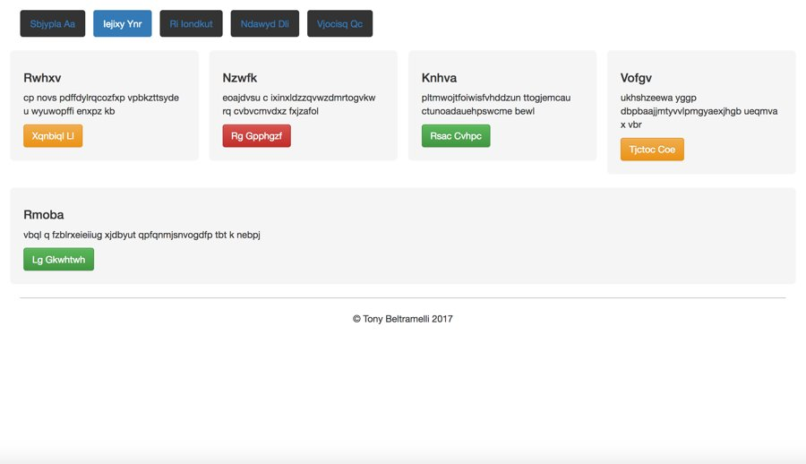<div class="ds-meta">顶栏 5 个按钮（第 2 个为激活态），一行 4 个 quadruple 卡片，另起一行 1 个 single 卡片；每个卡片为小标题、正文与彩色按钮</div><details class="ds-code"><summary>.gui（pix2code DSL）（共 22 行）</summary><pre>header {&#10;btn-inactive, btn-active, btn-inactive, btn-inactive, btn-inactive&#10;}&#10;row {&#10;quadruple {&#10;small-title, text, btn-orange&#10;}&#10;quadruple {&#10;small-title, text, btn-red&#10;}&#10;quadruple {&#10;small-title, text, btn-green&#10;}&#10;quadruple {&#10;small-title, text, btn-orange&#10;}&#10;}&#10;row {&#10;single {&#10;small-title, text, btn-green&#10;}&#10;}</pre></details></div><div class="ds-card">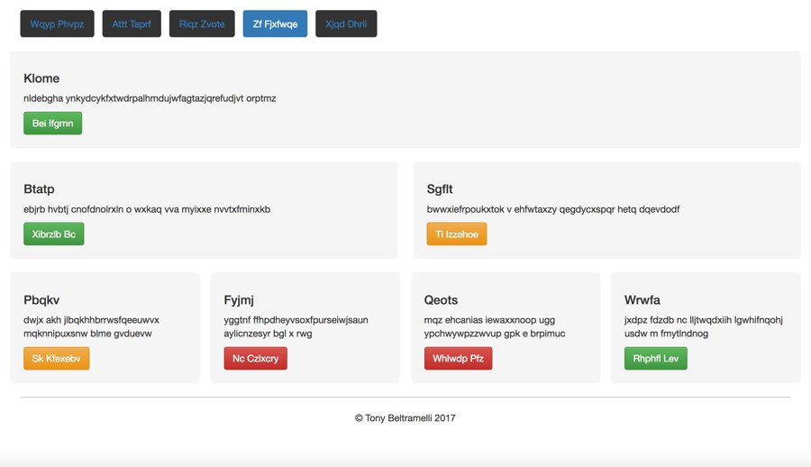<div class="ds-meta">顶栏 5 个按钮，下面依次是 1 个 single、2 个 double、4 个 quadruple 卡片</div><details class="ds-code"><summary>.gui（pix2code DSL）（共 30 行）</summary><pre>header {&#10;btn-inactive, btn-inactive, btn-inactive, btn-active, btn-inactive&#10;}&#10;row {&#10;single {&#10;small-title, text, btn-green&#10;}&#10;}&#10;row {&#10;double {&#10;small-title, text, btn-green&#10;}&#10;double {&#10;small-title, text, btn-orange&#10;}&#10;}&#10;row {&#10;quadruple {&#10;small-title, text, btn-orange&#10;}&#10;quadruple {&#10;small-title, text, btn-red&#10;}&#10;quadruple {&#10;small-title, text, btn-red&#10;}&#10;quadruple {&#10;small-title, text, btn-green&#10;}&#10;}</pre></details></div><div class="ds-card">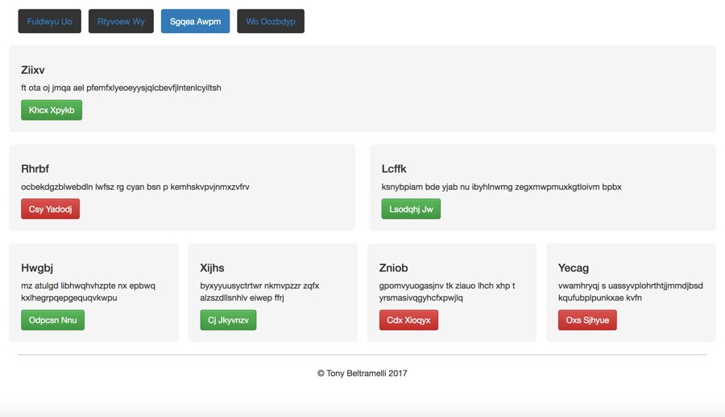<div class="ds-meta">顶栏 4 个按钮，布局与第 2 条相同，按钮颜色不同；文字均为随机字母串</div><details class="ds-code"><summary>.gui（pix2code DSL）（共 30 行）</summary><pre>header {&#10;btn-inactive, btn-inactive, btn-active, btn-inactive&#10;}&#10;row {&#10;single {&#10;small-title, text, btn-green&#10;}&#10;}&#10;row {&#10;double {&#10;small-title, text, btn-red&#10;}&#10;double {&#10;small-title, text, btn-green&#10;}&#10;}&#10;row {&#10;quadruple {&#10;small-title, text, btn-green&#10;}&#10;quadruple {&#10;small-title, text, btn-green&#10;}&#10;quadruple {&#10;small-title, text, btn-red&#10;}&#10;quadruple {&#10;small-title, text, btn-red&#10;}&#10;}</pre></details></div></div></div>

- **自动化合成流程**（对照上面的自绘图）
  1. **DSL 设计**：人工设计一套轻量的类标记语言 DSL，只描述布局、组件和层级，不管标签里的文字，所以词表很小
  2. **Stochastic user interface generator**：随机生成器按 DSL 语法随机组合出 GUI 描述（纯程序，不用模型）
  3. **DSL compiler**：编译器把 DSL 编译成目标平台代码（iOS Storyboard、Android XML、HTML/CSS），标签文字随机填
  4. **渲染截图**：在对应平台渲染编译出的代码并截图，得到（截图，代码）对
  5. **滑窗切样本**：DSL 按 48 个 token 的滑窗切开，每个窗口和整张截图配成一个训练样本
- **质量控制**
  - 数据由语法和编译器生成，天然保证正确，论文没有另设过滤或去重步骤
- **关键数字**
  - 生成器可产出的不同配置数：iOS 26×10⁵、Android 21×10⁶、Web 31×10⁴
  - 实际使用：每个平台 1,500 对训练、250 对测试；训练样本（图-序列对）分别为 93,672 / 85,756 / 143,850
  - 效果：greedy 解码的 token 错误率 iOS 22.73%、Android 22.34%、Web 12.14%；模型约 109×10⁶ 参数
- **局限**
  - DSL 只表达布局，不管真实文本，离真实代码很远
  - 生成器组合空间有限，数据量很小，界面风格单一
  - 输入统一缩放到 256×256，不保长宽比
- **可借鉴**
  - 先定义「DSL + 编译器」，再用随机文法采样造数据：配对天然正确、零标注成本，而且同一份 DSL 可以编译到多个平台
  - 训练目标用中间 DSL 而不是原始代码，能缩小词表和搜索空间

</details>

<a class="anchor" id="web-2-2-4"></a>

<details class="deep"><summary><span class="deep-title"> 2.2.4 CoSyn-400K（2025-02） <span class="org">AllenAI · UPenn</span> <a class="hf" href="https://huggingface.co/datasets/allenai/CoSyn-400K"><span class="hf-b hf-dl" title="downloads"><svg class="hf-i" viewBox="0 0 24 24" fill="none" stroke="currentColor" stroke-width="2.2" stroke-linecap="round" stroke-linejoin="round"><path d="M12 3v11"/><path d="M8 11l4 4 4-4"/><path d="M4 20h16"/></svg>11.0k</span><span class="hf-b hf-lk" title="likes"><svg class="hf-i" viewBox="0 0 24 24" fill="currentColor"><path d="M12 21C7 17.5 3 14 3 9.5 3 7 5 5 7.5 5 9.2 5 10.7 6 12 7.6 13.3 6 14.8 5 16.5 5 19 5 21 7 21 9.5 21 14 17 17.5 12 21z"/></svg>53</span></a></span></summary>

- **定位**：用纯文本 LLM 写渲染代码来批量造「富文本图 + 指令」，一套框架覆盖图表、文档、表格、图示、乐谱、电路、化学结构等 9 类

<figure class="paper-fig">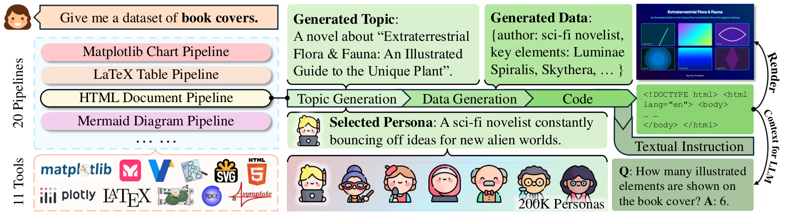<figcaption>CoSyn-400K · Fig. 2：一句查询选中渲染管线，persona 驱动主题，LLM 依次写数据和代码，渲染出图，再以代码为上下文生成问答</figcaption></figure>

<div class="ds-demo"><div class="ds-head"><b>数据样例</b> · <a href="https://huggingface.co/datasets/allenai/CoSyn-400K">allenai/CoSyn-400K</a> · 约 40 万张代码渲染的文字密集图，按 chart、chemical、circuit、diagram、document、graphic、math、music、nutrition、table 10 个 config 发布 · 展示字段：image、code、data、qa_pairs、metadata</div><div class="ds-grid"><div class="ds-card">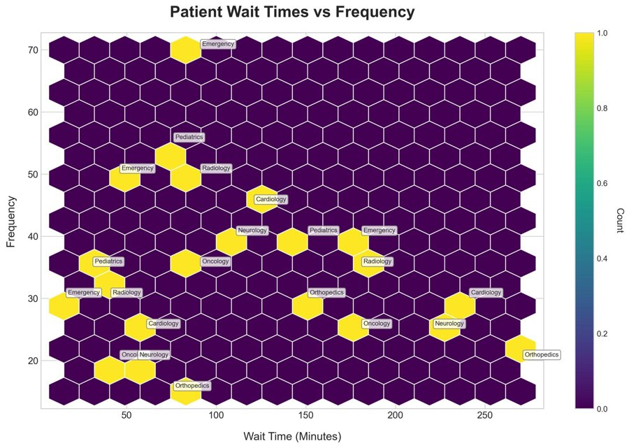<div class="ds-meta">chart（Matplotlib 六边形分箱图）：医院各科室按紧急程度的候诊时间；persona 为患者导诊护士，附 9 组问答</div><details class="ds-code"><summary>code（渲染代码）（共 48 行）</summary><pre>import numpy as np&#10;import matplotlib.pyplot as plt&#10;import io&#10;from PIL import Image&#10;&#10;def generate_plot(data):&#10;    plt.style.use('seaborn-v0_8-whitegrid')&#10;    &#10;    # Prepare data&#10;    x = data['Wait_Time_Minutes']&#10;    y = data['Frequency']&#10;    &#10;    # Create figure and axis&#10;    fig, ax = plt.subplots(figsize=(12, 8))&#10;    &#10;    # Create hexbin plot&#10;    hb = ax.hexbin(x, y, gridsize=15, cmap='viridis', edgecolors='white')&#10;    &#10;    # Customize plot&#10;    ax.set_title('Patient Wait Times vs Frequency', fontsize=20, fontweight='bold', pad=20)&#10;    ax.set_xlabel('Wait Time (Minutes)', fontsize=14, labelpad=15)&#10;    ax.set_ylabel('Frequency', fontsize=14, labelpad=15)&#10;    &#10;    # Add colorbar&#10;    cbar = plt.colorbar(hb, ax=ax)&#10;    cbar.set_label('Count', rotation=270, labelpad=20, fontsize=12)&#10;    &#10;    # Customize ticks&#10;    ax.tick_params(axis='both', which='major', labelsize=12)&#10;    &#10;    # Add text annotations for departments&#10;    for _, row in data.iterrows():&#10;        ax.annotate(row['Department'], (row['Wait_Time_Minutes'], row['Frequency']),&#10;                    xytext=(5, 5), textcoords='offset points', fontsize=8,&#10;                    bbox=dict(boxstyle="round,pad=0.3", fc="white", ec="gray", alpha=0.8))&#10;    &#10;    # Adjust layout&#10;    plt.tight_layout()&#10;    &#10;    # Save plot to BytesIO object&#10;    buf = io.BytesIO()&#10;    plt.savefig(buf, format='png', dpi=300, bbox_inches='tight')&#10;    buf.seek(0)&#10;    &#10;    # Convert to PIL Image&#10;    img = Image.open(buf)&#10;    &#10;    return img</pre></details><details class="ds-code"><summary>data（共 23 行）</summary><pre>Department,Urgency,Wait_Time_Minutes,Frequency&#10;Emergency,Critical,15,30&#10;Emergency,High,45,50&#10;Emergency,Medium,90,70&#10;Emergency,Low,180,40&#10;Cardiology,High,60,25&#10;Cardiology,Medium,120,45&#10;Cardiology,Low,240,30&#10;Oncology,High,45,20&#10;Oncology,Medium,90,35&#10;Oncology,Low,180,25&#10;Orthopedics,High,75,15&#10;Orthopedics,Medium,150,30&#10;Orthopedics,Low,270,20&#10;Pediatrics,High,30,35&#10;Pediatrics,Medium,75,55&#10;Pediatrics,Low,150,40&#10;Radiology,High,40,30&#10;Radiology,Medium,90,50&#10;Radiology,Low,180,35&#10;Neurology,High,55,20&#10;Neurology,Medium,110,40&#10;Neurology,Low,220,25</pre></details><details class="ds-code"><summary>qa_pairs（问题与答案）（共 26 行）</summary><pre>Q1: What is the title of the figure?&#10;A: Patient Wait Times vs Frequency&#10;&#10;Q2: What is the range of wait times shown on the x-axis?&#10;A: 15 to 270 minutes&#10;&#10;Q3: Which department has the highest wait time for the 'Low' urgency level?&#10;A: Orthopedics&#10;&#10;Q4: How many departments have a wait time of at least 180 minutes for the 'Low' urgency level?&#10;A: Three departments&#10;&#10;Q5: What is the color representing the highest density of data points?&#10;A: Dark purple&#10;&#10;Q6: Between Pediatrics and Neurology, which department has a lower average wait time for the 'High' urgency level?&#10;A: Pediatrics&#10;&#10;Q7: Which urgency level seems to exhibit the widest range of wait times across all departments?&#10;A: Low&#10;&#10;Q8: How does the frequency distribution of 'Medium' urgency levels compare between Oncology and Radiology?&#10;A: Radiology has a higher frequency for 'Medium' urgency&#10;&#10;Q9: Which department has the closest frequency for 'High' urgency levels to the Emergency department?&#10;A: Radiology</pre></details><details class="ds-code"><summary>metadata（共 5 行）</summary><pre>{&#10; "figure_type": "Hexbin Plot",&#10; "persona": "A nurse navigator who helps patients navigate the complex healthcare system and access necessary treatments",&#10; "topic": "Patient wait times across different departments in a hospital, broken down by urgency levels"&#10;}</pre></details></div><div class="ds-card">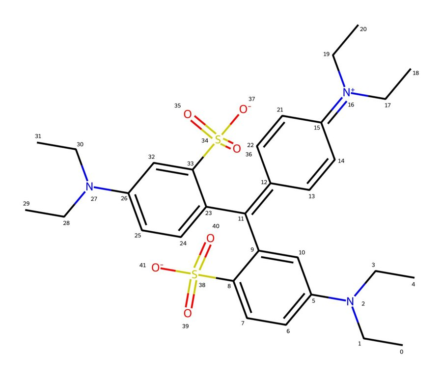<div class="ds-meta">chemical（RDKit 分子图）：代码字段就是 SMILES，主题为圣帕特里克节绿色食用色素；persona 为学爱尔兰文学的巴西工程师，附 6 组问答</div><details class="ds-code"><summary>code（渲染代码）（共 1 行）</summary><pre>CCN(CC)c1ccc(c(c1)C(=C2C=CC(=[N+](CC)CC)C=C2)c3ccc(N(CC)CC)cc3S(=O)(=O)[O-])S(=O)(=O)[O-]</pre></details><details class="ds-code"><summary>data（共 1 行）</summary><pre>CCN(CC)c1ccc(c(c1)C(=C2C=CC(=[N+](CC)CC)C=C2)c3ccc(N(CC)CC)cc3S(=O)(=O)[O-])S(=O)(=O)[O-]</pre></details><details class="ds-code"><summary>qa_pairs（问题与答案）（共 17 行）</summary><pre>Q1: What is the main functional group present in this chemical structure?&#10;A: sulfonyl&#10;&#10;Q2: How many nitrogen atoms are in this chemical?&#10;A: three&#10;&#10;Q3: What type of chemical compound is this classified as?&#10;A: sulfonamide&#10;&#10;Q4: In which element does this chemical primarily derive its green color?&#10;A: nitrogen&#10;&#10;Q5: What is the total number of carbon atoms present in this compound?&#10;A: twenty-five&#10;&#10;Q6: Why might this compound be used in food coloring for St. Patrick's Day?&#10;A: stability</pre></details><details class="ds-code"><summary>metadata（共 5 行）</summary><pre>{&#10; "figure_type": "drug",&#10; "persona": "A young Brazilian engineer taking evening classes to learn about Irish literature and folklore",&#10; "topic": "The chemical components of green food coloring used in St. Patrick's Day celebrations"&#10;}</pre></details></div><div class="ds-card">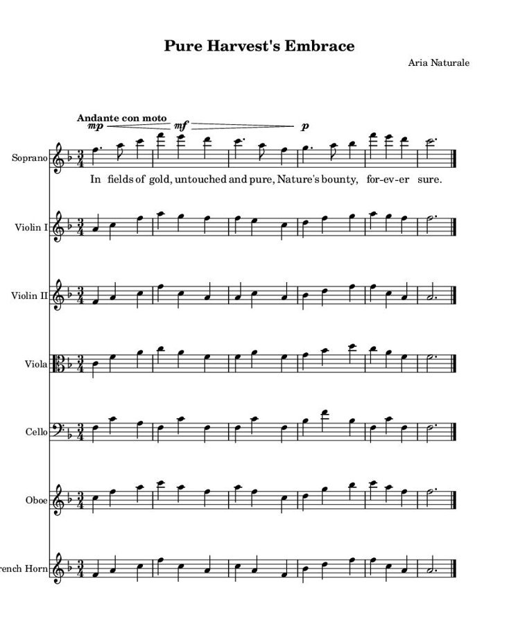<div class="ds-meta">music（LilyPond 乐谱）：3/4 拍 F 大调、女高音加 6 件乐器的歌剧片段；persona 为怀疑农药的营养师，附 7 组问答</div><details class="ds-code"><summary>code（渲染代码）（共 91 行，展示前 60 行）</summary><pre>\version "2.22.1"&#10;&#10;\paper {&#10;  #(set-paper-size "a4")&#10;  top-margin = 20&#10;  bottom-margin = 20&#10;  left-margin = 20&#10;  right-margin = 20&#10;  indent = 0&#10;  ragged-last-bottom = ##f&#10;}&#10;&#10;\header {&#10;  title = "Pure Harvest's Embrace"&#10;  composer = "Aria Naturale"&#10;  tagline = ##f&#10;}&#10;&#10;global = {&#10;  \key f \major&#10;  \time 3/4&#10;  \tempo "Andante con moto"&#10;}&#10;&#10;soprano = \relative c'' {&#10;  \global&#10;  \dynamicUp&#10;  f4.\mp\&lt; a8 c4 &#124; f e\mf\&gt; d &#124; c4. a8 f4 &#124; g4.\p a8 bes4 &#124; &#10;  f' e d &#124; c2.&#10;  \bar "&#124;."&#10;}&#10;&#10;violinI = \relative c'' {&#10;  \global&#10;  a4 c f &#124; a g f &#124; f e c &#124; d f g &#124;&#10;  a g f &#124; f2.&#10;}&#10;&#10;violinII = \relative c'' {&#10;  \global&#10;  f,4 a c &#124; f c a &#124; a c a &#124; bes d f &#124;&#10;  f c a &#124; a2.&#10;}&#10;&#10;viola = \relative c' {&#10;  \global&#10;  c4 f a &#124; c a f &#124; f a f &#124; g bes d &#124;&#10;  c a f &#124; f2.&#10;}&#10;&#10;cello = \relative c {&#10;  \global&#10;  f4 c' a &#124; f c' f, &#124; f c' f, &#124; bes f' bes, &#124;&#10;  f c' f, &#124; f2.&#10;}&#10;&#10;oboe = \relative c'' {&#10;  \global&#10;  c4 f a &#124; c a f &#124; a f c &#124; d g bes &#124;&#10;  c a f &#124; f2.&#10;…（截断，原文共 91 行）</pre></details><details class="ds-code"><summary>data（共 34 行）</summary><pre>{&#10;  "song_title": "Pure Harvest's Embrace",&#10;  "composer": "Aria Naturale",&#10;  "time_signature": "3/4",&#10;  "key_signature": "F major",&#10;  "tempo": "Andante con moto",&#10;  "instrumentation": [&#10;    "Soprano voice",&#10;    "Violin I",&#10;    "Violin II",&#10;    "Viola",&#10;    "Cello",&#10;    "Oboe",&#10;    "French Horn"&#10;  ],&#10;  "melody": {&#10;    "notes": "F4 A4 C5 &#124; F5 E5 D5 &#124; C5 A4 F4 &#124; G4 Bb4 D5 &#124; F5 E5 D5 &#124; C5 - - &#124;",&#10;    "rhythm": "4. 8 4 &#124; 4 4 4 &#124; 4. 8 4 &#124; 4. 8 4 &#124; 4 4 4 &#124; 2. &#124;"&#10;  },&#10;  "harmony": [&#10;    "F major",&#10;    "C7",&#10;    "F major",&#10;    "Bb major",&#10;    "C7",&#10;    "F major"&#10;  ],&#10;  "lyrics": "In fields of gold, untouched and pure,\nNature's bounty, forever sure.\nNo poison here, just Earth's sweet yield,\nA harvest blessed, in this fair field.",&#10;  "dynamics": "mp &lt; mf &gt; p",&#10;  "articulation": "legato",&#10;  "ornaments": "grace notes on 'pure' and 'yield'",&#10;  "mood": "serene and nostalgic",&#10;  "scene_description": "A soprano sings while overlooking a vast, pesticide-free wheat field at sunset, emphasizing the beauty and purity of natural farming methods."&#10;}</pre></details><details class="ds-code"><summary>qa_pairs（问题与答案）（共 20 行）</summary><pre>Q1: What is the key signature of this music?&#10;A: F major&#10;&#10;Q2: What is the time signature of this piece?&#10;A: 3/4&#10;&#10;Q3: What is the tempo marking of this score?&#10;A: Andante con moto&#10;&#10;Q4: How many measures does the soprano staff contain?&#10;A: 6&#10;&#10;Q5: Which instruments are included in the ensemble?&#10;A: Soprano, Violin I, Violin II, Viola, Cello, Oboe, French Horn&#10;&#10;Q6: What mood or theme does the text of the piece suggest?&#10;A: Purity and idyllic rural life&#10;&#10;Q7: What is the dynamics marking at the beginning of the soprano part?&#10;A: mezzo-piano</pre></details><details class="ds-code"><summary>metadata（共 5 行）</summary><pre>{&#10; "figure_type": "Opera",&#10; "persona": "A nutritionist skeptical about the health effects of chemical pesticides in food production",&#10; "topic": "Romantic operas set in idyllic rural communities untouched by chemical pesticides"&#10;}</pre></details></div></div></div>

- **自动化合成流程**（对照上图，从左往右读）
  1. **20 Pipelines / 11 Tools**：根据用户查询（如 "book covers"）选一条管线。11 种渲染工具包括 Matplotlib、Plotly、Vega-Lite、LaTeX、HTML、Mermaid、Graphviz、SVG、Asymptote、LilyPond、RDKit；每种工具都有对应的执行函数
  2. **Selected Persona**：从 Ge et al. 发布的 20 万个 persona 里采样一个，塞进 prompt，用来打散 LLM 的输出分布
  3. **Topic Generation**：LLM 以 persona 为条件，一次生成若干个不重叠的主题
  4. **Data Generation**：Claude-3.5-Sonnet 按主题生成 JSON 格式的具体内容，prompt 要求用真实实体名，禁止 xxA、[Name] 这类占位
  5. **Code**：Claude-3.5-Sonnet 把数据硬编码进单文件渲染代码，prompt 要求单页、不重叠、不引用外部文件
  6. **Render**：执行代码，得到图片
  7. **Textual Instruction**（Context for LLM）：只把数据和代码给 GPT-4o-mini（不给图），让它生成「问题 | 解释 | 短答案」三元组，每张图 5–10 条，天然带 CoT
  - （图外）**Pointing 数据**：让 LLM 读源码，提一个指点类问题，并改代码在答案位置画上指定颜色的点；再从像素里读出 (x, y)，归一化到 0–100
- **质量控制**
  - 论文没有单独的过滤、去重或打分环节，也没给丢弃比例；质量主要靠三点：代码必须能执行出图、prompt 约束、选用强代码模型
  - 生成模型对比：各造 10 万张图表后，用 Claude-3.5-Sonnet 数据训出的模型 ChartQA 77.2，用 GPT-4o 的只有 72.4；GPT-4o 在冷门库上的代码失败率更高
  - 多样性量化：图像用 CLIP、文本用 Sentence-BERT 算平均两两余弦距离；图表子集的图像多样性 0.596，ChartQA 是 0.340
- **关键数字**
  - 规模：40 万张图、270 万条指令、9 类图像；文档一类就用了 100 多个查询
  - 成本：40 万张图约 8,000 美元
  - 下游：7B 模型（CLIP ViT-L/14 + Mistral-7B，沿用 Molmo 训练流程）在 7 个富文本基准上平均 80.9，比 Llama 3.2 11B 高 3.9；不看任何评测集训练数据的 zero-shot 版本也有 74.7
  - 工具多样性：同样 45K 张图，只用 Matplotlib 时 ChartQA 73.9，换成 5 种工具混合后 75.2
  - 新任务：只合成 7K 张营养成分表样本，就在 NutritionQA 上超过大多数开源 VLM
  - Pointing：65K 张合成图的效果接近 155K 张人工标注图（ScreenSpot 68.0 vs 68.5）；两者合并 74.9，超过用 130 万张截图训练的 UGround（73.3）
  - 去偏：ChartQA 上人写问题与机器生成问题之间的分差，从 21.8 降到 14.2
- **局限**
  - 效果高度依赖 prompt 和渲染管线的设计；小众领域要单独做 prompt 工程（论文自述）
  - 只有英文
  - 缺少显式质检，渲染成功但画面有瑕疵（比如文字重叠）的样本可能混进来（推断）
- **可借鉴**
  - 把代码当图文之间的桥：问答只看源码生成，答案可以做到精确，不依赖 VLM 去读图
  - persona 条件采样是低成本的多样性开关
  - 同一类图用多种渲染工具生成，本身就是有效的增强
  - 改源码画点来造 grounding 数据，坐标可以从像素里读出来，不用人标

</details>

<a class="anchor" id="web-2-2-5"></a>

<details class="deep"><summary><span class="deep-title"> 2.2.5 ScreenCoder（2025-07） <span class="org">CUHK</span> <a class="hf" href="https://github.com/leigest519/ScreenCoder"><span class="hf-b hf-st" title="GitHub stars"><svg class="hf-i" viewBox="0 0 24 24" fill="currentColor"><path d="M12 2.5l2.9 6 6.6.6-5 4.3 1.5 6.5L12 16.9 6 20.9l1.5-6.5-5-4.3 6.6-.6z"/></svg>3.0k</span></a></span></summary>

- **定位**：模块化多 agent 的截图转 HTML 框架，同时当作数据引擎，产出 Screen-10K，用于 SFT + RL 两阶段后训练

<figure class="paper-fig">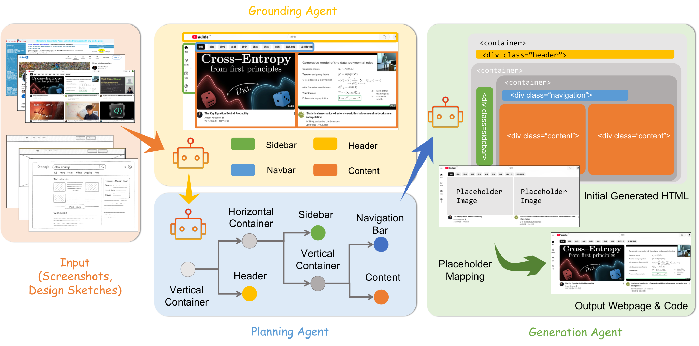<figcaption>ScreenCoder · Fig. 3：Grounding 标出组件区域，Planning 建布局树，Generation 写带占位符的 HTML，最后用原图素材回填占位</figcaption></figure>

<div class="ds-demo"><div class="ds-head"><b>数据样例</b> · <a href="https://huggingface.co/datasets/Leigest/ScreenCoder">Leigest/ScreenCoder</a> · ScreenBench 共 1,000 对真实网页截图与清洗后的 HTML，按 7 个类别存放 · 展示字段：image、HTML</div><div class="ds-grid"><div class="ds-card"><div class="ds-meta">类别 1：百度搜索结果页（关键词 Home organization hacks），左侧结果列表、右侧热搜榜</div><details class="ds-code"><summary>HTML（1_Home_organization_hacks.html）（共 8245 行，展示前 60 行）</summary><pre>&lt;!DOCTYPE html&gt;&#10;&lt;html class=""&gt;&lt;!-- &#10; single html processed by https://github.com/zTrix/webpage2html&#10; title: Home organization hacks_百度搜索&#10; url: baidu_snaps_1000/original\Home_organization_hacks.html&#10; date: Tue Sep 23 21:37:38 2025&#10;--&gt;&lt;head&gt;&#10;&lt;meta content="IE=edge,chrome=1" http-equiv="X-UA-Compatible"/&gt;&#10;&lt;meta content="text/html;charset=utf-8" http-equiv="content-type"/&gt;&#10;&lt;meta content="origin-when-cross-origin" name="referrer"/&gt;&#10;&lt;meta content="#ffffff" name="theme-color"/&gt;&#10;&lt;link data-href="https://www.baidu.com/favicon.ico" href="placeholder.png" rel="shortcut icon" type="image/x-icon"/&gt;&#10;&lt;link data-href="https://www.baidu.com/favicon.ico" href="placeholder.png" mask="" rel="icon" sizes="any"/&gt;&#10;&lt;link data-href="/content-search.xml" href="/content-search.xml" rel="search" title="百度搜索" type="application/opensearchdescription+xml"/&gt;&#10;&lt;style data-for="result" data-href="https://pss.bdstatic.com/r/www/static/font/cosmic/pc/cos-icon_acd3da0.css" rel="stylesheet" type="text/css"&gt;@font-face {&#10;    font-family: "cos-icon"; /* Project id 1775033 */&#10;    font-weight: 400;&#10;    src: url(); /* IE9 */&#10;    src: url(), /* IE6-IE8 */&#10;        url(),&#10;        url(),&#10;        url(),&#10;        url(placeholder.png) format('svg');&#10;}&#10;&#10;.cos-icon {&#10;    font-family: "cos-icon" !important;&#10;    font-style: normal;&#10;    -webkit-font-smoothing: antialiased;&#10;    -moz-osx-font-smoothing: grayscale;&#10;}&#10;&#10;.cos-icon-photo-stack::before {&#10;    content: "\e626";&#10;}&#10;&#10;.cos-icon-new-dialog::before {&#10;    content: "\e620";&#10;}&#10;&#10;.cos-icon-suggestion::before {&#10;    content: "\e621";&#10;}&#10;&#10;.cos-icon-dqa::before {&#10;    content: "\e622";&#10;}&#10;&#10;.cos-icon-quick-entry::before {&#10;    content: "\e623";&#10;}&#10;&#10;.cos-icon-expand-panel::before {&#10;    content: "\e624";&#10;}&#10;&#10;.cos-icon-stowed-panel::before {&#10;    content: "\e625";&#10;}&#10;&#10;…（截断，原文共 8245 行）</pre></details></div><div class="ds-card"><div class="ds-meta">类别 3：YouTube 搜索 country music 的结果页，左侧导航栏、中间视频卡片列表（繁体中文界面）</div><details class="ds-code"><summary>HTML（3_country-music.html）（共 6901 行，展示前 60 行）</summary><pre>&lt;!DOCTYPE html&gt;&#10;&lt;html darker-dark-theme="" darker-dark-theme-deprecate="" lang="zh-Hant-HK" style="font-size: 10px;font-family: Roboto, Arial, sans-serif;" system-icons="" typography="" typography-spacing=""&gt;&lt;!-- &#10; single html processed by https://github.com/zTrix/webpage2html&#10; title: country music - YouTube&#10; url: yt_snaps/original\country-music.html&#10; date: Wed Sep 24 08:50:44 2025&#10;--&gt;&lt;head&gt;&lt;meta content="ApvK67ociHgr2egd6c2ZjrfPuRs8BHcvSggogIOPQNH7GJ3cVlyJ1NOq/COCdj0+zxskqHt9HgLLETc8qqD+vwsAAABteyJvcmlnaW4iOiJodHRwczovL3lvdXR1YmUuY29tOjQ0MyIsImZlYXR1cmUiOiJQcml2YWN5U2FuZGJveEFkc0FQSXMiLCJleHBpcnkiOjE2OTUxNjc5OTksImlzU3ViZG9tYWluIjp0cnVlfQ==" http-equiv="origin-trial"/&gt;&lt;link d…（本行共 46,848 字符，截断）&#10;  /*! rtl:ignore */background:#065fd4}.yt-spec-button-shape-next--call-to-action.yt-spec-button-shape-next--filled:hover{&#10;  /*! rtl:ignore */background:#0556bf;border-color:transparent}@media (hover:none){.yt-spec-button-shape-next--call-to-action.yt-spec-button-shape-next--filled:hover{&#10;    /*! rtl:ignore */background:#065fd4}}@media (hover:none){.yt-spec-button-shape-next--call-to-action.yt-spec-button-shape-next--filled:active{&#10;    /*! rtl:ignore */background:#0556bf;border-color:transparent}}@media (-ms-high-contrast:active),(forced-colors:active){.yt-spec-button-shape-next--call-to-action.yt-spec-button-shape-next--filled{border:1px solid rgba(0,0,0,0.1)}}.yt-spec-button-shape-next--call-to-action.yt-spec-button-shape-ne…（本行共 439 字符，截断）&#10;  /*! rtl:ignore */background:#def1ff;border-color:transparent}@media (hover:none){.yt-spec-button-shape-next--call-to-action.yt-spec-button-shape-next--outline:hover{&#10;    /*! rtl:ignore */border-color:rgba(0,0,0,0.1)}}@media (hover:none){.yt-spec-button-shape-next--call-to-action.yt-spec-button-shape-next--outline:active{&#10;    /*! rtl:ignore */background:#def1ff;border-color:transparent}}.yt-spec-button-shape-next--call-to-action.yt-spec-button-shape-next--text{color:#065fd4}.yt-spec-button-shape-next--call-to-action.yt-spec-button-shape-next--text:hover{&#10;  /*! rtl:ignore */background:#def1ff;border-color:transparent}@media (hover:none){}@media (hover:none){.yt-spec-button-shape-next--call-to-action.yt-spec-button-shape-next--text:active{&#10;    /*! rtl:ignore */background:#def1ff;border-color:transparent}}.yt-spec-button-shape-next--call-to-action.yt-spec-button-shape-next--tonal{color:#065fd4;&#10;  /*! rtl:ignore */background:#def1ff}.yt-spec-button-shape-next--call-to-action.yt-spec-button-shape-next--tonal:hover{&#10;  /*! rtl:ignore */background:#dadfe6;border-color:transparent}@media (hover:none){.yt-spec-button-shape-next--call-to-action.yt-spec-button-shape-next--tonal:hover{&#10;    /*! rtl:ignore */background:#def1ff}}@media (hover:none){.yt-spec-button-shape-next--call-to-action.yt-spec-button-shape-next--tonal:active{&#10;    /*! rtl:ignore */background:#dadfe6;border-color:transparent}}@media (-ms-high-contrast:active),(forced-colors:active){.yt-spec-button-shape-next--call-to-action.yt-spec-button-shape-next--tonal{border:1px solid rgba(0,0,0,0.1)}}.yt-spec-button-shape-next--call-to-action.yt-spec-button-shape-nex…（本行共 325 字符，截断）&#10;  /*! rtl:ignore */background:unset;border-color:#065fd4}.yt-spec-button-shape-next--call-to-action.yt-spec-button-shape-next--focused:hover{&#10;  /*! rtl:ignore */background:#def1ff;border-color:transparent}@media (hover:none){.yt-spec-button-shape-next--call-to-action.yt-spec-button-shape-next--focused:hover{&#10;    /*! rtl:ignore */background:unset;border-color:#065fd4}}@media (hover:none){.yt-spec-button-shape-next--call-to-action.yt-spec-button-shape-next--focused:active{&#10;    /*! rtl:ignore */background:#def1ff;border-color:transparent}}.yt-spec-button-shape-next--call-to-action-inverse.yt-spec-button-shape-next--text{color:#3ea6ff}.yt-spec-button-shape-next--call-to-action-inverse.yt-spec-button-shape-next--text:hover{&#10;  /*! rtl:ignore */background:#263850;border-color:transparent}@media (hover:none){}@media (hover:none){.yt-spec-button-shape-next--call-to-action-inverse.yt-spec-button-shape-next--text:active{&#10;    /*! rtl:ignore */background:#263850;border-color:transparent}}.yt-spec-button-shape-next--call-to-action-overlay.yt-spec-button-shape-next--filled{color:#030303;&#10;  /*! rtl:ignore */background:#3ea6ff}.yt-spec-button-shape-next--call-to-action-overlay.yt-spec-button-shape-next--filled:hover{&#10;  /*! rtl:ignore */background:#65b8ff;border-color:transparent}@media (hover:none){.yt-spec-button-shape-next--call-to-action-overlay.yt-spec-button-shape-next--filled:hover{&#10;    /*! rtl:ignore */background:#3ea6ff}}@media (hover:none){.yt-spec-button-shape-next--call-to-action-overlay.yt-spec-button-shape-next--filled:active{&#10;    /*! rtl:ignore */background:#65b8ff;border-color:transparent}}.yt-spec-button-shape-next--call-to-action-overlay.yt-spec-button-shape-next--focused{color:#3ea6ff;&#10;  /*! rtl:ignore */background:#000;border-color:#3ea6ff}.yt-spec-button-shape-next--call-to-action-overlay.yt-spec-button-shape-next--focused:hover{&#10;  /*! rtl:ignore */background:#65b8ff;border-color:transparent}@media (hover:none){.yt-spec-button-shape-next--call-to-action-overlay.yt-spec-button-shape-next--focused:hover{&#10;    /*! rtl:ignore */background:#000;border-color:#3ea6ff}}@media (hover:none){.yt-spec-button-shape-next--call-to-action-overlay.yt-spec-button-shape-next--focused:active{&#10;    /*! rtl:ignore */background:#65b8ff;border-color:transparent}}.yt-spec-button-shape-next--mono.yt-spec-button-shape-next--filled{color:#fff;&#10;  /*! rtl:ignore */background:#0f0f0f}.yt-spec-button-shape-next--mono.yt-spec-button-shape-next--filled:hover{&#10;  /*! rtl:ignore */background:#272727;border-color:transparent}@media (hover:none){.yt-spec-button-shape-next--mono.yt-spec-button-shape-next--filled:hover{&#10;    /*! rtl:ignore */background:#0f0f0f}}@media (hover:none){.yt-spec-button-shape-next--mono.yt-spec-button-shape-next--filled:active{&#10;    /*! rtl:ignore */background:#272727;border-color:transparent}}@media (-ms-high-contrast:active),(forced-colors:active){.yt-spec-button-shape-next--mono.yt-spec-button-shape-next--filled{border:1px solid rgba(0,0,0,0.1)}}.yt-spec-button-shape-next--mono.yt-spec-button-shape-next--outline{color:#0…（本行共 409 字符，截断）&#10;  /*! rtl:ignore */background:rgba(0,0,0,0.1);border-color:transparent}@media (hover:none){.yt-spec-button-shape-next--mono.yt-spec-button-shape-next--outline:hover{&#10;    /*! rtl:ignore */border-color:rgba(0,0,0,0.1)}}@media (hover:none){.yt-spec-button-shape-next--mono.yt-spec-button-shape-next--outline:active{&#10;    /*! rtl:ignore */background:rgba(0,0,0,0.1);border-color:transparent}}.yt-spec-button-shape-next--mono.yt-spec-button-shape-next--text{color:#0f0f0f}.yt-spec-button-shape-next--mono.yt-spec-button-shape-next--text:hover{&#10;  /*! rtl:ignore */background:rgba(0,0,0,0.1);border-color:transparent}@media (hover:none){}@media (hover:none){.yt-spec-button-shape-next--mono.yt-spec-button-shape-next--text:active{&#10;    /*! rtl:ignore */background:rgba(0,0,0,0.1);border-color:transparent}}.yt-spec-button-shape-next--mono.yt-spec-button-shape-next--tonal{color:#0f0f0f;&#10;  /*! rtl:ignore */background:rgba(0,0,0,0.05)}.yt-spec-button-shape-next--mono.yt-spec-button-shape-next--tonal:hover{&#10;  /*! rtl:ignore */background:rgba(0,0,0,0.1);border-color:transparent}@media (hover:none){.yt-spec-button-shape-next--mono.yt-spec-button-shape-next--tonal:hover{&#10;    /*! rtl:ignore */background:rgba(0,0,0,0.05)}}@media (hover:none){.yt-spec-button-shape-next--mono.yt-spec-button-shape-next--tonal:active{&#10;    /*! rtl:ignore */background:rgba(0,0,0,0.1);border-color:transparent}}@media (-ms-high-contrast:active),(forced-colors:active){.yt-spec-button-shape-next--mono.yt-spec-button-shape-next--tonal{border:1px solid rgba(0,0,0,0.1)}}.yt-spec-button-shape-next--mono.yt-spec-button-shape-next--focused{c…（本行共 313 字符，截断）&#10;  /*! rtl:ignore */background:unset;border-color:#0f0f0f}.yt-spec-button-shape-next--mono.yt-spec-button-shape-next--focused:hover{&#10;  /*! rtl:ignore */background:rgba(0,0,0,0.1);border-color:transparent}@media (hover:none){.yt-spec-button-shape-next--mono.yt-spec-button-shape-next--focused:hover{&#10;    /*! rtl:ignore */background:unset;border-color:#0f0f0f}}@media (hover:none){.yt-spec-button-shape-next--mono.yt-spec-button-shape-next--focused:active{&#10;    /*! rtl:ignore */background:rgba(0,0,0,0.1);border-color:transparent}}.yt-spec-button-shape-next--mono-inverse.yt-spec-button-shape-next--filled{color:#0f0f0f;&#10;  /*! rtl:ignore */background:#fff}.yt-spec-button-shape-next--mono-inverse.yt-spec-button-shape-next--filled:hover{&#10;  /*! rtl:ignore */background:#d9d9d9;border-color:transparent}@media (hover:none){.yt-spec-button-shape-next--mono-inverse.yt-spec-button-shape-next--filled:hover{&#10;    /*! rtl:ignore */background:#fff}}@media (hover:none){.yt-spec-button-shape-next--mono-inverse.yt-spec-button-shape-next--filled:active{&#10;    /*! rtl:ignore */background:#d9d9d9;border-color:transparent}}@media (-ms-high-contrast:active),(forced-colors:active){.yt-spec-button-shape-next--mono-inverse.yt-spec-button-shape-next--filled{border:1px solid rgba(0,0,0,0.1)}}.yt-spec-button-shape-next--mono-inverse.yt-spec-button-shape-next--…（本行共 436 字符，截断）&#10;  /*! rtl:ignore */background:rgba(255,255,255,0.1);border-color:transparent}@media (hover:none){.yt-spec-button-shape-next--mono-inverse.yt-spec-button-shape-next--outline:hover{&#10;    /*! rtl:ignore */border-color:rgba(255,255,255,0.2)}}@media (hover:none){.yt-spec-button-shape-next--mono-inverse.yt-spec-button-shape-next--outline:active{&#10;    /*! rtl:ignore */background:rgba(255,255,255,0.1);border-color:transparent}}.yt-spec-button-shape-next--mono-inverse.yt-spec-button-shape-next--text{color:#fff}.yt-spec-button-shape-next--mono-inverse.yt-spec-button-shape-next--text:hover{&#10;  /*! rtl:ignore */background:rgba(0,0,0,0.1);border-color:transparent}@media (hover:none){}@media (hover:none){.yt-spec-button-shape-next--mono-inverse.yt-spec-button-shape-next--text:active{&#10;    /*! rtl:ignore */background:rgba(0,0,0,0.1);border-color:transparent}}.yt-spec-button-shape-next--mono-inverse.yt-spec-button-shape-next--tonal{color:#fff;&#10;…（截断，原文共 6901 行）</pre></details></div><div class="ds-card">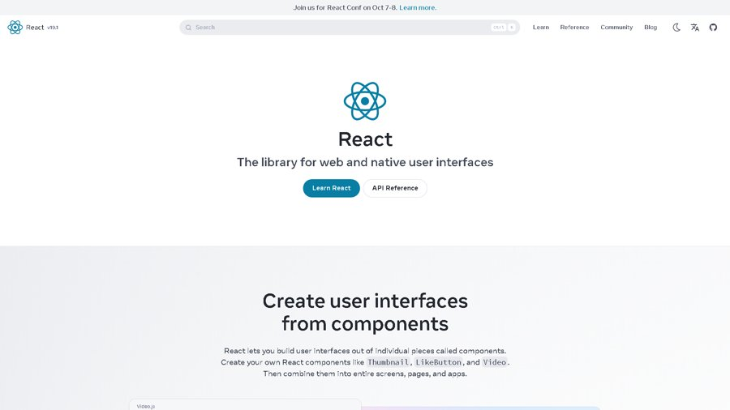<div class="ds-meta">类别 5：React 官网首页，顶部导航、标题区与两个按钮；HTML 仅 14 行，但单行最长约 35 万字符</div><details class="ds-code"><summary>HTML（5_reactdev.html）（共 15 行）</summary><pre>&lt;!DOCTYPE html&gt;&#10;&lt;html dir="ltr" lang="en"&gt;&lt;!-- &#10; single html processed by https://github.com/zTrix/webpage2html&#10; title: React&#10; url: https://react.dev/&#10; date: Tue Sep 23 20:13:44 2025&#10;--&gt;&lt;head&gt;&lt;meta charset="utf-8" data-next-head=""/&gt;&lt;meta content="width=device-width, initial-scale=1" data-next-head="" name="viewport"/&gt;&lt;title data-next-head=""&gt;React&lt;/title&gt;&lt;meta content="React is the library for web and native user interfaces. Build user interfaces out of individual pieces called…（本行共 25,416 字符，截断）&#10;&#10;/*&#10; ! tailwindcss v3.4.1 &#124; MIT License &#124; https://tailwindcss.com&#10; */*,:after,:before{box-sizing:border-box;border:0 solid #e5e7eb}:after,:before{--tw-content:""}:host,html{line-height:1.5;-webkit-text-size-adjust:100%;-moz-tab-size:4;-o-tab-size:4;tab-size:4;font-family:ui-sans-serif,system-ui,sans-serif,Apple Color Emoji,Segoe UI Emoji,Segoe UI Symbol,Noto Color…（本行共 106,814 字符，截断）&#10;&#10;/*&#10; ! tailwindcss v3.4.1 &#124; MIT License &#124; https://tailwindcss.com&#10; */*,:after,:before{box-sizing:border-box;border:0 solid #e5e7eb}:after,:before{--tw-content:""}:host,html{line-height:1.5;-webkit-text-size-adjust:100%;-moz-tab-size:4;-o-tab-size:4;tab-size:4;font-family:ui-sans-serif,system-ui,sans-serif,Apple Color Emoji,Segoe UI Emoji,Segoe UI Symbol,Noto Color…（本行共 351,632 字符，截断）</pre></details></div></div></div>

- **自动化合成流程**（对照上图，从左往右读）
  1. **Input (Screenshots, Design Sketches)**：网页截图或设计草图；做数据时的输入是爬到的 5 万个网页
  2. **Grounding Agent**：用 MLLM 按文字提问定位 Sidebar / Header / Navbar / Content，返回框和标签。后处理全靠规则：类内 NMS 去重；漏检时按空间先验兜底（顶部又宽又矮的框视为 header）；把不与任何组件重叠的最大矩形推断为主内容区
  3. **Planning Agent**：一个确定性算法（Visual-to-Structural Tree Mapping），把框转成 DOM 式布局树。像素坐标换成百分比并用绝对定位；带子区域的节点设为 CSS Grid 容器。整个过程不调用模型
  4. **Generation Agent**：遍历布局树，每个节点用一个自适应 prompt（包含语义标签、树上下文和可选的用户指令）让 LLM 写代码，再按树结构拼成 **Initial Generated HTML**，图片先放占位符
  5. **Placeholder Mapping**：用 UIED 检测原图里的图标和图片，按规划得到的区域分组；以负 CIoU 作代价、Hungarian 算法一对一匹配占位框，然后从原图裁图回填
  6. **Output Webpage & Code**：得到最终页面和代码
  - （图外）**Screen-10K**：爬取 5 万个网页，经过自动过滤留下 1 万对高质量图-码对；其中 9K 用于 SFT，1K 用于 RL
  - （图外）**RL 奖励**：把生成的代码渲染出来，和原图算 −MSE，用 GRPO 优化
- **质量控制**
  - 50K → 10K，只保留 20%；论文只说是「严格的自动化过滤」，没有公开过滤标准
  - grounding 阶段有规则后处理（NMS、兜底、主内容推断）
  - RL 阶段用像素级渲染对比当奖励，相当于在线的执行校验
- **关键数字**
  - 规模：Screen-10K 共 10,000 对；ScreenBench 有 1,000 个网页
  - 训练：基座 Qwen2.5-VL-32B，LLaMA-Factory，16 张 A100
  - 后训练收益（ScreenBench）：Block 0.723 → SFT 0.741 → RL 0.758；Position 0.613 → 0.705 → 0.742；CLIP 0.762 → 0.784 → 0.791
  - 人评：与 GPT-4o 两两对比，ScreenCoder 胜 65%、负 11%、平 24%
- **局限**
  - 过滤规则、数据引擎用的具体 MLLM 都没在正文写明（prompt 只以图片形式放在附录）
  - 规划器输出的是百分比 + 绝对定位的代码，响应式能力和代码风格都被锁死（推断）
  - v1 和 v2 口径不一致：v1 写的是 5 万对数据集、3,000 对评测集、「块 + 文本 + 位置」组合奖励；v2 改成 1 万对、1,000 对、−MSE
- **可借鉴**
  - 把感知、规划、生成拆开：规划用确定性算法，结构不会跑偏，数据更干净
  - 图片占位加上「检测 + Hungarian 匹配 + 裁原图回填」，截图里的真实素材就能进到代码里
  - 渲染 −MSE 奖励最简单，拿同一批数据接着做 RL 就行

</details>

<a class="anchor" id="web-2-2-6"></a>

<details class="deep"><summary><span class="deep-title"> 2.2.6 Vision2UI → WebCode2M（2024-04） <span class="org">HUST</span> <a class="hf" href="https://huggingface.co/datasets/xcodemind/webcode2m"><span class="hf-b hf-dl" title="downloads"><svg class="hf-i" viewBox="0 0 24 24" fill="none" stroke="currentColor" stroke-width="2.2" stroke-linecap="round" stroke-linejoin="round"><path d="M12 3v11"/><path d="M8 11l4 4 4-4"/><path d="M4 20h16"/></svg>2.4k</span><span class="hf-b hf-lk" title="likes"><svg class="hf-i" viewBox="0 0 24 24" fill="currentColor"><path d="M12 21C7 17.5 3 14 3 9.5 3 7 5 5 7.5 5 9.2 5 10.7 6 12 7.6 13.3 6 14.8 5 16.5 5 19 5 21 7 21 9.5 21 14 17 17.5 12 21z"/></svg>48</span></a></span></summary>

- **定位**：来自真实网页的大规模「设计图 → HTML/CSS + 布局树」数据，用来弥补 WebSight 这类合成数据结构过于简单的问题

<figure class="paper-fig">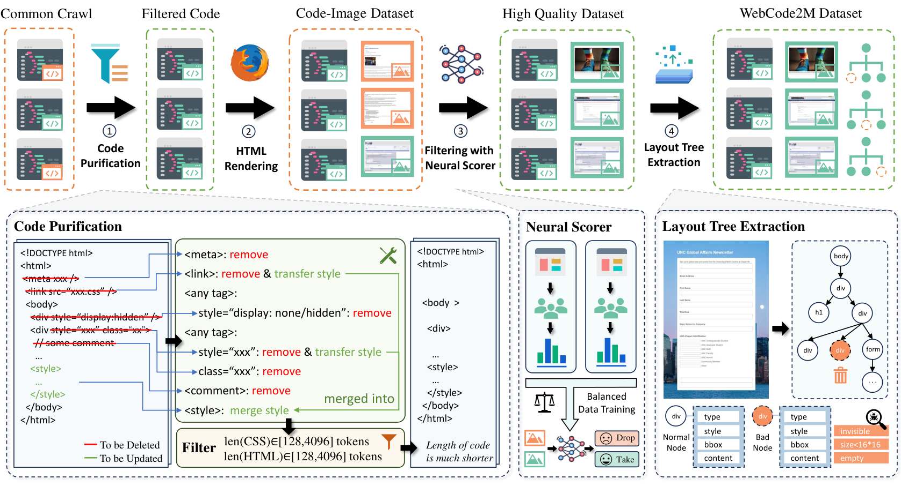<figcaption>Vision2UI → WebCode2M · Fig. 1：Common Crawl 网页经过代码净化、渲染截图、神经打分器过滤、布局树抽取，得到三元组数据</figcaption></figure>

<div class="ds-demo"><div class="ds-head"><b>数据样例</b> · <a href="https://huggingface.co/datasets/xcodemind/webcode2m">xcodemind/webcode2m</a> · train 共 3,171,024 条网页截图与 HTML 代码对，附 DOM 布局框 · 展示字段：image、text、bbox、score</div><div class="ds-grid"><div class="ds-card">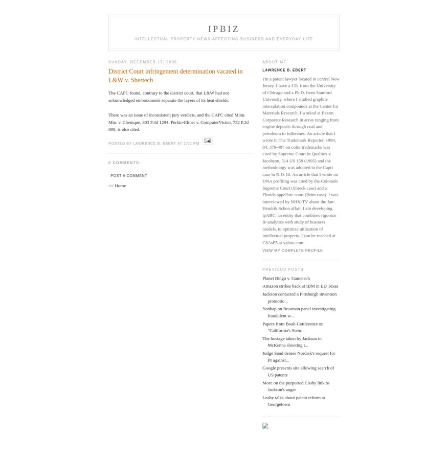<div class="ds-meta">IPBiz 博客文章页（英文，row 1002）：标题栏 + 正文 + 右侧个人简介与历史文章列表；质量分 score=3，截图尺寸 1280×1315</div><details class="ds-code"><summary>text（HTML）（共 182 行，展示前 60 行）</summary><pre>&lt;!DOCTYPE html&gt;&#10;&#10;&lt;html&gt;&lt;head&gt;&lt;title&gt;IPBiz: District Court infringement determination vacated in L&amp;amp;W v. Shertech&lt;/title&gt;&lt;/head&gt;&lt;body&gt;&lt;div id="navbar-iframe-container"&gt;&lt;/div&gt;&lt;div id="header"&gt;&lt;h1 id="blog-title"&gt;&lt;a&gt;&#10;	IPBiz&#10;	&lt;/a&gt;&lt;/h1&gt;&lt;p id="description"&gt;Intellectual property news affecting business and everyday life&lt;/p&gt;&lt;/div&gt;&lt;div id="content"&gt;&lt;div id="main"&gt;&lt;div id="main2"&gt;&lt;h2 class="date-header"&gt;Sunday, December 17, 2006&lt;/h2&gt;&lt;div class="post"&gt;&lt;a&gt;&lt;/a&gt;&lt;h3 class="post-title"&gt;&#10;	 District Court infringement determination vacated in L&amp;amp;W v. Shertech&#10;    &lt;/h3&gt;&lt;div class="post-body"&gt;&lt;div&gt;&lt;div style="clear:both;"&gt;&lt;/div&gt;The CAFC found, contrary to the district court, that L&amp;amp;W had not acknowledged embossments separate the layers of its heat shields.&lt;br/&gt;&lt;br/&gt;There was an issue of inconsistent jury verdicts, and the CAFC cited Minn. Min. v. Chemque, 303 F.3d 1294.  Perkin-Elmer v. ComputerVision, 732 F.2d 888, is also cited.&lt;div style="clear:both; padding-bottom:0.25em"&gt;&lt;/div&gt;&lt;/div&gt;&lt;/div&gt;&lt;p class="post-footer"&gt;&lt;em&gt;posted by Lawrence B. Ebert at &lt;a&gt;2:02 PM&lt;/a&gt;&lt;/em&gt;&lt;span class="item-action"&gt;&lt;a&gt;&lt;img class="icon-action" height="13" src="https://resources.blogblog.com/img/icon18_email.gif" width="18"/&gt;&lt;/a&gt;&lt;/span&gt;&lt;/p&gt;&lt;/div&gt;&lt;div id="comments"&gt;&lt;a&gt;&lt;/a&gt;&lt;h4&gt;0 Comments:&lt;/h4&gt;&lt;dl id="comments-block"&gt;&lt;/dl&gt;&lt;p class="comment-timestamp"&gt;&lt;a class="comment-link"&gt;Post a Comment&lt;/a&gt;&lt;/p&gt;&lt;p class="comment-timestamp"&gt;&lt;a&gt;&amp;lt;&amp;lt; Home&lt;/a&gt;&lt;/p&gt;&lt;/div&gt;&lt;/div&gt;&lt;/div&gt;&lt;div id="sidebar"&gt;&lt;div id="sidebar2"&gt;&lt;div id="profile-container"&gt;&lt;h2 class="sidebar-title"&gt;About Me&lt;/h2&gt;&lt;dl class="profile-datablock"&gt;&lt;dd class="profile-data"&gt;&lt;strong&gt;Name:&lt;/strong&gt; &lt;a&gt; Lawrence B. Ebert &lt;/a&gt;&lt;/dd&gt;&lt;/dl&gt;&lt;p class="profile-textblock"&gt;I'm a patent lawyer located in central New Jersey.  I have a J.D. from the University of Chicago and a Ph.D. from Stanford University, where I studied graphite intercalation compounds at the Center for Materials Research.  I worked at Exxon Corporate Research in areas ranging from engine deposits through coal and petroleum to fullerenes. An article that I wrote in The Trademark Reporter, 1994, 84, 379-407 on color trademarks was cited by Supreme Court in Qualitex v. Jacobson, 514 US 159 (1995) and the methodology was adopted&#10;in the Capri case in N.D. Ill. An article that I wrote on DNA profiling was cited by the Colorado Supreme Court (Shreck case) and a Florida appellate court (Brim case). I was interviewed by NHK-TV about the Jan-Hendrik Schon affair.  I am developing ipABC, an entity that combines rigorous IP analytics with study of business models, to optimize utilization of intellectual property.  I can be reached at C8AsF5 at yahoo.com.&lt;/p&gt;&lt;p class="profile-link"&gt;&lt;a&gt;View my complete profile&lt;/a&gt;&lt;/p&gt;&lt;/div&gt;&lt;h2 class="sidebar-title"&gt;Previous Posts&lt;/h2&gt;&lt;ul id="recently"&gt;&lt;li&gt;&lt;a&gt;Planet Bingo v. Gametech&lt;/a&gt;&lt;/li&gt;&lt;li&gt;&lt;a&gt;Amazon strikes back at IBM in ED Texas&lt;/a&gt;&lt;/li&gt;&lt;li&gt;&lt;a&gt;Jackson contacted  a Pittsburgh invention promotio...&lt;/a&gt;&lt;/li&gt;&lt;li&gt;&lt;a&gt;Yonhap on Brauman panel investigating fraudulent w...&lt;/a&gt;&lt;/li&gt;&lt;li&gt;&lt;a&gt;Papers from Boalt Conference on "California's Stem...&lt;/a&gt;&lt;/li&gt;&lt;li&gt;&lt;a&gt;The hostage taken by Jackson in McKenna shooting i...&lt;/a&gt;&lt;/li&gt;&lt;li&gt;&lt;a&gt;Judge Sand denies Nordisk's request for PI against...&lt;/a&gt;&lt;/li&gt;&lt;li&gt;&lt;a&gt;Google presents site allowing search of US patents&lt;/a&gt;&lt;/li&gt;&lt;li&gt;&lt;a&gt;More on the purported Cosby link to Jackson's anger&lt;/a&gt;&lt;/li&gt;&lt;li&gt;&lt;a&gt;Leahy talks about patent reform at Georgetown&lt;/a&gt;&lt;/li&gt;&lt;/ul&gt;&lt;p id="powered-by"&gt;&lt;a&gt;&lt;img src="https://lh3.googleusercontent.com/blogger_img_proxy/ALY8t1tc3h8aQynq56Rr1Uhw8qtsr65wBjbiXooxuXgbZuNBFesYZvF_wLTK8OpEljVy2UrBuUINVYiMzTF06qeDkLz3FLa5rC8kIK1E83LgDFd5=s0-d"/&gt;&lt;/a&gt;&lt;/p&gt;&lt;/div&gt;&lt;/div&gt;&lt;/div&gt;&lt;div id="footer"&gt;&lt;hr/&gt;&lt;p&gt; &lt;/p&gt;&lt;/div&gt;&lt;noscript&gt;&lt;a&gt;&lt;img src="https://lh3.googleusercontent.com/blogger_img_proxy/ALY8t1uqANWQSlq2qLr6cQdXF3i3P1-L0lmXQUEsiSfnNpq4eHtXP0qGb48-0sWy_ccK5dn5WRv6uhq-g3pA47sX1M33G7DIUDS3DFeyAHktrplLS2B7u4c0=s0-d"/&gt;&lt;/a&gt;&lt;/noscript&gt;&lt;style&gt;body {&#10;    background: #fff;&#10;    margin: 0;&#10;    padding: 40px 20px;&#10;    font: x-small Georgia, Serif;&#10;    text-align: center;&#10;    color: #333;&#10;    font-size/* */: /**/ small;&#10;    font-size: /**/ small&#10;    }&#10;a img {&#10;    border-width: 0&#10;    }&#10;#header {&#10;    width: 660px;&#10;    margin: 0 auto 10px;&#10;    border: 1px solid #ccc&#10;    }&#10;#blog-title {&#10;    margin: 5px 5px 0;&#10;    padding: 20px 20px 0.25em;&#10;    border: 1px solid #eee;&#10;    border-width: 1px 1px 0;&#10;    font-size: 200%;&#10;    line-height: 1.2em;&#10;    font-weight: normal;&#10;    color: #666;&#10;    text-transform: uppercase;&#10;    letter-spacing: 0.2em&#10;    }&#10;#blog-title a {&#10;    color: #666;&#10;    text-decoration: none&#10;    }&#10;#description {&#10;    margin: 0 5px 5px;&#10;    padding: 0 20px 20px;&#10;    border: 1px solid #eee;&#10;    border-width: 0 1px 1px;&#10;    max-width: 700px;&#10;    font: 78%/1.4em "Trebuchet MS", Trebuchet, Arial, Verdana, Sans-serif;&#10;    text-transform: uppercase;&#10;    letter-spacing: 0.2em;&#10;    color: #999&#10;    }&#10;#content {&#10;    width: 660px;&#10;    margin: 0 auto;&#10;    padding: 0;&#10;    text-align: left&#10;    }&#10;#main {&#10;    width: 410px;&#10;…（截断，原文共 182 行）</pre></details><details class="ds-code"><summary>bbox（布局树 JSON）（共 88 行，展示前 60 行）</summary><pre>{&#10; "type": "body",&#10; "content": "",&#10; "style": "background: #fff; margin: 0; padding: 40px 20px; font: x-small Georgia, Serif; text-align: center; color: #333; font-size: small; font-size: small",&#10; "bbox": [&#10;  0,&#10;  0,&#10;  1280,&#10;  1314&#10; ],&#10; "children": [&#10;  {&#10;   "type": "div",&#10;   "content": "",&#10;   "style": "width: 660px; margin: 0 auto 10px; border: 1px solid #ccc",&#10;   "bbox": [&#10;    309,&#10;    40,&#10;    662,&#10;    105&#10;   ],&#10;   "children": [&#10;    {&#10;     "type": "h1",&#10;     "content": "",&#10;     "style": "margin: 5px 5px 0; padding: 20px 20px 0.25em; border: 1px solid #eee; border-width: 1px 1px 0; font-size: 200%; line-height: 1.2em; font-weight: normal; color: #666; text-transform: uppercase; letter-spacing: 0.2em",&#10;     "bbox": [&#10;      315,&#10;      46,&#10;      650,&#10;      58&#10;     ],&#10;     "children": [&#10;      {&#10;       "type": "a",&#10;       "content": "IPBiz",&#10;       "style": "color: #666; text-decoration: none",&#10;       "bbox": [&#10;        594,&#10;        68,&#10;        91,&#10;        29&#10;       ],&#10;       "children": []&#10;      }&#10;     ]&#10;    },&#10;    {&#10;     "type": "p",&#10;     "content": "Intellectual property news affecting business and everyday life",&#10;     "style": "margin: 0 5px 5px; padding: 0 20px 20px; border: 1px solid #eee; border-width: 0 1px 1px; max-width: 700px; font: 78%/1.4em \"Trebuchet MS\", Trebuchet, Arial, Verdana, Sans-serif; text-transform: uppercase; letter-spacing: 0.2em; color: #999",&#10;     "bbox": [&#10;      315,&#10;      104,&#10;      650,&#10;      35&#10;     ],&#10;     "children": []&#10;    }&#10;   ]&#10;…（截断，原文共 88 行）</pre></details></div><div class="ds-card">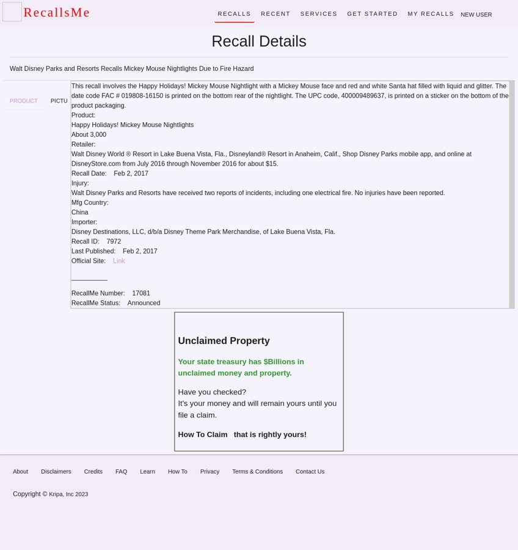<div class="ds-meta">RecallsMe 产品召回详情页（英文，row 1006）：导航栏、召回信息表格与页脚；质量分 score=3，截图尺寸 1280×1359</div><details class="ds-code"><summary>text（HTML）（共 638 行，展示前 60 行）</summary><pre>&lt;!DOCTYPE html&gt;&#10;&#10;&lt;html&gt;&lt;head&gt;&lt;title&gt;Walt Disney Parks and Resorts Recalls Mickey Mouse · RecallsMe&lt;/title&gt;&lt;/head&gt;&lt;body&gt;&lt;div id="page-view"&gt; &lt;div class="MuiBox-root css-hqeimm"&gt;&lt;div class="MuiContainer-root MuiContainer-maxWidthXl MuiContainer-disableGutters css-1g5pnzw"&gt;&lt;header class="MuiPaper-root MuiPaper-elevation MuiPaper-elevation0 MuiAppBar-root MuiAppBar-colorPrimary MuiAppBar-positionFixed mui-fixed css-1oi7wav"&gt;&lt;div class="MuiContainer-root MuiContainer-maxWidthXl css-1ekb41w"&gt;&lt;div class="MuiToolbar-root MuiToolbar-regular css-12brgso"&gt;&lt;div class="MuiBox-root css-is797a"&gt;&lt;div class="MuiBox-root css-1gs754q"&gt;&lt;a class="MuiTypography-root MuiTypography-inherit MuiLink-root MuiLink-underlineAlways css-13f3l8y"&gt;&lt;img height="48" src="/images/logo/logo.png" width="48"/&gt;&lt;/a&gt;&lt;/div&gt;&lt;div class="MuiBox-root css-1451br9"&gt;&lt;a class="MuiTypography-root MuiTypography-h6 MuiTypography-noWrap css-oyhw1d"&gt;&lt;span class="MuiBox-root css-1fog0o5"&gt;RecallsMe&lt;/span&gt;&lt;/a&gt;&lt;/div&gt;&lt;/div&gt;&lt;div class="MuiBox-root css-ievg8a"&gt;&lt;a class="MuiTypography-root MuiTypography-inherit MuiLink-root MuiLink-underlineAlways MuiButtonBase-root MuiButton-root MuiButton-text MuiButton-textPrimary MuiButton-sizeMedium MuiButton-textSizeMedium MuiButton-root MuiButton-text MuiButton-textPrimary MuiButton-sizeMedium MuiButton-textSizeMedium css-kxrbgp"&gt;Recalls&lt;/a&gt;&lt;a class="MuiTypography-root MuiTypography-inherit MuiLink-root MuiLink-underlineAlways MuiButtonBase-root MuiButton-root MuiButton-text MuiButton-textPrimary MuiButton-sizeMedium MuiButton-textSizeMedium MuiButton-root MuiButton-text MuiButton-textPrimary MuiButton-sizeMedium MuiButton-textSizeMedium css-1m4pwot"&gt;Recent&lt;/a&gt;&lt;a class="MuiTypography-root MuiTypography-inherit MuiLink-root MuiLink-underlineAlways MuiButtonBase-root MuiButton-root MuiButton-text MuiButton-textPrimary MuiButton-sizeMedium MuiButton-textSizeMedium MuiButton-root MuiButton-text MuiButton-textPrimary MuiButton-sizeMedium MuiButton-textSizeMedium css-1m4pwot"&gt;Services&lt;/a&gt;&lt;a class="MuiTypography-root MuiTypography-inherit MuiLink-root MuiLink-underlineAlways MuiButtonBase-root MuiButton-root MuiButton-text MuiButton-textPrimary MuiButton-sizeMedium MuiButton-textSizeMedium MuiButton-root MuiButton-text MuiButton-textPrimary MuiButton-sizeMedium MuiButton-textSizeMedium css-1m4pwot"&gt;Get Started&lt;/a&gt;&lt;a class="MuiTypography-root MuiTypography-inherit MuiLink-root MuiLink-underlineAlways MuiButtonBase-root MuiButton-root MuiButton-text MuiButton-textPrimary MuiButton-sizeMedium MuiButton-textSizeMedium MuiButton-root MuiButton-text MuiButton-textPrimary MuiButton-sizeMedium MuiButton-textSizeMedium css-1m4pwot"&gt;My Recalls&lt;/a&gt;&lt;/div&gt;&lt;div class="MuiBox-root css-z9bsr1"&gt;&lt;button class="MuiButtonBase-root MuiIconButton-root MuiIconButton-sizeMedium css-148fdm8"&gt;&lt;span class="MuiTypography-root MuiTypography-span css-h3qoqk"&gt;NEW USER&lt;/span&gt;&lt;/button&gt;&lt;/div&gt;&lt;div class="MuiBox-root css-t2oejo"&gt;&lt;/div&gt;&lt;div class="MuiBox-root css-p52qg0"&gt;&lt;button class="MuiButtonBase-root MuiIconButton-root MuiIconButton-colorInherit MuiIconButton-sizeMedium css-1sez342"&gt;&lt;svg class="MuiSvgIcon-root MuiSvgIcon-fontSizeMedium css-vubbuv"&gt;&lt;path&gt;&lt;/path&gt;&lt;/svg&gt;&lt;/button&gt;&lt;/div&gt;&lt;div class="MuiBox-root css-1ov9cr1"&gt;&lt;/div&gt;&lt;/div&gt;&lt;/div&gt;&lt;/header&gt;&lt;div class="MuiBox-root css-167lj4j"&gt;&lt;/div&gt;&lt;main&gt;&lt;div class="MuiGrid-root MuiGrid-container css-1d3bbye"&gt;&lt;div class="MuiPaper-root MuiPaper-elevation MuiPaper-elevation1 css-1eftu4k"&gt;&lt;div class="MuiGrid-root MuiGrid-container MuiGrid-item MuiGrid-spacing-xs-1 css-rk8e6v"&gt;&lt;div class="MuiGrid-root MuiGrid-item MuiGrid-grid-xs-12 MuiGrid-grid-sm-12 MuiGrid-grid-md-9 css-1xd5sck"&gt;&lt;h1 class="MuiTypography-root MuiTypography-h1 MuiTypography-alignCenter MuiTypography-gutterBottom css-1yyrvhg"&gt;Recall Details&lt;/h1&gt;&lt;h2 class="MuiTypography-root MuiTypography-h2 MuiTypography-alignCenter css-12jsxq1"&gt;&lt;/h2&gt;&lt;hr class="MuiDivider-root MuiDivider-middle css-zy8cjw"/&gt;&lt;div class="MuiGrid-root MuiGrid-container MuiGrid-spacing-xs-1 css-skvbsg"&gt;&lt;div class="MuiGrid-root MuiGrid-item MuiGrid-grid-xs-12 css-15j76c0"&gt; &lt;div class="MuiGrid-root MuiGrid-item MuiGrid-grid-xs-12 css-15j76c0"&gt;&lt;div class="MuiBox-root css-0"&gt;&lt;/div&gt;&lt;/div&gt;&lt;div class="MuiGrid-root MuiGrid-item MuiGrid-grid-xs-12 css-15j76c0"&gt;&lt;p class="MuiTypography-root MuiTypography-body1 MuiTypography-alignLeft MuiTypography-gutterBottom css-16it7j0"&gt;Walt Disney Parks and Resorts Recalls Mickey Mouse Nightlights Due to Fire Hazard&lt;/p&gt;&lt;hr class="MuiDivider-root MuiDivider-fullWidth css-39bbo6"/&gt;&lt;div class="MuiBox-root css-1v9avh5"&gt;&lt;div class="MuiTabs-root css-ujj5ys"&gt;&lt;div class="MuiTabs-scrollableX MuiTabs-hideScrollbar css-oqr85h" style="width:99px;height:99px;position:absolute;top:-9999px;overflow:scroll"&gt;&lt;/div&gt;&lt;div class="MuiTabs-scroller MuiTabs-hideScrollbar MuiTabs-scrollableX css-12qnib" style="overflow:hidden;margin-bottom:0"&gt;&lt;div class="MuiTabs-flexContainer css-k008qs"&gt;&lt;button class="MuiButtonBase-root MuiTab-root MuiTab-labelIcon MuiTab-textColorSecondary Mui-selected css-pltj1d" id="vertical-tab-detail-0"&gt;&lt;svg class="MuiSvgIcon-root MuiSvgIcon-fontSizeMedium MuiTab-iconWrapper css-vubbuv" style="vertical-align:middle;font-size:2.4rem"&gt;&lt;path&gt;&lt;/path&gt;&lt;/svg&gt;Product&lt;span class="MuiTabs-indicator css-at2bun"&gt;&lt;/span&gt;&lt;/button&gt;&lt;button class="MuiButtonBase-root MuiTab-root MuiTab-labelIcon MuiTab-textColorSecondary css-pltj1d" id="vertical-tab-detail-1"&gt;&lt;svg class="MuiSvgIcon-root MuiSvgIcon-fontSizeMedium MuiTab-iconWrapper css-vubbuv" style="vertical-align:middle;font-size:2.4rem"&gt;&lt;path&gt;&lt;/path&gt;&lt;/svg&gt;Pictures&lt;/button&gt;&lt;button class="MuiButtonBase-root MuiTab-root MuiTab-labelIcon MuiTab-textColorSecondary css-pltj1d" id="vertical-tab-detail-2"&gt;&lt;svg class="MuiSvgIcon-root MuiSvgIcon-fontSizeMedium MuiTab-iconWrapper css-vubbuv" style="vertical-align:middle;font-size:2.4rem"&gt;&lt;path&gt;&lt;/path&gt;&lt;/svg&gt;Hazard&lt;/button&gt;&lt;button class="MuiButtonBase-root MuiTab-root MuiTab-labelIcon MuiTab-textColorSecondary css-pltj1d" id="vertical-tab-detail-3"&gt;&lt;svg class="MuiSvgIcon-root MuiSvgIcon-fontSizeMedium MuiTab-iconWrapper css-vubbuv" style="vertical-align:middle;font-size:2.4rem"&gt;&lt;path&gt;&lt;/path&gt;&lt;/svg&gt;Contact&lt;/button&gt;&lt;/div&gt;&lt;/div&gt;&lt;/div&gt;&lt;div class="MuiTypography-root MuiTypography-body1 css-183gz39" id="vertical-tabpanel-detail-0"&gt;&lt;div class="MuiBox-root css-0"&gt;&lt;div class="MuiBox-root css-0"&gt;&lt;div class="MuiGrid-root MuiGrid-container css-1d3bbye"&gt;&lt;div class="MuiGrid-root MuiGrid-item MuiGrid-grid-xs-12 MuiGrid-grid-sm-12 MuiGrid-grid-md-6 css-1vwhtk1"&gt;&lt;div class="MuiBox-root css-1nsp1l3"&gt;&lt;span&gt;This recall involves the Happy Holidays! Mickey Mouse Nightlight with a Mickey Mouse face and red and white Santa hat filled with liquid and glitter. The date code FAC # 019808-16150 is printed on the bottom rear of the nightlight. The UPC code, 400009489637, is printed on a sticker on the bottom of the product packaging.&lt;/span&gt;&lt;/div&gt;&lt;div class="MuiBox-root css-1nsp1l3"&gt;&lt;div class="MuiBox-root css-10rvbm3"&gt;Product:&lt;/div&gt;&lt;div class="MuiBox-root css-0"&gt;&lt;span style="display:block;padding-left:1,1.25,1.5,1.75,2"&gt;Happy Holidays! Mickey Mouse Nightlights&lt;/span&gt;&lt;span style="display:block;padding-left:1,1.25,1.5,1.75,2"&gt;About 3,000&lt;/span&gt;&lt;/div&gt;&lt;/div&gt;&lt;div class="MuiBox-root css-1nsp1l3"&gt;&lt;div class="MuiBox-root css-10rvbm3"&gt;Retailer:&lt;/div&gt;&lt;div class="MuiBox-root css-0"&gt;&lt;span style="display:block;padding-left:1,1.25,1.5,1.75,2"&gt;Walt Disney World ® Resort in Lake Buena Vista, Fla., Disneyland® Resort in Anaheim, Calif., Shop Disney Parks mobile app, and online at DisneyStore.com from July 2016 through November 2016 for about &#36;15.&lt;/span&gt;&lt;/div&gt;&lt;/div&gt;&lt;div class="MuiBox-root css-1nsp1l3"&gt;&lt;span style="font-weight:500"&gt;Recall Date:    &lt;/span&gt;&lt;span&gt;Feb 2, 2017&lt;/span&gt;&lt;/div&gt;&lt;div class="MuiBox-root css-1nsp1l3"&gt;&lt;div class="MuiBox-root css-10rvbm3"&gt;Injury:&lt;/div&gt;&lt;div class="MuiBox-root css-0"&gt;&lt;span style="display:block;padding-left:1,1.25,1.5,1.75,2"&gt;Walt Disney Parks and Resorts have received two reports of incidents, including one electrical fire. No injuries have been reported.&lt;/span&gt;&lt;/div&gt;&lt;/div&gt;&lt;/div&gt;&lt;div class="MuiGrid-root MuiGrid-item MuiGrid-grid-xs-12 MuiGrid-grid-sm-12 MuiGrid-grid-md-6 css-1vwhtk1"&gt;&lt;div class="MuiBox-root css-1nsp1l3"&gt;&lt;div class="MuiBox-root css-10rvbm3"&gt;Mfg Country:&lt;/div&gt;&lt;div class="MuiBox-root css-0"&gt;&lt;span style="display:block;padding-left:1,1.25,1.5,1.75,2"&gt;China&lt;/span&gt;&lt;/div&gt;&lt;/div&gt;&lt;div class="MuiBox-root css-1nsp1l3"&gt;&lt;div class="MuiBox-root css-10rvbm3"&gt;Importer:&lt;/div&gt;&lt;div class="MuiBox-root css-0"&gt;&lt;span style="display:block;padding-left:1,1.25,1.5,1.75,2"&gt;Disney Destinations, LLC, d/b/a Disney Theme Park Merchandise, of Lake Buena Vista, Fla.&lt;/span&gt;&lt;/div&gt;&lt;/div&gt;&lt;div class="MuiBox-root css-1nsp1l3"&gt;&lt;span style="font-weight:500"&gt;Recall ID:    &lt;/span&gt;&lt;span&gt;7972&lt;/span&gt;&lt;/div&gt;&lt;div class="MuiBox-root css-1nsp1l3"&gt;&lt;span style="font-weight:500"&gt;Last Published:    &lt;/span&gt;&lt;span&gt;Feb 2, 2017&lt;/span&gt;&lt;/div&gt;&lt;div class="MuiBox-root css-1nsp1l3"&gt;&lt;span style="font-weight:500"&gt;Official Site:    &lt;/span&gt;&lt;span&gt;&lt;a class="MuiTypography-root MuiTypography-inherit MuiLink-root MuiLink-underlineAlways css-1bw0jzo"&gt;Link&lt;/a&gt;&lt;/span&gt;&lt;/div&gt;&lt;p&gt;__________&lt;/p&gt;&lt;div class="MuiBox-root css-1nsp1l3"&gt;&lt;span style="font-weight:500"&gt;RecallMe Number:    &lt;/span&gt;&lt;span&gt;17081&lt;/span&gt;&lt;/div&gt;&lt;div class="MuiBox-root css-1nsp1l3"&gt;&lt;span style="font-weight:500"&gt;RecallMe Status:    &lt;/span&gt;&lt;span&gt;Announced&lt;/span&gt;&lt;/div&gt;&lt;/div&gt;&lt;/div&gt;&lt;/div&gt;&lt;/div&gt;&lt;/div&gt;&lt;div class="MuiTypography-root MuiTypography-body1 css-183gz39" id="vertical-tabpanel-detail-1"&gt;&lt;/div&gt;&lt;div class="MuiTypography-root MuiTypography-body1 css-183gz39" id="vertical-tabpanel-detail-2"&gt;&lt;/div&gt;&lt;div class="MuiTypography-root MuiTypography-body1 css-183gz39" id="vertical-tabpanel-detail-3"&gt;&lt;/div&gt;&lt;/div&gt;&lt;/div&gt;&lt;/div&gt;&lt;/div&gt;&lt;/div&gt;&lt;div class="MuiGrid-root MuiGrid-item MuiGrid-grid-xs-12 MuiGrid-grid-sm-12 MuiGrid-grid-md-3 css-1ha4th6"&gt;&lt;div class="MuiBox-root css-1e5bgxv"&gt;&lt;div class="MuiBox-root css-0"&gt;&lt;img src="/images/claim/Unclaimed.jpg" style="object-fit:scale-down;background-color:white" width="100%"/&gt;&lt;div class="MuiBox-root css-0"&gt;&lt;h2&gt;Unclaimed Property&lt;/h2&gt;&lt;h3 style="color:#339933"&gt;Your state treasury has &#36;Billions in unclaimed money and property.&lt;/h3&gt;&lt;p style="font-size:1.2rem;padding:0;margin:0"&gt;Have you checked?&lt;/p&gt;&lt;p style="font-size:1.2rem;padding:0;margin:0"&gt;It's your money and will remain yours until you file a claim.&lt;/p&gt;&lt;h3&gt;&lt;a&gt;How To Claim &lt;/a&gt;   that is rightly yours!&lt;/h3&gt;&lt;/div&gt;&lt;/div&gt;&lt;/div&gt;&lt;/div&gt;&lt;/div&gt;&lt;/div&gt;&lt;/div&gt;&lt;/main&gt;&lt;footer&gt;&lt;div class="MuiBox-root css-5oqqb0"&gt;&lt;div class="MuiContainer-root MuiContainer-maxWidthLg css-172zz1e"&gt;&lt;div class="MuiBox-root css-16ilbvt"&gt;&lt;a class="MuiTypography-root MuiTypography-inherit MuiLink-root MuiLink-underlineAlways css-7hpag4"&gt;About&lt;/a&gt;&lt;a class="MuiTypography-root MuiTypography-inherit MuiLink-root MuiLink-underlineAlways css-7hpag4"&gt;Disclaimers&lt;/a&gt;&lt;a class="MuiTypography-root MuiTypography-inherit MuiLink-root MuiLink-underlineAlways css-7hpag4"&gt;Credits&lt;/a&gt;&lt;a class="MuiTypography-root MuiTypography-inherit MuiLink-root MuiLink-underlineAlways css-7hpag4"&gt;FAQ&lt;/a&gt;&lt;a class="MuiTypography-root MuiTypography-inherit MuiLink-root MuiLink-underlineAlways css-7hpag4"&gt;Learn&lt;/a&gt;&lt;a class="MuiTypography-root MuiTypography-inherit MuiLink-root MuiLink-underlineAlways css-7hpag4"&gt;How To&lt;/a&gt;&lt;a class="MuiTypography-root MuiTypography-inherit MuiLink-root MuiLink-underlineAlways css-7hpag4"&gt;Privacy&lt;/a&gt;&lt;a class="MuiTypography-root MuiTypography-inherit MuiLink-root MuiLink-underlineAlways css-7hpag4"&gt;Terms &amp;amp; Conditions&lt;/a&gt;&lt;a class="MuiTypography-root MuiTypography-inherit MuiLink-root MuiLink-underlineAlways css-7hpag4"&gt;Contact Us&lt;/a&gt;&lt;/div&gt;&lt;div class="MuiBox-root css-aetwd0"&gt;&lt;div class="MuiBox-root css-0"&gt;Copyright © &lt;a class="MuiTypography-root MuiTypography-inherit MuiLink-root MuiLink-underlineAlways css-lrx8c"&gt;Kripa, Inc 2023&lt;/a&gt;&lt;/div&gt;&lt;/div&gt;&lt;div class="MuiBox-root css-1jt0dql"&gt;&lt;div class="MuiBox-root css-qqlq20"&gt;&lt;/div&gt;&lt;span style="min-width:70%;font-size:0.8rem;letter-spacing:0.2rem;cursor:grab;height:30px;width:100px;display:table-cell"&gt;   &lt;/span&gt;&lt;/div&gt;&lt;/div&gt;&lt;/div&gt;&lt;/footer&gt;&lt;/div&gt;&lt;/div&gt; &lt;/div&gt;&lt;style&gt;html {&#10;    box-sizing: border-box&#10;    }&#10;body {&#10;    margin: 0;&#10;    color: rgba(0, 0, 0, 0.87);&#10;    font-family: Roboto, Helvetica, Arial, sans-serif;&#10;    font-weight: 400;&#10;    font-size: 1rem;&#10;    line-height: 1.5;&#10;    background-color: #fff&#10;    }&#10;.css-hqeimm {&#10;    background: #f1ecf7;&#10;    padding: 0&#10;    }&#10;.css-1g5pnzw {&#10;    width: 100%;&#10;    margin-left: auto;&#10;    box-sizing: border-box;&#10;    margin-right: auto;&#10;    display: block&#10;    }&#10;.css-1oi7wav {&#10;    background-color: #fff;&#10;    color: rgba(0, 0, 0, 0.87);&#10;    transition: box-shadow 300ms cubic-bezier(0.4, 0, 0.2, 1) 0ms;&#10;    box-shadow: none;&#10;    display: -webkit-box;&#10;    display: -webkit-flex;&#10;    display: -ms-flexbox;&#10;    display: flex;&#10;    flex-direction: column;&#10;    width: 100%;&#10;    box-sizing: border-box;&#10;    flex-shrink: 0;&#10;    position: fixed;&#10;    z-index: 1100;&#10;    top: 0;&#10;    left: auto;&#10;    right: 0;&#10;    background-color: #f1ecf7;&#10;    color: rgba(0, 0, 0, 0.87);&#10;    background-color: #f1ecf7&#10;    }&#10;.css-1ekb41w {&#10;    width: 100%;&#10;    margin-left: auto;&#10;    box-sizing: border-box;&#10;    margin-right: auto;&#10;    display: block;&#10;    padding-left: 16px;&#10;    padding-right: 16px&#10;    }&#10;.css-12brgso {&#10;    position: relative;&#10;    display: -webkit-box;&#10;    display: -webkit-flex;&#10;…（截断，原文共 638 行）</pre></details><details class="ds-code"><summary>bbox（布局树 JSON）（共 1677 行，展示前 60 行）</summary><pre>{&#10; "type": "body",&#10; "content": "",&#10; "style": "margin: 0; color: rgba(0, 0, 0, 0.87); font-family: Roboto, Helvetica, Arial, sans-serif; font-weight: 400; font-size: 1rem; line-height: 1.5; background-color: #fff",&#10; "bbox": [&#10;  0,&#10;  0,&#10;  1280,&#10;  1359&#10; ],&#10; "children": [&#10;  {&#10;   "type": "div",&#10;   "content": "",&#10;   "style": null,&#10;   "bbox": [&#10;    0,&#10;    0,&#10;    1280,&#10;    1359&#10;   ],&#10;   "children": [&#10;    {&#10;     "type": "div",&#10;     "content": "",&#10;     "style": "background: #f1ecf7; padding: 0",&#10;     "bbox": [&#10;      0,&#10;      0,&#10;      1280,&#10;      1359&#10;     ],&#10;     "children": [&#10;      {&#10;       "type": "div",&#10;       "content": "",&#10;       "style": "width: 100%; margin-left: auto; box-sizing: border-box; margin-right: auto; display: block",&#10;       "bbox": [&#10;        0,&#10;        0,&#10;        1280,&#10;        1359&#10;       ],&#10;       "children": [&#10;        {&#10;         "type": "header",&#10;         "content": "",&#10;         "style": "background-color: #fff; color: rgba(0, 0, 0, 0.87); transition: box-shadow 300ms cubic-bezier(0.4, 0, 0.2, 1) 0ms; box-shadow: none; display: -webkit-box; display: -webkit-flex; display: -ms-flexbox; display: flex; flex-direction: column; width: 100%; box-sizing: border-box; flex-shrink: 0; position: fixed; z-index: 1100; top: 0; left: auto; right: 0; background-color: #f1ecf7; color: rgba(0, 0, 0, 0.87); background-color: #f1ecf7",&#10;         "bbox": [&#10;          0,&#10;          0,&#10;          1280,&#10;          64&#10;         ],&#10;         "children": [&#10;          {&#10;           "type": "div",&#10;           "content": "",&#10;           "style": "width: 100%; margin-left: auto; box-sizing: border-box; margin-right: auto; display: block; padding-left: 16px; padding-right: 16px",&#10;           "bbox": [&#10;…（截断，原文共 1677 行）</pre></details></div><div class="ds-card">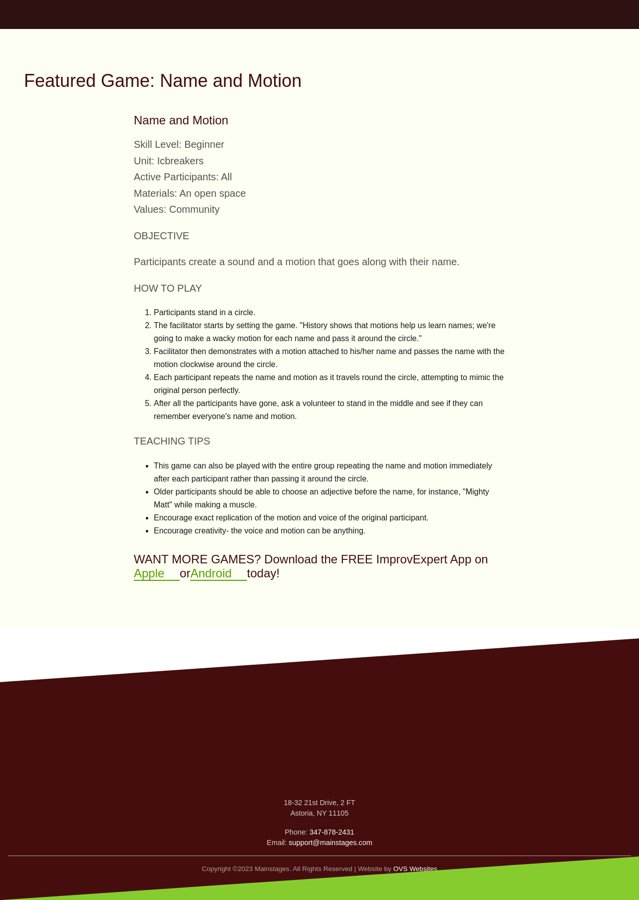<div class="ds-meta">mainstages 游戏说明页（英文，row 1011）：分节标题、编号步骤列表与深色页脚；质量分 score=3，截图尺寸 1280×1802</div><details class="ds-code"><summary>text（HTML）（共 367 行，展示前 60 行）</summary><pre>&lt;!DOCTYPE html&gt;&#10;&#10;&lt;!DOCTYPE html&gt;&#10;&#10;&lt;html&gt;&lt;head&gt;&lt;title&gt;Name and Motion: Icebreaker for Kids &#124; mainstages&lt;/title&gt;&lt;/head&gt;&lt;body&gt;&lt;div id="___gatsby"&gt;&lt;div id="gatsby-focus-wrapper" style="outline:none"&gt;&lt;div class="css-fg6u3d"&gt;&lt;header class="header"&gt;&lt;div id="overlay"&gt;&lt;/div&gt;&lt;div class="header__wrapper"&gt;&lt;a class="header__logo"&gt;&lt;img src="/images/mainstages-logo-horizontal.png" width="250"/&gt;&lt;/a&gt;&lt;nav class="top-nav__header-menu"&gt;&lt;div class="top-nav__main-menu-wrapper"&gt;&lt;div class="top-nav__menus css-1xvm8ud"&gt;&lt;p class="top-nav__mobile-title"&gt;Mainstages&lt;/p&gt;&lt;div class="menu-cross-links"&gt;&lt;span class="menu-cross-links__title css-1dhgl5b"&gt;&lt;a&gt;&lt;svg height="1em" width="1em"&gt;&lt;path&gt;&lt;/path&gt;&lt;/svg&gt; 347-878-2431&lt;/a&gt;&lt;/span&gt;&lt;div class="css-1ugf0iw"&gt;&lt;a class="active"&gt;&lt;span&gt;Virtual Entertainment&lt;/span&gt;&lt;/a&gt;&lt;a class=""&gt;&lt;span&gt;In-person Programs&lt;/span&gt;&lt;/a&gt;&lt;a class=""&gt;&lt;span&gt;In-person Performances&lt;/span&gt;&lt;/a&gt;&lt;/div&gt;&lt;/div&gt;&lt;ul class="top-nav__outer-list" id="menu-main-menu"&gt;&lt;li class="top-nav__item-level-1 menu-item top-nav__has-children"&gt;&lt;a&gt;Virtual Offerings&lt;/a&gt;&lt;span class="top-nav__submenu-button css-la3nd4"&gt;&lt;svg height="1em" width="1em"&gt;&lt;path&gt;&lt;/path&gt;&lt;/svg&gt;&lt;/span&gt;&lt;/li&gt;&lt;li class="top-nav__item-level-1 menu-item top-nav__has-children"&gt;&lt;a&gt;About Us&lt;/a&gt;&lt;span class="top-nav__submenu-button css-la3nd4"&gt;&lt;svg height="1em" width="1em"&gt;&lt;path&gt;&lt;/path&gt;&lt;/svg&gt;&lt;/span&gt;&lt;/li&gt;&lt;li class="top-nav__item-level-1 menu-item top-nav__has-children"&gt;&lt;a&gt;Jobs&lt;/a&gt;&lt;span class="top-nav__submenu-button css-la3nd4"&gt;&lt;svg height="1em" width="1em"&gt;&lt;path&gt;&lt;/path&gt;&lt;/svg&gt;&lt;/span&gt;&lt;/li&gt;&lt;li class="top-nav__item-level-1 menu-item"&gt;&lt;a&gt;The Faces of mainstages&lt;/a&gt;&lt;/li&gt;&lt;li class="top-nav__item-level-1 menu-item"&gt;&lt;a&gt;Blog&lt;/a&gt;&lt;/li&gt;&lt;li class="top-nav__item-level-1 menu-item"&gt;&lt;a&gt;Get a Quote&lt;/a&gt;&lt;/li&gt;&lt;li class="top-nav__item-level-1 menu-item"&gt;&lt;a&gt;Contact Us&lt;/a&gt;&lt;/li&gt;&lt;/ul&gt;&lt;/div&gt;&lt;/div&gt;&lt;div class="top-nav__image-buttons-wrapper"&gt;&lt;a class="image-button"&gt;&lt;span&gt;Virtual Entertainment&lt;/span&gt;&lt;/a&gt;&lt;a class="image-button sectionSwitch_btn--programming"&gt;&lt;span&gt;In-person Programs&lt;/span&gt;&lt;/a&gt;&lt;a class="image-button sectionSwitch_btn--performances"&gt;&lt;span&gt;In-person Performances&lt;/span&gt;&lt;/a&gt;&lt;/div&gt;&lt;/nav&gt;&lt;a class="header__menu-trigger"&gt;&lt;span class="label"&gt;Menu&lt;/span&gt;&lt;div class="header__menu-icon"&gt;&lt;div class="header__menu-icon__middle"&gt;&lt;/div&gt;&lt;/div&gt;&lt;/a&gt;&lt;/div&gt;&lt;/header&gt;&lt;div class="css-1lggbir"&gt;&lt;h1 class="css-pokxtt"&gt;Featured Game: Name and Motion&lt;/h1&gt;&lt;/div&gt;&lt;section class="css-14r1apu"&gt;&lt;div class="css-1v34t8r"&gt;&lt;div&gt;&lt;h3&gt;Name and Motion&lt;/h3&gt;&lt;p&gt;Skill Level: Beginner&lt;br/&gt;Unit: Icbreakers&lt;br/&gt;Active Participants: All&lt;br/&gt;Materials: An open space&lt;br/&gt;Values: Community&lt;/p&gt;&lt;p&gt;OBJECTIVE&lt;/p&gt;&lt;p&gt;Participants create a sound and a motion that goes along with their name.&lt;/p&gt;&lt;p&gt;HOW TO PLAY&lt;/p&gt;&lt;ol&gt;&lt;li&gt;Participants stand in a circle.&lt;/li&gt;&lt;li&gt;The facilitator starts by setting the game. "History shows that motions help us learn names; we're going to make a wacky motion for each name and pass it around the circle."&lt;/li&gt;&lt;li&gt;Facilitator then demonstrates with a motion attached to his/her name and passes the name with the motion clockwise around the circle.&lt;/li&gt;&lt;li&gt;Each participant repeats the name and motion as it travels round the circle, attempting to mimic the original person perfectly.&lt;/li&gt;&lt;li&gt;After all the participants have gone, ask a volunteer to stand in the middle and see if they can remember everyone's name and motion.&lt;/li&gt;&lt;/ol&gt;&lt;p&gt;TEACHING TIPS&lt;/p&gt;&lt;ul&gt;&lt;li&gt;This game can also be played with the entire group repeating the name and motion immediately after each participant rather than passing it around the circle.&lt;/li&gt;&lt;li&gt;Older participants should be able to choose an adjective before the name, for instance, "Mighty Matt" while making a muscle.&lt;/li&gt;&lt;li&gt;Encourage exact replication of the motion and voice of the original participant.&lt;/li&gt;&lt;li&gt;Encourage creativity- the voice and motion can be anything.&lt;/li&gt;&lt;/ul&gt;&lt;h3&gt;WANT MORE GAMES? Download the FREE ImprovExpert App on &lt;a class="externalLink"&gt;Apple  &lt;svg height="1em" width="1em"&gt;&lt;path&gt;&lt;/path&gt;&lt;/svg&gt;&lt;/a&gt;or&lt;a class="externalLink"&gt;Android  &lt;svg height="1em" width="1em"&gt;&lt;path&gt;&lt;/path&gt;&lt;/svg&gt;&lt;/a&gt;today!&lt;/h3&gt;&lt;/div&gt;&lt;/div&gt;&lt;/section&gt;&lt;div class="css-1lggbir"&gt;&lt;/div&gt;&lt;div class="footer__wrapper"&gt;&lt;footer class="footer"&gt;&lt;div class="footer__inner-wrapper"&gt;&lt;div class="footer__social-media"&gt;&lt;a&gt;&lt;svg height="1em" width="1em"&gt;&lt;path&gt;&lt;/path&gt;&lt;/svg&gt;&lt;/a&gt;&lt;a&gt;&lt;svg height="1em" width="1em"&gt;&lt;path&gt;&lt;/path&gt;&lt;/svg&gt;&lt;/a&gt;&lt;a&gt;&lt;svg height="1em" width="1em"&gt;&lt;path&gt;&lt;/path&gt;&lt;/svg&gt;&lt;/a&gt;&lt;/div&gt;&lt;div class="footer__logos"&gt;&lt;a class="footer__logo-link"&gt;&lt;img src="/images/nystea-logo.png"/&gt;&lt;/a&gt;&lt;a class="footer__logo-link"&gt;&lt;img src="/images/roundtable-logo.jpg"/&gt;&lt;/a&gt;&lt;a class="footer__logo-link"&gt;&lt;img src="/images/mainstages-logo-classic.png"/&gt;&lt;/a&gt;&lt;/div&gt;&lt;div class="footer__row"&gt;&lt;div class="footer__column footer__column--1"&gt;&lt;div class="adr"&gt;&lt;div class="street-address"&gt;18-32 21st Drive, 2 FT&lt;/div&gt;&lt;div&gt;&lt;span class="locality"&gt;Astoria&lt;/span&gt;, &lt;span class="region"&gt;NY&lt;/span&gt;&lt;span class="postal-code"&gt; 11105&lt;/span&gt;&lt;/div&gt;&lt;div class="country-name"&gt;USA&lt;/div&gt;&lt;/div&gt;&lt;/div&gt;&lt;div class="footer__column footer__column--2"&gt;&lt;div&gt;Phone: &lt;a class="tel"&gt;347-878-2431&lt;/a&gt;&lt;/div&gt;&lt;div&gt;Email: &lt;a class="email"&gt;support@mainstages.com&lt;/a&gt;&lt;/div&gt;&lt;/div&gt;&lt;/div&gt;&lt;p class="footer__copyright"&gt;Copyright ©2023 Mainstages. All Rights Reserved &#124; Website by &lt;a&gt;OVS Websites&lt;/a&gt;&lt;/p&gt;&lt;/div&gt;&lt;/footer&gt;&lt;/div&gt;&lt;/div&gt;&lt;/div&gt;&lt;div id="gatsby-announcer" style="position:absolute;top:0;width:1px;height:1px;padding:0;overflow:hidden;clip:rect(0, 0, 0, 0);white-space:nowrap;border:0"&gt;&lt;/div&gt;&lt;/div&gt;&lt;style&gt;.top-nav__header-menu {&#10;    position: absolute;&#10;    display: flex;&#10;    flex-direction: row-reverse;&#10;    flex-wrap: nowrap;&#10;    justify-content: flex-start;&#10;    right: 0;&#10;    top: 0;&#10;    background-color: #301111;&#10;    transform: scalex(0);&#10;    max-width: 840px;&#10;    z-index: 1;&#10;    overflow: auto;&#10;    opacity: 0;&#10;    pointer-events: none;&#10;    transition: all 0.2s;&#10;    transform-origin: 100% 50%;&#10;    width: 100%;&#10;    min-height: 100vh;&#10;    box-shadow: -5px 0 3px rgba(0, 0, 0, 0.4)&#10;    }&#10;.top-nav__main-menu-wrapper {&#10;    position: relative;&#10;    width: 100%;&#10;    padding-top: 70px;&#10;    overflow: auto&#10;    }&#10;.top-nav__main-menu-wrapper .top-nav__menus {&#10;    overflow: auto&#10;    }&#10;.top-nav__main-menu-wrapper .top-nav__outer-list {&#10;    padding: 0;&#10;    margin: 0;&#10;    list-style: none&#10;    }&#10;.top-nav__main-menu-wrapper .top-nav__outer-list a {&#10;    color: #fff;&#10;    text-decoration: none;&#10;    font-size: 1.2rem&#10;    }&#10;.top-nav__mobile-title {&#10;    color: #fff;&#10;    margin: 0.7rem 1rem 1.3rem;&#10;    font-size: 2em;&#10;    position: absolute;&#10;    top: 0;&#10;    left: 0&#10;    }&#10;.top-nav__outer-list {&#10;    list-style: none;&#10;    margin: 0;&#10;    padding: 0&#10;    }&#10;.top-nav__item-level-1, .top-nav__item-level-2 {&#10;    position: relative;&#10;    border-bottom: 1px solid hsla(0, 0%, 100%, 0.2)&#10;…（截断，原文共 367 行）</pre></details><details class="ds-code"><summary>bbox（布局树 JSON）（共 824 行，展示前 60 行）</summary><pre>{&#10; "type": "body",&#10; "content": "",&#10; "style": "color: var(--theme-ui-colors-text, #181818); background-color: var(--theme-ui-colors-background, #fcfff2); box-sizing: border-box; margin: 0; font-family: \"Europa\", sans-serif; line-height: 1.625; font-weight: 400; box-sizing: border-box; margin: 0; overflow: auto",&#10; "bbox": [&#10;  0,&#10;  0,&#10;  1280,&#10;  1802&#10; ],&#10; "children": [&#10;  {&#10;   "type": "div",&#10;   "content": "",&#10;   "style": "box-sizing: border-box; box-sizing: border-box",&#10;   "bbox": [&#10;    0,&#10;    0,&#10;    1280,&#10;    1802&#10;   ],&#10;   "children": [&#10;    {&#10;     "type": "div",&#10;     "content": "",&#10;     "style": "outline:none; box-sizing: border-box; box-sizing: border-box",&#10;     "bbox": [&#10;      0,&#10;      0,&#10;      1280,&#10;      1802&#10;     ],&#10;     "children": [&#10;      {&#10;       "type": "div",&#10;       "content": "",&#10;       "style": "box-sizing: border-box; padding-top: 80px; overflow: hidden; box-sizing: border-box",&#10;       "bbox": [&#10;        0,&#10;        0,&#10;        1280,&#10;        1802&#10;       ],&#10;       "children": [&#10;        {&#10;         "type": "header",&#10;         "content": "",&#10;         "style": "background-size: 100px; position: fixed; top: 0; left: 0; right: 0; width: 100%; z-index: 990; box-sizing: border-box; box-sizing: border-box",&#10;         "bbox": [&#10;          0,&#10;          0,&#10;          1280,&#10;          90&#10;         ],&#10;         "children": [&#10;          {&#10;           "type": "div",&#10;           "content": "",&#10;           "style": "background: linear-gradient(180deg, #301111 65%, hsla(0, 0%, 100%, 0) 0); min-height: 100px; padding: 1rem 1rem 2rem; display: flex; justify-content: space-between; min-height: 90px; box-sizing: border-box; box-sizing: border-box",&#10;           "bbox": [&#10;…（截断，原文共 824 行）</pre></details></div></div></div>

- **自动化合成流程**（对照上图，从左往右读）
  1. **Common Crawl**：从 CC-MAIN-2023-50 第一段（约 33.5 亿网页）里随机抽约 5 亿个网页
  2. **Code Purification**（规则程序）
     - 按长度快筛：HTML 限 [128×5, 2048×5] 字符，CSS 限 [128×5, 4096×5] 字符（图中写的是按 token 算：CSS 和 HTML 都在 [128, 4096]）
     - 删除注释、`<meta>` / `<script>`、隐藏元素（hidden、零尺寸、出界），属性只保留 class / id / width / height / style / src
     - 删掉不生效的 CSS；外链 CSS 和行内 CSS 全部合并进一个 `<style>`
  3. **HTML Rendering**：用 Playwright 无头浏览器渲染截图，占总处理时间约 80%，整个流程跑了约一个月
  4. **Filtering with Neural Scorer**
     - 6 名有 3 年以上前端经验的标注员分 2 组做共识标注，按 5 条标准各给 1 分：布局正常、样式正常、没有大片空白、配色丰富、整体美观。约两周标完 1 万条
     - 用这些标注训 ResNet-50 打分器，删掉得分 < 2 的样本
  5. **Layout Tree Extraction**：从渲染后的 DOM 抽出每个元素的类型、样式、框和内容，组成布局树；图中标出的坏节点是 invisible、`size<16*16`、empty，会被删掉
  6. **WebCode2M Dataset**：每条是（代码，设计图，布局）三元组
  - （图外）**合规过滤**：截图过一遍 NSFW 图像分类器，文本过一遍脏词表，两者都通过才保留
  - （图外）**去重与划分**：先用截图哈希去重；再挑约 2K 条得分 > 4 的作为测试候选，用 CLIP 相似度再去一次重并人工检查；按 2048 / 4096 两个长度阈值切成 Short / Mid / Long，每档 256 条
- **质量控制**
  - 人工标注的子集里 80% 得分只有 0–1，说明原始网页大多是低质
  - 打分器 5 分类准确率 75%，「是否 ≥ 2」的二分类约 90%
  - 按分数删掉的样本占原始数据的 52.5%
- **关键数字**
  - 规模：训练集 2,563,905 条；测试集 3×256 条
  - 复杂度（训练集）：平均 5,366 token、184 个标签、DOM 深度 15；WebSight 只有 647 token、19 个标签、深度 5
  - 下游：Pix2Struct-1.3B 全量微调得到 WebCoder。在 Short 集上 Visual 0.78、TreeBLEU 0.35；Design2Code-18B 是 0.75 / 0.04；同一个基座改训 WebSight，只有 0.42 / 0.06
  - 训练资源：4 张 A800 80GB
- **局限**
  - 净化后代码仍然很长，训练和推理成本都高（论文自述）
  - 打分器准确率约 90%，仍有低质样本混入；而且标准偏主观
  - 所有模型都复现不了图片元素
  - 正文引言写的平均长度是 31,216 token、158 个标签、深度 13，其实是表 2 里 Design2Code 那一列；WebCode2M 训练集的实际值是 5,366 token、184 个标签、深度 15，原文前后不一致
- **可借鉴**
  - 真实网页的净化规则可以直接照搬：删隐藏元素、白名单属性、合并 CSS、按长度卡阈值
  - 「少量人工多维打分 → 训小 CNN 打分器 → 按阈值批量过滤」的审美门控，成本低、能扩到百万级
  - 渲染后顺手从 DOM 导出布局树，给数据额外加一个结构监督信号

</details>

以下工作的采用度较低（下载量或 star 数为几十到几百），但带有可验证奖励或多轮修复轨迹。

<a class="anchor" id="web-2-2-7"></a>

<details class="deep"><summary><span class="deep-title"> 2.2.7 VinciCoder（2025-11） <span class="org">Meituan · CASIA</span> <a class="hf" href="https://huggingface.co/datasets/DocTron-Hub/VinciCoder-1.6M-SFT"><span class="hf-b hf-dl" title="downloads"><svg class="hf-i" viewBox="0 0 24 24" fill="none" stroke="currentColor" stroke-width="2.2" stroke-linecap="round" stroke-linejoin="round"><path d="M12 3v11"/><path d="M8 11l4 4 4-4"/><path d="M4 20h16"/></svg>829</span><span class="hf-b hf-lk" title="likes"><svg class="hf-i" viewBox="0 0 24 24" fill="currentColor"><path d="M12 21C7 17.5 3 14 3 9.5 3 7 5 5 7.5 5 9.2 5 10.7 6 12 7.6 13.3 6 14.8 5 16.5 5 19 5 21 7 21 9.5 21 14 17 17.5 12 21z"/></svg>2</span></a></span></summary>

- **定位**：跨图表、Web、SVG、TikZ、化学五个域的统一「图 → 代码」语料，并提供一个与实现方式无关的视觉 RL 奖励。
<figure class="paper-fig">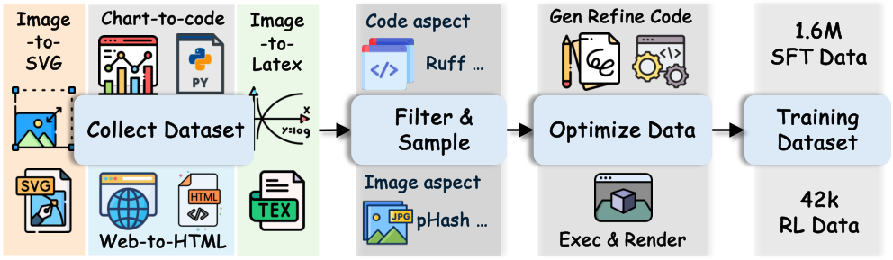<figcaption>VinciCoder · Fig. 2：数据构建管线</figcaption></figure>

<div class="ds-demo"><div class="ds-head"><b>数据样例</b> · <a href="https://huggingface.co/datasets/DocTron-Hub/VinciCoder-1.6M-SFT">DocTron-Hub/VinciCoder-1.6M-SFT</a> · train 约 160 万条图像到代码 SFT 样本，按 15 个 parquet 分域（图表、网页、SVG、LaTeX、电路 / 分子 / 表格等），其中 3 个 _refine 文件是「看图修代码」样本 · 展示字段：image、user_content、assistant_content</div><div class="ds-grid"><div class="ds-card">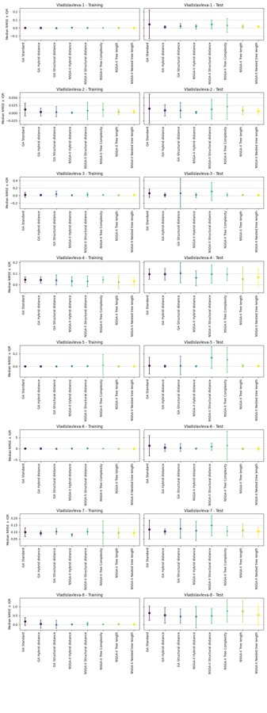<div class="ds-meta">看图修代码（chart2code_refine 第 0 行）：给出目标图表与一段有问题的 matplotlib 代码，要求修正后重现 8 组 Vladislavleva 问题的训练 / 测试误差图</div><details class="ds-code"><summary>user_content（指令）（共 223 行，展示前 60 行）</summary><pre>&lt;image&gt;&#10;You are a professional matplotlib code writer and now want you to rebuild the code based on the result charts.&#10;Please fix and optimize the following code to correctly plot the chart.&#10;```python&#10;import matplotlib.pyplot as plt&#10;import numpy as np&#10;&#10;# Data extracted from the table&#10;data = {&#10;    'Vladislavleva-1': {&#10;        'Training': {&#10;            'GA Standard': {'Median': 0.00, 'IQR': 0.00},&#10;            'GA Hybrid distance': {'Median': -0.01, 'IQR': 0.00},&#10;            'GA Structural distance': {'Median': -0.01, 'IQR': 0.00},&#10;            'NSGA-II Hybrid distance': {'Median': -0.01, 'IQR': 0.00},&#10;            'NSGA-II Structural distance': {'Median': -0.01, 'IQR': 0.00},&#10;            'NSGA-II Tree Complexity': {'Median': -0.01, 'IQR': 0.00},&#10;            'NSGA-II Tree length': {'Median': -0.01, 'IQR': 0.00},&#10;            'NSGA-II Nested tree length': {'Median': -0.01, 'IQR': 0.00},&#10;        },&#10;        'Test': {&#10;            'GA Standard': {'Median': 0.04, 'IQR': 0.23},&#10;            'GA Hybrid distance': {'Median': 0.01, 'IQR': 0.01},&#10;            'GA Structural distance': {'Median': 0.02, 'IQR': 0.03},&#10;            'NSGA-II Hybrid distance': {'Median': 0.01, 'IQR': 0.01},&#10;            'NSGA-II Structural distance': {'Median': 0.05, 'IQR': 0.06},&#10;            'NSGA-II Tree Complexity': {'Median': 0.02, 'IQR': 0.07},&#10;            'NSGA-II Tree length': {'Median': 0.01, 'IQR': 0.01},&#10;            'NSGA-II Nested tree length': {'Median': 0.01, 'IQR': 0.01},&#10;        }&#10;    },&#10;    'Vladislavleva-2': {&#10;        'Training': {&#10;            'GA Standard': {'Median': 0.01, 'IQR': 0.02},&#10;            'GA Hybrid distance': {'Median': 0.01, 'IQR': 0.01},&#10;            'GA Structural distance': {'Median': 0.01, 'IQR': 0.02},&#10;            'NSGA-II Hybrid distance': {'Median': 0.00, 'IQR': 0.00},&#10;            'NSGA-II Structural distance': {'Median': 0.01, 'IQR': 0.02},&#10;            'NSGA-II Tree Complexity': {'Median': 0.01, 'IQR': 0.02},&#10;            'NSGA-II Tree length': {'Median': 0.01, 'IQR': 0.01},&#10;            'NSGA-II Nested tree length': {'Median': 0.01, 'IQR': 0.01},&#10;        },&#10;        'Test': {&#10;            'GA Standard': {'Median': 0.01, 'IQR': 0.05},&#10;            'GA Hybrid distance': {'Median': 0.01, 'IQR': 0.02},&#10;            'GA Structural distance': {'Median': 0.01, 'IQR': 0.03},&#10;            'NSGA-II Hybrid distance': {'Median': 0.00, 'IQR': 0.00},&#10;            'NSGA-II Structural distance': {'Median': 0.01, 'IQR': 0.03},&#10;            'NSGA-II Tree Complexity': {'Median': 0.02, 'IQR': 0.04},&#10;            'NSGA-II Tree length': {'Median': 0.01, 'IQR': 0.01},&#10;            'NSGA-II Nested tree length': {'Median': 0.01, 'IQR': 0.01},&#10;        }&#10;    },&#10;    'Vladislavleva-3': {&#10;        'Training': {&#10;            'GA Standard': {'Median': 0.01, 'IQR': 0.01},&#10;            'GA Hybrid distance': {'Median': 0.00, 'IQR': 0.00},&#10;            'GA Structural distance': {'Median': 0.01, 'IQR': 0.01},&#10;            'NSGA-II Hybrid distance': {'Median': 0.00, 'IQR': 0.00},&#10;            'NSGA-II Structural distance': {'Median': 0.01, 'IQR': 0.01},&#10;…（截断，原文共 223 行）</pre></details><details class="ds-code"><summary>assistant_content（目标代码）（共 137 行，展示前 60 行）</summary><pre>```python&#10;import matplotlib.pyplot as plt&#10;import numpy as np&#10;import pandas as pd&#10;&#10;# Data extracted from the LaTeX table&#10;data = {&#10;    'Problem': [&#10;        'Vladislavleva-1', 'Vladislavleva-1', 'Vladislavleva-1', 'Vladislavleva-1',&#10;        'Vladislavleva-1', 'Vladislavleva-1', 'Vladislavleva-1', 'Vladislavleva-1',&#10;        'Vladislavleva-2', 'Vladislavleva-2', 'Vladislavleva-2', 'Vladislavleva-2',&#10;        'Vladislavleva-2', 'Vladislavleva-2', 'Vladislavleva-2', 'Vladislavleva-2',&#10;        'Vladislavleva-3', 'Vladislavleva-3', 'Vladislavleva-3', 'Vladislavleva-3',&#10;        'Vladislavleva-3', 'Vladislavleva-3', 'Vladislavleva-3', 'Vladislavleva-3',&#10;        'Vladislavleva-4', 'Vladislavleva-4', 'Vladislavleva-4', 'Vladislavleva-4',&#10;        'Vladislavleva-4', 'Vladislavleva-4', 'Vladislavleva-4', 'Vladislavleva-4',&#10;        'Vladislavleva-5', 'Vladislavleva-5', 'Vladislavleva-5', 'Vladislavleva-5',&#10;        'Vladislavleva-5', 'Vladislavleva-5', 'Vladislavleva-5', 'Vladislavleva-5',&#10;        'Vladislavleva-6', 'Vladislavleva-6', 'Vladislavleva-6', 'Vladislavleva-6',&#10;        'Vladislavleva-6', 'Vladislavleva-6', 'Vladislavleva-6', 'Vladislavleva-6',&#10;        'Vladislavleva-7', 'Vladislavleva-7', 'Vladislavleva-7', 'Vladislavleva-7',&#10;        'Vladislavleva-7', 'Vladislavleva-7', 'Vladislavleva-7', 'Vladislavleva-7',&#10;        'Vladislavleva-8', 'Vladislavleva-8', 'Vladislavleva-8', 'Vladislavleva-8',&#10;        'Vladislavleva-8', 'Vladislavleva-8', 'Vladislavleva-8', 'Vladislavleva-8',&#10;    ],&#10;    'Method': [&#10;        'GA Standard', 'GA Hybrid distance', 'GA Structural distance', 'NSGA-II Hybrid distance',&#10;        'NSGA-II Structural distance', 'NSGA-II Tree Complexity', 'NSGA-II Tree length', 'NSGA-II Nested tree length',&#10;        'GA Standard', 'GA Hybrid distance', 'GA Structural distance', 'NSGA-II Hybrid distance',&#10;        'NSGA-II Structural distance', 'NSGA-II Tree Complexity', 'NSGA-II Tree length', 'NSGA-II Nested tree length',&#10;        'GA Standard', 'GA Hybrid distance', 'GA Structural distance', 'NSGA-II Hybrid distance',&#10;        'NSGA-II Structural distance', 'NSGA-II Tree Complexity', 'NSGA-II Tree length', 'NSGA-II Nested tree length',&#10;        'GA Standard', 'GA Hybrid distance', 'GA Structural distance', 'NSGA-II Hybrid distance',&#10;        'NSGA-II Structural distance', 'NSGA-II Tree Complexity', 'NSGA-II Tree length', 'NSGA-II Nested tree length',&#10;        'GA Standard', 'GA Hybrid distance', 'GA Structural distance', 'NSGA-II Hybrid distance',&#10;        'NSGA-II Structural distance', 'NSGA-II Tree Complexity', 'NSGA-II Tree length', 'NSGA-II Nested tree length',&#10;        'GA Standard', 'GA Hybrid distance', 'GA Structural distance', 'NSGA-II Hybrid distance',&#10;        'NSGA-II Structural distance', 'NSGA-II Tree Complexity', 'NSGA-II Tree length', 'NSGA-II Nested tree length',&#10;        'GA Standard', 'GA Hybrid distance', 'GA Structural distance', 'NSGA-II Hybrid distance',&#10;        'NSGA-II Structural distance', 'NSGA-II Tree Complexity', 'NSGA-II Tree length', 'NSGA-II Nested tree length',&#10;        'GA Standard', 'GA Hybrid distance', 'GA Structural distance', 'NSGA-II Hybrid distance',&#10;        'NSGA-II Structural distance', 'NSGA-II Tree Complexity', 'NSGA-II Tree length', 'NSGA-II Nested tree length',&#10;    ],&#10;    'Training_Median': [&#10;        0.001, 0.001, 0.002, 0.000, 0.002, 0.002, 0.001, 0.001,&#10;        0.012, 0.004, 0.005, 0.001, 0.008, 0.011, 0.004, 0.004,&#10;        0.022, 0.017, 0.049, 0.004, 0.027, 0.018, 0.012, 0.013,&#10;        0.045, 0.043, 0.043, 0.030, 0.032, 0.046, 0.024, 0.030,&#10;        0.001, 0.001, 0.003, 0.000, 0.003, 0.022, 0.002, 0.002,&#10;        0.112, 0.057, 0.068, 0.000, 0.124, 0.036, 0.000, 0.000,&#10;        0.099, 0.092, 0.105, 0.079, 0.103, 0.097, 0.094, 0.093,&#10;        0.181, 0.033, 0.020, 0.007, 0.039, 0.013, 0.030, 0.011,&#10;    ],&#10;    'Training_IQR': [&#10;        0.002, 0.001, 0.002, 0.000, 0.003, 0.002, 0.002, 0.002,&#10;        0.021, 0.013, 0.017, 0.002, 0.028, 0.022, 0.009, 0.007,&#10;        0.063, 0.025, 0.075, 0.011, 0.057, 0.021, 0.015, 0.012,&#10;        0.026, 0.030, 0.046, 0.042, 0.048, 0.028, 0.060, 0.036,&#10;        0.003, 0.002, 0.004, 0.001, 0.007, 0.170, 0.010, 0.004,&#10;        0.220, 0.140, 0.160, 0.000, 0.167, 0.068, 0.039, 0.088,&#10;…（截断，原文共 137 行）</pre></details></div><div class="ds-card">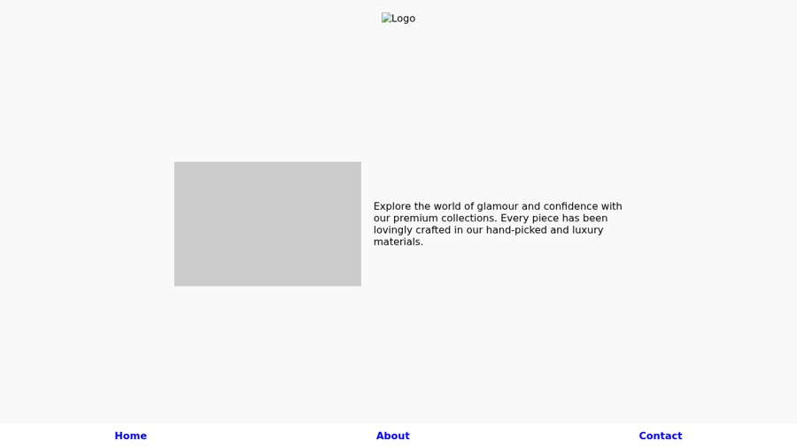<div class="ds-meta">Web（web2html_1 第 0 行）：按网页截图写 HTML/CSS，要求遵循 Material Design，图片用 rick.jpg 占位</div><details class="ds-code"><summary>user_content（指令）（共 3 行，全文）</summary><pre>&lt;image&gt;&#10;Generate HTML corresponding to the webpage in the given image. Show the code developed according to material design principles.&#10;If it involves any images, use "rick.jpg" as the placeholder.</pre></details><details class="ds-code"><summary>assistant_content（目标代码）（共 81 行，展示前 60 行）</summary><pre>```html&#10;&lt;!DOCTYPE html&gt;&#10;&lt;html lang="en"&gt;&#10;&lt;head&gt;&#10;    &lt;meta charset="UTF-8"&gt;&#10;    &lt;meta name="viewport" content="width=device-width, initial-scale=1.0"&gt;&#10;    &lt;title&gt;Styled Page&lt;/title&gt;&#10;    &lt;style&gt;&#10;        body {&#10;            margin: 0;&#10;            padding: 0;&#10;            font-family: Arial, sans-serif;&#10;            display: flex;&#10;            flex-direction: column;&#10;            align-items: center;&#10;            justify-content: space-between;&#10;            height: 100vh;&#10;            background-color: #f9f9f9;&#10;        }&#10;&#10;        header {&#10;            margin-top: 20px;&#10;        }&#10;&#10;        header img {&#10;            width: 100px;&#10;        }&#10;&#10;        main {&#10;            display: flex;&#10;            align-items: center;&#10;            justify-content: center;&#10;            text-align: left;&#10;            max-width: 800px;&#10;            padding: 20px;&#10;        }&#10;&#10;        .image-placeholder {&#10;            width: 300px;&#10;            height: 200px;&#10;            background-color: #ccc;&#10;            margin-right: 20px;&#10;        }&#10;&#10;        .description {&#10;            max-width: 400px;&#10;        }&#10;&#10;        footer {&#10;            display: flex;&#10;            justify-content: space-around;&#10;            width: 100%;&#10;            padding: 10px 0;&#10;            background-color: #fff;&#10;        }&#10;&#10;        footer a {&#10;            text-decoration: none;&#10;            color: blue;&#10;            font-weight: bold;&#10;…（截断，原文共 81 行）</pre></details></div><div class="ds-card"><div class="ds-meta">SVG（img2svg_1 第 3 行）：按图标图片写 SVG 代码，目标为线框笔记本电脑图标</div><details class="ds-code"><summary>user_content（指令）（共 2 行，全文）</summary><pre>&lt;image&gt;&#10;Generate the SVG code for the icon depicted in this image.</pre></details><details class="ds-code"><summary>assistant_content（目标代码）（共 3 行，全文）</summary><pre>```svg&#10;&lt;svg xmlns="http://www.w3.org/2000/svg" fill="none" viewBox="0 0 24 24"&gt;&lt;path fill="#000" d="M19.23 16.2H4.77a.75.75 0 0 1-.77-.75V5.89a1.76 1.76 0 0 1 1.78-1.75h12.44A1.76 1.76 0 0 1 20 5.89v9.56a.75.75 0 0 1-.77.75M5.52 14.7h13V5.89a.26.26 0 0 0-.26-.25H5.78a.26.26 0 0 0-.26.25z"/&gt;&lt;path fill="#000" d="M20.75 19.86H3.25a.76.76 0 0 1-.75-.75v-3.66a.76.76 0 0 1 .75-.75h17.5a.76.76 0 0 1 .75.75v3.66a.76.76 0 0 1-.75.75M4 18.36h16V16.2H4zM12 13.23a3.06 3.06 0 1 1 0-6.119 3.06 3.06 0 0 1 0 6.119m0-4.62a1.56 1.56 0 1 0 0 3.12 1.56 1.56 0 0 0 0-3.12"/&gt;&lt;/svg&gt;&#10;```</pre></details></div><div class="ds-card"><div class="ds-meta">TikZ（img2latex_1 第 1 行）：把论文中的量子线路图（4 个 Ry 旋转门加 CNOT 链）转成 TikZ / quantikz 代码</div><details class="ds-code"><summary>user_content（指令）（共 2 行，全文）</summary><pre>&lt;image&gt;&#10;Transform this academic diagram into TikZ code.</pre></details><details class="ds-code"><summary>assistant_content（目标代码）（共 26 行，全文）</summary><pre>```latex&#10;\documentclass[tikz]{standalone}&#10;\usepackage{amsmath,amssymb,amsfonts}%&#10;\usepackage{xcolor}%&#10;\usepackage{color}&#10;\usepackage{tikz} % the colored symbol&#10;\usepackage{quantikz}&#10;&#10;\begin{document}&#10;&#10;\begin{tikzpicture}&#10;\node[scale=0.7] {&#10;\begin{quantikz}&#10;\qw &amp; \gate{R_y(\theta_1)} \gategroup[4,steps=5,style={dashed,rounded&#10;corners,fill=blue!0, inner&#10;xsep=2pt},background,label style={label&#10;position=below right,anchor=north,xshift=0.7cm,yshift=-0.0cm}]{{&#36;\times&#36; D}} &amp; \ctrl{1} &amp; \qw &amp; \qw &amp; \targ{} &amp; \qw  \\&#10;\qw &amp; \gate{R_y(\theta_2)} &amp; \targ{} &amp; \ctrl{1} &amp; \qw &amp; \qw &amp; \qw  \\&#10;\qw &amp; \gate{R_y(\theta_3)} &amp; \qw &amp; \targ{} &amp; \ctrl{1} &amp; \qw &amp; \qw  \\&#10;\qw &amp; \gate{R_y(\theta_4)} &amp; \qw &amp; \qw &amp; \targ{} &amp; \ctrl{-3} &amp; \qw&#10;\end{quantikz}&#10;};&#10;\end{tikzpicture}&#10;&#10;\end{document}&#10;```</pre></details></div></div></div>

- **管线步骤**（对照上图，从左往右读）
  1. **Collect Dataset**：汇总 Image-to-SVG、Chart-to-code、Image-to-LaTeX、Web-to-HTML 四类开源数据，加上科研图，共 1.3M 条直接生成对（图表 412K、Web 355K、SVG 463K、TikZ 108K、科研图 238K）
  2. **Filter & Sample**：代码侧用 Ruff 等做静态检查，图像侧用 pHash 去重，再做多样性采样
  3. **Optimize Data**
     - Gen Refine Code：让初版 VLM 在不重叠的样本上产出第一版代码，与目标图、真值代码组成 300K 条「看图修代码」样本
     - Exec & Render：执行并渲染，校验代码能出图
  4. **Training Dataset**：1.6M SFT 数据 + 42K 条难例 RL 数据
  5. **ViRL 奖励**（论文 Fig. 3，图外）：渲染结果与目标图分别算全局缩略图和 448×448 patch 的 DINOv2 相似度取平均（渲染失败给 0），再与语言一致性奖励按 0.9 / 0.1 加权
- **关键数字**
  - 8B 模型：ChartMimic 执行率 91.6%，Design2Code 高层分 88.4%，UniSVG 高层分 94.1%
- **局限**
  - 只能评静态图，覆盖不了交互
  - 视觉奖励教不会模型缺失的领域知识，还可能被投机取巧
  - 长代码、高分辨率场景下渲染和采样成本高
- **可借鉴**
  - 「初版模型的错误输出 + 真值」是廉价的修复数据来源，不用人工造 bug
  - 用 DINOv2 patch 相似度做奖励，不依赖具体代码写法，跨域通用

</details>

<a class="anchor" id="web-2-2-8"></a>

<details class="deep"><summary><span class="deep-title"> 2.2.8 WebGen-Agent（2025-09） <span class="org">CUHK MMLab</span> <a class="hf" href="https://huggingface.co/datasets/luzimu/webgen-agent_train_sft"><span class="hf-b hf-dl" title="downloads"><svg class="hf-i" viewBox="0 0 24 24" fill="none" stroke="currentColor" stroke-width="2.2" stroke-linecap="round" stroke-linejoin="round"><path d="M12 3v11"/><path d="M8 11l4 4 4-4"/><path d="M4 20h16"/></svg>163</span></a></span></summary>

- **定位**：用截图打分和 GUI-agent 测试给网站生成 agent 提供逐步奖励，是目前少见的「多轮修复轨迹 + 过程奖励」开源组合。
<figure class="paper-fig">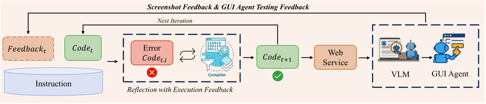<figcaption>WebGen-Agent · Fig. 1：带截图与 GUI-agent 反馈的迭代生成（轨迹采集）</figcaption></figure>

<figure class="paper-fig">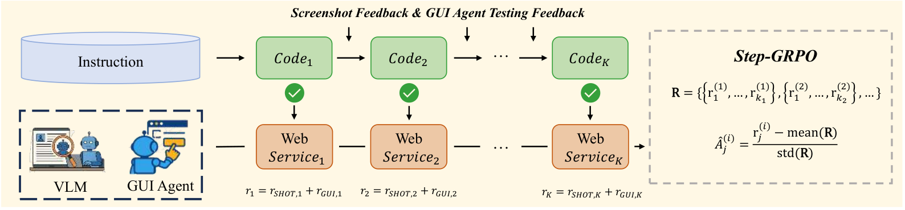<figcaption>WebGen-Agent · Fig. 2：Step-GRPO，每步奖励 = 截图分 + GUI 分</figcaption></figure>

<div class="ds-demo"><div class="ds-head"><b>数据样例</b> · <a href="https://huggingface.co/datasets/luzimu/webgen-agent_train_sft">luzimu/webgen-agent_train_sft</a> · train 共 711 条多轮 agent 轨迹（每条为一个 step 文件，含系统提示、指令、代码动作与执行 / 截图 / GUI 测试反馈），此处展示 row 3 一条完整短轨迹，系统提示（13,732 字符）略去 · 展示字段：messages</div><div class="ds-grid"><div class="ds-card"><div class="ds-meta">第 1 步（轨迹 train_000073，共 5 轮动作）：用户指令要求做一个医生分享脑电病例的小程序；agent 给出计划并用 boltAction 写出整个 Vite + React 项目</div><details class="ds-code"><summary>user：指令（共 1 行，全文）</summary><pre>Please implement a brain electrical activity exchange mini-program for doctors to share brain electrical images and case information. The mini-program should have functionalities for publishing cases, browsing others' published cases, uploading images and videos, and displaying user comments. Doctors should be able to log in, publish their own typical or difficult cases, browse and learn from other doctors' published cases, and view user comments and a leaderboard. Apply theme using silver as background and dark slate blue for elements.</pre></details><details class="ds-code"><summary>assistant：代码动作（共 407 行，展示前 60 行）</summary><pre>I'll create a medical case sharing platform with the requested features and color scheme. Here's the implementation plan:&#10;1. Set up Vite + React frontend&#10;2. Create login/auth system&#10;3. Implement case publishing/browsing&#10;4. Add image/video upload&#10;5. Create comment system and leaderboard&#10;&#10;&lt;boltArtifact id="brain-activity-exchange" title="Brain Electrical Activity Exchange Platform"&gt;&#10;  &lt;boltAction type="file" filePath="package.json"&gt;{&#10;  "name": "brain-activity-exchange",&#10;  "private": true,&#10;  "version": "0.0.0",&#10;  "type": "module",&#10;  "scripts": {&#10;    "dev": "vite",&#10;    "build": "vite build",&#10;    "preview": "vite preview"&#10;  },&#10;  "dependencies": {&#10;    "react": "^18.2.0",&#10;    "react-dom": "^18.2.0",&#10;    "react-router-dom": "^6.14.1",&#10;    "axios": "^1.4.0",&#10;    "react-icons": "^4.8.0"&#10;  },&#10;  "devDependencies": {&#10;    "@types/react": "^18.0.28",&#10;    "@types/react-dom": "^18.0.11",&#10;    "@vitejs/plugin-react": "^3.1.0",&#10;    "vite": "^4.2.0"&#10;  }&#10;}&lt;/boltAction&gt;&#10;&#10;  &lt;boltAction type="file" filePath="index.html"&gt;&amp;lt;!DOCTYPE html&amp;gt;&#10;&amp;lt;html lang="en"&amp;gt;&#10;  &amp;lt;head&amp;gt;&#10;    &amp;lt;meta charset="UTF-8" /&amp;gt;&#10;    &amp;lt;meta name="viewport" content="width=device-width, initial-scale=1.0" /&amp;gt;&#10;    &amp;lt;title&amp;gt;Brain Electrical Activity Exchange&amp;lt;/title&amp;gt;&#10;  &amp;lt;/head&amp;gt;&#10;  &amp;lt;body&amp;gt;&#10;    &amp;lt;div id="root"&amp;gt;&amp;lt;/div&amp;gt;&#10;    &amp;lt;script type="module" src="/src/main.jsx"&amp;gt;&amp;lt;/script&amp;gt;&#10;  &amp;lt;/body&amp;gt;&#10;&amp;lt;/html&amp;gt;&lt;/boltAction&gt;&#10;&#10;  &lt;boltAction type="file" filePath="src/main.jsx"&gt;import React from 'react'&#10;import ReactDOM from 'react-dom/client'&#10;import { BrowserRouter } from 'react-router-dom'&#10;import App from './App'&#10;import './index.css'&#10;&#10;ReactDOM.createRoot(document.getElementById('root')).render(&#10;  &amp;lt;React.StrictMode&amp;gt;&#10;    &amp;lt;BrowserRouter&amp;gt;&#10;      &amp;lt;App /&amp;gt;&#10;    &amp;lt;/BrowserRouter&amp;gt;&#10;  &amp;lt;/React.StrictMode&amp;gt;&#10;)&lt;/boltAction&gt;&#10;&#10;…（截断，原文共 407 行）</pre></details></div><div class="ds-card"><div class="ds-meta">第 2 步：环境反馈 vite 启动时找不到 ./pages/CaseDetail 模块；agent 补写缺失的组件文件并重新 npm run dev</div><details class="ds-code"><summary>user：启动报错反馈（共 49 行，全文）</summary><pre>Installation of dependencies was successful.&#10;&#10;**Starting the service emitted errors:**&#10;&#10;&gt; brain-activity-exchange@0.0.0 dev&#10;&gt; vite&#10;&#10;&#10;  VITE v4.5.14  ready in 3122 ms&#10;&#10;  ➜  Local:   http://localhost:36659/&#10;  ➜  Network: use --host to expose&#10;12:11:00 PM [vite] Internal server error: Failed to resolve import "./pages/CaseDetail" from "src/App.jsx". Does the file exist?&#10;  Plugin: vite:import-analysis&#10;  File: /mnt/cache/agent/Zimu/WebGen-Agent/workspaces_root/WebGenAgentV3_WebGen-Instruct_1_new_deepseek-v3-250324_iter20_select_best/train_000073/src/App.jsx:5:23&#10;  18 &#124;  import Home from "./pages/Home";&#10;  19 &#124;  import Cases from "./pages/Cases";&#10;  20 &#124;  import CaseDetail from "./pages/CaseDetail";&#10;     &#124;                          ^&#10;  21 &#124;  import Publish from "./pages/Publish";&#10;  22 &#124;  import Leaderboard from "./pages/Leaderboard";&#10;      at formatError (file:///mnt/cache/agent/Zimu/WebGen-Agent/workspaces_root/WebGenAgentV3_WebGen-Instruct_1_new_deepseek-v3-250324_iter20_select_best/train_000073/node_modules/vite/dist/node/chunks/dep-827b23df.js:44066:46)&#10;      at TransformContext.error (file:///mnt/cache/agent/Zimu/WebGen-Agent/workspaces_root/WebGenAgentV3_WebGen-Instruct_1_new_deepseek-v3-250324_iter20_select_best/train_000073/node_modules/vite/dist/node/chunks/dep-827b23df.js:44062:19)&#10;      at normalizeUrl (file:///mnt/cache/agent/Zimu/WebGen-Agent/workspaces_root/WebGenAgentV3_WebGen-Instruct_1_new_deepseek-v3-250324_iter20_select_best/train_000073/node_modules/vite/dist/node/chunks/dep-827b23df.js:41845:33)&#10;      at process.processTicksAndRejections (node:internal/process/task_queues:105:5)&#10;      at async file:///mnt/cache/agent/Zimu/WebGen-Agent/workspaces_root/WebGenAgentV3_WebGen-Instruct_1_new_deepseek-v3-250324_iter20_select_best/train_000073/node_modules/vite/dist/node/chunks/dep-827b23df.js:41999:47&#10;      at async Promise.all (index 7)&#10;      at async TransformContext.transform (file:///mnt/cache/agent/Zimu/WebGen-Agent/workspaces_root/WebGenAgentV3_WebGen-Instruct_1_new_deepseek-v3-250324_iter20_select_best/train_000073/node_modules/vite/dist/node/chunks/dep-827b23df.js:41915:13)&#10;      at async Object.transform (file:///mnt/cache/agent/Zimu/WebGen-Agent/workspaces_root/WebGenAgentV3_WebGen-Instruct_1_new_deepseek-v3-250324_iter20_select_best/train_000073/node_modules/vite/dist/node/chunks/dep-827b23df.js:44356:30)&#10;      at async loadAndTransform (file:///mnt/cache/agent/Zimu/WebGen-Agent/workspaces_root/WebGenAgentV3_WebGen-Instruct_1_new_deepseek-v3-250324_iter20_select_best/train_000073/node_modules/vite/dist/node/chunks/dep-827b23df.js:55088:29)&#10;Failed to resolve import "./pages/CaseDetail" from "src/App.jsx". Does the file exist?&#10;&#10;**The screenshot contains errors:**&#10;&#10;Failed to resolve import "./pages/CaseDetail" from "/src/App.jsx". Does the file exist?&#10;&#10;The service emitted errors when it was being started.&#10;Modify the code to fix the errors in service starting, screenshot.&#10;&#10;**The instruction describing the website you are currently developing:**&#10;&#10;Please implement a brain electrical activity exchange mini-program for doctors to share brain electrical images and case information. The mini-program should have functionalities for publishing cases, browsing others' published cases, uploading images and videos, and displaying user comments. Doctors should be able to log in, publish their own typical or difficult cases, browse and learn from other doctors' published cases, and view user comments and a leaderboard. Apply theme using silver as background and dark slate blue for elements.&#10;&#10;CRITICAL: Always provide the FULL, updated content of a file when editing. This means, if you need to create or modify a file:&#10;&#10;      - Include ALL code in the file, even if parts are unchanged&#10;      - NEVER use placeholders like "// rest of the code remains the same..." or "&lt;- leave original code here -&gt;"&#10;      - ALWAYS show the complete, up-to-date file content when updating the file&#10;      - Avoid any form of truncation or summarization</pre></details><details class="ds-code"><summary>assistant：修复动作（共 139 行，展示前 60 行）</summary><pre>I'll add the missing CaseDetail component and fix the error. Here's the complete implementation:&#10;&#10;&lt;boltArtifact id="brain-activity-exchange-update" title="Add CaseDetail Component"&gt;&#10;  &lt;boltAction type="file" filePath="src/pages/CaseDetail.jsx"&gt;import { useState } from 'react'&#10;import { useParams } from 'react-router-dom'&#10;import { FaComment, FaThumbsUp, FaShare } from 'react-icons/fa'&#10;&#10;export default function CaseDetail() {&#10;  const { id } = useParams()&#10;  const [comments, setComments] = useState([&#10;    { id: 1, author: 'Dr. Smith', text: 'Interesting case! Have you considered...', date: '2023-05-16' },&#10;    { id: 2, author: 'Dr. Lee', text: 'Similar to a case I saw last month.', date: '2023-05-15' }&#10;  ])&#10;  const [newComment, setNewComment] = useState('')&#10;&#10;  // Mock data - in a real app this would come from an API&#10;  const caseData = {&#10;    id: 1,&#10;    title: 'Unusual EEG pattern in temporal lobe epilepsy',&#10;    author: 'Dr. Smith',&#10;    date: '2023-05-15',&#10;    description: 'Case presents with atypical EEG patterns in a confirmed temporal lobe epilepsy patient.',&#10;    images: ['eeg1.jpg', 'eeg2.jpg'],&#10;    video: 'eeg-video.mp4'&#10;  }&#10;&#10;  const handleAddComment = (e) =&gt; {&#10;    e.preventDefault()&#10;    if (newComment.trim()) {&#10;      setComments([...comments, {&#10;        id: comments.length + 1,&#10;        author: 'You',&#10;        text: newComment,&#10;        date: new Date().toISOString().split('T')[0]&#10;      }])&#10;      setNewComment('')&#10;    }&#10;  }&#10;&#10;  return (&#10;    &lt;div style={{ padding: '20px', maxWidth: '800px', margin: '0 auto' }}&gt;&#10;      &lt;div style={{ &#10;        backgroundColor: 'white', &#10;        padding: '20px', &#10;        borderRadius: '8px',&#10;        boxShadow: '0 2px 4px rgba(0,0,0,0.1)',&#10;        marginBottom: '20px'&#10;      }}&gt;&#10;        &lt;h2&gt;{caseData.title}&lt;/h2&gt;&#10;        &lt;p&gt;&lt;strong&gt;Author:&lt;/strong&gt; {caseData.author}&lt;/p&gt;&#10;        &lt;p&gt;&lt;strong&gt;Date:&lt;/strong&gt; {caseData.date}&lt;/p&gt;&#10;        &lt;p style={{ margin: '16px 0' }}&gt;{caseData.description}&lt;/p&gt;&#10;&#10;        &lt;div style={{ margin: '20px 0' }}&gt;&#10;          &lt;h4&gt;EEG Images&lt;/h4&gt;&#10;          &lt;div style={{ display: 'flex', gap: '10px', marginTop: '10px' }}&gt;&#10;            {caseData.images.map((img, i) =&gt; (&#10;              &lt;div key={i} style={{&#10;                width: '150px',&#10;                height: '100px',&#10;…（截断，原文共 139 行）</pre></details></div><div class="ds-card"><div class="ds-meta">第 3–5 步：截图描述与改进建议作为反馈（数据中截图以 VLM 文字描述给出）；agent 按建议给卡片加图标，第二次截图后输出 screenshot_validated，GUI agent 测试通过后输出 finish</div><details class="ds-code"><summary>user：截图描述反馈（共 24 行，全文）</summary><pre>Installation of dependencies was successful.&#10;&#10;Starting the service was successful.&#10;&#10;**The screenshot description:**&#10;&#10;The screenshot shows a clean and organized homepage for 'Brain Activity Exchange'. The overall layout includes a header with the site name and navigation options ('Publish', 'Leaderboard', and 'Login') on the right. Below the header, there is a welcoming message: 'Welcome to Brain Electrical Activity Exchange' followed by a subtitle: 'Share and learn from brain electrical activity cases with fellow doctors.' The main section features three evenly spaced rectangular cards with rounded corners, each containing a heading and a brief description. The cards are labeled 'Recent Cases', 'Upload Your Case', and 'Top Contributors', respectively. The color scheme is primarily gray and white, giving it a professional and minimalistic look. The text is clear and legible, using a sans-serif font. There are no icons or additional graphics within the cards, focusing solely on textual information.&#10;&#10;**Suggestions for Improvement:**&#10;&#10;1. Consider adding icons next to the card headings to visually enhance the sections and make them more engaging. 2. Introduce subtle gradients or shadows to the cards to add depth and visual interest without overwhelming the design. 3. Ensure consistent spacing between elements to maintain a balanced and polished appearance.&#10;&#10;Observe the above feedback and decide whether further modifications to the code are needed based on the screenshot observations. If no further modification is necessary, output &lt;boltAction type="screenshot_validated"/&gt; to signal that the screenshot is satisfactory. Otherwise, continue modifying the code until the requirements are fulfilled. IMPORTANT: If you decide to make modifications, do not output the finish signal.&#10;&#10;**The instruction describing the website you are currently developing:**&#10;&#10;Please implement a brain electrical activity exchange mini-program for doctors to share brain electrical images and case information. The mini-program should have functionalities for publishing cases, browsing others' published cases, uploading images and videos, and displaying user comments. Doctors should be able to log in, publish their own typical or difficult cases, browse and learn from other doctors' published cases, and view user comments and a leaderboard. Apply theme using silver as background and dark slate blue for elements.&#10;&#10;CRITICAL: Always provide the FULL, updated content of a file when editing. This means, if you need to create or modify a file:&#10;&#10;      - Include ALL code in the file, even if parts are unchanged&#10;      - NEVER use placeholders like "// rest of the code remains the same..." or "&lt;- leave original code here -&gt;"&#10;      - ALWAYS show the complete, up-to-date file content when updating the file&#10;      - Avoid any form of truncation or summarization</pre></details><details class="ds-code"><summary>assistant：按反馈修改（共 98 行，展示前 60 行）</summary><pre>I'll enhance the Home page with icons and improved styling based on the feedback. Here's the updated version:&#10;&#10;&lt;boltArtifact id="brain-activity-exchange-homepage" title="Enhanced Home Page with Icons"&gt;&#10;  &lt;boltAction type="file" filePath="src/pages/Home.jsx"&gt;import { FaBookMedical, FaUpload, FaTrophy } from 'react-icons/fa'&#10;&#10;export default function Home() {&#10;  return (&#10;    &lt;div style={{ padding: '20px' }}&gt;&#10;      &lt;h2 style={{ color: 'dark slate blue' }}&gt;Welcome to Brain Electrical Activity Exchange&lt;/h2&gt;&#10;      &lt;p style={{ fontSize: '1.1rem', marginBottom: '30px' }}&gt;Share and learn from brain electrical activity cases with fellow doctors.&lt;/p&gt;&#10;      &lt;div style={{ &#10;        display: 'grid', &#10;        gridTemplateColumns: 'repeat(auto-fill, minmax(300px, 1fr))', &#10;        gap: '20px', &#10;        marginTop: '20px' &#10;      }}&gt;&#10;        &lt;div style={{ &#10;          backgroundColor: 'white', &#10;          padding: '24px', &#10;          borderRadius: '12px', &#10;          boxShadow: '0 4px 8px rgba(0,0,0,0.1)',&#10;          transition: 'transform 0.2s',&#10;          ':hover': {&#10;            transform: 'translateY(-4px)'&#10;          }&#10;        }}&gt;&#10;          &lt;div style={{ &#10;            backgroundColor: 'rgba(72, 61, 139, 0.1)', &#10;            width: '60px', &#10;            height: '60px', &#10;            borderRadius: '50%',&#10;            display: 'flex',&#10;            alignItems: 'center',&#10;            justifyContent: 'center',&#10;            marginBottom: '16px'&#10;          }}&gt;&#10;            &lt;FaBookMedical size={24} color="dark slate blue" /&gt;&#10;          &lt;/div&gt;&#10;          &lt;h3 style={{ margin: '0 0 12px 0', color: 'dark slate blue' }}&gt;Recent Cases&lt;/h3&gt;&#10;          &lt;p style={{ margin: 0, lineHeight: '1.5' }}&gt;Browse the latest shared cases from doctors worldwide.&lt;/p&gt;&#10;        &lt;/div&gt;&#10;        &lt;div style={{ &#10;          backgroundColor: 'white', &#10;          padding: '24px', &#10;          borderRadius: '12px', &#10;          boxShadow: '0 4px 8px rgba(0,0,0,0.1)',&#10;          transition: 'transform 0.2s',&#10;          ':hover': {&#10;            transform: 'translateY(-4px)'&#10;          }&#10;        }}&gt;&#10;          &lt;div style={{ &#10;            backgroundColor: 'rgba(72, 61, 139, 0.1)', &#10;            width: '60px', &#10;            height: '60px', &#10;            borderRadius: '50%',&#10;            display: 'flex',&#10;            alignItems: 'center',&#10;            justifyContent: 'center',&#10;            marginBottom: '16px'&#10;…（截断，原文共 98 行）</pre></details><details class="ds-code"><summary>user：第二次截图反馈（共 20 行，全文）</summary><pre>Installation of dependencies was successful.&#10;&#10;Starting the service was successful.&#10;&#10;**The screenshot description:**&#10;&#10;The screenshot shows a clean and organized interface for the 'Brain Activity Exchange' website. The overall layout includes a header with the site name and navigation options ('Publish', 'Leaderboard', and 'Login') on the right. Below the header, there is a welcoming message: 'Welcome to Brain Electrical Activity Exchange' followed by a subtitle: 'Share and learn from brain electrical activity cases with fellow doctors.' The main section features three rounded rectangular cards arranged horizontally, each with an icon and descriptive text. The cards are labeled 'Recent Cases,' 'Upload Your Case,' and 'Top Contributors,' respectively. Each card has a brief description underneath its title. The color scheme is primarily gray for the background and white for the cards, with black text for readability. The icons are simple and circular, adding a modern touch to the design. The font style appears to be sans-serif, contributing to a professional and accessible look.&#10;&#10;Observe the above feedback and decide whether further modifications to the code are needed based on the screenshot observations. If no further modification is necessary, output &lt;boltAction type="screenshot_validated"/&gt; to signal that the screenshot is satisfactory. Otherwise, continue modifying the code until the requirements are fulfilled. IMPORTANT: If you decide to make modifications, do not output the finish signal.&#10;&#10;**The instruction describing the website you are currently developing:**&#10;&#10;Please implement a brain electrical activity exchange mini-program for doctors to share brain electrical images and case information. The mini-program should have functionalities for publishing cases, browsing others' published cases, uploading images and videos, and displaying user comments. Doctors should be able to log in, publish their own typical or difficult cases, browse and learn from other doctors' published cases, and view user comments and a leaderboard. Apply theme using silver as background and dark slate blue for elements.&#10;&#10;CRITICAL: Always provide the FULL, updated content of a file when editing. This means, if you need to create or modify a file:&#10;&#10;      - Include ALL code in the file, even if parts are unchanged&#10;      - NEVER use placeholders like "// rest of the code remains the same..." or "&lt;- leave original code here -&gt;"&#10;      - ALWAYS show the complete, up-to-date file content when updating the file&#10;      - Avoid any form of truncation or summarization</pre></details><details class="ds-code"><summary>assistant（共 1 行，全文）</summary><pre>&lt;boltAction type="screenshot_validated"/&gt;</pre></details><details class="ds-code"><summary>user：GUI agent 测试反馈（共 18 行，全文）</summary><pre>Installation of dependencies was successful.&#10;&#10;Starting the service was successful.&#10;&#10;The GUI agent testing is successful and no further improvement is necessary.&#10;&#10;Observe the above feedback and decide whether further modifications to the code are needed based on the GUI-agent testing summary. If no further modification is necessary, output &lt;boltAction type="finish"/&gt; to signal that the task is finished. Otherwise, continue modifying the code until the requirements are fulfilled. IMPORTANT: If you decide to make modifications, do not output the finish signal.&#10;&#10;**The instruction describing the website you are currently developing:**&#10;&#10;Please implement a brain electrical activity exchange mini-program for doctors to share brain electrical images and case information. The mini-program should have functionalities for publishing cases, browsing others' published cases, uploading images and videos, and displaying user comments. Doctors should be able to log in, publish their own typical or difficult cases, browse and learn from other doctors' published cases, and view user comments and a leaderboard. Apply theme using silver as background and dark slate blue for elements.&#10;&#10;CRITICAL: Always provide the FULL, updated content of a file when editing. This means, if you need to create or modify a file:&#10;&#10;      - Include ALL code in the file, even if parts are unchanged&#10;      - NEVER use placeholders like "// rest of the code remains the same..." or "&lt;- leave original code here -&gt;"&#10;      - ALWAYS show the complete, up-to-date file content when updating the file&#10;      - Avoid any form of truncation or summarization</pre></details><details class="ds-code"><summary>assistant（共 1 行，全文）</summary><pre>&lt;boltAction type="finish"/&gt;</pre></details></div></div></div>

- **管线步骤**（对照上面两张图，从左往右读）
  - Fig. 1 · 采轨迹
    1. **Instruction → `Code_t`**：从 WebGen-Instruct（6,667 条）取指令，编码 LLM 生成或修改多文件代码库
    2. **Reflection with Execution Feedback**：装依赖、启动服务；报错就带着报错信息反思重写，直到跑通得到 `Code_t+1`
    3. **Web Service → VLM**：页面截图交给 VLM，输出描述、外观分（0–5）和修改建议
    4. **GUI Agent**：外观达标后，按功能执行测试并打分（1–5）
    5. **顶部回路 `Feedback_t`**：截图反馈 + GUI 测试反馈拼进下一轮；连续 5 次执行报错就回溯到最优步；结束时按「GUI 分优先、截图分次之」挑出最佳步
  - Fig. 2 · 训练
    6. **SFT**：用约 700 条 DeepSeek-V3 轨迹
    7. **Step-GRPO**：同一指令展开 K 步，每步奖励 `r_k = r_SHOT + r_GUI`；所有轨迹的步奖励放进集合 R 做归一化（图右框）；500 条指令 × 5 个采样
- **关键数字**
  - Claude-3.5-Sonnet 接上这套 agent 后：准确率 26.4% → 51.9%
  - Qwen2.5-Coder-7B：原始 12.4%，SFT 后 38.9%，Step-GRPO 后 45.4%
  - 人工核验打分准确率：截图分 93–96%，GUI 分 89–93%
- **局限**
  - 奖励完全依赖 VLM 和 GUI-agent 的判断，会继承判官的偏差
  - 训练代价高：7B 模型要 16×A800 跑 24 小时以上，没有验证更大模型
  - 不考虑响应速度和网络状况
- **可借鉴**
  - 把「截图分 + 交互测试分」拆成逐步稠密奖励，比只看终局的 0/1 奖励更稳
  - 带「回溯 + 选最优」的 agent 可以直接当轨迹采集器，SFT 数据就不需要人工标注

</details>

<a class="anchor" id="web-2-2-9"></a>

<details class="deep"><summary><span class="deep-title"> 2.2.9 VisCoder2 / VisCode-Multi-679K（2025-10） <span class="org">Waterloo TIGER-Lab · CMU</span> <a class="hf" href="https://huggingface.co/datasets/TIGER-Lab/VisCode-Multi-679K"><span class="hf-b hf-dl" title="downloads"><svg class="hf-i" viewBox="0 0 24 24" fill="none" stroke="currentColor" stroke-width="2.2" stroke-linecap="round" stroke-linejoin="round"><path d="M12 3v11"/><path d="M8 11l4 4 4-4"/><path d="M4 20h16"/></svg>49</span><span class="hf-b hf-lk" title="likes"><svg class="hf-i" viewBox="0 0 24 24" fill="currentColor"><path d="M12 21C7 17.5 3 14 3 9.5 3 7 5 5 7.5 5 9.2 5 10.7 6 12 7.6 13.3 6 14.8 5 16.5 5 19 5 21 7 21 9.5 21 14 17 17.5 12 21z"/></svg>7</span></a></span></summary>

- **定位**：12 种语言、执行验证过的可视化代码语料，外加多轮执行反馈纠错对话。
<figure class="paper-fig">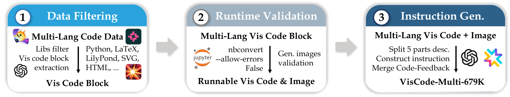<figcaption>VisCoder2 · Fig. 2：VisCode-Multi-679K 数据构建管线</figcaption></figure>

<div class="ds-demo"><div class="ds-head"><b>数据样例</b> · <a href="https://huggingface.co/datasets/TIGER-Lab/VisCode-Multi-679K">TIGER-Lab/VisCode-Multi-679K</a> · train 共 679,365 条，12 种语言的「自然语言描述 → 可视化代码」对（Python 186,954、HTML 135,230、LaTeX 124,039 条等）加 66,383 条多轮修错对话；数据集只含文本，不附渲染图 · 展示字段：messages、language</div><div class="ds-grid"><div class="ds-card"><div class="ds-meta">row 200008，language = python。Python：用 Seaborn 在 Titanic 数据上画按舱位与性别分组的生存率柱状图</div><details class="ds-code"><summary>user：指令（共 11 行，全文）</summary><pre>Generate a grouped barplot to visualize the survival probability of passengers based on their class and sex. The x-axis represents the passenger class, the y-axis shows the survival probability, and the bars are segmented by sex (male and female) for comparison.&#10;&#10;Use Python as the programming language for this task. Install and import libraries needed for data visualization, specifically Seaborn and Matplotlib. Seaborn is used for creating attractive statistical plots, and Matplotlib is used for additional customization and rendering the plot.&#10;&#10;The mock data used in this task is from the Titanic dataset which contains information about the passengers onboard the Titanic ship. The dataset includes variables such as passenger class, survival status, and sex.&#10;&#10;The mock data shows below:&#10;&#10;Load the Titanic dataset using the Seaborn library's built-in function for accessing example datasets: titanic = sns.load_dataset("titanic").&#10;&#10;Create a clean and visually appealing plot by setting the style to "whitegrid" for a clear background with gridlines. Apply a muted palette to the bar colors for aesthetic purposes. Remove the left spine of the plot for a streamlined look and label the y-axis with "survival probability" for clarity.</pre></details><details class="ds-code"><summary>assistant：python 代码（共 20 行，全文）</summary><pre>import seaborn as sns&#10;import matplotlib.pyplot as plt&#10;&#10;# Set the style&#10;sns.set(style="whitegrid")&#10;&#10;# Load the Titanic dataset&#10;titanic = sns.load_dataset("titanic")&#10;&#10;# Create a grouped barplot&#10;g = sns.catplot(x="class", y="survived", hue="sex",&#10;                data=titanic, kind="bar",&#10;                height=6, palette="muted")&#10;&#10;# Customize the plot&#10;g.despine(left=True)&#10;g.set_ylabels("survival probability")&#10;&#10;# Show the plot&#10;plt.show()</pre></details></div><div class="ds-card"><div class="ds-meta">row 200009，language = html。HTML：儿童科学实验套件礼品券网页，含欢迎语、多个实验套件分区与材料清单</div><details class="ds-code"><summary>user：指令（共 67 行，展示前 60 行）</summary><pre>Create a visually engaging page that serves as a gift voucher for a children's science experiment kit. Begin with a welcoming title and message directed at parents, highlighting the excitement and educational value of the gift. Provide a detailed description of the voucher's purpose, followed by sections that outline different experiment kits included in the package. Each kit section lists the materials provided and explains the scientific principles involved. Conclude with a section emphasizing the benefits of the kit and a footer with instructions on how to redeem the voucher.&#10;&#10;The page is structured using HTML and styled with CSS. HTML is used to define the structure and content of the page, while CSS is applied for styling and layout purposes.&#10;&#10;The page presents a gift voucher for a science experiment kit aimed at children. It is organized into several logical sections: an introductory message to parents, a description of the voucher, details of the kit inclusions with individual experiments, a list of benefits, and a footer with redemption information. Each kit inclusion is further detailed with a list of items and scientific facts related to the experiment.&#10;&#10;The data is shown below:&#10;&#10;{&#10;    "title": "Gift Voucher for a Comprehensive Science Experiment Kit",&#10;    "recipient": "Dear Parent",&#10;    "message": "Unlock the World of Science for Your Child with This Exciting Gift Voucher!",&#10;    "description": "This voucher entitles your child to receive a comprehensive science experiment kit, packed with all necessary materials, step-by-step instructions, and fun scientific facts. Designed with vibrant illustrations and a fun, cartoonish style, this kit will make learning science an enjoyable adventure!",&#10;    "kitInclusions": [&#10;        {&#10;            "item": "Baking Soda Volcano Kit",&#10;            "contents": [&#10;                "Baking Soda",&#10;                "Vinegar",&#10;                "Food Coloring",&#10;                "Plastic Volcano Model",&#10;                "Safety Goggles"&#10;            ],&#10;            "scientificFacts": [&#10;                "When baking soda (a base) reacts with vinegar (an acid), it produces carbon dioxide gas, causing the eruption!",&#10;                "This experiment demonstrates a chemical reaction and introduces kids to the concept of acids and bases."&#10;            ]&#10;        },&#10;        {&#10;            "item": "Crystal Growing Kit",&#10;            "contents": [&#10;                "Crystal Powder",&#10;                "Growing Container",&#10;                "Stirring Stick",&#10;                "Instructions Manual",&#10;                "Magnifying Glass"&#10;            ],&#10;            "scientificFacts": [&#10;                "Crystals form when molecules line up in a repeating pattern. Growing crystals is a way to see the structure of molecules at work.",&#10;                "This experiment illustrates principles of chemistry and geology, showing how minerals form in nature."&#10;            ]&#10;        },&#10;        {&#10;            "item": "Electric Circuit Kit",&#10;            "contents": [&#10;                "Small Light Bulb",&#10;                "Battery Pack",&#10;                "Wires",&#10;                "Switch",&#10;                "Instruction Diagram"&#10;            ],&#10;            "scientificFacts": [&#10;                "Electricity flows in a circuit. Completing the circuit allows electric current to flow and light up the bulb.",&#10;                "This kit helps children understand the basics of electricity and the concept of circuits."&#10;            ]&#10;        }&#10;    ],&#10;    "benefits": [&#10;        "Encourages critical thinking and problem-solving skills.",&#10;        "Provides hands-on learning experiences.",&#10;…（截断，原文共 67 行）</pre></details><details class="ds-code"><summary>assistant：html 代码（共 199 行，展示前 60 行）</summary><pre>&lt;!DOCTYPE html&gt;&#10;&lt;html lang="en"&gt;&#10;&lt;head&gt;&#10;&lt;meta charset="UTF-8"&gt;&#10;&lt;meta name="viewport" content="width=device-width, initial-scale=1.0"&gt;&#10;&lt;title&gt;Science Experiment Kit Gift Voucher&lt;/title&gt;&#10;&lt;style&gt;&#10;    @import url('https://fonts.googleapis.com/css2?family=Baloo+2:wght@400;700&amp;display=swap');&#10;    &#10;    body {&#10;        font-family: 'Baloo 2', cursive;&#10;        background-color: #f0f8ff;&#10;        margin: 0;&#10;        padding: 20px;&#10;        display: flex;&#10;        justify-content: center;&#10;        align-items: center;&#10;        min-height: 100vh;&#10;    }&#10;    &#10;    .voucher {&#10;        background-color: #ffffff;&#10;        border: 5px solid #ff6b6b;&#10;        border-radius: 15px;&#10;        box-shadow: 0 0 20px rgba(0, 0, 0, 0.1);&#10;        max-width: 800px;&#10;        padding: 30px;&#10;        position: relative;&#10;        overflow: hidden;&#10;    }&#10;    &#10;    .voucher::before {&#10;        content: "";&#10;        position: absolute;&#10;        top: -50px;&#10;        left: -50px;&#10;        width: 100px;&#10;        height: 100px;&#10;        background-color: #feca57;&#10;        transform: rotate(45deg);&#10;        z-index: -1;&#10;    }&#10;    &#10;    .voucher::after {&#10;        content: "";&#10;        position: absolute;&#10;        bottom: -50px;&#10;        right: -50px;&#10;        width: 100px;&#10;        height: 100px;&#10;        background-color: #54a0ff;&#10;        transform: rotate(45deg);&#10;        z-index: -1;&#10;    }&#10;    &#10;    h1 {&#10;        color: #ff6b6b;&#10;        text-align: center;&#10;        font-size: 2.5em;&#10;        margin-bottom: 20px;&#10;…（截断，原文共 199 行）</pre></details></div><div class="ds-card"><div class="ds-meta">row 200018，language = latex。LaTeX：用 circuitikz 画放克贝斯合成器包络发生器的 RC 电路原理图并加注释</div><details class="ds-code"><summary>user：指令（共 7 行，全文）</summary><pre>Generate a schematic representation of an RC (resistor-capacitor) circuit designed for use as an envelope generator in a funk bass synthesizer. The diagram illustrates the flow of current through the resistor and capacitor, with annotations indicating the charging and discharging processes of the capacitor. The circuit is labeled with input and output terminals, and the purpose of the circuit is described in a text box below the diagram.&#10;&#10;The language used is LaTeX, specifically with the `circuitikz` and `tikz` packages for rendering circuit diagrams. The rendering context is a standalone document class, which is optimized for creating isolated images or diagrams without additional document formatting.&#10;&#10;The visible content includes a schematic diagram of an electrical circuit. The circuit consists of a resistor labeled "R" with a current "i" passing through it, and a capacitor labeled "C". The circuit has an input on the left and an output on the right. There are arrows labeled "Charge" and "Discharge" indicating the direction of current flow related to the capacitor. Below the circuit, there is a textual label that reads "RC Circuit for Envelope Generator in Funk Bass Synth".&#10;&#10;The appearance is clean and technical, with a focus on clarity and precision typical of electronic circuit diagrams. Lines are straight and uniform, with components like resistors and capacitors symbolized by standard schematic symbols. Text labels are used to identify components and processes, with arrows providing directional cues. The layout is horizontal, with the circuit components aligned along a central axis, and additional explanatory text centered below the diagram.</pre></details><details class="ds-code"><summary>assistant：latex 代码（共 17 行，全文）</summary><pre>\documentclass[border=10pt]{standalone}&#10;\usepackage[siunitx, RPvoltages]{circuitikz}&#10;\usepackage{tikz}&#10;&#10;\begin{document}&#10;\begin{circuitikz}[scale=1.2]&#10;    \draw (0,0) node[left]{Input} to[short] (1,0);&#10;    \draw (1,0) to[R, l=&#36;R&#36;, i=&#36;i&#36;] (4,0);&#10;    \draw (4,0) to[short] (5,0) to[short] (5,-2) to[C, l=&#36;C&#36;] (1,-2) to[short] (1,0);&#10;    \draw (5,0) to[short] (6,0) node[right]{Output};&#10;    &#10;    \draw[thick,-&gt;] (2.5,-2.5) -- (2.5,-1) node[midway,right,rotate=90] {Charge};&#10;    \draw[thick,-&gt;] (3.5,-1) -- (3.5,-2.5) node[midway,left,rotate=90] {Discharge};&#10;    &#10;    \node[text width=4cm, align=center] at (3,-3.5) {\small RC Circuit for\\Envelope Generator\\in Funk Bass Synth};&#10;\end{circuitikz}&#10;\end{document}</pre></details></div></div></div>

- **管线步骤**（对照上图的三个框）
  1. **Data Filtering**（图中第 1 框）
     - Libs filter：在 the-stack-v2、svg-diagrams（182K）、CoSyn-400K 等多语言代码里，按绘图库关键词初筛
     - Vis code block extraction：GPT-4.1-mini 抽出可独立运行的可视化代码块，缺数据的注入 mock 数据
  2. **Runtime Validation**（图中第 2 框）
     - 在分语言内核的隔离 Jupyter 里用 nbconvert 执行，`--allow-errors False`：一报错就丢
     - Gen. images validation：只保留「出图、非单色、图 > 10KB」的样本
  3. **Instruction Gen.**（图中第 3 框）
     - Split 5 parts desc.：GPT-4.1 为每条写五段式描述（环境、数据与视觉描述、数据块、输出、风格），拼成指令
     - Merge Code-Feedback：混入 66K+ 条多轮纠错对话，得到 VisCode-Multi-679K
- **关键数字**
  - 验证通过 612,982 条，总计 679K（Python 187K / HTML 135K / LaTeX 124K）
  - 32B 模型加迭代 self-debug 后，执行通过率 82.4%
- **局限**
  - 语言分布不均，符号类和领域专用语言偏少
  - 纠错对话是借来的通用代码数据，不是针对视觉错误的修复
  - 只验证「能出图」，不验证「图是否符合指令」
- **可借鉴**
  - 执行加图像的廉价过滤（非单色、字节数阈值）在大规模场景下性价比很高
  - 结构化的五段式指令能让模型同时学到语义和风格，可以直接照搬到 3D 或游戏的指令合成

</details>

<a class="anchor" id="web-3"></a>

## 3 In-House Data Pipeline

待补充。

</div>

<div class="env-view" data-view="3d" data-label="3D">

<nav class="toc view-toc"><h2>Contents</h2><ul><li class="l2"><a href="#3d-1"><span class="num">1</span> Open Benchmarks</a></li><li class="l2"><a href="#3d-2"><span class="num">2</span> Open Data Pipelines</a></li><li class="l2"><a href="#3d-3"><span class="num">3</span> In-House Data Pipeline</a></li></ul></nav>

<a class="anchor" id="3d-1"></a>

## 1 Open Benchmarks

<a class="anchor" id="3d-1-1"></a>

### 1.1 Benchmark

核心发现：3D 方向只有 BenchCAD 被两家厂商同时报告；Blender 方向只有 Qwen 报了分数，其余厂商只放 demo。

<table class="frontier"><thead><tr><th>Benchmark</th><th>模型</th><th>分数</th><th>口径</th><th>来源</th></tr></thead><tbody><tr><td rowspan="4" class="bench"><a href="https://benchcad.com/leaderboard">BenchCAD</a></td><td> GPT-6 Astra</td><td>95.9%</td><td>带工具，geometric overlap</td><td><a href="https://openai.com/index/gpt-6-astra/">Blog</a></td></tr><tr><td> GPT-5.6 Sol</td><td>70.6% / 83.4%</td><td>不带工具 / 带 Python 工具</td><td><a href="https://openai.com/index/gpt-5-6/">Blog</a></td></tr><tr><td> Claude Opus 5</td><td>0.366 / 0.821</td><td>Vision2Code 子任务，voxel IoU，1000 个文件的子集，不带工具 / 带工具</td><td><a href="https://www.anthropic.com/claude-opus-5-system-card">Blog</a></td></tr><tr><td> Claude Mythos 5</td><td>0.384</td><td>Vision2Code 子任务，voxel IoU，全集 17,874 个文件，不带工具</td><td><a href="https://anthropic.com/claude-fable-5-mythos-5-system-card">Blog</a></td></tr><tr><td rowspan="1" class="bench">Kimi Webdev Bench · 3D / WebGL / Shader<span class="self-tag">自建</span></td><td> Kimi K3</td><td>胜 72.7 / 平 13.7 / 负 13.6</td><td>对 Claude Opus 4.8，专家盲评</td><td><a href="https://github.com/MoonshotAI/Kimi-K3/blob/main/k3_tech_report.pdf">Blog</a></td></tr><tr><td rowspan="1" class="bench">QwenBlenderBench<span class="self-tag">自建</span></td><td> Qwen3.8-Max</td><td>69.9</td><td>原文标注为内部 benchmark</td><td><a href="https://qwen.ai/blog?id=qwen3.8">Blog</a></td></tr><tr><td rowspan="1" class="bench">Parametric CAD Bench<span class="self-tag">来源不明</span></td><td> Qwen3.8-Max</td><td>91.5</td><td>原文未说明口径与来源</td><td><a href="https://qwen.ai/blog?id=qwen3.8">Blog</a></td></tr><tr><td rowspan="6" class="bench">未报告相关分数</td><td> GPT-6 Astra</td><td>未报告</td><td>Blender 建模并导入 UE5（发布页视频与开发者博客）</td><td><a href="https://developers.openai.com/blog/architectural-visualization-with-astra">Blog</a></td></tr><tr><td> Claude Opus 5</td><td>未报告</td><td>FreeCAD 按图纸重建零件（Frontier-Bench 中的一题，无单独分数）</td><td><a href="https://www.anthropic.com/news/claude-opus-5">Blog</a></td></tr><tr><td> Gemini 3.8 Flash</td><td>未报告</td><td>Three.js 爆炸视图、3D 城堡</td><td><a href="https://blog.google/innovation-and-ai/models-and-research/gemini-models/3-8-flash-and-3-8-flash-cyber/">Blog</a></td></tr><tr><td> GLM-5.3-Flash</td><td>未报告</td><td>Blender 场景、build123d CAD</td><td><a href="https://docs.z.ai/guides/vlm/glm-5.3-flash">Blog</a></td></tr><tr><td> Seed2.1 Pro</td><td>未报告</td><td>设计图生成 3D 庭院</td><td>—（媒体转述，未找到官方页）</td></tr><tr><td>   DeepSeek-V4-Pro-0813 / Hy4 preview / MiniMax-M3</td><td>未报告</td><td>—</td><td>Blog：<a href="https://huggingface.co/deepseek-ai/DeepSeek-V4-Pro-0813">DeepSeek</a> · <a href="https://huggingface.co/tencent/Hy4-preview">Hy4</a> · <a href="https://www.minimax.io/blog/minimax-m3">MiniMax-M3</a></td></tr></tbody></table>

数据解读：

- **BenchCAD 是唯一被两家厂商同时报告的 3D benchmark，但两家的数字不能直接比较。** OpenAI 报的是带工具的几何重叠百分比；Anthropic 报的是 voxel IoU，并区分全集和 1000 个文件的子集、带工具和不带工具。BenchCAD 官方榜把两家的分数都标注为「厂商自报，未重新评测」。
- **Blender 方向没有厂商采用公开 benchmark。** Benchmark Timeline by Capability 总表 Blender 组中的 BlenderGym、3DCodeBench 等没有出现在任何厂商的发布材料里。Qwen 用内部的 QwenBlenderBench，OpenAI 只放了 Blender 建模的 demo。
- **厂商选择 CAD 作为 3D 指标，与验收方式有关。** CAD 的结果可以按几何确定性判分，不依赖 VLM 看图打分，适合放进发布页的对比表。
- **Diffusion 组的 benchmark 没有语言模型厂商报告**，因为这些 benchmark 评的是专门的 3D 生成模型，不是写代码的模型。

<a class="anchor" id="3d-1-2"></a>

### 1.2 Benchmark Timeline

3D 类 benchmark 分属四条路线。本文用三个维度比较它们：

- **任务形态（Task Form）**：生成（文本或图像到程序）、编辑（起始场景到目标场景）、逆向（点云或网格到代码）、GUI 操作（在桌面软件中长程操作）。
- **表示（Representation）**：Blender Python、Three.js、CadQuery、mesh 或 Gaussian。表示决定产物能否编辑和追溯。
- **验收方式（Evaluation）**：
  - 多视图视觉相似度：无法发现漂浮部件、背面空洞等结构错误。
  - 几何指标：Chamfer 距离、IoU。
  - 确定性测试：B-Rep 有效性、尺寸约束、有限元分析、装配运动学。
  - 运行时状态：物理求解器状态、隐藏状态约束。
  - 人工偏好评审：用于资产外观。

四条路线的区别如下：

| 路线 | 产物 | 典型验收 |
|---|---|---|
| Blender | Blender Python 或 Three.js 代码 | 渲染相似度、几何指标、运行时状态 |
| Diffusion | mesh、NeRF 或 Gaussian，不写代码 | 多视图外观、文本一致性、人工偏好 |
| GUI | 专业软件中的操作序列 | 任务完成率 |
| CAD | CadQuery 等参数化 CAD 代码，目标是工程零件 | 尺寸、约束、可制造性 |

CAD 和 Blender 不是同一类任务。CAD 使用精确的 B-Rep 曲面，面向加工制造；Blender 使用多边形网格，面向渲染和游戏引擎。CAD 列在本节，是因为它的确定性验收和程序化数据合成方法可以用于 Blender。

> 下表按路线分为 4 组，点击表格上方的按钮切换，每组按发布时间排序。名称前为参与机构的 logo，工业界和学术界各取一个；名称链接到论文。Download 列为数据下载入口。影响力列只填写有公开数字的项目（GitHub star 或 HF 下载量）。

<div class="tbl-tabs">

<div class="tbl-pane" data-label="Blender" data-count="17">

<p class="tbl-desc">写 Blender Python / Three.js 代码来建模和编辑场景。</p>

<table class="merged"><thead><tr><th>发布日期</th><th>名称</th><th>类型</th><th>来源</th><th>形态</th><th>规模/题量</th><th>影响力</th><th>说明</th></tr></thead><tbody><tr class="top5"><td>2023/6/15</td><td> <a href="https://arxiv.org/abs/2306.09310">Infinigen</a> <span class="org">Princeton</span></td><td><span class="type type-data">数据集</span></td><td><a class="src src-gh" href="https://github.com/princeton-vl/infinigen">GitHub</a></td><td>程序化生成器→自然场景</td><td>无上限</td><td><a class="hf" href="https://github.com/princeton-vl/infinigen"><span class="hf-b hf-st" title="GitHub stars"><svg class="hf-i" viewBox="0 0 24 24" fill="currentColor"><path d="M12 2.5l2.9 6 6.6.6-5 4.3 1.5 6.5L12 16.9 6 20.9l1.5-6.5-5-4.3 6.6-.6z"/></svg>7.3k</span></a></td><td><strong>无限程序化 3D</strong>：随机数学规则生成形状纹理，可当代码→3D 源</td></tr><tr><td>2024/2/14</td><td> <a href="https://arxiv.org/abs/2402.09052">UFO（L3GO）</a> <span class="org">Yale</span></td><td><span class="type type-bench">Benchmark</span></td><td><span class="src src-paper">论文</span></td><td>文本→Blender</td><td>50</td><td>—</td><td><strong>非常规物体构造</strong>：分步调 API 搭出「五条腿的椅子」类反常识物体</td></tr><tr><td>2024/3/2</td><td>  <a href="https://arxiv.org/abs/2403.01248">SceneCraft</a> <span class="org">Google DeepMind · Caltech</span></td><td><span class="type type-data">数据集</span></td><td><span class="src src-paper">论文</span></td><td>文本→Blender 场景脚本</td><td>—（方法）</td><td>—</td><td><strong>渲染反馈迭代</strong>：场景图约束写脚本，GPT-V 看图改，常用函数沉淀成库</td></tr><tr class="top5"><td>2024/6/17</td><td> <a href="https://arxiv.org/abs/2406.11824">Infinigen Indoors</a> <span class="org">Princeton</span></td><td><span class="type type-data">数据集</span></td><td><a class="src src-gh" href="https://github.com/princeton-vl/infinigen">GitHub</a></td><td>程序化室内资产+约束 DSL</td><td>无上限</td><td><a class="hf" href="https://github.com/princeton-vl/infinigen"><span class="hf-b hf-st" title="GitHub stars"><svg class="hf-i" viewBox="0 0 24 24" fill="currentColor"><path d="M12 2.5l2.9 6 6.6.6-5 4.3 1.5 6.5L12 16.9 6 20.9l1.5-6.5-5-4.3 6.6-.6z"/></svg>7.3k</span></a></td><td><strong>可控室内场景</strong>：程序化家具建筑，约束求解器排布，可批量造场景</td></tr><tr><td>2024/12/16</td><td>  <a href="https://arxiv.org/abs/2412.14203">BlenderLLM / BlendNet</a> <span class="org">China Tower · CUHK-Shenzhen</span></td><td><span class="type type-data">数据集</span></td><td><a class="src src-hf" href="https://huggingface.co/datasets/FreedomIntelligence/BlendNet">HF</a></td><td>指令→Blender 脚本</td><td>12,059</td><td><a class="hf" href="https://huggingface.co/datasets/FreedomIntelligence/BlendNet"><span class="hf-b hf-dl" title="downloads"><svg class="hf-i" viewBox="0 0 24 24" fill="none" stroke="currentColor" stroke-width="2.2" stroke-linecap="round" stroke-linejoin="round"><path d="M12 3v11"/><path d="M8 11l4 4 4-4"/><path d="M4 20h16"/></svg>221</span></a></td><td><strong>指令-bpy 对</strong>：2K 人工+10K GPT-4o 标注，再自我改进迭代扩充</td></tr><tr><td>2025/4/2</td><td> <a href="https://arxiv.org/abs/2504.01786">BlenderGym</a> <span class="org">Stanford</span></td><td><span class="type type-bench">Benchmark</span></td><td><a class="src src-gh" href="https://github.com/richard-guyunqi/BlenderGym-Open">GitHub</a></td><td>场景编辑→bpy</td><td>245</td><td><a class="hf" href="https://github.com/richard-guyunqi/BlenderGym-Open"><span class="hf-b hf-st" title="GitHub stars"><svg class="hf-i" viewBox="0 0 24 24" fill="currentColor"><path d="M12 2.5l2.9 6 6.6.6-5 4.3 1.5 6.5L12 16.9 6 20.9l1.5-6.5-5-4.3 6.6-.6z"/></svg>45</span></a></td><td><strong>图形编辑闭环</strong>：改 bpy 脚本把起始场景对齐到目标图</td></tr><tr><td>2025/4/2</td><td> <a href="https://arxiv.org/abs/2504.01786">BlenderGym</a> <span class="org">Stanford</span></td><td><span class="type type-data">数据集</span></td><td><a class="src src-gh" href="https://github.com/richard-guyunqi/BlenderGym-Open">GitHub</a></td><td>场景+目标图→bpy 编辑</td><td>—</td><td><a class="hf" href="https://github.com/richard-guyunqi/BlenderGym-Open"><span class="hf-b hf-st" title="GitHub stars"><svg class="hf-i" viewBox="0 0 24 24" fill="currentColor"><path d="M12 2.5l2.9 6 6.6.6-5 4.3 1.5 6.5L12 16.9 6 20.9l1.5-6.5-5-4.3 6.6-.6z"/></svg>45</span></a></td><td><strong>图形编辑闭环</strong>：VLM 改 Blender 代码逼近目标渲染，可作验证环境</td></tr><tr><td>2025/8/11</td><td> <a href="https://arxiv.org/abs/2508.08228">LL3M</a> <span class="org">UChicago</span></td><td><span class="type type-data">数据集</span></td><td><span class="src src-paper">论文</span></td><td>文本→Blender 代码</td><td>—（方法）</td><td><a class="hf" href="https://github.com/threedle/ll3m"><span class="hf-b hf-st" title="GitHub stars"><svg class="hf-i" viewBox="0 0 24 24" fill="currentColor"><path d="M12 2.5l2.9 6 6.6.6-5 4.3 1.5 6.5L12 16.9 6 20.9l1.5-6.5-5-4.3 6.6-.6z"/></svg>554</span></a></td><td><strong>多 agent 建模</strong>：规划/检索/写码/调试/看图自评，检索库来自 API 文档</td></tr><tr><td>2025/8/20</td><td> <a href="https://arxiv.org/abs/2508.14879">MeshCoder</a> <span class="org">Tsinghua</span></td><td><span class="type type-data">数据集</span></td><td><a class="src src-hf" href="https://huggingface.co/datasets/InternRobotics/MeshCoderDataset">HF</a></td><td>点云→分部件 bpy 代码</td><td>1M</td><td><a class="hf" href="https://huggingface.co/datasets/InternRobotics/MeshCoderDataset"><span class="hf-b hf-dl" title="downloads"><svg class="hf-i" viewBox="0 0 24 24" fill="none" stroke="currentColor" stroke-width="2.2" stroke-linecap="round" stroke-linejoin="round"><path d="M12 3v11"/><path d="M8 11l4 4 4-4"/><path d="M4 20h16"/></svg>283</span></a></td><td><strong>部件级代码对</strong>：Infinigen 对象逐部件转代码拼装，CD 超阈值丢弃</td></tr><tr><td>2026/1/16</td><td>  <a href="https://arxiv.org/abs/2601.11109">BlenderBench（VIGA）</a> <span class="org">Impossible, Inc. · UC Berkeley</span></td><td><span class="type type-bench">Benchmark</span></td><td><a class="src src-hf" href="https://huggingface.co/datasets/DietCoke4671/BlenderBench">HF</a></td><td>图像→bpy</td><td>视觉 → 代码任务集</td><td><a class="hf" href="https://github.com/Fugtemypt123/VIGA"><span class="hf-b hf-st" title="GitHub stars"><svg class="hf-i" viewBox="0 0 24 24" fill="currentColor"><path d="M12 2.5l2.9 6 6.6.6-5 4.3 1.5 6.5L12 16.9 6 20.9l1.5-6.5-5-4.3 6.6-.6z"/></svg>1.3k</span></a></td><td><strong>逆向图形推理</strong>：看图迭代写 Blender 代码重建场景</td></tr><tr><td>2026/5/1</td><td>  <a href="https://arxiv.org/abs/2605.00632">BlenderRAG</a> <span class="org">Ferrari · University of Bologna</span></td><td><span class="type type-data">数据集</span></td><td><a class="src src-gh" href="https://github.com/MaxRondelli/BlenderRAG">GitHub</a></td><td>文本+bpy 代码+渲染图</td><td>500</td><td><a class="hf" href="https://github.com/MaxRondelli/BlenderRAG"><span class="hf-b hf-st" title="GitHub stars"><svg class="hf-i" viewBox="0 0 24 24" fill="currentColor"><path d="M12 2.5l2.9 6 6.6.6-5 4.3 1.5 6.5L12 16.9 6 20.9l1.5-6.5-5-4.3 6.6-.6z"/></svg>19</span></a></td><td><strong>专家校验检索库</strong>：Claude 写初稿专家修正，供 RAG 检索示例</td></tr><tr><td>2026/5/31</td><td>  <a href="https://arxiv.org/abs/2606.01057">3DCodeBench</a> <span class="org">Google DeepMind · USC</span></td><td><span class="type type-bench">Benchmark</span></td><td><a class="src src-gh" href="https://github.com/gaoypeng/3dcodebench">GitHub</a></td><td>文本/图像→bpy</td><td>212</td><td><a class="hf" href="https://github.com/gaoypeng/3dcodebench"><span class="hf-b hf-st" title="GitHub stars"><svg class="hf-i" viewBox="0 0 24 24" fill="currentColor"><path d="M12 2.5l2.9 6 6.6.6-5 4.3 1.5 6.5L12 16.9 6 20.9l1.5-6.5-5-4.3 6.6-.6z"/></svg>99</span></a></td><td><strong>程序化建模</strong>：Blender 5.0 API 正确性与部件连接合理性</td></tr><tr><td>2026/6/1</td><td>  <a href="https://arxiv.org/abs/2606.01869">WorldCoder-Bench</a> <span class="org">Huawei Noah's Ark Lab · CASIA</span></td><td><span class="type type-bench">Benchmark</span></td><td><a class="src src-hf" href="https://huggingface.co/datasets/shuolucs/WorldCoder-Bench">HF</a></td><td>文本→Three.js</td><td>2,026</td><td><a class="hf" href="https://huggingface.co/datasets/shuolucs/WorldCoder-Bench"><span class="hf-b hf-dl" title="downloads"><svg class="hf-i" viewBox="0 0 24 24" fill="none" stroke="currentColor" stroke-width="2.2" stroke-linecap="round" stroke-linejoin="round"><path d="M12 3v11"/><path d="M8 11l4 4 4-4"/><path d="M4 20h16"/></svg>261</span></a></td><td><strong>可交互 3D 世界</strong>：隐藏运行时状态须与物理/控件约束一致</td></tr><tr><td>2026/6/9</td><td>  <a href="https://arxiv.org/abs/2606.11152">P3D-Bench</a> <span class="org">Envision · Nanjing University</span></td><td><span class="type type-bench">Benchmark</span></td><td><a class="src src-hf" href="https://huggingface.co/datasets/SpatiaOS/P3D-Bench">HF</a></td><td>文本/图像→参数化 3D</td><td>1,003</td><td><a class="hf" href="https://github.com/SpatiaOS/P3D-Bench"><span class="hf-b hf-st" title="GitHub stars"><svg class="hf-i" viewBox="0 0 24 24" fill="currentColor"><path d="M12 2.5l2.9 6 6.6.6-5 4.3 1.5 6.5L12 16.9 6 20.9l1.5-6.5-5-4.3 6.6-.6z"/></svg>53</span></a></td><td><strong>参数化结构推理</strong>：精确尺寸、拓扑与多部件装配</td></tr><tr><td>2026/7/2</td><td> <a href="https://arxiv.org/abs/2607.01766">4DBuildBench（SimWorlds）</a> <span class="org">Harvard</span></td><td><span class="type type-bench">Benchmark</span></td><td><span class="src src-paper">论文</span></td><td>文本→动态 bpy</td><td>50</td><td>—</td><td><strong>动态物理场景</strong>：生成可编辑 4D 场景并正确配置物理求解器</td></tr><tr><td>2026/7/22</td><td>  <a href="https://arxiv.org/abs/2607.22738">Nova3D-Bench</a> <span class="org">Rare Sense · University of Edinburgh</span></td><td><span class="type type-bench">Benchmark</span></td><td><a class="src src-gh" href="https://github.com/RareSense/Nova3D">GitHub</a></td><td>文本/图像→bpy</td><td>54</td><td><a class="hf" href="https://github.com/RareSense/Nova3D"><span class="hf-b hf-st" title="GitHub stars"><svg class="hf-i" viewBox="0 0 24 24" fill="currentColor"><path d="M12 2.5l2.9 6 6.6.6-5 4.3 1.5 6.5L12 16.9 6 20.9l1.5-6.5-5-4.3 6.6-.6z"/></svg>718</span></a></td><td><strong>可编程资产</strong>：带命名部件、层级与约束的可执行 3D 程序</td></tr><tr><td>2026/9/6</td><td> <a href="https://arxiv.org/abs/2609.06535">3DHarnessBench</a> <span class="org">École Polytechnique</span></td><td><span class="type type-bench">Benchmark</span></td><td><a class="src src-hf" href="https://huggingface.co/datasets/lingada/3DHarnessBench">HF</a></td><td>3D→bpy</td><td>4 级</td><td><a class="hf" href="https://github.com/llada60/3DHarnessBench"><span class="hf-b hf-st" title="GitHub stars"><svg class="hf-i" viewBox="0 0 24 24" fill="currentColor"><path d="M12 2.5l2.9 6 6.6.6-5 4.3 1.5 6.5L12 16.9 6 20.9l1.5-6.5-5-4.3 6.6-.6z"/></svg>14</span></a></td><td><strong>3D→代码</strong>：工具权限逐级放开下还原几何为 Blender 代码</td></tr></tbody></table>

</div>

<div class="tbl-pane" data-label="Diffusion" data-count="13">

<p class="tbl-desc">评 text / image-to-3D 生成模型（SDS 优化、前馈重建、3D latent diffusion），直接输出 mesh / NeRF / Gaussian，不写代码；只评外观质量与文本一致性。</p>

<table class="merged"><thead><tr><th>发布日期</th><th>名称</th><th>类型</th><th>来源</th><th>形态</th><th>规模/题量</th><th>影响力</th><th>说明</th></tr></thead><tbody><tr class="top5"><td>2022/12/15</td><td> <a href="https://arxiv.org/abs/2212.08051">Objaverse</a> <span class="org">AllenAI</span></td><td><span class="type type-data">数据集</span></td><td><a class="src src-hf" href="https://huggingface.co/datasets/allenai/objaverse">HF</a></td><td>3D 模型+标签</td><td>800K+</td><td><a class="hf" href="https://huggingface.co/datasets/allenai/objaverse"><span class="hf-b hf-dl" title="downloads"><svg class="hf-i" viewBox="0 0 24 24" fill="none" stroke="currentColor" stroke-width="2.2" stroke-linecap="round" stroke-linejoin="round"><path d="M12 3v11"/><path d="M8 11l4 4 4-4"/><path d="M4 20h16"/></svg>629k</span></a></td><td><strong>3D 资产底座</strong>：Sketchfab 采集 CC 许可模型，带名称/标签/描述</td></tr><tr class="top5"><td>2023/6/12</td><td>  <a href="https://arxiv.org/abs/2306.07279">Cap3D</a> <span class="org">LG AI Research · University of Michigan</span></td><td><span class="type type-data">数据集</span></td><td><a class="src src-hf" href="https://huggingface.co/datasets/tiange/Cap3D">HF</a></td><td>3D↔文本 caption</td><td>660K</td><td><a class="hf" href="https://huggingface.co/datasets/tiange/Cap3D"><span class="hf-b hf-dl" title="downloads"><svg class="hf-i" viewBox="0 0 24 24" fill="none" stroke="currentColor" stroke-width="2.2" stroke-linecap="round" stroke-linejoin="round"><path d="M12 3v11"/><path d="M8 11l4 4 4-4"/><path d="M4 20h16"/></svg>9.6k</span></a></td><td><strong>自动 caption</strong>：多视图渲染→图像描述→CLIP 对齐→LLM 汇总</td></tr><tr><td>2023/7/11</td><td>  <a href="https://arxiv.org/abs/2307.05663">Objaverse-XL</a> <span class="org">Stability AI · AllenAI</span></td><td><span class="type type-data">数据集</span></td><td><a class="src src-hf" href="https://huggingface.co/datasets/allenai/objaverse-xl">HF</a></td><td>多来源 3D 对象</td><td>10M+</td><td><a class="hf" href="https://huggingface.co/datasets/allenai/objaverse-xl"><span class="hf-b hf-dl" title="downloads"><svg class="hf-i" viewBox="0 0 24 24" fill="none" stroke="currentColor" stroke-width="2.2" stroke-linecap="round" stroke-linejoin="round"><path d="M12 3v11"/><path d="M8 11l4 4 4-4"/><path d="M4 20h16"/></svg>2.5k</span></a></td><td><strong>千万级原料</strong>：汇总 GitHub/Thingiverse 等多源并去重</td></tr><tr><td>2023/10/4</td><td> <a href="https://arxiv.org/abs/2310.02977">T³Bench</a> <span class="org">Tsinghua</span></td><td><span class="type type-bench">Benchmark</span></td><td><a class="src src-gh" href="https://github.com/THU-LYJ-Lab/T3Bench">GitHub</a></td><td>文本→3D 资产</td><td>300</td><td><a class="hf" href="https://github.com/THU-LYJ-Lab/T3Bench"><span class="hf-b hf-st" title="GitHub stars"><svg class="hf-i" viewBox="0 0 24 24" fill="currentColor"><path d="M12 2.5l2.9 6 6.6.6-5 4.3 1.5 6.5L12 16.9 6 20.9l1.5-6.5-5-4.3 6.6-.6z"/></svg>1.1k</span></a></td><td><strong>多视角质量对齐</strong>：自动评 text-to-3D 质量与文本一致性</td></tr><tr><td>2023/11/28</td><td>  <a href="https://arxiv.org/abs/2311.16918">G-Objaverse（RichDreamer）</a> <span class="org">Alibaba · CUHK-Shenzhen</span></td><td><span class="type type-data">数据集</span></td><td><a class="src src-hf" href="https://huggingface.co/datasets/3DAIGC/gobjaverse">HF</a></td><td>多视图渲染</td><td>280K</td><td><a class="hf" href="https://huggingface.co/datasets/3DAIGC/gobjaverse"><span class="hf-b hf-dl" title="downloads"><svg class="hf-i" viewBox="0 0 24 24" fill="none" stroke="currentColor" stroke-width="2.2" stroke-linecap="round" stroke-linejoin="round"><path d="M12 3v11"/><path d="M8 11l4 4 4-4"/><path d="M4 20h16"/></svg>270</span></a></td><td><strong>统一渲染多通道</strong>：统一相机光照渲 RGB/法线/深度等，分 10 类</td></tr><tr><td>2024/1/8</td><td>  <a href="https://arxiv.org/abs/2401.04092">GPTEval3D</a> <span class="org">Adobe Research · Stanford</span></td><td><span class="type type-bench">Benchmark</span></td><td><a class="src src-gh" href="https://github.com/3DTopia/GPTEval3D">GitHub</a></td><td>文本→3D 资产</td><td>用 GPT-4V 生成评测 prompt 集</td><td><a class="hf" href="https://github.com/3DTopia/GPTEval3D"><span class="hf-b hf-st" title="GitHub stars"><svg class="hf-i" viewBox="0 0 24 24" fill="currentColor"><path d="M12 2.5l2.9 6 6.6.6-5 4.3 1.5 6.5L12 16.9 6 20.9l1.5-6.5-5-4.3 6.6-.6z"/></svg>292</span></a></td><td><strong>人类对齐评估器</strong>：GPT-4V 两两比较按准则算 Elo</td></tr><tr><td>2024/4/11</td><td>  <a href="https://arxiv.org/abs/2404.07984">DiffuRank</a> <span class="org">LG AI Research · University of Michigan</span></td><td><span class="type type-data">数据集</span></td><td><a class="src src-hf" href="https://huggingface.co/datasets/tiange/Cap3D">HF</a></td><td>3D↔caption（去幻觉）</td><td>1M</td><td><a class="hf" href="https://huggingface.co/datasets/tiange/Cap3D"><span class="hf-b hf-dl" title="downloads"><svg class="hf-i" viewBox="0 0 24 24" fill="none" stroke="currentColor" stroke-width="2.2" stroke-linecap="round" stroke-linejoin="round"><path d="M12 3v11"/><path d="M8 11l4 4 4-4"/><path d="M4 20h16"/></svg>9.6k</span></a></td><td><strong>视角排序去幻觉</strong>：用 text-to-3D 排视角，只送高分给 GPT-4V</td></tr><tr><td>2024/12/13</td><td> <a href="https://arxiv.org/abs/2412.09997">GT23D-Bench</a> <span class="org">UESTC</span></td><td><span class="type type-bench">Benchmark</span></td><td><span class="src src-paper">论文</span></td><td>文本→3D 资产</td><td>400K</td><td>—</td><td><strong>通用 T23D 指标</strong>：10 项指标覆盖对齐、纹理与几何质量</td></tr><tr><td>2024/12/13</td><td> <a href="https://arxiv.org/abs/2412.09997">GT23D-Bench 400K</a> <span class="org">Tongji</span></td><td><span class="type type-data">数据集</span></td><td><span class="src src-paper">论文</span></td><td>3D+64 视图+caption</td><td>400K</td><td>—</td><td><strong>清洗版原料</strong>：Objaverse 按碎片/纹理/美学过滤，配多粒度描述</td></tr><tr><td>2024/12/15</td><td> <a href="https://arxiv.org/abs/2412.11170">MATE-3D</a> <span class="org">SJTU</span></td><td><span class="type type-bench">Benchmark</span></td><td><a class="src src-hf" href="https://huggingface.co/datasets/ccccby/MATE-3D">HF</a></td><td>文本→3D 资产</td><td>1,280</td><td><a class="hf" href="https://github.com/zhangyujie-1998/HyperScore"><span class="hf-b hf-st" title="GitHub stars"><svg class="hf-i" viewBox="0 0 24 24" fill="currentColor"><path d="M12 2.5l2.9 6 6.6.6-5 4.3 1.5 6.5L12 16.9 6 20.9l1.5-6.5-5-4.3 6.6-.6z"/></svg>8</span></a></td><td><strong>多维质量评估</strong>：四维主观标注训练 HyperScore 评估器</td></tr><tr><td>2025/3/27</td><td> <a href="https://arxiv.org/abs/2503.21745">3DGen-Bench</a> <span class="org">Stanford</span></td><td><span class="type type-bench">Benchmark</span></td><td><a class="src src-hf" href="https://huggingface.co/datasets/3DGen/3DGen-Bench">HF</a></td><td>文本/图像→3D 资产</td><td>1,020</td><td><a class="hf" href="https://github.com/3DTopia/3DGen-Bench"><span class="hf-b hf-st" title="GitHub stars"><svg class="hf-i" viewBox="0 0 24 24" fill="currentColor"><path d="M12 2.5l2.9 6 6.6.6-5 4.3 1.5 6.5L12 16.9 6 20.9l1.5-6.5-5-4.3 6.6-.6z"/></svg>8</span></a></td><td><strong>3D 人类偏好</strong>：大规模对战投票训练自动评估器</td></tr><tr><td>2025/4/9</td><td>  <a href="https://arxiv.org/abs/2504.07334">Objaverse++</a> <span class="org">Exascale Labs · CMU</span></td><td><span class="type type-data">数据集</span></td><td><a class="src src-hf" href="https://huggingface.co/datasets/cindyxl/ObjaversePlusPlus">HF</a></td><td>3D 质量/属性标签</td><td>500K</td><td><a class="hf" href="https://huggingface.co/datasets/cindyxl/ObjaversePlusPlus"><span class="hf-b hf-dl" title="downloads"><svg class="hf-i" viewBox="0 0 24 24" fill="none" stroke="currentColor" stroke-width="2.2" stroke-linecap="round" stroke-linejoin="round"><path d="M12 3v11"/><path d="M8 11l4 4 4-4"/><path d="M4 20h16"/></svg>439</span></a></td><td><strong>质量筛选标签</strong>：人工标 10K 训分类器推广全量，可按质量过滤</td></tr><tr><td>2025/8/7</td><td> <a href="https://arxiv.org/abs/2508.05609">Hi3DEval</a> <span class="org">Stanford</span></td><td><span class="type type-bench">Benchmark</span></td><td><a class="src src-hf" href="https://huggingface.co/datasets/3DTopia/Hi3DBench">HF</a></td><td>文本/图像→3D 资产</td><td>Hi3DBench 大规模标注集</td><td><a class="hf" href="https://github.com/3DTopia/Hi3DEval"><span class="hf-b hf-st" title="GitHub stars"><svg class="hf-i" viewBox="0 0 24 24" fill="currentColor"><path d="M12 2.5l2.9 6 6.6.6-5 4.3 1.5 6.5L12 16.9 6 20.9l1.5-6.5-5-4.3 6.6-.6z"/></svg>24</span></a></td><td><strong>层级化评测</strong>：物体级、部件级与材质真实感分层打分</td></tr></tbody></table>

</div>

<div class="tbl-pane" data-label="GUI" data-count="5">

<p class="tbl-desc">不写代码，直接在 Blender / CAD / Photoshop 等专业软件里长程点击操作。</p>

<table class="merged"><thead><tr><th>发布日期</th><th>名称</th><th>类型</th><th>来源</th><th>形态</th><th>规模/题量</th><th>影响力</th><th>说明</th></tr></thead><tbody><tr class="top5"><td>2024/4/11</td><td>  <a href="https://arxiv.org/abs/2404.07972">OSWorld</a> <span class="org">Salesforce Research · CMU</span></td><td><span class="type type-bench">Benchmark</span></td><td><a class="src src-gh" href="https://github.com/xlang-ai/OSWorld">GitHub</a></td><td>桌面软件操作</td><td>369</td><td><a class="hf" href="https://github.com/xlang-ai/OSWorld"><span class="hf-b hf-st" title="GitHub stars"><svg class="hf-i" viewBox="0 0 24 24" fill="currentColor"><path d="M12 2.5l2.9 6 6.6.6-5 4.3 1.5 6.5L12 16.9 6 20.9l1.5-6.5-5-4.3 6.6-.6z"/></svg>3.2k</span></a></td><td><strong>真实 OS 操作</strong>：GIMP 修图、Impress 做幻灯片等执行判分</td></tr><tr><td>2025/4/4</td><td> <a href="https://arxiv.org/abs/2504.07981">ScreenSpot-Pro</a> <span class="org">NUS</span></td><td><span class="type type-bench">Benchmark</span></td><td><a class="src src-hf" href="https://huggingface.co/datasets/likaixin/ScreenSpot-Pro">HF</a></td><td>GUI grounding</td><td>23 应用</td><td><a class="hf" href="https://github.com/likaixin2000/ScreenSpot-Pro-GUI-Grounding"><span class="hf-b hf-st" title="GitHub stars"><svg class="hf-i" viewBox="0 0 24 24" fill="currentColor"><path d="M12 2.5l2.9 6 6.6.6-5 4.3 1.5 6.5L12 16.9 6 20.9l1.5-6.5-5-4.3 6.6-.6z"/></svg>397</span></a></td><td><strong>专业软件定位</strong>：高分辨率界面中精确定位细小控件</td></tr><tr><td>2025/5/30</td><td> <a href="https://arxiv.org/abs/2505.24838">VideoCAD</a> <span class="org">MIT</span></td><td><span class="type type-bench">Benchmark</span></td><td><a class="src src-gh" href="https://github.com/ghadinehme/VideoCAD">GitHub</a></td><td>CAD GUI 操作</td><td>41K+</td><td><a class="hf" href="https://github.com/ghadinehme/VideoCAD"><span class="hf-b hf-st" title="GitHub stars"><svg class="hf-i" viewBox="0 0 24 24" fill="currentColor"><path d="M12 2.5l2.9 6 6.6.6-5 4.3 1.5 6.5L12 16.9 6 20.9l1.5-6.5-5-4.3 6.6-.6z"/></svg>228</span></a></td><td><strong>长程CAD交互</strong>：从录屏学习最长 186 步的 Onshape 操作</td></tr><tr><td>2026/5/19</td><td><span class="org-mark" title="USEIT AI">U</span>  <a href="https://arxiv.org/abs/2605.19484">CutVerse</a> <span class="org">USEIT AI · NUS</span></td><td><span class="type type-bench">Benchmark</span></td><td><a class="src src-gh" href="https://github.com/CUC-MIPG/CutVerse">GitHub</a></td><td>剪辑软件操作</td><td>186</td><td><a class="hf" href="https://github.com/CUC-MIPG/CutVerse"><span class="hf-b hf-st" title="GitHub stars"><svg class="hf-i" viewBox="0 0 24 24" fill="currentColor"><path d="M12 2.5l2.9 6 6.6.6-5 4.3 1.5 6.5L12 16.9 6 20.9l1.5-6.5-5-4.3 6.6-.6z"/></svg>12</span></a></td><td><strong>媒体后期编辑</strong>：Premiere/Photoshop 等长程组合式操作</td></tr><tr><td>2026/9/14</td><td>  <a href="https://arxiv.org/abs/2609.16251">CADWorld</a> <span class="org">CAMEL-AI · NUS</span></td><td><span class="type type-bench">Benchmark</span></td><td><a class="src src-gh" href="https://github.com/Zdong104/CADWORLD">GitHub</a></td><td>CAD GUI 操作</td><td>200</td><td><a class="hf" href="https://github.com/Zdong104/CADWORLD"><span class="hf-b hf-st" title="GitHub stars"><svg class="hf-i" viewBox="0 0 24 24" fill="currentColor"><path d="M12 2.5l2.9 6 6.6.6-5 4.3 1.5 6.5L12 16.9 6 20.9l1.5-6.5-5-4.3 6.6-.6z"/></svg>16</span></a></td><td><strong>桌面CAD操作</strong>：computer-use 产出原生工程文件</td></tr></tbody></table>

</div>

<div class="tbl-pane" data-label="CAD" data-count="16">

<p class="tbl-desc">写 CadQuery 等参数化 CAD 代码，目标是工程零件，按尺寸、约束、可制造性验收。列在这里是因为它的确定性验收和程序化合成方法值得借鉴。</p>

<table class="merged"><thead><tr><th>发布日期</th><th>名称</th><th>类型</th><th>来源</th><th>形态</th><th>规模/题量</th><th>影响力</th><th>说明</th></tr></thead><tbody><tr><td>2021/5/20</td><td> <a href="https://arxiv.org/abs/2105.09492">DeepCAD</a> <span class="org">Columbia</span></td><td><span class="type type-data">数据集</span></td><td><a class="src src-gh" href="https://github.com/ChrisWu1997/DeepCAD">GitHub</a></td><td>Onshape→CAD 构造序列</td><td>178,238</td><td><a class="hf" href="https://github.com/rundiwu/DeepCAD"><span class="hf-b hf-st" title="GitHub stars"><svg class="hf-i" viewBox="0 0 24 24" fill="currentColor"><path d="M12 2.5l2.9 6 6.6.6-5 4.3 1.5 6.5L12 16.9 6 20.9l1.5-6.5-5-4.3 6.6-.6z"/></svg>827</span></a></td><td><strong>CAD 序列基座</strong>：解析 Onshape 公开模型得建模序列，下游广泛沿用</td></tr><tr><td>2024/9/25</td><td> <a href="https://arxiv.org/abs/2409.17106">Text2CAD</a> <span class="org">DFKI</span></td><td><span class="type type-bench">Benchmark</span></td><td><a class="src src-hf" href="https://huggingface.co/datasets/SadilKhan/Text2CAD">HF</a></td><td>文本→CAD 序列</td><td>170K</td><td><a class="hf" href="https://github.com/SadilKhan/Text2CAD"><span class="hf-b hf-st" title="GitHub stars"><svg class="hf-i" viewBox="0 0 24 24" fill="currentColor"><path d="M12 2.5l2.9 6 6.6.6-5 4.3 1.5 6.5L12 16.9 6 20.9l1.5-6.5-5-4.3 6.6-.6z"/></svg>477</span></a></td><td><strong>多粒度文本→CAD</strong>：从新手到专家描述生成参数化建模序列</td></tr><tr><td>2024/9/25</td><td> <a href="https://arxiv.org/abs/2409.17106">Text2CAD</a> <span class="org">DFKI</span></td><td><span class="type type-data">数据集</span></td><td><a class="src src-hf" href="https://huggingface.co/datasets/SadilKhan/Text2CAD">HF</a></td><td>多级文本→CAD 序列</td><td>170K</td><td><a class="hf" href="https://huggingface.co/datasets/SadilKhan/Text2CAD"><span class="hf-b hf-dl" title="downloads"><svg class="hf-i" viewBox="0 0 24 24" fill="none" stroke="currentColor" stroke-width="2.2" stroke-linecap="round" stroke-linejoin="round"><path d="M12 3v11"/><path d="M8 11l4 4 4-4"/><path d="M4 20h16"/></svg>522</span></a></td><td><strong>多粒度文本标注</strong>：VLM/LLM 给 DeepCAD 配新手到专家四级描述</td></tr><tr><td>2024/10/7</td><td> <a href="https://arxiv.org/abs/2410.05340">CADPrompt</a> <span class="org">Georgia Tech</span></td><td><span class="type type-bench">Benchmark</span></td><td><a class="src src-gh" href="https://github.com/Kamel773/CAD_Code_Generation">GitHub</a></td><td>文本→CAD 代码</td><td>200</td><td><a class="hf" href="https://github.com/Kamel773/CAD_Code_Generation"><span class="hf-b hf-st" title="GitHub stars"><svg class="hf-i" viewBox="0 0 24 24" fill="currentColor"><path d="M12 2.5l2.9 6 6.6.6-5 4.3 1.5 6.5L12 16.9 6 20.9l1.5-6.5-5-4.3 6.6-.6z"/></svg>65</span></a></td><td><strong>CAD 脚本自验证</strong>：生成 CadQuery 并按点云距离迭代修正</td></tr><tr><td>2024/11/7</td><td>  <a href="https://arxiv.org/abs/2411.04954">CAD-MLLM / Omni-CAD</a> <span class="org">DeepSeek · HKU</span></td><td><span class="type type-data">数据集</span></td><td><a class="src src-hf" href="https://huggingface.co/datasets/jingwei-xu-00/Omni-CAD">HF</a></td><td>文本/多视图/点云→CAD</td><td>450K</td><td><a class="hf" href="https://huggingface.co/datasets/jingwei-xu-00/Omni-CAD"><span class="hf-b hf-dl" title="downloads"><svg class="hf-i" viewBox="0 0 24 24" fill="none" stroke="currentColor" stroke-width="2.2" stroke-linecap="round" stroke-linejoin="round"><path d="M12 3v11"/><path d="M8 11l4 4 4-4"/><path d="M4 20h16"/></svg>266</span></a></td><td><strong>多模态条件齐全</strong>：每个 CAD 配文本、多视图、点云和命令序列</td></tr><tr><td>2024/12/18</td><td>  <a href="https://arxiv.org/abs/2412.14042">CAD-Recode</a> <span class="org">Artec3D · University of Luxembourg</span></td><td><span class="type type-data">数据集</span></td><td><a class="src src-hf" href="https://huggingface.co/datasets/filapro/cad-recode">HF</a></td><td>点云→CadQuery</td><td>1M</td><td><a class="hf" href="https://huggingface.co/datasets/filapro/cad-recode"><span class="hf-b hf-dl" title="downloads"><svg class="hf-i" viewBox="0 0 24 24" fill="none" stroke="currentColor" stroke-width="2.2" stroke-linecap="round" stroke-linejoin="round"><path d="M12 3v11"/><path d="M8 11l4 4 4-4"/><path d="M4 20h16"/></svg>4.1k</span></a></td><td><strong>程序化合成代码</strong>：图元布尔+拉伸合成，BRep 校验去重，可直接 SFT</td></tr><tr><td>2025/1/31</td><td>  <a href="https://arxiv.org/abs/2501.19054">CADFusion</a> <span class="org">Microsoft Research · University of Toronto</span></td><td><span class="type type-data">数据集</span></td><td><a class="src src-gh" href="https://github.com/microsoft/CADFusion">GitHub</a></td><td>文本→CAD 序列+渲染偏好</td><td>—</td><td><a class="hf" href="https://github.com/microsoft/CADFusion"><span class="hf-b hf-st" title="GitHub stars"><svg class="hf-i" viewBox="0 0 24 24" fill="currentColor"><path d="M12 2.5l2.9 6 6.6.6-5 4.3 1.5 6.5L12 16.9 6 20.9l1.5-6.5-5-4.3 6.6-.6z"/></svg>91</span></a></td><td><strong>视觉反馈偏好</strong>：渲染图被偏好的序列得奖励，与序列学习交替训练</td></tr><tr><td>2025/5/20</td><td> <a href="https://arxiv.org/abs/2505.14646">CAD-Coder（VLM 版）/ GenCAD-Code</a> <span class="org">MIT</span></td><td><span class="type type-data">数据集</span></td><td><a class="src src-hf" href="https://huggingface.co/datasets/CADCODER/GenCAD-Code">HF</a></td><td>CAD 图像→CadQuery</td><td>163K+</td><td><a class="hf" href="https://huggingface.co/datasets/CADCODER/GenCAD-Code"><span class="hf-b hf-dl" title="downloads"><svg class="hf-i" viewBox="0 0 24 24" fill="none" stroke="currentColor" stroke-width="2.2" stroke-linecap="round" stroke-linejoin="round"><path d="M12 3v11"/><path d="M8 11l4 4 4-4"/><path d="M4 20h16"/></svg>545</span></a></td><td><strong>图像-代码对</strong>：GenCAD 模型转 CadQuery 并渲染，直接 SFT</td></tr><tr><td>2025/5/26</td><td> <a href="https://arxiv.org/abs/2505.19713">CAD-Coder（文本版）</a> <span class="org">HKU</span></td><td><span class="type type-data">数据集</span></td><td><a class="src src-hf" href="https://huggingface.co/datasets/gudo7208/CAD-Coder">HF</a></td><td>文本→CadQuery→3D</td><td>110K</td><td><a class="hf" href="https://huggingface.co/datasets/gudo7208/CAD-Coder"><span class="hf-b hf-dl" title="downloads"><svg class="hf-i" viewBox="0 0 24 24" fill="none" stroke="currentColor" stroke-width="2.2" stroke-linecap="round" stroke-linejoin="round"><path d="M12 3v11"/><path d="M8 11l4 4 4-4"/><path d="M4 20h16"/></svg>541</span></a></td><td><strong>CD 择优+CoT</strong>：V3 多候选执行取 CD 最小者，另配 1.5K CoT</td></tr><tr><td>2025/5/28</td><td> <a href="https://arxiv.org/abs/2505.22914">cadrille</a> <span class="org">ETH Zurich</span></td><td><span class="type type-data">数据集</span></td><td><a class="src src-gh" href="https://github.com/col14m/cadrille">GitHub</a></td><td>点云/图像/文本→CAD 代码</td><td>复用程序化数据</td><td><a class="hf" href="https://github.com/col14m/cadrille"><span class="hf-b hf-st" title="GitHub stars"><svg class="hf-i" viewBox="0 0 24 24" fill="currentColor"><path d="M12 2.5l2.9 6 6.6.6-5 4.3 1.5 6.5L12 16.9 6 20.9l1.5-6.5-5-4.3 6.6-.6z"/></svg>185</span></a></td><td><strong>在线几何 RL</strong>：程序化数据 SFT 后以几何反馈做在线 GRPO</td></tr><tr><td>2026/5/8</td><td> <a href="https://arxiv.org/abs/2605.07807">CADTests（CADTestBench）</a> <span class="org">University of Luxembourg</span></td><td><span class="type type-bench">Benchmark</span></td><td><a class="src src-hf" href="https://huggingface.co/datasets/dimitrismallis/CADTestBench">HF</a></td><td>文本→CAD 代码</td><td>文本 → CAD，每题配可执行测试</td><td><a class="hf" href="https://github.com/dimitrismallis/CADTestBench"><span class="hf-b hf-st" title="GitHub stars"><svg class="hf-i" viewBox="0 0 24 24" fill="currentColor"><path d="M12 2.5l2.9 6 6.6.6-5 4.3 1.5 6.5L12 16.9 6 20.9l1.5-6.5-5-4.3 6.6-.6z"/></svg>12</span></a></td><td><strong>测试驱动 CAD</strong>：用可执行测试验证几何/拓扑需求是否满足</td></tr><tr><td>2026/5/11</td><td> <a href="https://arxiv.org/abs/2605.10865">BenchCAD</a> <span class="org">UC San Diego</span></td><td><span class="type type-bench">Benchmark</span></td><td><a class="src src-hf" href="https://huggingface.co/datasets/BenchCAD/BenchCAD">HF</a></td><td>图像→CAD 代码</td><td>17.9K</td><td><a class="hf" href="https://github.com/BenchCAD/BenchCAD-main"><span class="hf-b hf-st" title="GitHub stars"><svg class="hf-i" viewBox="0 0 24 24" fill="currentColor"><path d="M12 2.5l2.9 6 6.6.6-5 4.3 1.5 6.5L12 16.9 6 20.9l1.5-6.5-5-4.3 6.6-.6z"/></svg>71</span></a></td><td><strong>工业级 CAD 操作</strong>：sweep/loft 等高级特征而非一律拉伸</td></tr><tr><td>2026/5/11</td><td> <a href="https://arxiv.org/abs/2605.10873">CADBench</a> <span class="org">MIT</span></td><td><span class="type type-bench">Benchmark</span></td><td><a class="src src-hf" href="https://huggingface.co/datasets/DeCoDELab/CADBench">HF</a></td><td>多模态→CAD 代码</td><td>18K</td><td><a class="hf" href="https://github.com/anniedoris/CADBench"><span class="hf-b hf-st" title="GitHub stars"><svg class="hf-i" viewBox="0 0 24 24" fill="currentColor"><path d="M12 2.5l2.9 6 6.6.6-5 4.3 1.5 6.5L12 16.9 6 20.9l1.5-6.5-5-4.3 6.6-.6z"/></svg>22</span></a></td><td><strong>可编辑 CAD 逆向</strong>：从 mesh/点云/图像恢复紧凑 CAD 程序</td></tr><tr><td>2026/5/18</td><td><span class="org-mark" title="BitInf">B</span>  <a href="https://arxiv.org/abs/2605.18430">Text2CAD-Bench</a> <span class="org">BitInf · CASIA</span></td><td><span class="type type-bench">Benchmark</span></td><td><a class="src src-hf" href="https://huggingface.co/datasets/AICAD/Text2CAD-Bench">HF</a></td><td>文本→CAD 代码</td><td>600</td><td><a class="hf" href="https://huggingface.co/datasets/AICAD/Text2CAD-Bench"><span class="hf-b hf-dl" title="downloads"><svg class="hf-i" viewBox="0 0 24 24" fill="none" stroke="currentColor" stroke-width="2.2" stroke-linecap="round" stroke-linejoin="round"><path d="M12 3v11"/><path d="M8 11l4 4 4-4"/><path d="M4 20h16"/></svg>122</span></a></td><td><strong>复杂特征与跨领域</strong>：分级考察高级建模特征与双风格描述</td></tr><tr><td>2026/5/27</td><td><span class="org-mark" title="Curvature Flow">C</span>  <a href="https://arxiv.org/abs/2605.28579">MUSE</a> <span class="org">Curvature Flow · PolyU</span></td><td><span class="type type-bench">Benchmark</span></td><td><a class="src src-hf" href="https://huggingface.co/datasets/dongxiaoyu/MUSE">HF</a></td><td>文本→CAD 装配</td><td>文本 → CAD，带设计意图 rubric</td><td><a class="hf" href="https://github.com/dong7313/muse"><span class="hf-b hf-st" title="GitHub stars"><svg class="hf-i" viewBox="0 0 24 24" fill="currentColor"><path d="M12 2.5l2.9 6 6.6.6-5 4.3 1.5 6.5L12 16.9 6 20.9l1.5-6.5-5-4.3 6.6-.6z"/></svg>7</span></a></td><td><strong>工程设计意图</strong>：可制造、可装配、功能满足的 B-Rep 装配体</td></tr><tr><td>2026/8/10</td><td> <a href="https://arxiv.org/abs/2608.09296">CADEngBench</a> <span class="org">MBZUAI</span></td><td><span class="type type-bench">Benchmark</span></td><td><span class="src src-paper">论文</span></td><td>文本→CAD 代码</td><td>600</td><td>—</td><td><strong>工程级可用性</strong>：参数扰动、有限元与装配运动学全验证</td></tr></tbody></table>

</div>

</div>

<a class="anchor" id="3d-1-3"></a>

### 1.3 Evolution

核心发现：3D 评测从外观评分转向可执行、可验证的工程验收。

- **2023 年至 2024 年：先评外观，程序化生成开始出现。** T³Bench 和 GPTEval3D 评测 text-to-3D 的外观，GPTEval3D 用 GPT-4V 两两比较后计算 Elo。L3GO 的 UFO 测试「五条腿的椅子」这类分布外组合。Text2CAD 和 CADPrompt 把文本生成 CAD 定义为可量化的任务。
- **2025 年：Blender 进入评测。** BlenderGym 包含 245 个编辑任务，最强的 VLM 在人类认为简单的任务上仍然失败。ScreenSpot-Pro 在 Blender、Photoshop 等专业软件界面上做元素定位，已有模型为 18.9%。3DGen-Bench 收集了 68K 条人工偏好。
- **2026 年上半年：程序化 3D 与 CAD 的 benchmark 集中出现。** 3DCodeBench 覆盖 212 个类别，首要失败原因是 API 不匹配。BenchCAD 包含 17.9K 个 CadQuery 程序，全部按执行结果判分，不使用 LLM judge。P3D-Bench 发现模型能做出整体形状，但做不出精确参数的几何。WorldCoder-Bench 检查 Three.js 的隐藏运行时状态，最好的系统为 27.8%。
- **2026 年中：评测动态场景、工程级任务和长程 GUI 操作。** 4DBuildBench 检查物理求解器的运行时状态。CADEngBench 加入有限元分析和装配运动学。CADWorld 在真实 CAD 软件中做长程任务，最强的 agent 为 17.5%，人类专家为 87.0%。

数据解读：只看多视图截图的评测会高估模型，新的 benchmark 普遍加入了几何、状态或执行检查。

<a class="anchor" id="3d-1-4"></a>

### 1.4 Use

按目标能力选择：

- 程序化建模：3DCodeBench、BlenderGym
- 动态场景与物理：4DBuildBench、WorldCoder-Bench
- 神经 3D 资产外观：3DGen-Bench、GT23D-Bench
- 专业软件长程操作：CADWorld、CutVerse
- 精确参数与约束：BenchCAD、CADTests、Text2CAD-Bench
- 装配与部件连接：P3D-Bench、CADEngBench

确定性检查类（BenchCAD、CADTests、WorldCoder-Bench）可以作为主指标；VLM judge 只作参考。

<a class="anchor" id="3d-2"></a>

## 2 Open Data Pipelines

<a class="anchor" id="3d-2-1"></a>

### 2.1 Observations

- **程序化合成可以提供无标注成本的真值。** CAD-Recode（1M）、MeshCoder（约 1M）和 Infinigen 都由程序同时生成几何和对应的代码。CAD-Recode 的实验中，程序化生成的 1M 条数据在真实测试集上的效果超过 160K 条真实数据（DeepCAD）。
- **Diffusion 路线的数据是资产原料，不含建模过程。** Objaverse-XL 包含 10M 以上的对象，但只有 mesh。Objaverse++ 和 GT23D-Bench 的结果表明，经过质量筛选的子集比全量数据效果更好。
- **缺少「失败后修复」的轨迹。** 几乎所有数据都是一次生成成功的配对。BlenderLLM 的自我迭代和 CADFusion 的视觉反馈是少数带迭代过程的工作。

<a class="anchor" id="3d-2-2"></a>

### 2.2 Deep Dives

细讲按采用度（下载量或 star 数）排序，重点说明数据如何自动构建。采用度较低的工作放在最后。

| 候选 | 数据开源 | 规模 | 可验证信号 | 多轮修复轨迹 | 采用度 | 结论 |
|---|---|---|---|---|---|---|
| Objaverse / Objaverse-XL | ✓ | 800K+ / 10M+ | ✗ 原料 | ✗ | 629k 下载 | **细讲** |
| Cap3D / DiffuRank | ✓ | 660K / 1M | ✗ caption | ✗ | 9.6k 下载 | **细讲** |
| Infinigen | ✓ | 无上限 | 程序化生成器 | ✗ | 7.3k star | **细讲** |
| CAD-Recode | ✓ | 1M | 执行 + BRepCheck | ✗ | 4.1k 下载 | **细讲** |
| DeepCAD | ✓ | 178K | ✗ 构造序列 | ✗ | 827 star | 未选：已被 CAD-Recode 的程序化 1M 超过 |
| GenCAD-Code | ✓ | 163K | 执行 + 渲染 | ✗ | 545 下载 | 未选：做法与 CAD-Recode 同类，规模更小 |
| Text2CAD | ✓ | 170K | ✗ 文本标注 | ✗ | 522 下载 | 未选：CAD 命令序列，不是可执行代码 |
| MeshCoder | ✓ 放出 100K | 1M | Chamfer 过滤 | ✗ | 283 下载 | 细讲（靠后） |
| CADFusion | 仅代码 | — | 视觉反馈偏好 | ✓ | 91 star | 未选：数据没放出 |

<a class="anchor" id="3d-2-2-1"></a>

<details class="deep"><summary><span class="deep-title"> 2.2.1 Objaverse / Objaverse-XL（2022-12） <span class="org">AllenAI · University of Washington</span> <a class="hf" href="https://huggingface.co/datasets/allenai/objaverse"><span class="hf-b hf-dl" title="downloads"><svg class="hf-i" viewBox="0 0 24 24" fill="none" stroke="currentColor" stroke-width="2.2" stroke-linecap="round" stroke-linejoin="round"><path d="M12 3v11"/><path d="M8 11l4 4 4-4"/><path d="M4 20h16"/></svg>629k</span></a></span></summary>

- **定位**：原料。给 3D / Blender 代码生成提供海量「可导入 Blender、可渲染」的真实资产（含 `.blend` 源文件），后续的 caption、渲染图、代码反推都从这里取

<figure class="paper-fig"><div class="flow"><div class="step"><b>多源爬取</b>Sketchfab API · GitHub 37M 文件 · Thingiverse · Polycam · Smithsonian</div><span class="arr">→</span><div class="step"><b>许可过滤</b>只收可分发的 CC 许可，排除 restricted</div><span class="arr">→</span><div class="step"><b>hash 去重</b>按文件内容全局去重，砍掉约 23M</div><span class="arr">→</span><div class="step"><b>Blender 导入渲染</b>导入失败即丢，GitHub 剩 5.5M</div><span class="arr">→</span><div class="step"><b>元数据 + CLIP 特征</b>面数 / 材质 / 动画；12 视角 CLIP 驱动质量分类器</div></div><figcaption>Objaverse / Objaverse-XL · 自绘流程图（两篇论文均无管线图，依据正文描述）</figcaption></figure>

<figure class="paper-fig">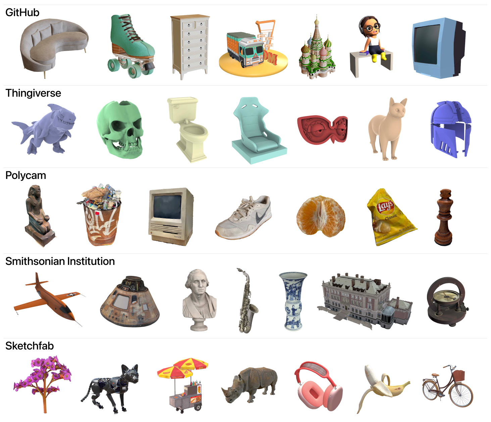<figcaption>Objaverse / Objaverse-XL · Fig. 3（XL 论文）：五个爬取来源各自的对象示例，Thingiverse 无颜色，渲染时随机上色</figcaption></figure>

<figure class="paper-fig">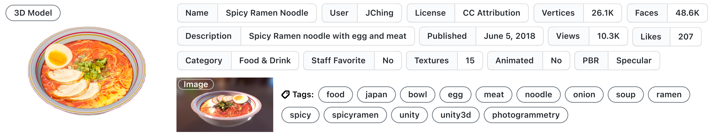<figcaption>Objaverse / Objaverse-XL · Fig. 4（1.0 论文）：每个对象直接继承上传者填写的元数据，没有额外标注</figcaption></figure>

<div class="ds-demo"><div class="ds-head"><b>数据样例</b> · <a href="https://huggingface.co/datasets/allenai/objaverse">allenai/objaverse</a> · 80 万+ 个 Sketchfab 3D 对象，元数据按 160 个分片存放 · 展示字段：缩略图、name、categories、tags、license 等元数据（取自 metadata/000-157.json.gz，未下载 glb）</div><div class="ds-grid"><div class="ds-card">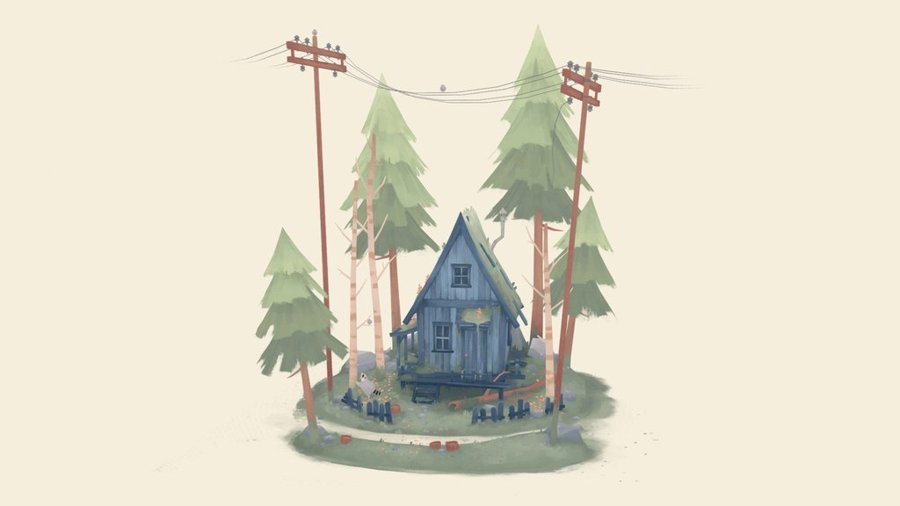<div class="ds-meta">Forest House：森林小屋场景，类别 nature-plants / places-travel，许可 CC BY-NC</div><details class="ds-code"><summary>metadata（JSON，共 26 行）</summary><pre>{&#10;  "uid": "52429e4ef7bf4deda1309364a2cda86f",&#10;  "name": "Forest House",&#10;  "categories": [&#10;    "nature-plants",&#10;    "places-travel"&#10;  ],&#10;  "tags": [&#10;    "forest",&#10;    "bird",&#10;    "b3d",&#10;    "racoon",&#10;    "blender",&#10;    "house"&#10;  ],&#10;  "license": "by-nc",&#10;  "description": "Little forest scene for my racoon to play in. Music by https://soundcloud.com/glogsound",&#10;  "viewCount": 39512,&#10;  "likeCount": 2187,&#10;  "faceCount": 21518,&#10;  "vertexCount": 14324,&#10;  "publishedAt": "2019-12-12T17:31:03.331377",&#10;  "viewerUrl": "https://sketchfab.com/3d-models/52429e4ef7bf4deda1309364a2cda86f",&#10;  "user": "peachyroyalty",&#10;  "thumbnails": "5 张（最大 1920×1080）"&#10;}</pre></details></div><div class="ds-card">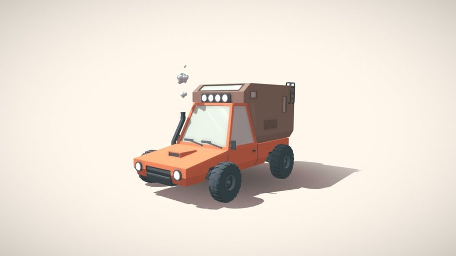<div class="ds-meta">Low-poly truck &quot;Drifter&quot;：低多边形越野卡车，类别 cars-vehicles，许可 CC BY-NC</div><details class="ds-code"><summary>metadata（JSON，共 57 行）</summary><pre>{&#10;  "uid": "f3750246b6564607afbefc61cb1683b1",&#10;  "name": "Low-poly truck (car \"Drifter\")",&#10;  "categories": [&#10;    "art-abstract",&#10;    "cars-vehicles"&#10;  ],&#10;  "tags": [&#10;    "wheel",&#10;    "truck",&#10;    "frame",&#10;    "orange",&#10;    "white",&#10;    "wheels",&#10;    "j",&#10;    "van",&#10;    "mirror",&#10;    "brown",&#10;    "gray",&#10;    "fbx",&#10;    "colors",&#10;    "reynolds",&#10;    "drifter",&#10;    "notexture",&#10;    "low-poly-model",&#10;    "lowpolymodel",&#10;    "low-poly-blender",&#10;    "low-poly",&#10;    "glass",&#10;    "game",&#10;    "blender",&#10;    "vehicle",&#10;    "lowpoly",&#10;    "blender3d",&#10;    "gameart",&#10;    "low",&#10;    "poly",&#10;    "gameasset",&#10;    "car",&#10;    "animation",&#10;    "black",&#10;    "light",&#10;    "fbxmodel",&#10;    "fbx-object-model",&#10;    "timothy"&#10;  ],&#10;  "license": "by-nc",&#10;  "description": "Low poly car \"Drifter\" from Timothy J.Reynolds with simple animation, thank you)\nI used the reference at this link https://dribbble.com/shots/4069087-Drifter-update",&#10;  "viewCount": 31410,&#10;  "likeCount": 759,&#10;  "faceCount": 15892,&#10;  "vertexCount": 9036,&#10;  "publishedAt": "2019-12-03T18:55:20.591596",&#10;  "viewerUrl": "https://sketchfab.com/3d-models/f3750246b6564607afbefc61cb1683b1",&#10;  "user": "vanidza",&#10;  "thumbnails": "5 张（最大 1920×1080）"&#10;}</pre></details></div><div class="ds-card"><div class="ds-meta">Flare Gun：信号枪 PBR 模型，类别 weapons-military，许可 CC BY</div><details class="ds-code"><summary>metadata（JSON，共 31 行）</summary><pre>{&#10;  "uid": "ca3695b7ecaf4e35a8b3f2e1ffb84c2c",&#10;  "name": "Flare Gun",&#10;  "categories": [&#10;    "weapons-military"&#10;  ],&#10;  "tags": [&#10;    "red",&#10;    "flare",&#10;    "signal",&#10;    "orion",&#10;    "flare-gun",&#10;    "substance",&#10;    "blender",&#10;    "pbr",&#10;    "lowpoly",&#10;    "substance-painter",&#10;    "gun",&#10;    "gameready"&#10;  ],&#10;  "license": "by",&#10;  "description": "Just a quick flare gun model based of off various flare gun models, modeled in Blender, textured in Substance Painter.",&#10;  "viewCount": 18608,&#10;  "likeCount": 478,&#10;  "faceCount": 12604,&#10;  "vertexCount": 6576,&#10;  "publishedAt": "2018-07-04T14:58:23.958577",&#10;  "viewerUrl": "https://sketchfab.com/3d-models/ca3695b7ecaf4e35a8b3f2e1ffb84c2c",&#10;  "user": "soidev",&#10;  "thumbnails": "5 张（最大 1920×1080）"&#10;}</pre></details></div></div></div>

- **自动化构建流程**（对照最上面的自绘流程图；下面两张原图分别是「数据来源」和「单条数据长什么样」）
  1. **Sketchfab**（1.0）：用 Sketchfab 公共 API 批量拉取
     - 规则过滤：只收可分发的 Creative Commons 许可；标为 restricted（成人 / 不良内容）的直接排除
     - 输出：统一的 GLB 文件
  2. **Name / Description / Tags / Category**：标注全部继承自上传者，零人工成本
     - Sketchfab 自带分类只有 18 类，太粗
  3. **Objaverse-LVIS**（图外）：模型召回加众包确认的半自动细分类
     - 每个 LVIS 类别召回 500 个候选：CLIP 看缩略图找外观像的，GloVe 比元数据找名字像的
     - 约 250K 候选交给 MTurk 众包，每次看 9 个、勾选属于该类的
     - 输出：47K 个对象，1156 类
  4. **GitHub / Thingiverse / Polycam / Smithsonian Institution**（XL）：Python 脚本多源爬取
     - **GitHub**：检索 37M 个带 3D 扩展名的公开文件，扩展名按 Blender 支持度选定（`.obj` `.glb` `.gltf` `.usdz` `.usd` `.usda` `.fbx` `.stl` `.dae` `.ply` `.abc` `.blend`），只收非 fork 仓库，来自 500K+ 仓库
     - **Thingiverse**：约 3.5M 个对象，基本是无纹理的 STL
     - **Polycam**：只收标为 savable 且 CC-BY 4.0 的扫描，72K → 去重后 71K
     - **Smithsonian Institution**：2.4K 个 CC0 文物扫描
     - **Sketchfab**：直接复用 Objaverse 1.0
  5. **去重 + 能否导入**（图外）：按文件内容 hash 全局去重，砍掉约 23M 个文件；GitHub 剩余文件中成功导入并渲染的只有 5.5M
     - 失败原因：导入不兼容（FBX ASCII）、文件里没有 mesh、扩展名撞车（`.obj` 其实是 C 编译产物）
  6. **Blender 元数据**（图外）：渲染时顺手抽取 `sha256`、面数 / 顶点数 / 边数、材质数、纹理数、动画数、`linked-files`、`missing-textures` 等；缺纹理的随机上色
  7. **模型元数据**（图外）：每个对象在球面上随机取 12 个视角渲染，取 CLIP ViT-L/14 的平均 embedding，同一份特征驱动下游多个分类器（美学、NSFW、人脸、扫描破洞）
- **质量控制**
  - NSFW：LAION-5B NSFW 分类器，单张分数 > 0.9 且 12 张渲染中至少 3 张命中才判定；10M 个对象里只滤掉 815 个
  - 人脸：同样要求至少 3 张命中，估计有 266K 个对象带人脸（多为玩偶、雕塑、卡通），只做标记
  - 扫描破洞：人工标注 1.2K 张 Polycam 渲染图，在 CLIP 特征上训练两层 MLP，交叉验证准确率 90% 以上（阈值 0.5）；71K 个 Polycam 对象中 38.20% 的渲染图是坏图，58K 个对象至少有 2 张坏图
  - 美学分层：LAION-Aesthetics V2 打分，T1（> 4.5）占 14.2%，T2（4–4.5）占 69.2%，T3（< 4）占 16.6%
  - 对齐子集：按顶点数、面数、来源站点热度、来源等启发式规则，从全集挑出 1.3M 高质量对象，用于二阶段微调
- **关键数字**
  - 规模：1.0 版 818K 个对象（160K 位作者，2.35M 个 tag，其中 170K 个不重复，覆盖约 21K 个 WordNet 概念）；XL 版 10.2M
  - 细分：1.0 含 44K 个动画对象、63K+ 个角色、16K+ 个室内场景；XL 的动画对象从 41K 增至 459K，带骨骼的从 34K 增至 438K
  - 成本：XL 的采集费用在几千美元量级（查找、索引、下载，用的是 AWS CPU 实例），2023 年 Q1–Q2 完成采集
  - 下游效果
    - GET3D 在 Objaverse 上训练，生成结果 91% 的情况下被众包评为比 ShapeNet 版更多样
    - Zero123-XL 用 1 亿+ 张渲染图训练；在 1.3M 对齐子集上微调后，GSO 零样本 PSNR 从 18.225 升到 19.876
    - PixelNeRF 用 XL 预训练：DTU PSNR 15.32 → 17.53，ShapeNet 22.71 → 24.22
- **局限**
  - 文本侧只有用户自填元数据，很多对象的名称和描述很短甚至为空，没法直接当 caption（Cap3D 正是为此而做）
  - 大量 GitHub 文件导不进 Blender，论文认为统一格式转换还能再救回几百万个对象
  - Thingiverse 没有颜色，Polycam 扫描常缺背面；质量方差极大，只能靠后置分类器分层
  - 论文自己也承认：规模仍比十亿级图文数据小几个数量级，而且不一定每个样本都值得训练
- **可借鉴**
  - 用「能被 Blender 导入并成功渲染」作为第一道硬过滤，把格式正确性交给 Blender 判定
  - 爬取范围按目标工具支持的扩展名定；GitHub 上的 `.blend` 本身就是现成的 Blender 工程语料
  - 内容 hash 全局去重放在最前面（XL 一步砍掉约 23M 个文件）
  - 多视角渲染一次，CLIP 平均 embedding 存下来复用给多个轻量分类器；判定要求「多视角一致」（≥ 3/12），避免单视角误杀
  - 人工只标 1.2K 张就能训一个坏图检测 MLP；再用启发式挑出「对齐子集」做二阶段微调

</details>

<a class="anchor" id="3d-2-2-2"></a>

<details class="deep"><summary><span class="deep-title"> 2.2.2 Cap3D + DiffuRank（2023-06） <span class="org">University of Michigan · LG AI Research</span> <a class="hf" href="https://huggingface.co/datasets/tiange/Cap3D"><span class="hf-b hf-dl" title="downloads"><svg class="hf-i" viewBox="0 0 24 24" fill="none" stroke="currentColor" stroke-width="2.2" stroke-linecap="round" stroke-linejoin="round"><path d="M12 3v11"/><path d="M8 11l4 4 4-4"/><path d="M4 20h16"/></svg>9.6k</span></a></span></summary>

- **定位**：标注。把 Objaverse 的「无文本资产」变成「文本 ↔ 3D」配对，是 text-to-3D / text-to-Blender-code 最常用的 caption 来源；DiffuRank 是它的纠错与扩容版

<figure class="paper-fig">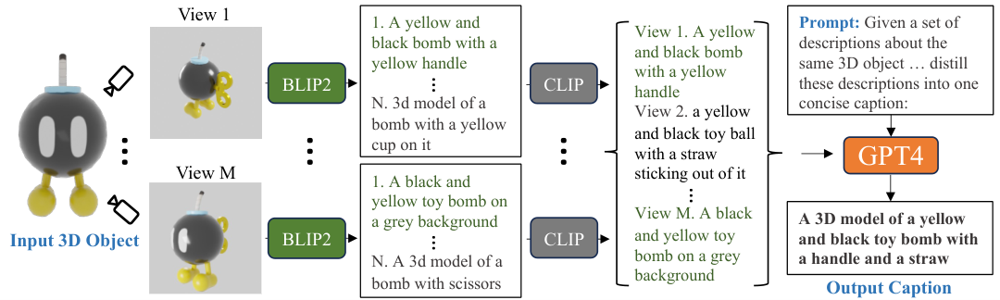<figcaption>Cap3D + DiffuRank · Fig. 2（Cap3D）：8 视角渲染 → 每视角由 BLIP2 出 5 条 → CLIP 选 1 条 → GPT4 汇总成一句</figcaption></figure>

<figure class="paper-fig">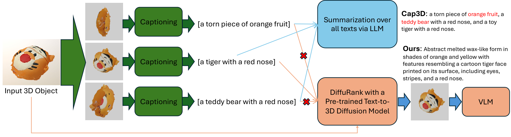<figcaption>Cap3D + DiffuRank · Fig. 3（DiffuRank）：Cap3D 走蓝色支路（纯文本汇总）；DiffuRank 走橙色支路，先用 text-to-3D 扩散模型给视角排序，再把选中的图交给 VLM</figcaption></figure>

<div class="ds-demo"><div class="ds-head"><b>数据样例</b> · <a href="https://huggingface.co/datasets/tiange/Cap3D">tiange/Cap3D</a> · Objaverse / Objaverse-XL / ABO / ShapeNet 3D 对象的自动 caption（Objaverse 全量 CSV 255MB）· 展示字段：uid、caption（新旧两版）；图片为 Objaverse 元数据里的 Sketchfab 缩略图，不是 Cap3D 自己的渲染视角（渲染图在单个 5–42GB 的 zip 中，未下载）</div><div class="ds-grid"><div class="ds-card">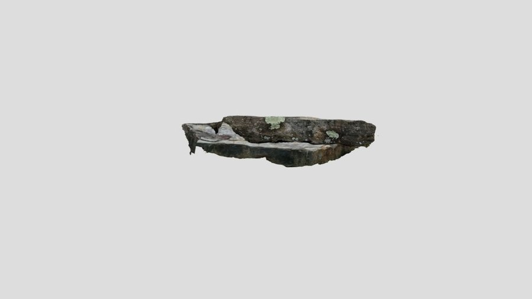<div class="ds-meta">苔藓石板：旧版 caption 写成「带洞的岩石」，新版改为描述石面纹理与地衣</div><details class="ds-code"><summary>caption（文本，共 8 行）</summary><pre>uid: 955e65d3e1b74619b75a68b0cfbe2f87&#10;Objaverse name: Eubrontes&#10;&#10;Cap3D_automated_Objaverse_full.csv（当前版，第 461 行）:&#10;Textured stone slab with a patchy surface showing various tones of gray, brown, and hints of green lichen-like patterns.&#10;&#10;misc/Cap3D_automated_Objaverse.csv（旧版）:&#10;A 3D model of a rock with a hole in it.</pre></details></div><div class="ds-card"><div class="ds-meta">Minecraft 风格木箱：旧版只说「顶部有云的像素方块」，新版写出木箱与烟雾</div><details class="ds-code"><summary>caption（文本，共 8 行）</summary><pre>uid: 4b26ff3f7e634ff08170170ec8d241de&#10;Objaverse name: Minecraft 生日空降箱子&#10;&#10;Cap3D_automated_Objaverse_full.csv（当前版，第 429 行）:&#10;A wooden crate with white smoke or steam emanating from its top, with some black markings on the smoke.&#10;&#10;misc/Cap3D_automated_Objaverse.csv（旧版）:&#10;A 3D pixelated cube with a cloud on top.</pre></details></div><div class="ds-card">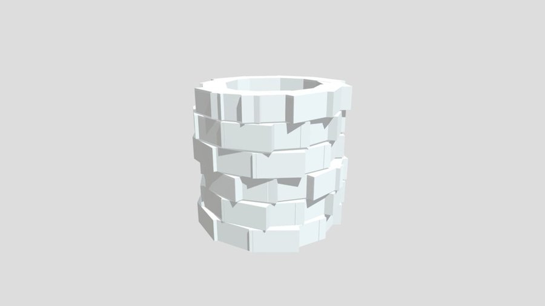<div class="ds-meta">分段空心圆柱（井口）：旧版误认为扑克筹码堆，新版改为几何形状描述</div><details class="ds-code"><summary>caption（文本，共 8 行）</summary><pre>uid: b6550219072d42d2beac49d2b862f50d&#10;Objaverse name: Carter0107 Well&#10;&#10;Cap3D_automated_Objaverse_full.csv（当前版，第 420 行）:&#10;A segmented hollow cylindrical structure with an irregular polygonal outline.&#10;&#10;misc/Cap3D_automated_Objaverse.csv（旧版）:&#10;A 3D model of a stack of alternating white and black cubes resembling poker chips or boxes.</pre></details></div></div></div>

- **自动化构建流程**（先读 Cap3D 图，再读 DiffuRank 图，均从左往右）
  1. **许可与可渲染过滤**（图外）：去掉 CC BY-NC(-SA)，只留 CC BY / CC BY-SA / CC0，798K → 723.7K；再去掉缺少相机信息、无法渲染的，剩 680K
  2. **Input 3D Object**：Blender 渲染
     - 先归一化到单位立方体并居中；3 盏面光（主光 / 补光 / 轮廓光）
     - M = 8 个视角绕物体一圈，其中 2 个略低于物体（为了拍到底部），512×512
  3. **BLIP2**（ViT-G + FlanT5XXL）：每个视角用 nucleus sampling 生成 N = 5 条 caption
     - ABO 几何描述改成两段式 QA：先问「这是什么物体」，再把答案代入第二问「这个 `<object>` 的结构和几何是什么」
  4. **CLIP**（ViT-B/32）：每个视角在 5 条中选与图像余弦相似度最高的 1 条，40 条 → 8 条
     - 顺序是有意安排的：先用 CLIP 纠错再交给 GPT4，GPT4 就不用消化更多错误细节
  5. **GPT4** → **Output Caption**：用固定短 prompt（「Given a set of descriptions about the same 3D object, distill these descriptions into one concise caption…Avoid describing background, surface, and posture.」）把 8 条合成一句
     - 试过更长的 prompt，GPT4 会把推理过程写进输出，所以保留短版本
  6. **Captioning**（DiffuRank）：每个对象渲染 28 张图，再用 BLIP2 为每张出 5 条 caption
     - 8 张沿用 Cap3D 的做法：灰底，CYCLES 光追（16 samples + OPTIX 降噪）
     - 20 张沿用 Shap·E 的做法：归一化后随机视角，透明底，EEVEE 实时渲染；这 20 张同时用来编码 Shap·E latent
  7. **DiffuRank with a Pre-trained Text-to-3D Diffusion Model**：用 Shap·E 给每个视角打「代表性」分
     - 固定同一组 (t, ε) 加噪物体 latent，分别以该视角的每条 caption 为条件去噪；平均去噪 loss 取负就是该视角与 3D 物体的对齐分
     - 直觉：从「意外视角」得到的 caption 描述的是错的物体，对去噪帮助小，loss 高
     - 取 Top-6 视角；灰底 / 透明底哪种更合适也由分数自动决定，不用人工
  8. **VLM**：Top-6 张图交给 GPT-4-1106-vision-preview，prompt 为「Renderings show different angles of the same set of 3D objects. Concisely describe 3D object…」
     - 平均每次输入约 1,867 个 token，输出约 26.72 个 token
  9. **定位旧错 + 扩容**（图外）
     - 纠错：先找出可能出错的旧 caption，只对它们重跑步骤 6–8，共改约 200K 条
     - 扩容：把 Objaverse 剩余对象和 Objaverse-XL 高质量子集纳入，数据集扩到 1.5M 条
- **质量控制**
  - Cap3D 伦理过滤：在正面渲染图上跑人脸检测和 NSFW 分类，分数 ≥ 0.9 就删，分别删掉 18.6K 和 217 个；GPT4 输出再过词表黑名单，删 226 个 → 最终 661K
  - 抽检结果：人脸过滤精度只有 16%，NSFW 为 47%（宁可错杀）；估计仍漏了约 1K 张人脸和不到 1K 个 NSFW 对象
  - 众包对照集：41.4K 条人写 caption（覆盖 39.7K 个对象），标注员表现差会被封号并删除其全部数据
  - DiffuRank 找错的三条规则
    - CLIP 均值 / 最大值双阈值：阈值在人工标注的约 7K 个错例验证集上定（要求全部覆盖），从 660K 条中圈出约 167K 条
    - 全灰图：约 10K 张渲染失败的全灰图，重新渲染后重写 caption
    - 文本规则：caption 里出现「image」「rendering」这类渲染过程用词，约 23,000 条
  - DiffuRank 伦理过滤：沿用 Cap3D 的人脸 / NSFW 流程，再加 GPT-4V 返回的 `content_policy_violation`，共标出约 35K 个对象
- **关键数字**
  - Cap3D 成本（每 1K 个对象）：BLIP2 $3.79 + CLIP $0.38 + GPT4 $4.18 = $8.35；人工 $87.18
    - A40 按 $1.28/hr 计（CoreWeave）；不用 CLIP 过滤时 GPT4 要花 $15.33
  - Cap3D 速度：65K 个对象 / 天（8 张 A40），人工只有 1.4K / 天
  - Cap3D 质量：与人写 caption 做 A/B，胜率 52.3%，人写为 37.8%
  - Cap3D 下游：Point·E 在 350K 条 Cap3D caption 上微调后，CLIP R@1 从 6.0 升到 12.4，FID 从 36.1 降到 32.8
    - 给全部 660K 个对象算点云和 latent 需要约 20K GPU 天，因此只用了 350K
  - DiffuRank 质量：与 Cap3D 做幻觉 A/B，Cap3D 胜 25.8%、负 63.9%；Top-6 视角优于用全部 28 张、水平 6 张和 Bottom-6 张
  - DiffuRank 下游：在 330K 训练集里改掉约 72K 条（约 20%），Shap·E(STF) R@1 从 11.9（Cap3D 版，比预训练的 12.7 还低）升到 13.4；扩到 825K 后为 14.9
  - DiffuRank 人工评测：Hive 上 46 名标注员，约 $35 / 1K 任务
- **局限**
  - Cap3D 的相机放在物体上方或下方，会拍出奇怪视角，BLIP2 在这里犯的错 CLIP 滤不掉；GPT4 只看文本也纠正不了，结果是「一只青蛙、一个泰迪熊和一个怪物」这类拼接幻觉
  - 几何描述弱：在 ABO 上，普通 Cap3D 输给人写 caption（47.3% vs 41.4%），要换成 QA prompt 才能反超
  - DiffuRank 依赖初始 BLIP2 caption：各视角的 caption 都错时，排序也会错（例如全是「a tree in the dark」）；小物体容易漏描述；打分质量受 Shap·E 能力上限约束
  - 人脸过滤精度只有 16%，误删很多
- **可借鉴**
  - 「多采样 → 独立判别模型择优 → 大模型汇总」三段式：生成与判别用不同训练数据的模型，错误不容易叠加
  - 先过滤再汇总：40 条 → 8 条，GPT 花费降到约 1/3.7，同时剔除错误细节
  - 把任意「条件生成模型」的去噪 loss 当作对齐打分器：Blender 代码场景可以用 text-to-3D / text-to-image 模型给「渲染图 ↔ 描述」打分，挑出最有代表性的视角后再让 VLM 写描述或反推代码
  - 视角少而精好过多而杂（6 张好过 28 张）
  - 修旧数据不用全量重跑：CLIP 双阈值 + 小验证集定阈值、全灰图检测、渲染泄漏词规则，三路圈出约 30% 的可疑条目，只重做这部分

</details>

<a class="anchor" id="3d-2-2-3"></a>

<details class="deep"><summary><span class="deep-title"> 2.2.3 Infinigen / Infinigen Indoors（2023-06） <span class="org">Princeton University</span> <a class="hf" href="https://github.com/princeton-vl/infinigen"><span class="hf-b hf-st" title="GitHub stars"><svg class="hf-i" viewBox="0 0 24 24" fill="currentColor"><path d="M12 2.5l2.9 6 6.6.6-5 4.3 1.5 6.5L12 16.9 6 20.9l1.5-6.5-5-4.3 6.6-.6z"/></svg>7.3k</span></a></span></summary>

- **定位**：程序化生成器。每个资产都是一段在 Blender 中执行的随机化 Python 程序，天然就是「参数化 Blender 代码 ↔ 渲染图 ↔ 精确 3D 真值」三元组的无限来源

<figure class="paper-fig">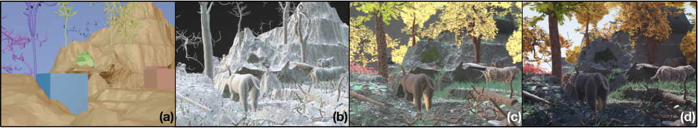<figcaption>Infinigen / Infinigen Indoors · Fig. 13（Infinigen）：(a) 程序化场景布局 + 随机相机 → (b) 生成所需资产 → (c) 施加程序化材质与位移 → (d) 渲染照片级图像</figcaption></figure>

<figure class="paper-fig">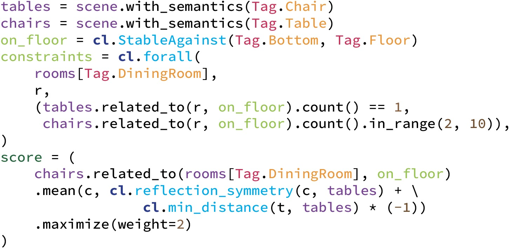<figcaption>Infinigen / Infinigen Indoors · Fig. 9（Indoors）：用约束 DSL 声明「餐厅 1 张桌、2–10 把椅子、椅子对称且靠近桌子」，由求解器负责摆放</figcaption></figure>

- **自动化构建流程**（先读 Infinigen 的 (a)→(d)，再读 Indoors 的约束排布；图中只有字母标签，模块名取自图注）
  1. **生成器库**（图外）：182 个概率程序式生成器，共 1070 个可解释自由度（地形 26、材质 50、天气与流体 19、岩石 4、小植物 30、树 3、生物 39、表面散布 11）
     - 参数默认从贴近自然界的分布采样，用户也可以通过 Python API 覆盖任意参数
     - Node Transpiler：把美术在 Blender 里连好的 node graph 自动转成 Python 代码（后序遍历，node group 递归转成函数）；在节点名里写分布注解，转出的代码会自动插入随机数调用
  2. **(a) Scene layout + random camera poses**
     - 布局：先生成低分辨率的全场景地表，用 Poisson-disc 采样放置点，密度由法线、Perlin 噪声、地形属性等掩码调节；11 套场景配置（Arctic、Desert、Forest、Underwater 等）写入「沙漠多仙人掌」这类简单先验
     - 相机：高度从高斯分布采样；与所有物体保持最小距离；要求画面里有特定地形成分（如河流）；随机采 10 个视角，取深度方差最大的那个
  3. **(b) Generate all necessary assets**：按相机位置动态决定分辨率，让每个面在画面上小于 1 px；草、落叶等密集散布物用 instancing 复用；平均每个场景 16M 个多边形
  4. **(c) Procedural materials and displacement**：50 个材质生成器，每个由随机 shader 和对应的局部几何生成器组成
     - 禁用 bump mapping、法线插值、透明贴图等「假细节」技巧，保证几何真值精确
  5. **(d) Render a photo-real image**：Cycles 路径追踪，1920×1080，每像素 10,000 samples
  6. **真值提取**（图外）：不用 Blender 自带的 render pass（半透明、体积、运动模糊时会出错），改为用 OpenGL 直接从 mesh 计算深度、法线、遮挡边界和实例分割；光流和反照率从渲染元数据取
  7. **室内资产与房屋平面**（图外，Indoors）
     - 79 个物体生成器：家电 10 个 / 112 参数，门窗楼梯 14 / 127，家具 17 / 216，装饰 15 / 92，小物件 19 / 194；另有 30 个材质生成器 / 120 参数
     - 平面图：先由房间类型的概率上下文无关文法生成房间邻接图，再用 Mondrian 过程切分随机外轮廓，然后用模拟退火优化到入口的最短路径、房间面积、长宽比、凸性、窄通道等目标
  8. **Constraint Specification API**（Fig. 9）：用 Python DSL 声明「要什么」，不写「怎么摆」
     - 硬约束：`cl.forall(rooms[Tag.DiningRoom], …)` 要求每个餐厅桌子 `count() == 1`，椅子 `count().in_range(2, 10)`，且都满足 `cl.StableAgainst(Tag.Bottom, Tag.Floor)`
     - 软目标：`cl.reflection_symmetry` 加上负的 `cl.min_distance`，用 `.maximize(weight=2)` 加权
     - 整屋约束图有 1058 个节点，含 11 条硬约束和 25 个打分项；平均每种房间约 15 条约束，约 15 行 Python
  9. **Arrangement Solver**（图外）：模拟退火，Metropolis-Hastings 接受准则，温度从 0.25 指数降到 0.001
     - 7 种 move：增加、删除、换依附平面、重采样（重新生成物体参数）、重置位姿、平移、旋转；离散 move 的概率逐步衰减，连续 move 的概率逐步上升
     - 分三阶段求解：大件 → 中件 → 小件；每个物体的自由度由它的依附关系限定（靠墙的书架只能沿墙线移动）
     - 物体尺寸参数也在搜索空间内，求解器会根据可用空间自动调整桌子大小
  10. **导出**（图外）：一键导出 USD，自动 UV 展开并把程序化材质烘焙成标准贴图；单个物体可导出为 OBJ / FBX / STL，并自动生成带碰撞和关节信息的 URDF
- **质量控制**
  - 不做事后过滤，靠「构造即正确」
    - 几何都是真几何，真值直接从 mesh 算，不依赖渲染 pass
    - 相机启发式（最小距离、目标成分覆盖、深度方差择优）拒绝空洞或被遮挡的画面
    - 生物分布校准：手工建模 30 个头部和身体样例，确认随机分布能覆盖它们
  - Indoors：硬约束保证碰撞、稳定性和数量正确；求解器消融显示，去掉碰撞检测或对称项后画面质量下降（论文只给出对比图，没有量化数字）
  - 人工感知评测：在真实感、布局真实感、错误少三项上，受试者都更偏好 Infinigen Indoors，而不是 ATISS 等基线
- **关键数字**
  - 工程量：Infinigen 主分支 40,485 行代码
  - 渲染成本：1000 次试验中，生成一对 1080p 立体图平均耗时 3.5 小时（2 颗 Xeon Silver 4114 + 1 张 GPU），其中约 1 小时用 GPU 渲染，平均内存约 24GB
  - Infinigen 下游：用 30K 对立体图从零训练 RAFT-Stereo，在 Middlebury 上平均 Bad 3.0 为 29.7%（SceneFlow 25.0%、FallingThings 28.6%）；自然物体 Jadeplant 为 35.2%，优于所有对比数据集
  - Indoors 求解器：5K 步平均耗时 2280.68 s，比未优化版快约 3 倍，提速主要来自 BVH 缓存和 plane hashing；与未优化版跑同样时长，得分高 28%
  - Indoors 下游
    - 遮挡边界：1464 张图训练 U-Net，ODS 29.47，高于 Hypersim 的 26.02 和 Infinigen 自然版的 14.38
    - 阴影去除：加入 2K 对合成图后，SRD 零样本 PSNR 从 22.83 升到 24.56
  - 实时性：导出到 UE5 跑 60 FPS，Isaac Sim 开物理跑 50 FPS（RTX 4090）
- **局限**
  - 单张图成本很高（3.5 小时 / 对），规模受算力限制
  - 自然版缺少平面和无纹理表面，在 Middlebury 室内场景上泛化差；场景先验只有简单的密度规则，捕食者和猎物互相回避、阴影处不长植物这类复杂关系都没有
  - Indoors 的约束要人手写（每种房间约 15 条）；加入合成数据后在 ISTD 上反而略降
  - 程序化材质依赖 Blender shader，导出到其他引擎必须先烘焙
  - 生成器代码庞大，每个资产不自带自然语言描述；要做「文本 → Blender 代码」还需另配 caption
- **可借鉴**
  - Node Transpiler 思路：把 Blender node graph 自动转成 Python，美术连节点，产出的就是可执行的 Blender 代码语料；节点名里的分布注解直接变成随机参数
  - 生成器 = 带可解释参数的概率程序：采样参数 → 执行 → 渲染，每条样本都有「参数 / 代码 / 图 / 真值」严格对齐，参数本身就可以作为代码生成的监督目标
  - 用声明式约束 DSL 加通用求解器，把「要什么」和「怎么摆」分开：写约束只需约 15 行 / 房间，适合让 LLM 生成约束程序、再由求解器兜底
  - 相机选择用「随机 10 个取深度方差最大」这种便宜的启发式，自动避开空画面
  - 真值从几何直接算，不依赖渲染 pass；分辨率跟随相机动态调整，控制多边形预算

</details>

<a class="anchor" id="3d-2-2-4"></a>

<details class="deep"><summary><span class="deep-title"> 2.2.4 CAD-Recode（2024-12）+ cadrille（2025-05） <span class="org">Artec3D · Univ. Luxembourg · AIRI</span> <a class="hf" href="https://huggingface.co/datasets/filapro/cad-recode"><span class="hf-b hf-dl" title="downloads"><svg class="hf-i" viewBox="0 0 24 24" fill="none" stroke="currentColor" stroke-width="2.2" stroke-linecap="round" stroke-linejoin="round"><path d="M12 3v11"/><path d="M8 11l4 4 4-4"/><path d="M4 20h16"/></svg>4.1k</span></a></span></summary>

- **定位**：纯程序化合成 1M 条可执行 CadQuery 代码；在此基础上，cadrille 加了基于几何反馈的在线 RL。
<figure class="paper-fig">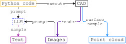<figcaption>cadrille · Fig. 2：从真值 CAD 派生文本、多视图图像、点云三种输入</figcaption></figure>

<figure class="paper-fig">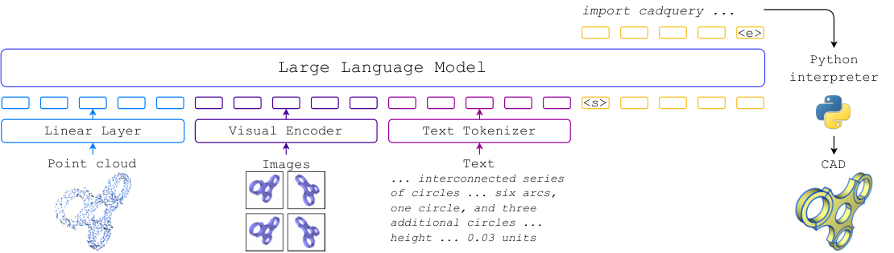<figcaption>cadrille · Fig. 3：三模态统一进 LLM，输出 CadQuery 代码，由 Python 解释器执行出 CAD</figcaption></figure>

<div class="ds-demo"><div class="ds-head"><b>数据样例</b> · <a href="https://huggingface.co/datasets/filapro/cad-recode">filapro/cad-recode</a> · 约 100 万条训练、约 1,000 条验证 CadQuery 程序，每条一个 .py 文件 · 展示字段：code（仓库只含代码，没有网格或点云，故无图）</div><div class="ds-grid"><div class="ds-card"><div class="ds-meta">YZ 平面上圆柱与多段线草图拉伸体做布尔并（train/batch_00/1.py）</div><details class="ds-code"><summary>code（Python，共 3 行）</summary><pre>import cadquery as cq&#10;w0=cq.Workplane('YZ',origin=(-1,0,0))&#10;r=w0.workplane(offset=-13/2).moveTo(24,3).cylinder(13,12).union(w0.sketch().segment((-50,-8),(-26,-19)).segment((-26,-26)).segment((30,-26)).segment((30,2)).segment((50,2)).segment((50,4)).segment((30,4)).segment((30,26)).segment((-26,26)).segment((-26,21)).segment((-35,25)).close().assemble().finalize().extrude(15))</pre></details></div><div class="ds-card"><div class="ds-meta">ZX 平面上由圆弧与线段围成的对称轮廓，中心减去一个圆孔后拉伸（train/batch_00/2.py）</div><details class="ds-code"><summary>code（Python，共 3 行）</summary><pre>import cadquery as cq&#10;w0=cq.Workplane('ZX',origin=(0,-16,0))&#10;r=w0.sketch().arc((-37,-15),(-31,-26),(-21,-34)).segment((-21,-50)).segment((21,-50)).segment((21,-34)).arc((30,-26),(37,-15)).segment((30,-15)).arc((33,0),(30,15)).segment((37,15)).arc((30,26),(21,34)).segment((21,50)).segment((-21,50)).segment((-21,34)).arc((-31,26),(-37,15)).segment((-31,15)).arc((-34,0),(-31,-15)).close().assemble().circle(6,mode='s').finalize().extrude(32)</pre></details></div><div class="ds-card"><div class="ds-meta">两个工作平面、矩形 / 圆 / 圆弧草图四次拉伸后并在一起（train/batch_00/5.py）</div><details class="ds-code"><summary>code（Python，共 4 行）</summary><pre>import cadquery as cq&#10;w0=cq.Workplane('YZ',origin=(26,0,0))&#10;w1=cq.Workplane('XY',origin=(0,0,-24))&#10;r=w0.sketch().push([(14,-16.5)]).rect(32,33).push([(22,30)]).rect(18,40).finalize().extrude(-52).union(w0.sketch().push([(14,-16)]).circle(24).push([(-4,-24.5)]).rect(2,9,mode='s').finalize().extrude(-24)).union(w0.sketch().segment((-38,-50),(2,-50)).segment((2,-44)).arc((12,-26),(2,-8)).segment((2,6)).segment((-38,6)).close().assemble().finalize().extrude(-2)).union(w1.sketch().segment((-4,-8),(7,-8)).arc((1,-4),(-4,2)).close().assemble().finalize().extrude(-12))</pre></details></div></div></div>

- **管线步骤**
  - 真值来源（CAD-Recode，纯程序化，论文无流程图）
    1. 草图：3–8 个圆或旋转矩形做并、差运算，抽出边界环并校验拓扑
    2. 在随机的标准平面上拉伸，多个体合并；坐标量化到 [−100, 100]
    3. Python 语法检查 + BRepCheck 几何检查双重校验，再去重、归一化到单位包围盒 → 1M 条 CadQuery 代码
  - Fig. 2 · 派生多模态输入
    4. **Point cloud**：在真值 B-Rep 的参数曲面上直接采点
    5. **Images**：B-Rep 三角化成网格，渲染多视图
    6. **Text**：沿用 Text2CAD 的标注协议生成描述
  - Fig. 3 · 训练
    7. 点云经 **Linear Layer**、图像经 **Visual Encoder**、文本经 **Text Tokenizer**，统一送进 **LLM**，输出 `import cadquery ...`
    8. **Python interpreter** 执行出 CAD；SFT 之后，用执行得到的几何反馈做在线 RL（论文用 Dr. CPPO）
- **关键数字**
  - 1M 程序化数据 vs DeepCAD 160K：平均 CD 1.98 → 0.30，IoU 80.7% → 92.0%
- **局限**
  - 只覆盖 sketch-extrude，没有旋转、倒角、B 样条
  - 程序化分布和真实工业件之间有差距
- **可借鉴**
  - 「随机程序 → 执行 → 校验」可以无限生成代码–几何对，而且真值零成本
  - 规模远比「真实但少」有效：程序化 1M 在真实测试集上胜过 DeepCAD

</details>

以下工作的采用度较低（下载量或 star 数为几十到几百），但带有可验证奖励或多轮修复轨迹。

<a class="anchor" id="3d-2-2-5"></a>

<details class="deep"><summary><span class="deep-title"> 2.2.5 MeshCoder（2025-08） <span class="org">Shanghai AI Lab · Tsinghua</span> <a class="hf" href="https://huggingface.co/datasets/InternRobotics/MeshCoderDataset"><span class="hf-b hf-dl" title="downloads"><svg class="hf-i" viewBox="0 0 24 24" fill="none" stroke="currentColor" stroke-width="2.2" stroke-linecap="round" stroke-linejoin="round"><path d="M12 3v11"/><path d="M8 11l4 4 4-4"/><path d="M4 20h16"/></svg>283</span></a></span></summary>

- **定位**：把复杂 3D 对象拆成带语义的部件，每个部件是一段 Blender Python 代码，提供开源的对象–代码配对。
<figure class="paper-fig">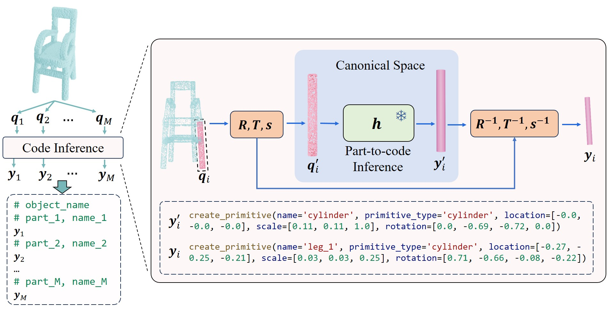<figcaption>MeshCoder · Fig. 5：用部件→代码模型把整件物体转成对象级代码</figcaption></figure>

<div class="ds-demo"><div class="ds-head"><b>数据样例</b> · 未能取到样本：<a href="https://huggingface.co/datasets/InternRobotics/MeshCoderDataset">InternRobotics/MeshCoderDataset</a> 为需申请访问的 gated 数据集，未登录时 rows 接口与文件下载均被拒绝</div></div>

- **管线步骤**
  - 前置 · 部件级（图外）
    1. 自定义表达力更强的 Blender API：图元、扫掠、bridge loop、布尔、阵列
    2. 随机参数合成部件级点云–代码对，约 10M 条
    3. 训练部件→代码模型 **h**（三平面 tokenizer + Llama-3.2-1B）；图中雪花表示这一步里 h 被冻结
  - Fig. 5 · 对象级（对照上图）
    4. **左上**：Infinigen Indoor 的 157 万个实例，拆成部件点云 `q_1 … q_M`
    5. **右侧放大框**：每个部件 `q_i` 先用 **R, T, s** 变换到 **Canonical Space** 得到 `q'_i` → 冻结的 **h** 推理出代码 `y'_i` → 用 **R⁻¹, T⁻¹, s⁻¹** 变回原位得到 `y_i`
       - 下方代码框：`y'_i` 是规范空间里的原始圆柱，`y_i` 带上真实位置、尺度和名字 `leg_1`
    6. **左下**：按 `# part_k, name_k` 顺序拼成整件物体的代码
    7. 过滤：所有部件 CD ≤ 5e-3 才保留 → 约 1M 条对象–代码对（41 类）
    8. 以部件模型为初始化，训练对象→代码模型
- **关键数字**
  - IoU 86.75%（PLAD 67.62%），CD 0.063e-2
  - 部件阶段训练用 64×A100，约 1 周
- **局限**
  - 只适用于人造物，有机形体做不了
  - 代码里没有颜色和材质
  - HF 只放出了 100K 对象
- **可借鉴**
  - 「程序化生成器（Infinigen）→ 逆向转写成代码 → 用 CD 过滤」是把任意 3D 资产变成代码数据的通用范式
  - 先部件后对象的课程顺序，适合长代码的视觉编程任务

</details>

<a class="anchor" id="3d-3"></a>

## 3 In-House Data Pipeline

待补充。

</div>

<div class="env-view" data-view="game" data-label="Game">

<nav class="toc view-toc"><h2>Contents</h2><ul><li class="l2"><a href="#game-1"><span class="num">1</span> Open Benchmarks</a></li><li class="l2"><a href="#game-2"><span class="num">2</span> Open Data Pipelines</a></li><li class="l2"><a href="#game-3"><span class="num">3</span> In-House Data Pipeline</a></li></ul></nav>

<a class="anchor" id="game-1"></a>

## 1 Open Benchmarks

<a class="anchor" id="game-1-1"></a>

### 1.1 Benchmark

核心发现：没有任何厂商报告公开的游戏生成 benchmark。游戏方向的分数只来自自建评测集的子类，其余都是 demo。

<table class="frontier"><thead><tr><th>Benchmark</th><th>模型</th><th>分数</th><th>口径</th><th>来源</th></tr></thead><tbody><tr><td rowspan="1" class="bench">Kimi Webdev Bench · Games<span class="self-tag">自建</span></td><td> Kimi K3</td><td>胜 55.6 / 平 3.7 / 负 40.7</td><td>对 Claude Opus 4.8，专家盲评</td><td><a href="https://github.com/MoonshotAI/Kimi-K3/blob/main/k3_tech_report.pdf">Blog</a></td></tr><tr><td rowspan="8" class="bench">未报告相关分数</td><td> GPT-6 Astra</td><td>未报告</td><td>Three.js + WebGPU 太空游戏</td><td><a href="https://developers.openai.com/blog/how-to-build-games-with-astra">Blog</a></td></tr><tr><td> Claude Fable 5</td><td>未报告</td><td>玩宝可梦、Slay the Spire（玩游戏，不是做游戏）</td><td><a href="https://www.anthropic.com/news/claude-fable-5-mythos-5">Blog</a></td></tr><tr><td> Claude Opus 5</td><td>未报告</td><td>只报了 ARC-AGI-3（30.2%），测交互式环境推理，是玩游戏不是做游戏</td><td><a href="https://www.anthropic.com/news/claude-opus-5">Blog</a></td></tr><tr><td> Gemini 3.8 Flash</td><td>未报告</td><td>一句提示生成 3D 城堡解谜游戏</td><td><a href="https://blog.google/innovation-and-ai/models-and-research/gemini-models/3-8-flash-and-3-8-flash-cyber/">Blog</a></td></tr><tr><td> GLM-5.3-Flash</td><td>未报告</td><td>Godot 游戏</td><td><a href="https://docs.z.ai/guides/vlm/glm-5.3-flash">Blog</a></td></tr><tr><td> Qwen3.8-Max</td><td>未报告</td><td>一句话生成游戏</td><td><a href="https://qwen.ai/blog?id=qwen3.8">Blog</a></td></tr><tr><td> Seed2.1 Pro</td><td>未报告</td><td>只报了 GameWorld（31.2），测玩浏览器游戏，不是做游戏</td><td><a href="https://lf3-static.bytednsdoc.com/obj/eden-cn/lapzild-tss/ljhwZthlaukjlkulzlp/seed2.1/Seed2_1_Model_Card.pdf">Blog</a></td></tr><tr><td> Hy4 preview</td><td>未报告</td><td>单个 prompt 生成可玩原型（文字描述）</td><td><a href="https://huggingface.co/tencent/Hy4-preview">Blog</a></td></tr></tbody></table>

数据解读：

- **游戏生成没有公开 benchmark 进入厂商的发布材料。** Benchmark Timeline by Capability 总表中的 GameDevBench、PlaytestArena、GameEngineBench 等都没有厂商报告。
- **现有的游戏类分数有两种，都不是在测做游戏。** 一种是自建评测集的子类（Kimi Webdev Bench 的 Games、GLM CC-Bench-V2 的 Web Games、QwenWebBench 的 Games），题目不公开；另一种是玩游戏的能力（GameWorld、ARC-AGI-3、宝可梦）。
- **这是一个空白。** 游戏生成可以用单元测试和 agent 试玩自动验收，具备建立公开 benchmark 的条件。

<a class="anchor" id="game-1-2"></a>

### 1.2 Benchmark Timeline

游戏类 benchmark 数量不多。本文用三个维度比较它们：

- **任务形态（Task Form）**：从零生成可玩的游戏、在已有工程上修改、查找 bug。
- **引擎（Engine）**：Pygame、浏览器 JavaScript、Godot、UE5 C++。越靠后越接近商业工程。
- **验收方式（Evaluation）**：
  - 沙箱运行加视觉检查：只能证明游戏可以运行。
  - 单元测试或行为测试：证明逻辑正确。
  - Agent 试玩加 rubric：证明游戏可以玩。

三个维度对应五种能力：可运行、可玩、资产与着色器、工程架构、查找 bug。

> 下表按发布时间排序。名称前为参与机构的 logo，工业界和学术界各取一个；名称链接到论文。Download 列为数据下载入口。影响力列只填写有公开数字的项目（GitHub star 或 HF 下载量）。

<table class="merged"><thead><tr><th>发布日期</th><th>名称</th><th>类型</th><th>来源</th><th>形态</th><th>规模/题量</th><th>影响力</th><th>说明</th></tr></thead><tbody><tr><td>2023/2/11</td><td> <a href="https://arxiv.org/abs/2302.05817">Level Generation Through LLMs</a> <span class="org">NYU</span></td><td><span class="type type-data">数据集</span></td><td><a class="src src-gh" href="https://github.com/gdrtodd/lm-pcg">GitHub</a></td><td>Sokoban 关卡文本</td><td>—</td><td><a class="hf" href="https://github.com/gdrtodd/lm-pcg"><span class="hf-b hf-st" title="GitHub stars"><svg class="hf-i" viewBox="0 0 24 24" fill="currentColor"><path d="M12 2.5l2.9 6 6.6.6-5 4.3 1.5 6.5L12 16.9 6 20.9l1.5-6.5-5-4.3 6.6-.6z"/></svg>5</span></a></td><td><strong>可玩性校验</strong>：LLM 生成 Sokoban 关卡再验可解，效果随数据量提升</td></tr><tr class="top5"><td>2023/2/12</td><td>  <a href="https://arxiv.org/abs/2302.05981">MarioGPT</a> <span class="org">modl.ai · IT University of Copenhagen</span></td><td><span class="type type-data">数据集</span></td><td><a class="src src-gh" href="https://github.com/shyamsn97/mario-gpt">GitHub</a></td><td>文本→瓦片关卡</td><td>—</td><td><a class="hf" href="https://github.com/shyamsn97/mario-gpt"><span class="hf-b hf-st" title="GitHub stars"><svg class="hf-i" viewBox="0 0 24 24" fill="currentColor"><path d="M12 2.5l2.9 6 6.6.6-5 4.3 1.5 6.5L12 16.9 6 20.9l1.5-6.5-5-4.3 6.6-.6z"/></svg>1.2k</span></a></td><td><strong>文本控关卡</strong>：VGLC 马里奥关卡微调 GPT-2，新颖性搜索开放扩增</td></tr><tr><td>2024/3/30</td><td> <a href="https://arxiv.org/abs/2404.00276">IDGE</a> <span class="org">SJTU</span></td><td><span class="type type-data">数据集</span></td><td><a class="src src-gh" href="https://github.com/gingasan/idge">GitHub</a></td><td>规则+动作→下一状态</td><td>—</td><td><a class="hf" href="https://github.com/gingasan/idge"><span class="hf-b hf-st" title="GitHub stars"><svg class="hf-i" viewBox="0 0 24 24" fill="currentColor"><path d="M12 2.5l2.9 6 6.6.6-5 4.3 1.5 6.5L12 16.9 6 20.9l1.5-6.5-5-4.3 6.6-.6z"/></svg>13</span></a></td><td><strong>LLM 当游戏引擎</strong>：课程式 next-state 预测，以扑克为例</td></tr><tr class="top5"><td>2025/5/20</td><td> <a href="https://arxiv.org/abs/2505.13886">Game-RL / Code2Logic / GameQA</a> <span class="org">Fudan</span></td><td><span class="type type-data">数据集</span></td><td><a class="src src-hf" href="https://huggingface.co/datasets/OpenMOSS-Team/GameQA-140K">HF</a></td><td>游戏代码→可验证 VQA</td><td>140K</td><td><a class="hf" href="https://huggingface.co/datasets/OpenMOSS-Team/GameQA-140K"><span class="hf-b hf-dl" title="downloads"><svg class="hf-i" viewBox="0 0 24 24" fill="none" stroke="currentColor" stroke-width="2.2" stroke-linecap="round" stroke-linejoin="round"><path d="M12 3v11"/><path d="M8 11l4 4 4-4"/><path d="M4 20h16"/></svg>3.7k</span></a></td><td><strong>可验证推理数据</strong>：改写游戏代码批量产状态图+问答真值，难度可控</td></tr><tr><td>2025/9/24</td><td>  <a href="https://arxiv.org/abs/2509.20136">V-GameGym</a> <span class="org">Alibaba · Shanghai AI Lab</span></td><td><span class="type type-bench">Benchmark</span></td><td><a class="src src-hf" href="https://huggingface.co/datasets/alibabagroup/SKYLENAGE-GameCodeGym">HF</a></td><td>需求→Pygame</td><td>2,219</td><td><a class="hf" href="https://github.com/alibaba/SKYLENAGE-GameCodeGym"><span class="hf-b hf-st" title="GitHub stars"><svg class="hf-i" viewBox="0 0 24 24" fill="currentColor"><path d="M12 2.5l2.9 6 6.6.6-5 4.3 1.5 6.5L12 16.9 6 20.9l1.5-6.5-5-4.3 6.6-.6z"/></svg>10</span></a></td><td><strong>可玩视觉游戏</strong>：沙箱运行评代码、画面与可玩性</td></tr><tr><td>2025/9/24</td><td>  <a href="https://arxiv.org/abs/2509.20136">V-GameGym</a> <span class="org">Alibaba · Shanghai AI Lab</span></td><td><span class="type type-data">数据集</span></td><td><a class="src src-hf" href="https://huggingface.co/datasets/alibabagroup/SKYLENAGE-GameCodeGym">HF</a></td><td>需求→Pygame</td><td>2,219</td><td><a class="hf" href="https://huggingface.co/datasets/alibabagroup/SKYLENAGE-GameCodeGym"><span class="hf-b hf-dl" title="downloads"><svg class="hf-i" viewBox="0 0 24 24" fill="none" stroke="currentColor" stroke-width="2.2" stroke-linecap="round" stroke-linejoin="round"><path d="M12 3v11"/><path d="M8 11l4 4 4-4"/><path d="M4 20h16"/></svg>103</span></a></td><td><strong>真实代码聚类</strong>：筛 pygame 码聚类取优，改自动演示沙箱验证</td></tr><tr><td>2025/10/6</td><td> <a href="https://arxiv.org/abs/2510.04542">Code World Models</a> <span class="org">Google DeepMind</span></td><td><span class="type type-data">数据集</span></td><td><span class="src src-paper">论文</span></td><td>规则→Python 世界模型</td><td>10 游戏</td><td>—</td><td><strong>可执行世界模型</strong>：LLM 把规则译成状态转移代码，供 MCTS 规划</td></tr><tr class="top5"><td>2026/2/11</td><td> <a href="https://arxiv.org/abs/2602.11103">GameDevBench</a> <span class="org">Princeton</span></td><td><span class="type type-bench">Benchmark</span></td><td><a class="src src-gh" href="https://github.com/waynchi/gamedevbench">GitHub</a></td><td>Godot 任务</td><td>333</td><td><a class="hf" href="https://github.com/waynchi/gamedevbench"><span class="hf-b hf-st" title="GitHub stars"><svg class="hf-i" viewBox="0 0 24 24" fill="currentColor"><path d="M12 2.5l2.9 6 6.6.6-5 4.3 1.5 6.5L12 16.9 6 20.9l1.5-6.5-5-4.3 6.6-.6z"/></svg>126</span></a></td><td><strong>多模态游戏开发</strong>：改 shader/sprite/动画等资产与代码</td></tr><tr><td>2026/2/11</td><td> <a href="https://arxiv.org/abs/2602.11103">GameDevBench</a> <span class="org">Princeton</span></td><td><span class="type type-data">数据集</span></td><td><a class="src src-gh" href="https://github.com/waynchi/gamedevbench">GitHub</a></td><td>游戏开发任务</td><td>333</td><td><a class="hf" href="https://github.com/waynchi/gamedevbench"><span class="hf-b hf-st" title="GitHub stars"><svg class="hf-i" viewBox="0 0 24 24" fill="currentColor"><path d="M12 2.5l2.9 6 6.6.6-5 4.3 1.5 6.5L12 16.9 6 20.9l1.5-6.5-5-4.3 6.6-.6z"/></svg>126</span></a></td><td><strong>教程提炼任务</strong>：从网页/视频教程提炼着色器、精灵、动画等任务</td></tr><tr><td>2026/4/3</td><td> <a href="https://arxiv.org/abs/2604.02648">GBQA</a> <span class="org">HKU</span></td><td><span class="type type-bench">Benchmark</span></td><td><a class="src src-gh" href="https://github.com/camel-ai/GBQA">GitHub</a></td><td>游戏找 bug</td><td>124</td><td><a class="hf" href="https://github.com/camel-ai/GBQA"><span class="hf-b hf-st" title="GitHub stars"><svg class="hf-i" viewBox="0 0 24 24" fill="currentColor"><path d="M12 2.5l2.9 6 6.6.6-5 4.3 1.5 6.5L12 16.9 6 20.9l1.5-6.5-5-4.3 6.6-.6z"/></svg>16</span></a></td><td><strong>游戏 QA 探索</strong>：长程交互自主发现运行时 bug</td></tr><tr class="top5"><td>2026/4/20</td><td> <a href="https://arxiv.org/abs/2604.18394">OpenGame / GameCoder-27B</a> <span class="org">CUHK</span></td><td><span class="type type-data">数据集</span></td><td><span class="src src-paper">论文</span></td><td>设计→Phaser 网页游戏</td><td>未披露</td><td><a class="hf" href="https://github.com/leigest519/OpenGame"><span class="hf-b hf-st" title="GitHub stars"><svg class="hf-i" viewBox="0 0 24 24" fill="currentColor"><path d="M12 2.5l2.9 6 6.6.6-5 4.3 1.5 6.5L12 16.9 6 20.9l1.5-6.5-5-4.3 6.6-.6z"/></svg>3.0k</span></a></td><td><strong>全流程配方</strong>：Phaser 仓库续训+codex 出题 SFT+单测 RL</td></tr><tr><td>2026/4/21</td><td>  <a href="https://arxiv.org/abs/2604.19742">PlayEval（PlayCoder）</a> <span class="org">Tencent LightSpeed · SJTU</span></td><td><span class="type type-bench">Benchmark</span></td><td><a class="src src-gh" href="https://github.com/Tencent/PlayCoder">GitHub</a></td><td>需求→GUI 应用</td><td>43</td><td><a class="hf" href="https://github.com/Tencent/PlayCoder"><span class="hf-b hf-st" title="GitHub stars"><svg class="hf-i" viewBox="0 0 24 24" fill="currentColor"><path d="M12 2.5l2.9 6 6.6.6-5 4.3 1.5 6.5L12 16.9 6 20.9l1.5-6.5-5-4.3 6.6-.6z"/></svg>46</span></a></td><td><strong>可玩性验证</strong>：agent 实际试玩检出编译通过后的逻辑错误</td></tr><tr><td>2026/5/23</td><td> <a href="https://arxiv.org/abs/2605.24375">GameCWM 蒸馏</a> <span class="org">Brown</span></td><td><span class="type type-data">数据集</span></td><td><span class="src src-paper">论文</span></td><td>规则→游戏代码世界模型</td><td>30 游戏</td><td>—</td><td><strong>RLVR 蒸馏小模型</strong>：SFT 后按结构与语义性质验证代码做 RL</td></tr><tr><td>2026/5/27</td><td>  <a href="https://arxiv.org/abs/2605.28258">PlaytestArena</a> <span class="org">Xiaohongshu · Fudan</span></td><td><span class="type type-bench">Benchmark</span></td><td><span class="src src-paper">论文</span></td><td>浏览器游戏生成</td><td>200</td><td>—</td><td><strong>写码-试玩循环</strong>：GUI agent 游玩对照行为 rubric 迭代修正</td></tr><tr class="top5"><td>2026/6/16</td><td>  <a href="https://arxiv.org/abs/2606.17861">GameCraft-Bench</a> <span class="org">Tencent Hunyuan · CUHK-SZ</span></td><td><span class="type type-bench">Benchmark</span></td><td><a class="src src-gh" href="https://github.com/FreedomIntelligence/gamecraft-bench">GitHub</a></td><td>Godot 任务</td><td>140</td><td><a class="hf" href="https://github.com/FreedomIntelligence/gamecraft-bench"><span class="hf-b hf-st" title="GitHub stars"><svg class="hf-i" viewBox="0 0 24 24" fill="currentColor"><path d="M12 2.5l2.9 6 6.6.6-5 4.3 1.5 6.5L12 16.9 6 20.9l1.5-6.5-5-4.3 6.6-.6z"/></svg>225</span></a></td><td><strong>端到端做游戏</strong>：在真实引擎中从零构建可玩游戏</td></tr><tr><td>2026/6/18</td><td>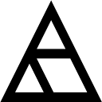  <a href="https://arxiv.org/abs/2606.19830">JAMER / JamBench</a> <span class="org">Shanda Alaya Lab · Nankai University</span></td><td><span class="type type-bench">Benchmark</span></td><td><span class="src src-paper">论文</span></td><td>游戏引擎项目</td><td>300</td><td>—</td><td><strong>项目级引擎工程</strong>：大项目架构设计而非语法才是瓶颈</td></tr><tr><td>2026/7/3</td><td>  <a href="https://arxiv.org/abs/2607.03525">GameEngineBench</a> <span class="org">Nexon · Columbia</span></td><td><span class="type type-bench">Benchmark</span></td><td><span class="src src-paper">论文</span></td><td>UE5 C++</td><td>110</td><td>—</td><td><strong>引擎 C++ 运行时</strong>：真实 UE5 仓库中编译并通过行为测试</td></tr><tr><td>2026/9/8</td><td> <a href="https://arxiv.org/abs/2609.09059">PlayTrain</a> <span class="org">Harvard</span></td><td><span class="type type-data">数据集</span></td><td><a class="src src-gh" href="https://github.com/heyodog0/playtrain">GitHub</a></td><td>规格→单文件 JS 游戏</td><td>24 游戏</td><td><a class="hf" href="https://github.com/heyodog0/playtrain"><span class="hf-b hf-st" title="GitHub stars"><svg class="hf-i" viewBox="0 0 24 24" fill="currentColor"><path d="M12 2.5l2.9 6 6.6.6-5 4.3 1.5 6.5L12 16.9 6 20.9l1.5-6.5-5-4.3 6.6-.6z"/></svg>10</span></a></td><td><strong>游戏即 RL 环境</strong>：LLM 按固定接口写 JS 游戏，直接接 gym 训练</td></tr></tbody></table>

<a class="anchor" id="game-1-3"></a>

### 1.3 Evolution

核心发现：验收标准从「能编译」提高到「能玩、能维护」。

- **2025 年：第一批游戏生成 benchmark。** V-GameGym 包含 2,219 个 Pygame 样本，评测了 70 个模型，最好的约为 45%。
- **2026 年上半年：使用真实引擎，并由 agent 试玩。** GameDevBench 包含 333 个 Godot 任务，最佳 agent 约为 54%，其中 2D 图形类只有 31.6%；加入图像和视频反馈后，Sonnet 4.5 从 33.3% 提高到 47.7%。PlayEval 中各基线的编译通过率高，但 Play@3 接近 0。PlaytestArena 中边写边试玩的 Play2Code 通过率为 66.8%，比单次生成高 37.1 个百分点。GBQA 中找 bug 最好的模型为 48.39%。
- **2026 年中：评测工程规模。** GameCraft-Bench（Godot）中最强的 agent 为 41.46%。JamBench 中运行通过率从小项目的 80.4% 降到大项目的 5.7%，主要失败原因是架构设计，不是语法。GameEngineBench（UE5 C++）最强配置的 pass@1 为 55.5%，有 31 题所有配置都没有解出。

数据解读：编译通过率会高估模型的游戏开发能力，评测必须加入试玩或行为测试。

<a class="anchor" id="game-1-4"></a>

### 1.4 Use

按目标能力选择：

- 从零生成可玩游戏：PlaytestArena、V-GameGym
- 真实引擎工程：GameDevBench（Godot）、GameEngineBench（UE5）
- 大项目架构：JamBench
- 逻辑正确性与查找 bug：PlayEval、GBQA

只看编译结果或截图的评测会高估模型，必须有 agent 试玩或行为测试。

<a class="anchor" id="game-2"></a>

## 2 Open Data Pipelines

<a class="anchor" id="game-2-1"></a>

### 2.1 Observations

- **没有规模化的开源「游戏代码加执行轨迹」训练集。** 10 条中只有 GameQA 的数据可以下载，它是由游戏代码生成的视觉问答数据，不是代码生成数据。
- **最接近的工作**：V-GameGym（2.2K 条，偏评测）、OpenGame（只公开了框架）、PlayTrain（把游戏用作强化学习环境）。
- **游戏可以自动验证。** 单元测试和试玩 agent 都能给出可验证的奖励，适合构建自动化数据管线。

<a class="anchor" id="game-2-2"></a>

### 2.2 Deep Dives

游戏方向没有同时满足「数据开源、规模化、可验证」的工作。细讲按采用度挑选了影响最大的三条，说明它们的数据如何自动合成。

| 候选 | 数据开源 | 规模 | 可验证信号 | 多轮修复轨迹 | 采用度 | 结论 |
|---|---|---|---|---|---|---|
| GameQA | ✓ | 140K | 游戏代码生成真值 | ✗ | 3.7k 下载 | **细讲** |
| OpenGame / GameCoder | 仅框架 | 未披露 | 单测 + 无头浏览器 | ✗ | 3.0k star | **细讲** |
| MarioGPT | 仅代码 | — | 可玩性 | ✗ | 1.2k star | **细讲** |
| V-GameGym | ✓ | 2,219 | 沙箱运行 | ✗ | 103 下载 | 未选：规模太小，偏评测 |

<a class="anchor" id="game-2-2-1"></a>

<details class="deep"><summary><span class="deep-title"> 2.2.1 Code2Logic / GameQA（2025-05） <span class="org">Fudan · Shanghai Innovation Institute</span> <a class="hf" href="https://huggingface.co/datasets/OpenMOSS-Team/GameQA-140K"><span class="hf-b hf-dl" title="downloads"><svg class="hf-i" viewBox="0 0 24 24" fill="none" stroke="currentColor" stroke-width="2.2" stroke-linecap="round" stroke-linejoin="round"><path d="M12 3v11"/><path d="M8 11l4 4 4-4"/><path d="M4 20h16"/></svg>3.7k</span></a></span></summary>

- **定位**：把「LLM 写的游戏代码」反过来当成数据引擎，批量产出答案可验证的游戏状态推理 VQA，给 VLM 做 RL；它证明了**游戏代码本身就是可无限复用的标注器**

<figure class="paper-fig">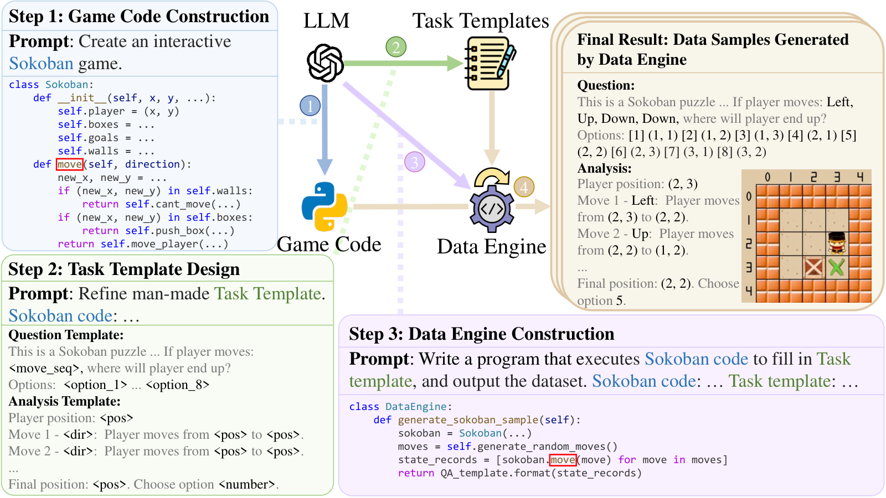<figcaption>Code2Logic / GameQA · Fig. 1：LLM 先写游戏代码，再抽出问答模板，最后写一个复用游戏逻辑的数据引擎批量出题</figcaption></figure>

<div class="ds-demo"><div class="ds-head"><b>数据样例</b> · <a href="https://huggingface.co/datasets/OpenMOSS-Team/GameQA-140K">OpenMOSS-Team/GameQA-140K</a> · 约 14 万条游戏状态图问答，30 款游戏分属 4 类认知能力；样本取自官方 300 条 preview 文件 · 展示字段：image、question、answer、analysis、refinement</div><div class="ds-grid"><div class="ds-card">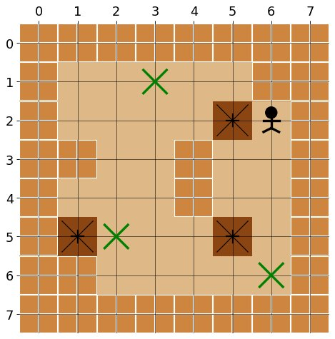<div class="ds-meta">推箱子（Strategic Planning / Target Perception）：找出玩家所在坐标，8 选 1，答案为选项 3 即 (2, 6)；data_id = sokoban-data-01018-00004，画面难度 Medium，问题难度 Easy</div><details class="ds-code"><summary>question + answer（共 12 行，全文）</summary><pre>This is a Sokoban puzzle where black figure is player, green X is target, brown box with X is box to push, brown tiles are walls, and light brown areas are movable spaces.The coordinates (x, y) in this puzzle represent the matrix format.What is the current position of the player (row, column)?&#10;Options:&#10;[1] (5, 6)&#10;[2] (2, 4)&#10;[3] (2, 6)&#10;[4] (6, 3)&#10;[5] (6, 5)&#10;[6] (5, 3)&#10;[7] (4, 1)&#10;[8] (1, 4)&#10;&#10;【answer】3</pre></details><details class="ds-code"><summary>analysis（程序生成的推理过程）（共 6 行，全文）</summary><pre>- Player position: (2, 6)&#10;- Boxes positions: (2, 5), (5, 1), (5, 5)&#10;- Target positions: (1, 3), (5, 2), (6, 6)&#10;The player is currently at position (2, 6).&#10;&#10;So the answer is (2, 6). The option number is 3.</pre></details><details class="ds-code"><summary>refinement（改写后的思维链）（共 22 行，全文）</summary><pre>I will carefully analyze the question and the image and provide detailed reasoning steps.&#10;&#10;1. **Understanding the Puzzle Layout**:&#10;   - The puzzle is a Sokoban game, which involves a player (black figure), boxes (brown box with X), targets (green X), walls (brown tiles), and movable spaces (light brown areas).&#10;   - The coordinates (x, y) are given in matrix format, where the first number represents the row and the second number represents the column.&#10;&#10;2. **Identifying Key Elements**:&#10;   - **Player Position**: The player is represented by a black figure. We need to locate this figure in the puzzle.&#10;   - **Box Positions**: There are three boxes, each represented by a brown box with an X. Their positions are given as (2, 5), (5, 1), and (5, 5).&#10;   - **Target Positions**: There are three targets, each represented by a green X. Their positions are given as (1, 3), (5, 2), and (6, 6).&#10;&#10;3. **Locating the Player**:&#10;   - We need to find the black figure (player) in the puzzle. According to the ground truth, the player is at position (2, 6).&#10;&#10;4. **Verifying the Player Position**:&#10;   - The player is located in the second row and the sixth column of the puzzle grid.&#10;   - This position is consistent with the ground truth provided.&#10;&#10;5. **Conclusion**:&#10;   - The current position of the player is (2, 6).&#10;&#10;Therefore, the correct answer is (2, 6), which corresponds to option [3].</pre></details></div><div class="ds-card">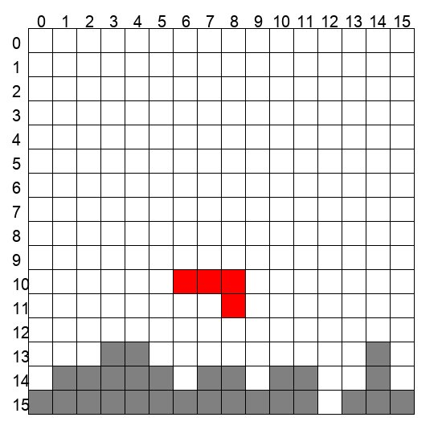<div class="ds-meta">俄罗斯方块（Pattern Recognition / State Prediction）：红色方块右移一列后还要几步落地碰撞，填空题，答案 3；data_id = tetris-03576-onestep-outcome，画面难度 Hard，问题难度 Medium</div><details class="ds-code"><summary>question + answer（共 14 行，全文）</summary><pre>Rules:&#10;1. The image shows a standard Tetris grid with 16 rows and 16 columns. &#10;2. The first number in a cell coordinate represents the row, and the second number represents the column.3. The action done to the falling tetromino is randomly selected between moved to left / right.&#10;4. The active tetromino falls one row every timestep.&#10;5. Collision means there is at least one cell around the falling tetromino taken by another tetromino or the boundary, which causes the falling tetromino can't continue falling or moving left/right.&#10;6. There may not be active tetromino(colored in red) falling in the image. If so, the answer should be -1. &#10;&#10;&#10;Question:&#10;If the current active Tetrimino is only moved one step (After moving right for one column), how many timesteps will it take to collide with another block or the grid boundary?&#10;&#10;&#10;&#10;【answer】3</pre></details><details class="ds-code"><summary>analysis（程序生成的推理过程）（共 3 行，全文）</summary><pre>The red cells in the image are at [(10, 6), (10, 7), (10, 8), (11, 8)].&#10;From the image we can see a falling red Tetrimino. The red tetromino has three blocks in a horizontal line with one block extending down on the right. So this is a J-shape tetromino rotated 270° clockwise.&#10;After moving right for one column, the tetromino can fall freely for 3 timesteps before colliding with another block. Therefore, it will take 3 timesteps to collide.</pre></details><details class="ds-code"><summary>refinement（改写后的思维链）（共 31 行，全文）</summary><pre>I will carefully analyze the question and the image and provide detailed reasoning steps.&#10;&#10;### Analysis and Reasoning:&#10;&#10;1. **Understanding the Tetromino Configuration:**&#10;   - The active tetromino is described as having three blocks in a horizontal line with one block extending down on the right. This configuration matches a J-shaped tetromino rotated 270° clockwise.&#10;   - The coordinates of the red cells in the image are [(10, 6), (10, 7), (10, 8), (11, 8)]. This confirms the J-shape configuration.&#10;&#10;2. **Initial Position and Movement:**&#10;   - The tetromino is initially positioned with its blocks at rows 10 and 11, and columns 6 to 8.&#10;   - The action performed is moving the tetromino one step to the right. This means the new coordinates of the tetromino will be [(10, 7), (10, 8), (10, 9), (11, 9)].&#10;&#10;3. **Checking for Collisions:**&#10;   - After moving right, the tetromino will start falling one row per timestep.&#10;   - We need to determine how many timesteps it will take for the tetromino to collide with another block or the grid boundary.&#10;&#10;4. **Falling Process:**&#10;   - **Timestep 1:** The tetromino moves from [(10, 7), (10, 8), (10, 9), (11, 9)] to [(11, 7), (11, 8), (11, 9), (12, 9)].&#10;   - **Timestep 2:** The tetromino moves from [(11, 7), (11, 8), (11, 9), (12, 9)] to [(12, 7), (12, 8), (12, 9), (13, 9)].&#10;   - **Timestep 3:** The tetromino moves from [(12, 7), (12, 8), (12, 9), (13, 9)] to [(13, 7), (13, 8), (13, 9), (14, 9)].&#10;&#10;5. **Collision Detection:**&#10;   - At the end of Timestep 3, the tetromino is at [(13, 7), (13, 8), (13, 9), (14, 9)].&#10;   - We need to check if any of these cells are occupied by another block or if they are at the boundary of the grid.&#10;   - If any of these cells are occupied or if the tetromino reaches the bottom boundary (row 16), a collision occurs.&#10;&#10;6. **Conclusion:**&#10;   - Based on the provided information, the tetromino can fall freely for 3 timesteps before colliding with another block or the grid boundary.&#10;&#10;### Answer:&#10;It will take 3 timesteps for the tetromino to collide with another block or the grid boundary after moving right for one column.</pre></details></div><div class="ds-card">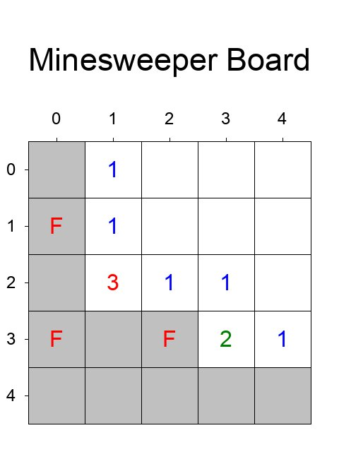<div class="ds-meta">扫雷（Multi-step Reasoning / State Prediction）：翻开 (4,3) 会发生什么，4 选 1，答案 A（踩雷）；data_id = minesweeper-train-00473-5，画面难度 Medium，问题难度 Hard</div><details class="ds-code"><summary>question + answer（共 17 行，全文）</summary><pre>This is a Minesweeper game. The size of the chessboard is 5x5, and there are a total of 5 mines hidden on the board.&#10;&#10;The numbers on the board indicate how many mines are adjacent to that cell, including diagonals. Cells marked with "F" (flagged) are identified as potential locations of mines based on logical deduction or prior knowledge. These flagged cells play a critical role in guiding your reasoning for answering the questions. Cells with no numbers and no flags are safe and contain no adjacent mines.&#10;&#10;The board uses a coordinate system where the top-left cell corresponds to (0,0), and the rows and columns are numbered starting from 0.&#10;&#10;Please use the provided board configuration and logical reasoning to deduce the correct answers to the following questions:&#10;&#10;**Question:** What will happen if the player reveals the cell at (4,3)? &#10;&#10;**Options:**&#10;A: The game will end because the cell contains a mine. &#10;B: The cell will reveal an empty area, and adjacent cells will also be revealed. &#10;C: The cell will reveal the number 8. &#10;D: The cell will reveal the number 3.&#10;&#10;【answer】A</pre></details><details class="ds-code"><summary>analysis（程序生成的推理过程）（共 1 行，全文）</summary><pre>The cell at (4,3) is a mine ('M'). This can be inferred from surrounding cells that indicate the number of adjacent mines and the flags placed by the player. If the player reveals this cell, the mine will explode and the game will end immediately, matching the scenario described by option 'A'.</pre></details><details class="ds-code"><summary>refinement（改写后的思维链）（共 36 行，全文）</summary><pre>I will carefully analyze the question and the image and provide detailed reasoning steps.&#10;&#10;**Step-by-Step Reasoning:**&#10;&#10;1. **Understanding the Board Configuration:**&#10;   - The board is a 5x5 grid.&#10;   - There are 5 mines hidden on the board.&#10;   - The numbers on the board indicate how many mines are adjacent to that cell, including diagonals.&#10;   - Cells marked with "F" are flagged as potential mine locations.&#10;   - Cells with no numbers and no flags are safe and contain no adjacent mines.&#10;&#10;2. **Analyzing the Cell at (4,3):**&#10;   - We need to determine what will happen if the player reveals the cell at (4,3).&#10;&#10;3. **Evaluating the Surrounding Cells:**&#10;   - Look at the cells adjacent to (4,3) to understand the number of mines around it.&#10;   - Check the numbers on the adjacent cells to infer the presence of mines.&#10;&#10;4. **Using Logical Deduction:**&#10;   - If the cell at (4,3) is a mine, it will be marked with 'M'.&#10;   - If the cell at (4,3) is not a mine, it will reveal a number indicating the number of adjacent mines or an empty area if there are no adjacent mines.&#10;&#10;5. **Considering the Flags:**&#10;   - Flags indicate potential mine locations.&#10;   - If the cell at (4,3) is flagged, it suggests that the player believes it contains a mine.&#10;&#10;6. **Determining the Outcome:**&#10;   - If the cell at (4,3) is a mine, revealing it will end the game immediately.&#10;   - If the cell at (4,3) is not a mine, revealing it will either show a number or an empty area, and adjacent cells may also be revealed.&#10;&#10;7. **Conclusion:**&#10;   - Based on the provided ground truth, the cell at (4,3) is a mine.&#10;   - Revealing this cell will cause the mine to explode, ending the game immediately.&#10;&#10;**Answer:**&#10;A: The game will end because the cell contains a mine.</pre></details></div></div></div>

- **自动化合成流程**（对照上图，从左往右读）
  1. **Step 1: Game Code Construction**：用一句 prompt 让 LLM（Claude 3.5 / GPT-4o）写出可交互的游戏（如 Sokoban）
     - 输入：游戏名；输出：包含状态空间和状态转移函数（如 `move`）的游戏代码
     - LLM 写不对的复杂玩法，就检索开源实现提供给 LLM 改写（Spider Solitaire、Klondike、Space Invaders）
  2. **Step 2: Task Template Design**：由 LLM 辅助设计、精修 **Question Template** 与 **Analysis Template**
     - 一个模板对应一种推理模式，分三类：Target Perception、State Prediction、Strategy Optimization
     - 输入：游戏代码；输出：带槽位的问题 / 推理过程模板（如 `<move_seq>`、`<pos>`）；LLM 也能直接提出新任务
  3. **Step 3: Data Engine Construction**：LLM 根据「游戏代码 + 模板」写出 `DataEngine` 程序，分四个模块
     - 环境初始化：直接复用 Step 1 的初始化函数，随机生成棋盘
     - 出题：生成一段随机动作序列作为题目实例
     - 解题：用对应算法求解，状态预测任务直接复用游戏的 `move` 逻辑逐步模拟（碰撞、推箱都由代码处理）
     - 填模板：动作序列填进问题模板，状态轨迹填进推理过程模板
  4. **Final Result: Data Samples Generated by Data Engine**：执行引擎，批量产出「游戏截图 + 问题 + 带步骤的推理过程 + 答案」
     - 题型只有选择（平均约 7 个选项）和填空（数字 / 坐标），保证答案可自动判对
     - 难度由代码参数控制：QA Level 与 Plot Level（网格大小）各分 3 档
  5. **推理改写增强**（图外）：InternVL2.5-78B 只看文本（题目、原推理过程、答案）改写推理过程，打破模板化句式
     - 不给图，因为实验发现模型看图会引入视觉错误
- **质量控制**
  - 游戏代码：人工运行游戏，显示或逻辑有错就反馈给 LLM 重写
  - 数据引擎：人工测试首版，不符合模板或答案错误就让 LLM 重写
  - 抽检：STEM 学生检查初始样本；GPT-4o 与 Claude-3.5 Sonnet 检查可理解性；增强后随机子集人工核对推理
  - 自动过滤：按长度、4-gram 重复率 >70%、答案错误过滤，约 150K → 126,760 条（训练集）
- **关键数字**
  - 规模：30 个游戏、158 个任务、约 140K 题；训练集 20 个游戏 / 102 个任务 / 126,760 题，测试集 30 个游戏 / 15,047 题
  - 成本：每个游戏走完主要步骤耗时 4–12 小时，平均 7.5 小时；引擎建好后可无限出题
  - 效果：只用 5K 条 GameQA 做 GRPO，Qwen2.5-VL-7B 在 7 个通用视觉基准上平均 +2.33%；未见过的游戏上提升 1.16%–3.82%
  - 规模律：游戏数越多（4 → 20 个）泛化越好；数据量扩到 20K 条总体仍在上升
- **局限**
  - 每个游戏仍需人工试玩代码、测试引擎，平均 7.5 小时，不是端到端全自动
  - 产物是「看图答题」的推理数据，不是游戏代码本身；游戏代码只是中间产物
  - 只覆盖回合制 / 静态截图可表达的状态，实时动作类玩法被转成静态快照
  - SFT 用这份数据在域外泛化不如 GRPO，推理过程的用法仍待探索
- **可借鉴**
  - 游戏代码的状态转移函数直接当求解器，答案由程序算出而不是模型生成，天然可验证
  - 「模板 = 一种推理模式」：每加一个模板就多一类任务，扩展成本线性可控
  - 难度用代码参数（网格大小、步数）显式控制，便于做课程学习与分档评测
  - 模板化推理过程用纯文本 LLM 改写 + n-gram 去重兜底，兼顾多样性与正确性

</details>

<a class="anchor" id="game-2-2-2"></a>

<details class="deep"><summary><span class="deep-title"> 2.2.2 OpenGame / GameCoder（2026-04） <span class="org">CUHK MMLab</span> <a class="hf" href="https://github.com/leigest519/OpenGame"><span class="hf-b hf-st" title="GitHub stars"><svg class="hf-i" viewBox="0 0 24 24" fill="currentColor"><path d="M12 2.5l2.9 6 6.6.6-5 4.3 1.5 6.5L12 16.9 6 20.9l1.5-6.5-5-4.3 6.6-.6z"/></svg>3.0k</span></a></span></summary>

- **定位**：唯一直接面向「从自然语言生成完整可玩 Phaser 网页游戏」的开源框架，GameCoder-27B 的三段训练数据（CPT 语料 → 合成指令 SFT → 单测奖励 RL）是游戏代码模型训练数据配方的直接参照

<figure class="paper-fig">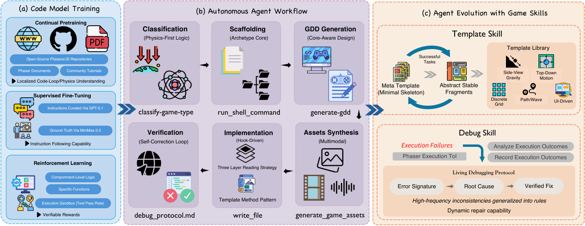<figcaption>OpenGame / GameCoder · Fig. 2：左栏是 GameCoder-27B 的三段训练数据管线，中栏是六阶段造游戏 agent，右栏是模板库与调试协议的自我进化</figcaption></figure>

- **自动化合成流程**（对照上图，从左往右读）
  1. **Continual Pretraining**：爬取语料，没有合成环节
     - 来源：**Open-Source Phasers/JS Repositories**（GitHub 上的 Phaser 与 JS/TS 游戏仓库）、**Phaser Documents**、**Community Tutorials**
     - 目标：**Localized Code-Loop/Physics Understanding**，建立游戏循环、物理、资源、状态管理的先验
     - 语料规模、清洗与去重方式：未披露
  2. **Supervised Fine-Tuning**：两个模型分工蒸馏出指令–代码对
     - **Instructions Curated Via GPT-5.1**：生成复杂的多步游戏设计指令（例：「实现一个带二段跳和精灵动画的 2D 平台跳跃角色控制器」）；正文写作 gpt-codex5.1
     - **Ground Truth Via MiniMax-2.5**：由 MiniMax 2.5 为每条指令写目标解答
     - 条数、过滤规则：未披露
  3. **Reinforcement Learning**：组件级、可执行的奖励
     - **Compoment-Level Logic** / **Specific Functions**：只让模型生成单文件玩法逻辑与功能模块（如碰撞检测、状态机转移），不生成整个游戏
     - **Execution Sandbox (Test Pass Rate)**：在沙箱里跑预定义单测，奖励 = 执行成功 + 单测通过率（**Verifiable Rewards**）
     - 单测从哪来、题目数量、RL 算法：未披露
  4. **Autonomous Agent Workflow**（推理时的造游戏流程，不是训练数据）：**Classification** → **Scaffolding** → **GDD Generation** → **Assets Synthesis** → **Implementation** → **Verification**
     - 对应工具：`classify-game-type` → `run_shell_command` → `generate-gdd` → `generate_game_assets` → `write_file` → `debug_protocol.md`
     - 每轮以 `npm run build` + `npm run test`（无头浏览器）为闭环，失败就解析报错、定位文件、修复
  5. **Template Skill / Debug Skill**：agent 的经验在跑任务的过程中自动沉淀
     - Template Skill：从 **Meta Template (Minimal Skeleton)** 出发，**Successful Tasks** 中稳定、通用、可安全复用的片段被 **Abstract Stable Fragments** 并入 **Template Library**，最终长出 5 族：**Side-View Gravity**、**Top-Down Motion**、**Discrete Grid**、**Path/Wave**、**UI-Driven**
     - Debug Skill：每次失败记录一条 **Error Signature** → **Root Cause** → **Verified Fix**，写进 **Living Debugging Protocol**，反复出现的写成规则
- **质量控制**
  - 训练侧：只有 RL 阶段有明确的执行验证（单测通过率）；SFT 数据是否过滤、过滤掉多少：未披露
  - 生成侧：build / test 闭环 + 调试协议里的静态预检（资源 key 不匹配、配置字段缺失、非法场景跳转）
  - 评测侧：OpenGame-Bench 150 个任务，无头浏览器实际运行并截图，按 Build Health / Visual Usability / Intent Alignment 打分，每题跑 3 个随机种子
- **关键数字**
  - 基座：Qwen3.5-27B；训练数据规模、token 数、算力：未披露
  - 训练消融（同一 agent 框架，BH / VU / IA）：基座 62.8 / 53.8 / 49.8 → +CPT 63.2 / 54.7 / 50.6 → +SFT 63.5 / 55.7 / 52.5 → +RL 63.9 / 57.0 / 54.1；SFT 对 IA 贡献最大（+1.9）
  - 框架消融（Claude Sonnet 4.6 后端）：完整版 72.4 / 67.2 / 65.1；去掉 Hook-Driven 实现后 BH −10.1、IA −11.6，是影响最大的一项
  - 作者自己的结论：主要提升来自框架，而不是模型训练
- **局限**
  - 训练数据细节几乎全未披露（语料量、SFT 条数、单测来源、过滤比例），无法复现
  - 数据描述前后不一致：图中写 GPT-5.1，正文写 gpt-codex5.1；README 写成「SFT 用游戏开发轨迹、RL 用可玩性奖励」，与正文「指令–解答对 + 单测奖励」不同
  - RL 奖励只覆盖单文件组件，而项目的主要失败来自跨文件不一致，训练信号和真实失败点错位
  - 仅限 Phaser 2D 网页游戏；评测管线尚未开源
- **可借鉴**
  - SFT 数据「强模型出题 + 另一个模型解题」的两段蒸馏，出题模型专门负责多样性与难度
  - RL 不拿整个游戏当单位，而是拆成可单测的组件（碰撞、状态机），先让奖励可验证
  - 用模板方法模式约束生成：只允许覆写 hook（如 `setupCustomCollisions`），同样的约束也可以用来规范合成数据的代码结构
  - 把 agent 跑任务时沉淀的「报错特征 → 根因 → 已验证修复」三元组收集起来，本身就是现成的调试类训练数据

</details>

<a class="anchor" id="game-2-2-3"></a>

<details class="deep"><summary><span class="deep-title"> 2.2.3 MarioGPT（2023-02） <span class="org">IT University of Copenhagen · modl.ai</span> <a class="hf" href="https://github.com/shyamsn97/mario-gpt"><span class="hf-b hf-st" title="GitHub stars"><svg class="hf-i" viewBox="0 0 24 24" fill="currentColor"><path d="M12 2.5l2.9 6 6.6.6-5 4.3 1.5 6.5L12 16.9 6 20.9l1.5-6.5-5-4.3 6.6-.6z"/></svg>1.2k</span></a></span></summary>

- **定位**：游戏内容生成里最早的「文本 → 关卡」LLM；用规则自动给关卡打文本标签得到训练对，再用 LLM 当变异算子做新颖性搜索，持续产出新关卡，是「LLM + 进化搜索」自我扩充游戏数据的原型

<figure class="paper-fig">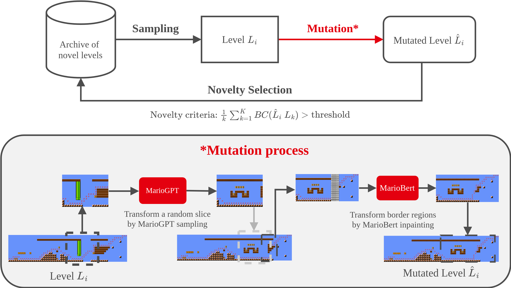<figcaption>MarioGPT · Fig. 3：从关卡存档采样，用 MarioGPT 重写随机切片、MarioBert 修补接缝，足够新颖的关卡才回存档</figcaption></figure>

<div class="ds-demo"><div class="ds-head"><b>数据样例</b> · <a href="https://github.com/shyamsn97/mario-gpt">shyamsn97/mario-gpt</a> · 训练数据为 Super Mario Bros 与 The Lost Levels 关卡拼成的 14 行 × 7,294 列字符网格（来自 VGLC），按 50 列窗口切片，描述由规则计数水管 / 敌人 / 方块 / 高度自动生成 · 展示字段：prompt、level</div><div class="ds-grid"><div class="ds-card">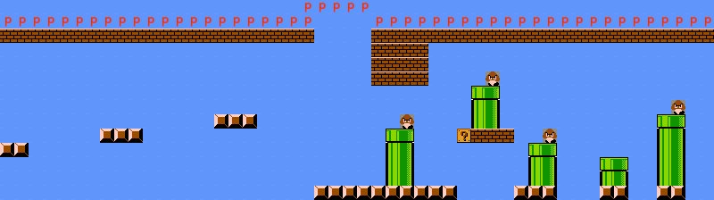<div class="ds-meta">训练关卡片段（FULL_LEVEL_STR_WITH_PATHS 第 250–299 列，14×50）。按仓库 prompter 的计数规则与内置阈值得到描述「some pipes, some enemies, some blocks, low elevation」（5 个水管、4 个敌人、87 个方块）；渲染图用仓库自带贴图生成</div><details class="ds-code"><summary>prompt（文本描述）（共 1 行，全文）</summary><pre>some pipes, some enemies, some blocks, low elevation</pre></details><details class="ds-code"><summary>level（字符网格）（共 16 行，全文）</summary><pre>---------------------xxxxx------------------------&#10;xxxxxxxxxxxxxxxxxxxxxx----xxxxxxxxxxxxxxxxxxxxxxxx&#10;SSSSSSSSSSSSSSSSSSSSSS----SSSSSSSSSSSSSSSSSSSSSSSS&#10;--------------------------SSSS--------------------&#10;--------------------------SSSS--------------------&#10;--------------------------SSSS----E---------------&#10;---------------------------------&lt;&gt;---------------&#10;---------------------------------[]------------E--&#10;---------------XXX----------E----[]-----------&lt;&gt;--&#10;-------XXX-----------------&lt;&gt;---?SSS--E-------[]--&#10;XX-------------------------[]--------&lt;&gt;-------[]--&#10;---------------------------[]--------[]---&lt;&gt;--[]--&#10;---------------------------[]--------[]---[]--[]--&#10;----------------------XXXXXXXXXX----XXX---XX--XX--&#10;&#10;字符含义（仓库 utils.py 的贴图映射）：- 背景，X 地面 / 不可破坏块，S 砖块，? / Q 问号块，E 敌人，&lt;&gt;[] 水管上下左右，B / b 炮台，o 金币，x 为 A* 求得的通行路径（渲染成红色 P）</pre></details></div><div class="ds-card">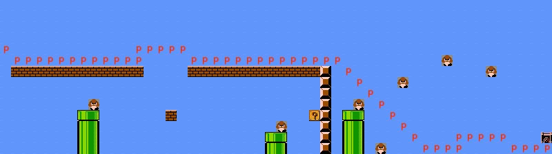<div class="ds-meta">训练关卡片段（第 1250–1299 列）。描述「some pipes, many enemies, little blocks, low elevation」（3 个水管、8 个敌人、34 个方块）</div><details class="ds-code"><summary>prompt（文本描述）（共 1 行，全文）</summary><pre>some pipes, many enemies, little blocks, low elevation</pre></details><details class="ds-code"><summary>level（字符网格）（共 16 行，全文）</summary><pre>--------------------------------------------------&#10;--------------------------------------------------&#10;--------------------------------------------------&#10;--------------------------------------------------&#10;x-----------xxxxx---------------------------------&#10;-xxxxxxxxxxxx----xxxxxxxxxxxxxx---------E---------&#10;-SSSSSSSSSSSS----SSSSSSSSSSSSX-x------------E-----&#10;-----------------------------X--x---E-------------&#10;-----------------------------X---x----------------&#10;--------E--------------------X--E-x---------------&#10;-------&lt;&gt;------S------------?X-&lt;&gt;--x--------------&#10;-------[]----------------E---X-[]---x-------------&#10;-------[]---------------&lt;&gt;---X-[]----x---xxxxx---B&#10;-------[]---------------[]---X-[]-E---xxxx----xxxx&#10;&#10;字符含义（仓库 utils.py 的贴图映射）：- 背景，X 地面 / 不可破坏块，S 砖块，? / Q 问号块，E 敌人，&lt;&gt;[] 水管上下左右，B / b 炮台，o 金币，x 为 A* 求得的通行路径（渲染成红色 P）</pre></details></div><div class="ds-card">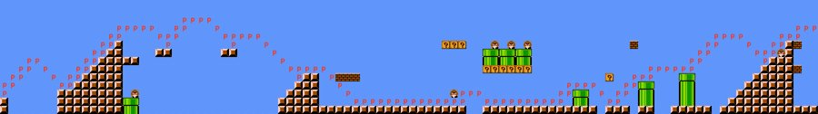<div class="ds-meta">模型生成的关卡（仓库 notebooks/test_level.txt，14×100）。仓库未记录生成它所用的 prompt；渲染图用仓库贴图生成</div><details class="ds-code"><summary>level（生成结果）（共 14 行，全文）</summary><pre>----------------------------------------------------------------------------------------------------&#10;----------------------------------------------------------------------------------------------------&#10;----------------------xxxx--------------------------------------------------------------------------&#10;--------------xxxxx--xx---x----------------------------------------------------------------------xxx&#10;-------------xx----xxx-----xxxxx-------------------------------------------------------xxxx----xxx--&#10;------------xxX-----x-------x---x---------------------QQQ---E-E-E------------S--------xx---x--xxXS--&#10;-----------xxXX----XX------XX----x-------------------------&lt;&gt;&lt;&gt;&lt;&gt;--------------------xx-----xxxEX---&#10;---xx-----xxXXXXX-----------------x------------------------[][][]-------------------xx-------xXXX---&#10;--xx-x---xxXXXX--------------------xxxxx-------------------QQQQQQ--------------xxxxxx--------XXXXS--&#10;-xx---x-xxXXXXX---------------------xXX-xSSS------------------------------Q--xxx---&lt;&gt;-------XXXXX---&#10;xx-----xxXXXXXX---------------------XXX--x---------------------------xxxx---xx&lt;&gt;---[]------XXXXXX---&#10;x------XXXXXXXX-E------------------XXXX---x------------Exxx---------xx&lt;&gt;-x-xx-[]---[]-----XXXXXXX---&#10;X------XXXXXXXX&lt;&gt;-----------------XXXXX----xxxxxxxxxxxxxx--xxxxxxxxxx-[]--xx--[]---[]----XXXXXXXX---&#10;X------XXXXXXXX[]-----------------XXXXXXXXXXXXXXXXXXXXXXX--XXXXXXXXXXXXXX-XXX-XX--XXXXX-XXXXXXXXXXXX</pre></details></div></div></div>

- **自动化合成流程**（对照上图，从左往右读）
  1. **关卡转文本**（图外）：VGLC 里带路径标注的 37 个关卡（Super Mario Bros. + The Lost Levels）拼成一个长关卡，每个 tile 表示成一个字符，用 GPT-2 的 BPE 分词
  2. **规则自动写 prompt**（图外）：在 50 列的窗口里数管道、敌人、方块，按分位数映射到 no / little / some / many，按最高不可破坏方块判 low / high elevation
     - 例：管道 0 / 1 / 2 / 5 分别对应 no / little / some / many
     - 纯程序计数，得到「关卡切片 + 文本描述」训练对，无需人工标注
  3. **训练 MarioGPT**（图外）：DistilGPT2 + 交叉注意力接冻结的 BART 文本编码器，随机切片共训练 200,000 个样本
  4. **Archive of novel levels** → **Sampling**：用 30 个关卡初始化存档，每次从精英中采样一个关卡 **Level Lᵢ**
  5. **Mutation\***：两步变异，全部由模型完成
     - **Transform a random slice by MarioGPT sampling**：随机选 40–80 列的切片，用随机 prompt 让 MarioGPT 重新生成
     - **Transform border regions by MarioBert inpainting**：MarioGPT 是单向模型，接缝处的路径可能断，用双向的 MarioBert 做掩码补全，得到 **Mutated Level**
  6. **Novelty Selection**：计算变异关卡与存档中 K 个最近邻的行为特征距离，均值超过阈值（`Novelty criteria`）才入档
     - 行为特征 = 模型同时生成的玩家路径的平滑平均坐标（维度 100），不依赖外部 agent 试玩
- **质量控制**
  - 入档只看新颖度，搜索循环里不跑可玩性检查
  - 可玩性离线评估：Baumgarten A\* agent 对 250 个生成关卡各跑 5 次，88.4% 可通关（LSTM 基线约 31%）
  - 模型生成的路径与 A\* 真实路径的 MAE：可玩关卡 1.15 格、不可玩关卡 4.56 格，可以当作廉价的可玩性代理信号
  - 记忆检查：温度 1.0 几乎照抄训练集，实际生成用 2.4–2.7
- **关键数字**
  - 数据：37 个原始关卡 → 200,000 个训练切片；模型 96M 参数，单张 RTX 2080 Ti 可训
  - 可控性（1,000 个样本）：管道 81%、敌人 68%、方块 92%、高度 76%
  - 多样性：存档到 300 个关卡时覆盖约 78% 的路径坐标，350–400 代后趋于平台期
- **局限**
  - 原始数据只有 37 个关卡，所有敌人共用一个 token，玩法表达很粗
  - 路径标注来自 A\* 求解器而不是真实 agent，模型生成的路径不守重力，导致部分关卡不可玩
  - 循环中没有可玩性过滤，存档里混有不可玩关卡
  - 生成的是关卡数据（tile 文本），不是游戏代码
- **可借鉴**
  - 从数据本身统计出文本标签（计数 → 分位数 → 关键词），零成本造出「描述–内容」对，可以照搬为「从游戏代码 / 截图统计特征 → 生成需求描述」
  - LLM 当变异算子 + 新颖性存档：从少量种子出发不断扩充多样性，适合为游戏代码数据做 evol 式扩充
  - 单向生成 + 双向补全修接缝：局部重写代码后，也可以用补全模型修复上下文衔接
  - 让模型同时输出「内容 + 预期轨迹」，用轨迹偏差当廉价的可玩性信号，替代昂贵的试玩

</details>

<a class="anchor" id="game-3"></a>

## 3 In-House Data Pipeline

待补充。

</div>

<div class="env-view" data-view="video" data-label="Video">

<nav class="toc view-toc"><h2>Contents</h2><ul><li class="l2"><a href="#video-1"><span class="num">1</span> Open Benchmarks</a></li><li class="l2"><a href="#video-2"><span class="num">2</span> Open Data Pipelines</a></li><li class="l2"><a href="#video-3"><span class="num">3</span> In-House Data Pipeline</a></li></ul></nav>

<a class="anchor" id="video-1"></a>

## 1 Open Benchmarks

<a class="anchor" id="video-1-1"></a>

### 1.1 Benchmark

<table class="frontier"><thead><tr><th>信号</th><th>厂商 / 模型</th><th>形态</th><th>来源</th></tr></thead><tbody><tr><td class="bench" rowspan="3">全代码成片技能潮<span class="self-tag">社区</span></td><td> Claude Opus 5.5</td><td>编码时长跨过门槛，社区用它写 HTML/Canvas/Three.js 动画代码逐帧渲染出片，无视频模型</td><td><a href="https://www.anthropic.com/news/claude-opus-5-5">Blog</a></td></tr><tr><td> Gemini 3.8 Flash</td><td>一句提示生成 Three.js 动画与可交互 3D 场景（发布页 demo）</td><td><a href="https://blog.google/innovation-and-ai/models-and-research/gemini-models/3-8-flash-and-3-8-flash-cyber/">Blog</a></td></tr><tr><td> GPT-6 Astra</td><td>Three.js + WebGPU 动画与游戏（发布页 demo）</td><td><a href="https://developers.openai.com/blog/how-to-build-games-with-astra">Blog</a></td></tr><tr><td class="bench" rowspan="1">自建动画子类<span class="self-tag">自建</span></td><td> Kimi K3</td><td>Kimi Webdev Bench 的 SVG / 动画子类，题目不公开</td><td><a href="https://github.com/MoonshotAI/Kimi-K3/blob/main/k3_tech_report.pdf">Blog</a></td></tr><tr><td class="bench" rowspan="1">未报告相关分数</td><td>   等</td><td>未报告 code-video 分数</td><td>—</td></tr></tbody></table>

数据解读：

- **没有厂商报告公开的 code-video benchmark。** MMMC、TeachQuiz、TheoremExplainBench 等都没有出现在任何厂商的发布材料里。这是一个和游戏方向一样的空白：可执行验收条件具备，但还没进入厂商的对比表。
- **厂商的信号只有两种，都不是在测做视频。** 一种是全代码成片的社区技能潮，由 Claude Opus 5.5 的编码能力触发，而非某个新视频功能；另一种是发布页的动画 demo（Gemini、GPT-6 Astra）。
- **这是一个开源与学术主导的方向。** 和 Web、3D、Game 不同，code-video 的前沿目前在开源仓库和论文里，不在厂商榜单上。

<a class="anchor" id="video-1-2"></a>

### 1.2 Benchmark Timeline

视频即代码（Code2Video）指：让 agent 写出可执行的动画代码，再由确定性渲染器把代码渲染成视频，而不是用扩散模型直接生成像素。本文用三个维度比较这类工作：

- **任务形态（Task Form）**：讲稿或论文到教学动画、静态图到矢量动画、文档到幻灯片与演讲视频、规格说明到成片。
- **渲染器（Renderer）**：Manim、SVG + CSS、Lottie、Beamer、HTML/Canvas、游戏引擎。渲染器决定表达力上限，也决定这支视频能被怎样验证。
- **验收方式（Evaluation）**：
  - 渲染成功率：代码能否无错渲染。可执行、可复现。
  - 版式几何检查：元素是否重叠、出框。可执行。
  - 知识传递：让模型先屏蔽知识再只看视频答题，答对率就是传递量（TeachQuiz、PaperQuiz）。
  - VLM 看图打分：用视觉语言模型给画面打分，与人评经常不相关，只能作参考。

四组工作的渲染器与验收方式区别如下：

| 组 | 典型渲染器 | 产物 | 典型验收 |
|---|---|---|---|
| 教学动画 | Manim（Python） | 数学 / 定理 / 物理讲解视频 | 渲染成功率、版式几何、知识传递（TeachQuiz） |
| 矢量 / 图表 / Lottie | SVG + CSS、Lottie、TikZ | 矢量动画、动态图表、图示代码 | 语义对齐、渲染成功率、紧凑度 |
| 幻灯片 / 演讲视频 | python-pptx、Beamer LaTeX | 幻灯片、海报、带讲解的演讲视频 | 看产物答题（PaperQuiz / PresentQuiz）、设计质量 |
| 全代码成片 | HTML / Canvas / 引擎 | 短片、MV、完整影片 | 可运行、可交互、时序截图审查 |

逐帧确定性是这条路线的根：每一帧是帧号与代码的纯函数，同代码同帧永远渲染出相同像素，所以可逐帧复现、可测试、可迭代——这是扩散视频没有的性质。

<div class="tbl-tabs">

<div class="tbl-pane" data-label="Manim" data-count="9">

<p class="tbl-desc">Python + Manim 等数学动画引擎：把讲稿 / 论文 / 定理写成 Manim 代码，引擎逐帧渲成 mp4。</p>

<table class="merged"><thead><tr><th>发布日期</th><th>名称</th><th>类型</th><th>语言</th><th>产物</th><th>来源</th><th>形态</th><th>规模/题量</th><th>影响力</th><th>说明</th></tr></thead><tbody><tr><td>2025/2</td><td><span class="org-mark" title="U. Waterloo">U</span> <a href="https://arxiv.org/abs/2502.19400">TheoremExplainBench</a> <span class="org">U. Waterloo</span></td><td><span class="type type-bench">Benchmark</span></td><td>—</td><td>—</td><td><a class="src src-hf" href="https://huggingface.co/datasets/TIGER-Lab/TheoremExplainBench">HF</a></td><td>定理→Manim 视频</td><td>240 定理</td><td><a class="hf" href="https://github.com/TIGER-AI-Lab/TheoremExplainAgent"><span class="hf-b hf-st" title="GitHub stars"><svg class="hf-i" viewBox="0 0 24 24" fill="currentColor"><path d="M12 2.5l2.9 6 6.6.6-5 4.3 1.5 6.5L12 16.9 6 20.9l1.5-6.5-5-4.3 6.6-.6z"/></svg>1.5k</span></a></td><td><strong>长视频多模态讲解</strong>：o3-mini 成功率 93.8%/0.77，版式为普遍弱项</td></tr><tr><td>2025/2</td><td><span class="org-mark" title="U. Waterloo">U</span> <a href="https://arxiv.org/abs/2502.19400">TheoremExplainAgent</a> <span class="org">U. Waterloo</span></td><td><span class="type type-data">系统</span></td><td>Python(Manim)</td><td>Manim 视频 mp4</td><td><a class="src src-gh" href="https://github.com/TIGER-AI-Lab/TheoremExplainAgent">GitHub</a></td><td>定理 → Manim 视频 agent</td><td>240 定理基准</td><td><a class="hf" href="https://github.com/TIGER-AI-Lab/TheoremExplainAgent"><span class="hf-b hf-st" title="GitHub stars"><svg class="hf-i" viewBox="0 0 24 24" fill="currentColor"><path d="M12 2.5l2.9 6 6.6.6-5 4.3 1.5 6.5L12 16.9 6 20.9l1.5-6.5-5-4.3 6.6-.6z"/></svg>1.5k</span></a></td><td>Planner + Coder 写 Manim + TTS，agentic RAG 查文档，渲染失败重试≤5</td></tr><tr><td>2025/7</td><td><span class="org-mark" title="PES University">P</span> <a href="https://arxiv.org/abs/2507.14306">manimator</a> <span class="org">PES University</span></td><td><span class="type type-data">系统</span></td><td>Python(Manim)</td><td>Manim 动画 mp4</td><td><a class="src src-gh" href="https://github.com/HyperCluster-Tech/manimator">GitHub</a></td><td>论文 → Manim 动画系统</td><td>无自建集，在 TEB 上评</td><td><a class="hf" href="https://github.com/HyperCluster-Tech/manimator"><span class="hf-b hf-st" title="GitHub stars"><svg class="hf-i" viewBox="0 0 24 24" fill="currentColor"><path d="M12 2.5l2.9 6 6.6.6-5 4.3 1.5 6.5L12 16.9 6 20.9l1.5-6.5-5-4.3 6.6-.6z"/></svg>74</span></a></td><td>两步 LLM：读 PDF 产结构化场景描述 → 转 Manim 代码，多后端，无验证环</td></tr><tr><td>2025/10</td><td> <a href="https://arxiv.org/abs/2510.01174">Code2Video · MMMC</a> <span class="org">NUS</span></td><td><span class="type type-bench">Benchmark</span></td><td>—</td><td>—</td><td><a class="src src-gh" href="https://github.com/showlab/Code2Video">GitHub</a></td><td>主题→Manim 视频</td><td>456 单元</td><td><a class="hf" href="https://github.com/showlab/Code2Video"><span class="hf-b hf-st" title="GitHub stars"><svg class="hf-i" viewBox="0 0 24 24" fill="currentColor"><path d="M12 2.5l2.9 6 6.6.6-5 4.3 1.5 6.5L12 16.9 6 20.9l1.5-6.5-5-4.3 6.6-.6z"/></svg>2.1k</span></a></td><td><strong>知识传递（TeachQuiz）</strong>：Opus 4.1 达 86.0，扩散基线 Veo3 仅 2.5</td></tr><tr><td>2025/10</td><td> <a href="https://arxiv.org/abs/2510.23538">DTVBench · JanusCoder</a> <span class="org">Shanghai AI Lab</span></td><td><span class="type type-bench">Benchmark</span></td><td>—</td><td>—</td><td><a class="src src-gh" href="https://github.com/InternLM/JanusCoder">GitHub</a></td><td>可视化→代码（Manim 引擎）</td><td>102 任务</td><td>—</td><td><strong>视觉-程序接口</strong>：7–14B 开源逼近或超过商用模型</td></tr><tr><td>2025/10</td><td> <a href="https://arxiv.org/abs/2510.01174">Code2Video</a> <span class="org">NUS</span></td><td><span class="type type-data">系统</span></td><td>Python(Manim)</td><td>Manim 视频 mp4</td><td><a class="src src-gh" href="https://github.com/showlab/Code2Video">GitHub</a></td><td>主题 → Manim 教学视频三 agent</td><td>MMMC 456 单元</td><td><a class="hf" href="https://github.com/showlab/Code2Video"><span class="hf-b hf-st" title="GitHub stars"><svg class="hf-i" viewBox="0 0 24 24" fill="currentColor"><path d="M12 2.5l2.9 6 6.6.6-5 4.3 1.5 6.5L12 16.9 6 20.9l1.5-6.5-5-4.3 6.6-.6z"/></svg>2.1k</span></a></td><td>Planner 分镜 → Coder 并行写码 + 作用域分级自修复 → Critic 用 6×6 锚点栅格回修</td></tr><tr><td>2025/11</td><td><span class="org-mark" title="South China Normal Univ.">S</span> <a href="https://aclanthology.org/2025.findings-emnlp.889/">VisualEDU</a> <span class="org">South China Normal Univ.</span></td><td><span class="type type-bench">Benchmark</span></td><td>—</td><td>—</td><td><span class="src src-paper">论文</span></td><td>数学题→Manim 解题视频</td><td>200 题</td><td>—</td><td><strong>分步解题动画</strong>：难题上 GPT-4o 等均 <56%</td></tr><tr><td>2026/2</td><td> <a href="https://arxiv.org/abs/2602.10840">SimuScene</a> <span class="org">MBZUAI</span></td><td><span class="type type-bench">Benchmark</span></td><td>—</td><td>—</td><td><a class="src src-gh" href="https://github.com/Yanan-Wang-cs/SimuScene">GitHub</a></td><td>文本→物理动画代码</td><td>7,659 场景</td><td>—</td><td><strong>代码渲染视频做 RL 奖励</strong>：最强 LLM 仅 21.5%，RL 后 32B 72.2%</td></tr><tr><td>2026/6</td><td><span class="org-mark" title="Southeast Univ.">S</span> <a href="https://arxiv.org/abs/2606.30296">ManimAgent</a> <span class="org">Southeast Univ.</span></td><td><span class="type type-data">系统</span></td><td>Python(Manim)</td><td>Manim 动画 mp4</td><td><span class="src src-paper">论文</span></td><td>论文段落 → Manim 动画</td><td>任务流 + 记忆库 200 条</td><td>—</td><td>双通道 episodic 记忆（正例软参考 / 负例硬禁区），不改权重不喂人工样本</td></tr></tbody></table>

</div>

<div class="tbl-pane" data-label="PPT" data-count="10">

<p class="tbl-desc">生成幻灯片 / 海报 / 演讲视频：python-pptx、Beamer 等，产物是 .pptx / PDF，再转视频。</p>

<table class="merged"><thead><tr><th>发布日期</th><th>名称</th><th>类型</th><th>语言</th><th>产物</th><th>来源</th><th>形态</th><th>规模/题量</th><th>影响力</th><th>说明</th></tr></thead><tbody><tr><td>2025/1</td><td> <a href="https://arxiv.org/abs/2501.00912">AutoPresent · SlidesBench</a> <span class="org">UC Berkeley</span></td><td><span class="type type-bench">Benchmark</span></td><td>—</td><td>—</td><td><a class="src src-gh" href="https://github.com/para-lost/AutoPresent">GitHub</a></td><td>指令→幻灯片代码</td><td>585 测试</td><td><a class="hf" href="https://github.com/para-lost/AutoPresent"><span class="hf-b hf-st" title="GitHub stars"><svg class="hf-i" viewBox="0 0 24 24" fill="currentColor"><path d="M12 2.5l2.9 6 6.6.6-5 4.3 1.5 6.5L12 16.9 6 20.9l1.5-6.5-5-4.3 6.6-.6z"/></svg>181</span></a></td><td><strong>幻灯片即代码</strong>：程序化出片优于端到端图像，8B 达 GPT-4o 水平</td></tr><tr><td>2025/1</td><td><span class="org-mark" title="ISCAS">I</span> <a href="https://arxiv.org/abs/2501.03936">PPTAgent · PPTEval</a> <span class="org">ISCAS</span></td><td><span class="type type-bench">Benchmark</span></td><td>—</td><td>—</td><td><a class="src src-gh" href="https://github.com/icip-cas/PPTAgent">GitHub</a></td><td>文档→PPT 编辑</td><td>500 任务</td><td><a class="hf" href="https://github.com/icip-cas/PPTAgent"><span class="hf-b hf-st" title="GitHub stars"><svg class="hf-i" viewBox="0 0 24 24" fill="currentColor"><path d="M12 2.5l2.9 6 6.6.6-5 4.3 1.5 6.5L12 16.9 6 20.9l1.5-6.5-5-4.3 6.6-.6z"/></svg>5.1k</span></a></td><td><strong>套模板编辑</strong>：三维 VLM 评测，成功率 95.0%、均分 3.67</td></tr><tr><td>2025/1</td><td> <a href="https://arxiv.org/abs/2501.00912">AutoPresent</a> <span class="org">UC Berkeley</span></td><td><span class="type type-data">系统</span></td><td>Python(SlidesLib)</td><td>幻灯片 .pptx</td><td><a class="src src-gh" href="https://github.com/para-lost/AutoPresent">GitHub</a></td><td>指令 → 幻灯片绘图程序（SlidesLib）</td><td>训练 7k 指令-代码对</td><td><a class="hf" href="https://github.com/para-lost/AutoPresent"><span class="hf-b hf-st" title="GitHub stars"><svg class="hf-i" viewBox="0 0 24 24" fill="currentColor"><path d="M12 2.5l2.9 6 6.6.6-5 4.3 1.5 6.5L12 16.9 6 20.9l1.5-6.5-5-4.3 6.6-.6z"/></svg>181</span></a></td><td>自然语言指令生成 Python 绘图程序渲染幻灯片，带自我迭代修正</td></tr><tr><td>2025/1</td><td><span class="org-mark" title="ISCAS">I</span> <a href="https://arxiv.org/abs/2501.03936">PPTAgent</a> <span class="org">ISCAS</span></td><td><span class="type type-data">系统</span></td><td>Python(python-pptx)</td><td>PPT .pptx</td><td><a class="src src-gh" href="https://github.com/icip-cas/PPTAgent">GitHub</a></td><td>文档 → PPT 编辑指令（.pptx）</td><td>Zenodo10K 10,448 份</td><td><a class="hf" href="https://github.com/icip-cas/PPTAgent"><span class="hf-b hf-st" title="GitHub stars"><svg class="hf-i" viewBox="0 0 24 24" fill="currentColor"><path d="M12 2.5l2.9 6 6.6.6-5 4.3 1.5 6.5L12 16.9 6 20.9l1.5-6.5-5-4.3 6.6-.6z"/></svg>5.1k</span></a></td><td>两阶段：分析参考 PPT 聚类抽 schema → 套模板执行编辑动作，每页≤2 次自校正</td></tr><tr><td>2025/5</td><td><span class="org-mark" title="Oxford">O</span> <a href="https://arxiv.org/abs/2505.21497">Paper2Poster · PaperQuiz</a> <span class="org">Oxford</span></td><td><span class="type type-bench">Benchmark</span></td><td>—</td><td>—</td><td><a class="src src-gh" href="https://github.com/Paper2Poster/Paper2Poster">GitHub</a></td><td>论文→海报</td><td>约 100 对</td><td><a class="hf" href="https://github.com/Paper2Poster/Paper2Poster"><span class="hf-b hf-st" title="GitHub stars"><svg class="hf-i" viewBox="0 0 24 24" fill="currentColor"><path d="M12 2.5l2.9 6 6.6.6-5 4.3 1.5 6.5L12 16.9 6 20.9l1.5-6.5-5-4.3 6.6-.6z"/></svg>4.0k</span></a></td><td><strong>看海报答题（PaperQuiz）</strong>：开源版多指标超 GPT-4o，省 87% token</td></tr><tr><td>2025/5</td><td><span class="org-mark" title="Oxford">O</span> <a href="https://arxiv.org/abs/2505.21497">Paper2Poster</a> <span class="org">Oxford</span></td><td><span class="type type-data">系统</span></td><td>Python(python-pptx)</td><td>海报 .pptx</td><td><a class="src src-gh" href="https://github.com/Paper2Poster/Paper2Poster">GitHub</a></td><td>论文 PDF → 海报（可编辑 .pptx）</td><td>约 100 论文-海报对</td><td><a class="hf" href="https://github.com/Paper2Poster/Paper2Poster"><span class="hf-b hf-st" title="GitHub stars"><svg class="hf-i" viewBox="0 0 24 24" fill="currentColor"><path d="M12 2.5l2.9 6 6.6.6-5 4.3 1.5 6.5L12 16.9 6 20.9l1.5-6.5-5-4.3 6.6-.6z"/></svg>4.0k</span></a></td><td>Parser → Planner（二叉树版式）→ Painter-Commenter 环（VLM 修溢出对齐）</td></tr><tr><td>2025/7</td><td><span class="org-mark" title="AIGeeksGroup">A</span> <a href="https://arxiv.org/abs/2507.04036">PresentAgent · PresentEval</a> <span class="org">AIGeeksGroup</span></td><td><span class="type type-bench">Benchmark</span></td><td>—</td><td>—</td><td><a class="src src-gh" href="https://github.com/AIGeeksGroup/PresentAgent">GitHub</a></td><td>文档→演讲视频</td><td>30 对</td><td><a class="hf" href="https://github.com/AIGeeksGroup/PresentAgent"><span class="hf-b hf-st" title="GitHub stars"><svg class="hf-i" viewBox="0 0 24 24" fill="currentColor"><path d="M12 2.5l2.9 6 6.6.6-5 4.3 1.5 6.5L12 16.9 6 20.9l1.5-6.5-5-4.3 6.6-.6z"/></svg>146</span></a></td><td><strong>看视频答题</strong>：quiz 0.64 接近人类 0.56</td></tr><tr><td>2025/7</td><td><span class="org-mark" title="AIGeeksGroup">A</span> <a href="https://arxiv.org/abs/2507.04036">PresentAgent</a> <span class="org">AIGeeksGroup</span></td><td><span class="type type-data">系统</span></td><td>Python(python-pptx)</td><td>幻灯片 → 配音视频 mp4</td><td><a class="src src-gh" href="https://github.com/AIGeeksGroup/PresentAgent">GitHub</a></td><td>文档 → 配音演讲视频</td><td>30 文档-演讲对</td><td><a class="hf" href="https://github.com/AIGeeksGroup/PresentAgent"><span class="hf-b hf-st" title="GitHub stars"><svg class="hf-i" viewBox="0 0 24 24" fill="currentColor"><path d="M12 2.5l2.9 6 6.6.6-5 4.3 1.5 6.5L12 16.9 6 20.9l1.5-6.5-5-4.3 6.6-.6z"/></svg>146</span></a></td><td>切分文档 → 渲染幻灯片帧 → LLM 旁白 + TTS → 音画对齐合成视频</td></tr><tr><td>2025/10</td><td> <a href="https://arxiv.org/abs/2510.05096">Paper2Video</a> <span class="org">NUS</span></td><td><span class="type type-bench">Benchmark</span></td><td>—</td><td>—</td><td><a class="src src-gh" href="https://github.com/showlab/Paper2Video">GitHub</a></td><td>论文→演讲视频</td><td>101 篇</td><td><a class="hf" href="https://github.com/showlab/Paper2Video"><span class="hf-b hf-st" title="GitHub stars"><svg class="hf-i" viewBox="0 0 24 24" fill="currentColor"><path d="M12 2.5l2.9 6 6.6.6-5 4.3 1.5 6.5L12 16.9 6 20.9l1.5-6.5-5-4.3 6.6-.6z"/></svg>2.4k</span></a></td><td><strong>PresentQuiz 0.842 超人类 0.738</strong>；端到端视频模型各项垫底</td></tr><tr><td>2025/10</td><td> <a href="https://arxiv.org/abs/2510.05096">Paper2Video</a> <span class="org">NUS</span></td><td><span class="type type-data">系统</span></td><td>LaTeX(Beamer)+Python</td><td>Beamer 演讲视频 mp4</td><td><a class="src src-gh" href="https://github.com/showlab/Paper2Video">GitHub</a></td><td>论文 → Beamer 演讲视频</td><td>101 篇论文</td><td><a class="hf" href="https://github.com/showlab/Paper2Video"><span class="hf-b hf-st" title="GitHub stars"><svg class="hf-i" viewBox="0 0 24 24" fill="currentColor"><path d="M12 2.5l2.9 6 6.6.6-5 4.3 1.5 6.5L12 16.9 6 20.9l1.5-6.5-5-4.3 6.6-.6z"/></svg>2.4k</span></a></td><td>版式树搜索 + 光标 grounding + 字幕 + TTS + 数字人，逐页并行</td></tr></tbody></table>

</div>

<div class="tbl-pane" data-label="HTML · 网页" data-count="22">

<p class="tbl-desc">浏览器渲染一类：HTML / CSS / SVG / Canvas / Lottie 代码，逐帧截图合成视频（含 OpenCV 逐帧直出的 SimuScene）。</p>

<table class="merged"><thead><tr><th>发布日期</th><th>名称</th><th>类型</th><th>语言</th><th>产物</th><th>来源</th><th>形态</th><th>规模/题量</th><th>影响力</th><th>说明</th></tr></thead><tbody><tr><td>2023/10</td><td><span class="org-mark" title="U. Mannheim">U</span> <a href="https://arxiv.org/abs/2310.00367">AutomaTikZ</a> <span class="org">U. Mannheim</span></td><td><span class="type type-bench">Benchmark</span></td><td>—</td><td>—</td><td><a class="src src-gh" href="https://github.com/potamides/AutomaTikZ">GitHub</a></td><td>caption→TikZ</td><td>DaTikZ 120k</td><td><a class="hf" href="https://github.com/potamides/AutomaTikZ"><span class="hf-b hf-st" title="GitHub stars"><svg class="hf-i" viewBox="0 0 24 24" fill="currentColor"><path d="M12 2.5l2.9 6 6.6.6-5 4.3 1.5 6.5L12 16.9 6 20.9l1.5-6.5-5-4.3 6.6-.6z"/></svg>115</span></a></td><td><strong>图即代码（静态）</strong>：科学矢量图/LaTeX 代码合成，CLiMA 相似度超 GPT-4</td></tr><tr><td>2024/2</td><td> <a href="https://arxiv.org/abs/2402.06071">Keyframer</a> <span class="org">Apple</span></td><td><span class="type type-data">系统</span></td><td>SVG + CSS</td><td>CSS 动画(网页)</td><td><a class="src src-gh" href="https://github.com/apple/ml-keyframer">GitHub</a></td><td>静态 SVG → CSS 2D 动画代码</td><td>13 人设计研究</td><td><a class="hf" href="https://github.com/apple/ml-keyframer"><span class="hf-b hf-st" title="GitHub stars"><svg class="hf-i" viewBox="0 0 24 24" fill="currentColor"><path d="M12 2.5l2.9 6 6.6.6-5 4.3 1.5 6.5L12 16.9 6 20.9l1.5-6.5-5-4.3 6.6-.6z"/></svg>76</span></a></td><td>LLM 从自然语言生成 CSS 动画，内联预览 + 分解式提示迭代，人在环无自动验证</td></tr><tr><td>2024/5</td><td><span class="org-mark" title="U. Mannheim">U</span> <a href="https://arxiv.org/abs/2405.15306">DeTikZify</a> <span class="org">U. Mannheim</span></td><td><span class="type type-bench">Benchmark</span></td><td>—</td><td>—</td><td><a class="src src-gh" href="https://github.com/potamides/DeTikZify">GitHub</a></td><td>草图/图→TikZ</td><td>DaTikZv2 360k+</td><td><a class="hf" href="https://github.com/potamides/DeTikZify"><span class="hf-b hf-st" title="GitHub stars"><svg class="hf-i" viewBox="0 0 24 24" fill="currentColor"><path d="M12 2.5l2.9 6 6.6.6-5 4.3 1.5 6.5L12 16.9 6 20.9l1.5-6.5-5-4.3 6.6-.6z"/></svg>1.8k</span></a></td><td><strong>图像逆向代码（静态）</strong>：MCTS 推理期精炼用编译器反馈，超 Claude 3/GPT-4V</td></tr><tr><td>2024/6</td><td>  <a href="https://arxiv.org/abs/2406.09961">ChartMimic</a> <span class="org">Tencent AI Lab · Tsinghua</span></td><td><span class="type type-bench">Benchmark</span></td><td>—</td><td>—</td><td><a class="src src-gh" href="https://github.com/ChartMimic/ChartMimic">GitHub</a></td><td>图→图表代码</td><td>4,800 三元组</td><td><a class="hf" href="https://github.com/ChartMimic/ChartMimic"><span class="hf-b hf-st" title="GitHub stars"><svg class="hf-i" viewBox="0 0 24 24" fill="currentColor"><path d="M12 2.5l2.9 6 6.6.6-5 4.3 1.5 6.5L12 16.9 6 20.9l1.5-6.5-5-4.3 6.6-.6z"/></svg>135</span></a></td><td><strong>图表即代码（静态邻居）</strong>：多层级评代码+渲染图，GPT-4o 仍差距明显</td></tr><tr><td>2024/11</td><td><span class="org-mark" title="Westlake Univ.">W</span> <a href="https://arxiv.org/abs/2411.11916">DiagramAgent</a> <span class="org">Westlake Univ.</span></td><td><span class="type type-bench">Benchmark</span></td><td>—</td><td>—</td><td><span class="src src-paper">论文</span></td><td>文本→图代码</td><td>生成 6,983 + 编辑 1,600</td><td>—</td><td><strong>图即代码（静态）</strong>：TeX/DOT 多任务，生成 Pass@1 58.15、编辑 98.00</td></tr><tr><td>2025/2</td><td> <a href="https://arxiv.org/abs/2502.13372">MoVer</a> <span class="org">Stanford</span></td><td><span class="type type-data">系统</span></td><td>JavaScript(GSAP)</td><td>网页矢量动画</td><td><a class="src src-gh" href="https://github.com/jama1017/MoVer">GitHub</a></td><td>GSAP 动画 + 一阶逻辑验证 DSL</td><td>5,600 条 prompt + 真值验证程序</td><td><a class="hf" href="https://github.com/jama1017/MoVer"><span class="hf-b hf-st" title="GitHub stars"><svg class="hf-i" viewBox="0 0 24 24" fill="currentColor"><path d="M12 2.5l2.9 6 6.6.6-5 4.3 1.5 6.5L12 16.9 6 20.9l1.5-6.5-5-4.3 6.6-.6z"/></svg>39</span></a></td><td>LLM 同时写动画与 MoVer 验证程序，按谓词检查失败处反馈闭环修复</td></tr><tr><td>2025/7</td><td>  <a href="https://arxiv.org/abs/2507.04952">ArtifactsBench</a> <span class="org">Tencent Hunyuan · PKU</span></td><td><span class="type type-bench">Benchmark</span></td><td>—</td><td>—</td><td><a class="src src-gh" href="https://github.com/Tencent-Hunyuan/ArtifactsBenchmark">GitHub</a></td><td>指令→可视化/交互代码</td><td>1,825 任务</td><td><a class="hf" href="https://github.com/Tencent-Hunyuan/ArtifactsBenchmark"><span class="hf-b hf-st" title="GitHub stars"><svg class="hf-i" viewBox="0 0 24 24" fill="currentColor"><path d="M12 2.5l2.9 6 6.6.6-5 4.3 1.5 6.5L12 16.9 6 20.9l1.5-6.5-5-4.3 6.6-.6z"/></svg>279</span></a></td><td><strong>时序截图捕动态</strong>：与 WebDev Arena 排名一致 94.4%</td></tr><tr><td>2025/10</td><td><span class="org-mark" title="Opus AI Research">O</span> <a href="https://arxiv.org/abs/2510.03341">DCG-Bench · OpusAnimation</a> <span class="org">Opus AI Research</span></td><td><span class="type type-bench">Benchmark</span></td><td>—</td><td>—</td><td><span class="src src-paper">论文</span></td><td>文/视频→动画图表代码</td><td>700 测试</td><td>—</td><td><strong>唯一动画图表代码基准</strong>：执行率+代码/视频 QA，3B 专家平均 +8.31%</td></tr><tr><td>2025/10</td><td><span class="org-mark" title="Opus AI Research">O</span> <a href="https://arxiv.org/abs/2510.03341">OpusAnimation</a> <span class="org">Opus AI Research</span></td><td><span class="type type-data">系统</span></td><td>HTML/JS(ECharts)</td><td>逐帧截图 → mp4</td><td><span class="src src-paper">论文</span></td><td>文 / 视频 → 动画图表代码</td><td>DCG-8K 约 8K</td><td>—</td><td>两阶段 SFT 冷启动 + 联合代码-视觉奖励 GRPO，配 3B 专家模型</td></tr><tr><td>2025/10</td><td> <a href="https://arxiv.org/abs/2510.11341">InternSVG</a> <span class="org">Shanghai AI Lab</span></td><td><span class="type type-data">系统</span></td><td>SVG</td><td>SVG(含动画)</td><td><a class="src src-gh" href="https://github.com/hmwang2002/InternSVG">GitHub</a></td><td>统一 SVG MLLM（含动画）</td><td>SAgoge 约 5.16M（动画 61K/122K）</td><td><a class="hf" href="https://github.com/hmwang2002/InternSVG"><span class="hf-b hf-st" title="GitHub stars"><svg class="hf-i" viewBox="0 0 24 24" fill="currentColor"><path d="M12 2.5l2.9 6 6.6.6-5 4.3 1.5 6.5L12 16.9 6 20.9l1.5-6.5-5-4.3 6.6-.6z"/></svg>127</span></a></td><td>两阶段 SFT，SVG 专用 token + 子词嵌入；配 SArena 基准</td></tr><tr><td>2025/11</td><td> <a href="https://arxiv.org/abs/2511.14967">MermaidSeqBench</a> <span class="org">IBM Research</span></td><td><span class="type type-bench">Benchmark</span></td><td>—</td><td>—</td><td><a class="src src-gh" href="https://github.com/IBM/MermaidSeqBench-Eval">GitHub</a></td><td>NL→Mermaid 时序图</td><td>132 对</td><td><a class="hf" href="https://github.com/IBM/MermaidSeqBench-Eval"><span class="hf-b hf-st" title="GitHub stars"><svg class="hf-i" viewBox="0 0 24 24" fill="currentColor"><path d="M12 2.5l2.9 6 6.6.6-5 4.3 1.5 6.5L12 16.9 6 20.9l1.5-6.5-5-4.3 6.6-.6z"/></svg>3</span></a></td><td><strong>图即代码（静态）</strong>：双判官 6 维，排名随判官翻转</td></tr><tr><td>2025/12</td><td> <a href="https://arxiv.org/abs/2512.14336">Vector Prism</a> <span class="org">KAIST</span></td><td><span class="type type-bench">Benchmark</span></td><td>—</td><td>—</td><td><a class="src src-gh" href="https://github.com/YeolJ00/Vector-Prism">GitHub</a></td><td>SVG→CSS 动画</td><td>114 测试对</td><td><a class="hf" href="https://github.com/YeolJ00/Vector-Prism"><span class="hf-b hf-st" title="GitHub stars"><svg class="hf-i" viewBox="0 0 24 24" fill="currentColor"><path d="M12 2.5l2.9 6 6.6.6-5 4.3 1.5 6.5L12 16.9 6 20.9l1.5-6.5-5-4.3 6.6-.6z"/></svg>30</span></a></td><td><strong>部件语义分组</strong>：GPT-T2V 76.1 vs Sora 2 69.1，矢量比视频小 54×</td></tr><tr><td>2026/2</td><td> <a href="https://arxiv.org/abs/2602.10840">SimuScene</a> <span class="org">MBZUAI</span></td><td><span class="type type-data">系统</span></td><td>Python(OpenCV cv2)</td><td>cv2 直写 mp4</td><td><a class="src src-gh" href="https://github.com/Yanan-Wang-cs/SimuScene">GitHub</a></td><td>文本 → 物理动画代码</td><td>7,659 场景（SFT 3K + RL 4.3K）</td><td>—</td><td>代码渲染视频后逐条 VLM 二元 Code-Video-Judge 奖励做 GRPO</td></tr><tr><td>2026/3</td><td> <a href="https://arxiv.org/abs/2603.02138">MMLottieBench · OmniLottie</a> <span class="org">StepFun</span></td><td><span class="type type-bench">Benchmark</span></td><td>—</td><td>—</td><td><a class="src src-hf" href="https://huggingface.co/datasets/OmniLottie/MMLottieBench">HF</a></td><td>文/图/视频→Lottie</td><td>900 条</td><td><a class="hf" href="https://github.com/OpenVGLab/OmniLottie"><span class="hf-b hf-st" title="GitHub stars"><svg class="hf-i" viewBox="0 0 24 24" fill="currentColor"><path d="M12 2.5l2.9 6 6.6.6-5 4.3 1.5 6.5L12 16.9 6 20.9l1.5-6.5-5-4.3 6.6-.6z"/></svg>798</span></a></td><td><strong>矢量动画成功率 93.3%</strong>，FVD 180 vs AniClipart 266</td></tr><tr><td>2026/3</td><td> <a href="https://arxiv.org/abs/2603.02138">OmniLottie</a> <span class="org">StepFun</span></td><td><span class="type type-data">系统</span></td><td>Lottie JSON</td><td>Lottie 动画</td><td><a class="src src-gh" href="https://github.com/OpenVGLab/OmniLottie">GitHub</a></td><td>文 / 图 / 视频 → Lottie JSON</td><td>MMLottie-2M 约 2M</td><td><a class="hf" href="https://github.com/OpenVGLab/OmniLottie"><span class="hf-b hf-st" title="GitHub stars"><svg class="hf-i" viewBox="0 0 24 24" fill="currentColor"><path d="M12 2.5l2.9 6 6.6.6-5 4.3 1.5 6.5L12 16.9 6 20.9l1.5-6.5-5-4.3 6.6-.6z"/></svg>798</span></a></td><td>参数化 Lottie tokenizer（省 81% token）喂 Qwen2.5-VL 自回归</td></tr><tr><td>2026/4</td><td><span class="org-mark" title="LICA">L</span> <a href="https://arxiv.org/abs/2604.04192">Graphic-Design-Bench</a> <span class="org">LICA</span></td><td><span class="type type-bench">Benchmark</span></td><td>—</td><td>—</td><td><span class="src src-paper">论文</span></td><td>文/图→图形设计（动画轴）</td><td>约 50 任务</td><td>—</td><td><strong>动画远难于静态</strong>：最佳 Lottie FrameSSIM 仅 0.598</td></tr><tr><td>2026/4</td><td> <a href="https://arxiv.org/abs/2604.11792">LottieGPT</a> <span class="org">Tsinghua</span></td><td><span class="type type-data">系统</span></td><td>Lottie JSON</td><td>Lottie 矢量动画</td><td><a class="src src-gh" href="https://github.com/yisuanwang/LottieGPT">GitHub</a></td><td>文 → Lottie 矢量动画</td><td>LottieAnimation-660K</td><td><a class="hf" href="https://github.com/yisuanwang/LottieGPT"><span class="hf-b hf-st" title="GitHub stars"><svg class="hf-i" viewBox="0 0 24 24" fill="currentColor"><path d="M12 2.5l2.9 6 6.6.6-5 4.3 1.5 6.5L12 16.9 6 20.9l1.5-6.5-5-4.3 6.6-.6z"/></svg>39</span></a></td><td>关键帧式 Lottie tokenizer（只存关键帧 + 缓动）自回归，两阶段静到动</td></tr><tr><td>2026/5</td><td> <a href="https://arxiv.org/abs/2605.01517">VAnim · SVGAnim-134k</a> <span class="org">Beihang</span></td><td><span class="type type-bench">Benchmark</span></td><td>—</td><td>—</td><td><span class="src src-paper">论文</span></td><td>文→SVG 动画</td><td>134k</td><td>—</td><td><strong>稀疏状态更新 + 渲染 RL</strong>：对齐 0.281 vs Gemini3 Pro 0.243，压缩 9.8×</td></tr><tr><td>2026/5</td><td> <a href="https://arxiv.org/abs/2605.01517">VAnim</a> <span class="org">Beihang</span></td><td><span class="type type-data">系统</span></td><td>SVG</td><td>SVG 动画</td><td><span class="src src-paper">论文</span></td><td>文 → SVG 动画（持久 DOM 稀疏更新）</td><td>SVGAnim-134k</td><td>—</td><td>结构约束规划 + 稀疏状态差分（9.86× 压缩）+ 渲染感知奖励 GRPO</td></tr><tr><td>2026/9</td><td><span class="org-mark" title="lemomo-ai">L</span> <a href="https://github.com/lemomo-ai/lemo-opuscar">Lemo-Opuscar</a> <span class="org">lemomo-ai</span></td><td><span class="type type-data">系统</span></td><td>JavaScript(canvas/WebGL)</td><td>逐帧成片 mp4</td><td><a class="src src-gh" href="https://github.com/lemomo-ai/lemo-opuscar">GitHub</a></td><td>全代码短片（43 风格）</td><td>43 种影片风格</td><td><a class="hf" href="https://github.com/lemomo-ai/lemo-opuscar"><span class="hf-b hf-st" title="GitHub stars"><svg class="hf-i" viewBox="0 0 24 24" fill="currentColor"><path d="M12 2.5l2.9 6 6.6.6-5 4.3 1.5 6.5L12 16.9 6 20.9l1.5-6.5-5-4.3 6.6-.6z"/></svg>1.95k</span></a></td><td>Claude Opus 5.5 写 canvas/WebGL 逐帧 + TTS + ffmpeg，无视频生成无素材库</td></tr><tr><td>2026/9</td><td><span class="org-mark" title="JohnHeibel">J</span> <a href="https://github.com/JohnHeibel/PDoomVideo">PDoomVideo</a> <span class="org">JohnHeibel</span></td><td><span class="type type-data">系统</span></td><td>JavaScript(p5.js)</td><td>逐帧 MV mp4</td><td><a class="src src-gh" href="https://github.com/JohnHeibel/PDoomVideo">GitHub</a></td><td>全代码 MV（九章）</td><td>约 2m37s</td><td><a class="hf" href="https://github.com/JohnHeibel/PDoomVideo"><span class="hf-b hf-st" title="GitHub stars"><svg class="hf-i" viewBox="0 0 24 24" fill="currentColor"><path d="M12 2.5l2.9 6 6.6.6-5 4.3 1.5 6.5L12 16.9 6 20.9l1.5-6.5-5-4.3 6.6-.6z"/></svg>2.0k</span></a></td><td>p5.js 逐帧绘制 + 无头浏览器 + ffmpeg，每帧由代码画</td></tr><tr><td>2026/10</td><td><span class="org-mark" title="AlchainHust">A</span> <a href="https://github.com/alchaincyf/huashu-art-motion">huashu-art-motion</a> <span class="org">AlchainHust</span></td><td><span class="type type-data">系统</span></td><td>JavaScript(Canvas)</td><td>逐帧截图 → mp4</td><td><a class="src src-gh" href="https://github.com/alchaincyf/huashu-art-motion">GitHub</a></td><td>讲解动画（35 画风）</td><td>35 画风 + 8 讲解语法</td><td><a class="hf" href="https://github.com/alchaincyf/huashu-art-motion"><span class="hf-b hf-st" title="GitHub stars"><svg class="hf-i" viewBox="0 0 24 24" fill="currentColor"><path d="M12 2.5l2.9 6 6.6.6-5 4.3 1.5 6.5L12 16.9 6 20.9l1.5-6.5-5-4.3 6.6-.6z"/></svg>3.44k</span></a></td><td>代码绘制 + 代码合成配乐，独立 agent 复查节奏与空帧</td></tr></tbody></table>

</div>

<div class="tbl-pane" data-label="渲染器" data-count="7">

<p class="tbl-desc">把动画代码渲染成视频的确定性引擎，以及面向 agent 的视频框架 / DSL —— 本身不是内容，是底座。</p>

<table class="merged"><thead><tr><th>发布日期</th><th>名称</th><th>类型</th><th>语言</th><th>产物</th><th>来源</th><th>形态</th><th>规模/题量</th><th>影响力</th><th>说明</th></tr></thead><tbody><tr class="top5"><td>2018/3</td><td><span class="org-mark" title="Grant Sanderson">G</span> <a href="https://github.com/3b1b/manim">3b1b/manim</a> <span class="org">Grant Sanderson</span></td><td><span class="type type-data">渲染器</span></td><td>Python(OpenGL)</td><td>视频 mp4</td><td><a class="src src-gh" href="https://github.com/3b1b/manim">GitHub</a></td><td>渲染器 · Python（OpenGL）</td><td>渲染引擎</td><td><a class="hf" href="https://github.com/3b1b/manim"><span class="hf-b hf-st" title="GitHub stars"><svg class="hf-i" viewBox="0 0 24 24" fill="currentColor"><path d="M12 2.5l2.9 6 6.6.6-5 4.3 1.5 6.5L12 16.9 6 20.9l1.5-6.5-5-4.3 6.6-.6z"/></svg>94.9k</span></a></td><td>3Blue1Brown 原版，场景对象图经 OpenGL/GLSL 原生栅格化逐帧 + ffmpeg</td></tr><tr class="top5"><td>2020/6</td><td><span class="org-mark" title="Manim Community">M</span> <a href="https://github.com/ManimCommunity/manim">Manim Community</a> <span class="org">Manim Community</span></td><td><span class="type type-data">渲染器</span></td><td>Python(Cairo/OpenGL)</td><td>视频 mp4</td><td><a class="src src-gh" href="https://github.com/ManimCommunity/manim">GitHub</a></td><td>渲染器 · Python（Cairo/OpenGL）</td><td>渲染引擎</td><td><a class="hf" href="https://github.com/ManimCommunity/manim"><span class="hf-b hf-st" title="GitHub stars"><svg class="hf-i" viewBox="0 0 24 24" fill="currentColor"><path d="M12 2.5l2.9 6 6.6.6-5 4.3 1.5 6.5L12 16.9 6 20.9l1.5-6.5-5-4.3 6.6-.6z"/></svg>41.5k</span></a></td><td>原生 scene-graph 栅格化逐帧 + ffmpeg，文档稳定、教学主力</td></tr><tr class="top5"><td>2021/1</td><td><span class="org-mark" title="Remotion AG">R</span> <a href="https://github.com/remotion-dev/remotion">Remotion</a> <span class="org">Remotion AG</span></td><td><span class="type type-data">渲染器</span></td><td>TypeScript / React</td><td>视频 mp4</td><td><a class="src src-gh" href="https://github.com/remotion-dev/remotion">GitHub</a></td><td>渲染器 · TypeScript / React</td><td>渲染引擎</td><td><a class="hf" href="https://github.com/remotion-dev/remotion"><span class="hf-b hf-st" title="GitHub stars"><svg class="hf-i" viewBox="0 0 24 24" fill="currentColor"><path d="M12 2.5l2.9 6 6.6.6-5 4.3 1.5 6.5L12 16.9 6 20.9l1.5-6.5-5-4.3 6.6-.6z"/></svg>63.4k</span></a></td><td>每帧是帧号的纯函数，无头 Chromium 逐帧截图 + ffmpeg；按席位/按次收费</td></tr><tr><td>2022/5</td><td><span class="org-mark" title="Motion Canvas">M</span> <a href="https://github.com/motion-canvas/motion-canvas">Motion Canvas</a> <span class="org">Motion Canvas</span></td><td><span class="type type-data">渲染器</span></td><td>TypeScript</td><td>视频 mp4</td><td><a class="src src-gh" href="https://github.com/motion-canvas/motion-canvas">GitHub</a></td><td>渲染器 · TypeScript</td><td>渲染引擎</td><td><a class="hf" href="https://github.com/motion-canvas/motion-canvas"><span class="hf-b hf-st" title="GitHub stars"><svg class="hf-i" viewBox="0 0 24 24" fill="currentColor"><path d="M12 2.5l2.9 6 6.6.6-5 4.3 1.5 6.5L12 16.9 6 20.9l1.5-6.5-5-4.3 6.6-.6z"/></svg>19.3k</span></a></td><td>Canvas 过程式渲染，生成器描述时间轴，擅长旁白同步</td></tr><tr><td>2026/1</td><td><span class="org-mark" title="AzurIce">A</span> <a href="https://github.com/AzurIce/ranim">ranim</a> <span class="org">AzurIce</span></td><td><span class="type type-data">渲染器</span></td><td>Rust(wgpu)</td><td>视频 mp4</td><td><a class="src src-gh" href="https://github.com/AzurIce/ranim">GitHub</a></td><td>渲染器 · Rust（wgpu/GPU）</td><td>渲染引擎</td><td><a class="hf" href="https://github.com/AzurIce/ranim"><span class="hf-b hf-st" title="GitHub stars"><svg class="hf-i" viewBox="0 0 24 24" fill="currentColor"><path d="M12 2.5l2.9 6 6.6.6-5 4.3 1.5 6.5L12 16.9 6 20.9l1.5-6.5-5-4.3 6.6-.6z"/></svg>0.7k</span></a></td><td>Rust 原生 GPU 渲染，按时间求值帧；实验性、API 不稳</td></tr><tr class="top5"><td>2026/6</td><td><span class="org-mark" title="HeyGen">H</span> <a href="https://github.com/heygen-com/hyperframes">HyperFrames</a> <span class="org">HeyGen</span></td><td><span class="type type-data">渲染器</span></td><td>HTML/CSS/JS</td><td>视频 mp4</td><td><a class="src src-gh" href="https://github.com/heygen-com/hyperframes">GitHub</a></td><td>渲染器 · HTML / CSS / JS</td><td>渲染引擎</td><td><a class="hf" href="https://github.com/heygen-com/hyperframes"><span class="hf-b hf-st" title="GitHub stars"><svg class="hf-i" viewBox="0 0 24 24" fill="currentColor"><path d="M12 2.5l2.9 6 6.6.6-5 4.3 1.5 6.5L12 16.9 6 20.9l1.5-6.5-5-4.3 6.6-.6z"/></svg>61.2k</span></a></td><td>无头 Chrome 逐帧 seek + ffmpeg，适配 GSAP/Lottie/Three.js；HeyGen 出品，面向 agent</td></tr><tr class="top5"><td>2026/9</td><td><span class="org-mark" title="hypit-ai">H</span> <a href="https://github.com/hypit-ai/hypit">Hypit</a> <span class="org">hypit-ai</span></td><td><span class="type type-data">框架</span></td><td>.svml DSL</td><td>成片 mp4</td><td><a class="src src-gh" href="https://github.com/hypit-ai/hypit">GitHub</a></td><td>视频 DSL / 编译器 · 面向 agent</td><td>视频框架</td><td><a class="hf" href="https://github.com/hypit-ai/hypit"><span class="hf-b hf-st" title="GitHub stars"><svg class="hf-i" viewBox="0 0 24 24" fill="currentColor"><path d="M12 2.5l2.9 6 6.6.6-5 4.3 1.5 6.5L12 16.9 6 20.9l1.5-6.5-5-4.3 6.6-.6z"/></svg>21.4k</span></a></td><td>给 Claude Code / Codex 一套以词为锚点的视频语言（.svml），克隆参考视频为可编辑工作流，编译字幕/B-roll/特效；纯代码视觉可零成本出片</td></tr></tbody></table>

</div>

</div>

<a class="anchor" id="video-1-3"></a>

### 1.3 Evolution

核心发现：验收标准从「画面像不像」提高到「能不能跑、能不能学到知识」。

- **2024 年：矢量动画从设计工具起步。** Keyframer 把「静态 SVG 加自然语言 → CSS 动画代码」做成一项设计研究，归纳出用户怎样用提示词描述运动，是这条线最早、被引最多的工作。
- **2025 年上半年：教学动画进入 agent 化。** TheoremExplainAgent 用规划器加编码器写出五分钟以上的 Manim 讲解视频，并建了 TheoremExplainBench；AutoPresent、PPTAgent 把幻灯片生成变成写 python-pptx 代码或可执行编辑指令。
- **2025 年下半年：闭环成形，并扩展到演讲视频。** Code2Video 用 Planner-Coder-Critic 三段闭环把教学视频拉长、拉准，建了 MMMC 与 TeachQuiz；同一个实验室的 Paper2Video 把论文编成 Beamer 代码再编译成带讲解的演讲视频。动态图表方向出现 DCG-Bench。
- **2026 年：矢量动画走向自回归与强化学习，记忆闭环出现。** VAnim 把逐帧改成在 SVG 树上做稀疏状态更新并用渲染感知的强化学习训练，OmniLottie 用 Lottie tokenizer 自回归生成；ManimAgent 给闭环加跨任务记忆，把修复轮数砍了近一半。

数据解读：早期只看渲染出的画面像不像，新工作普遍加入了可执行检查（能否渲染、版式几何）和知识传递测试，少数开始把渲染反馈做成强化学习奖励。

<a class="anchor" id="video-1-4"></a>

### 1.4 Use

按目标能力选择：

- 教学数学动画：Code2Video、TheoremExplainAgent（Manim）
- 矢量与标识动画：Keyframer、Decomate、Vector Prism（SVG + CSS）、OmniLottie（Lottie）
- 动态图表：OpusAnimation / DCG-Bench
- 幻灯片、海报与演讲视频：AutoPresent、PPTAgent、Paper2Poster、Paper2Video
- 任意 HTML 画面与成片：HyperFrames、Remotion

验收方式决定结果能否作为主指标。可执行检查（渲染成功率、版式几何）和知识传递测试（TeachQuiz、PaperQuiz）可以作为主指标；VLM 看图打分与人评经常不相关，只能作参考。

<a class="anchor" id="video-2"></a>

## 2 Open Data Pipelines

<a class="anchor" id="video-2-1"></a>

### 2.1 Observations

- **紧凑表示是制胜招，不是写代码本身。** 直接让模型吐裸 Lottie JSON，成功率接近零；OmniLottie 加一个 Lottie tokenizer 后升到 88.3%，VAnim 把逐帧改成稀疏状态更新，token 效率提升 9.86 倍。模型学不动的是长串低层代码，不是代码这个媒介。
- **验收分成两半，可靠的那半是可执行检查。** 渲染成功率、版式几何、答题正确率可复现；VLM 看图打分不可靠——ManimAgent 实测它的 VLM 判官与人评相关系数为 −0.17，并明确把 VLM 排除在头部评测证据之外。
- **渲染器基础设施已成熟，但面向 agent 的只有一个。** Manim、Remotion、Motion Canvas 都稳定可用，HyperFrames 是唯一一个把「给 agent 自动化用」写进设计的渲染器（命令行默认非交互、逐帧定位可复现）。
- **最缺的是失败后如何修复的轨迹数据。** 公开数据几乎全是一次成功的配对；ManimAgent 用双通道记忆存成功与失败经验，是少数带迭代过程的工作。

<a class="anchor" id="video-2-2"></a>

### 2.2 Deep Dives

细讲按采用度（下载量或 star 数）排序，重点说明代码如何自动合成并验收。采用度较低、但带可验证奖励或多轮修复轨迹的工作放在最后。

| 候选 | 代码/数据开源 | 规模 | 可验证信号 | 多轮修复轨迹 | 采用度 | 结论 |
|---|---|---|---|---|---|---|
| Code2Video | ✓ | MMMC 456 单元 | TeachQuiz 知识传递 | ✓ 评审器迭代 | 细讲 | **细讲** |
| TheoremExplainAgent | ✓ | 240 定理 | 渲染成功率 + 5 指标 | ✓ 自纠 5 次 | 细讲 | **细讲** |
| Paper2Video | ✓ | 101 篇论文 | PresentQuiz 超过人类 | ✓ 编译反馈修复 | 细讲 | **细讲** |
| ManimAgent | 承诺开源 | 记忆库 200 条 | 渲染 + VLM 关键帧 | ✓ 记忆闭环 | 细讲（靠后） | 细讲（靠后） |
| Keyframer | ✓ | 设计研究 13 人 | 编译 + 人工 | ✗ | 细讲（靠后） | 细讲（靠后） |
| Vector Prism | 未放出 | 保真 76.1 | GPT-T2V 打分 | ✗ | 细讲（靠后） | 细讲（靠后） |
| VAnim | ✓ | SVGAnim-134k | 渲染感知 RL 奖励 | ✓ GRPO | 细讲（靠后） | 细讲（靠后） |

<a class="anchor" id="video-2-2-1"></a>

<details class="deep"><summary><span class="deep-title"> 2.2.1 Code2Video（2025-10） <span class="org">NUS</span> <a class="hf" href="https://github.com/showlab/Code2Video"><span class="hf-b hf-st" title="GitHub stars"><svg class="hf-i" viewBox="0 0 24 24" fill="currentColor"><path d="M12 2.5l2.9 6 6.6.6-5 4.3 1.5 6.5L12 16.9 6 20.9l1.5-6.5-5-4.3 6.6-.6z"/></svg>2.1k</span></a></span></summary>

- **定位**：代码中心的教学视频生成范式。不走像素级视频扩散，而让 agent 写可执行 Manim 代码产出 3Blue1Brown 风格长讲解视频；配套基准 MMMC 与知识传递指标 TeachQuiz。

<figure class="paper-fig">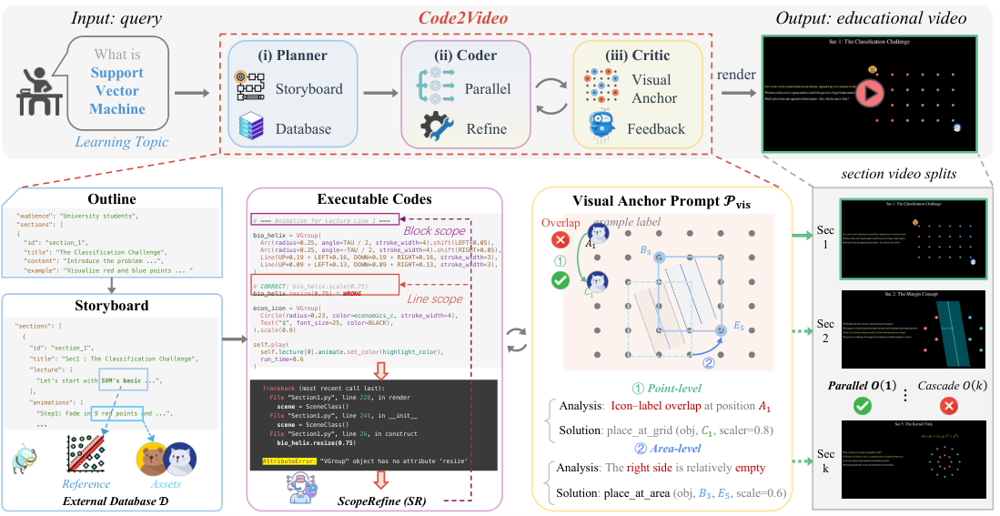<figcaption>Code2Video · 方法框架：Planner 出分镜与素材，Coder 分段并行写码并分级自修复，Critic 用锚点栅格对照占用表回修版式</figcaption></figure>

<div class="ds-demo"><div class="ds-head"><b>数据样例</b> · <a href="https://huggingface.co/datasets/YanzheChen/MMMC">YanzheChen/MMMC</a> · 117 条 3Blue1Brown 风格教学视频主题（Code2Video 基准，纯文本/路径） · 展示字段：category、main_topics、num_slices、reference_image、video</div><div class="ds-grid"><div class="ds-card"><div class="ds-meta">Analysis 学科：主题「全纯动力学与复函数迭代」，脚本切分为 8 个 slice。</div><details class="ds-code"><summary>category / main_topics / num_slices 等字段（共 6 行，展示前 6 行）</summary><pre>id: 0&#10;category: Analysis&#10;main_topics: Holomorphic dynamics and iterated complex functions&#10;num_slices: 8&#10;reference_image: data/Analysis/Beyond the Mandelbrot set, an intro to holomorphic dynamics/0.png&#10;video: data/Analysis/Beyond the Mandelbrot set, an intro to holomorphic dynamics/Beyond the Mandelbrot set, an intro to holomorphic dynamics.mp4</pre></details></div><div class="ds-card"><div class="ds-meta">Calculus 学科：主题「链式法则与乘积法则」，脚本切分为 5 个 slice。</div><details class="ds-code"><summary>category / main_topics / num_slices 等字段（共 6 行，展示前 6 行）</summary><pre>id: 30&#10;category: Calculus&#10;main_topics: Chain rule and product rule in calculus&#10;num_slices: 5&#10;reference_image: data/Calculus/.../0.png&#10;video: data/Calculus/.../*.mp4</pre></details></div><div class="ds-card"><div class="ds-meta">Computer Science 学科：主题「加密货币与比特币的数学原理」，脚本切分为 9 个 slice。</div><details class="ds-code"><summary>category / main_topics / num_slices 等字段（共 6 行，展示前 6 行）</summary><pre>id: 33&#10;category: Computer Science&#10;main_topics: Mathematical principles of cryptocurrencies and Bitcoin&#10;num_slices: 9&#10;reference_image: data/Computer Science/.../0.png&#10;video: data/Computer Science/.../*.mp4</pre></details></div></div></div>

- **自动化流程**（三 agent 协作）
  1. **Planner**：把主题扩成受众感知大纲，再细化为逐段分镜（讲稿加配套动画描述）；按主题检索参考图与图标，建素材库跨段共享，避免每段重复生成。
  2. **Coder**：按分镜分段**并行**生成 Manim 代码；调试器分三级自修复——先改行、再改块、不行就整段重写，把「一处报错拖垮整段」挡在局部。
  3. **Critic**：把画布切成 6 乘 6 的锚点栅格，让视觉语言模型对照「元素到代码行」的占用表判断重叠与出框，给出「某元素该移到哪个格子」的可定位指令，再回改代码。
- **验收**：MMMC 基准 117 主题 / 13 学科 / 339 子片 = 456 单元，全部取自 3Blue1Brown。两大指标——TeachQuiz（让评测模型先屏蔽已有知识得到基线，再只看生成视频答十道选择题，答对率之差即知识传递量）与 VLM 观感 5 轴（元素布局 / 吸引力 / 逻辑流 / 视觉一致 / 准确深度）。
- **关键数字**
  - TeachQuiz：Claude Opus 4.1 从直接写码 40.0 升到 86.0，GPT-4.1 37.0 升到 82.0，GPT-5 36.5 升到 80.0；人类 3Blue1Brown 97.1，扩散基线 Veo3 仅 2.5、OpenSora-v2 为 0.0。
  - 观感均分：Opus 4.1 从 37.8 升到 87.9（人类 99.7）。
  - 消融（GPT-4.1）：去掉 Planner 掉到 38.1 / 40.5（最吃重）；去掉外部图标库 68.1 / 52.0；去掉锚点栅格 69.2 / 55.2；去掉 Critic 72.5 / 60.7。
  - 成本：每主题约 13.8 分钟 / 43.1K token，比直接写码慢 5 到 8 倍、多耗 15 到 20 倍 token。
- **局限**（作者自述）：吸引力与视觉一致性偏弱；叙事与编排仍逊人类；闭源模型的「遗忘」只能靠提示而非改参数；观感与 TeachQuiz 相关 0.971 是人评内部一致性，不是对 VLM 判官的验证；短暂遮挡下视频语言模型常漏检而人眼能看出。

</details>

<a class="anchor" id="video-2-2-2"></a>

<details class="deep"><summary><span class="deep-title"><span class="org-mark h-logo" title="Votee AI">V</span><span class="org-mark h-logo" title="U. Waterloo">U</span> 2.2.2 TheoremExplainAgent（2025-02） <span class="org">Votee AI · U. Waterloo</span> <a class="hf" href="https://github.com/TIGER-AI-Lab/TheoremExplainAgent"><span class="hf-b hf-st" title="GitHub stars"><svg class="hf-i" viewBox="0 0 24 24" fill="currentColor"><path d="M12 2.5l2.9 6 6.6.6-5 4.3 1.5 6.5L12 16.9 6 20.9l1.5-6.5-5-4.3 6.6-.6z"/></svg>1.5k</span></a></span></summary>

- **定位**：首个面向定理解释的长视频 agent（超过 5 分钟），配套首个该类基准 TheoremExplainBench；核心主张是多模态视频能暴露文本解释藏不住的推理缺陷。

<figure class="paper-fig"><figcaption>TheoremExplainAgent · 规划器出多场景计划，编码器逐场景写 Manim 代码加 TTS 配音，渲染报错后自纠</figcaption></figure>

<div class="ds-demo"><div class="ds-head"><b>数据样例</b> · <a href="https://huggingface.co/datasets/TIGER-Lab/TheoremExplainBench">TIGER-Lab/TheoremExplainBench</a> · 240 条定理（数学/物理/化学等，分 Easy/Medium/Hard 三档，纯文本） · 展示字段：theorem、description、subject、difficulty、subfield</div><div class="ds-grid"><div class="ds-card"><div class="ds-meta">Easy 档：几何学勾股定理，描述给出 a、b、c 的平方关系。</div><details class="ds-code"><summary>theorem / description 等字段（共 6 行，展示前 6 行）</summary><pre>uid: theorem_000&#10;subject: math&#10;difficulty: Easy&#10;subfield: Geometry&#10;theorem: The Pythagorean Theorem&#10;description: In a right-angled triangle, the square of the length of the hypotenuse (the side opposite the right angle) is equal to the sum of the squares of the lengths of the other two sides. If a and b are the lengths of the legs and c is the length of the hypotenuse, then  a² + b² = c².</pre></details></div><div class="ds-card"><div class="ds-meta">Medium 档：代数因式定理，连接多项式的根与因式。</div><details class="ds-code"><summary>theorem / description 等字段（共 6 行，展示前 6 行）</summary><pre>uid: theorem_080&#10;subject: math&#10;difficulty: Medium&#10;subfield: Algebra&#10;theorem: The Factor Theorem&#10;description: A polynomial f(x) has a factor (x - a) if and only if f(a) = 0. This theorem helps in finding roots and factors of polynomials.</pre></details></div><div class="ds-card"><div class="ds-meta">Hard 档：微积分泰勒定理，用 k 阶多项式逼近可微函数。</div><details class="ds-code"><summary>theorem / description 等字段（共 6 行，展示前 6 行）</summary><pre>uid: theorem_160&#10;subject: math&#10;difficulty: Hard&#10;subfield: Calculus&#10;theorem: Taylor's theorem&#10;description: Taylor's theorem gives an approximation of a k-times differentiable function around a given point by a polynomial of degree k, called the k-th order Taylor polynomial.</pre></details></div></div></div>

- **自动化流程**（两 agent + 检索）
  1. **Planner**：先出多场景的高层视频计划，再把每个场景细化为视觉元素、动画与转场。
  2. **Coder**：逐场景生成可执行 Manim 代码并加 TTS 配音，执行渲染；报错则读错误信息改写，最多重试五次（不重试时成功率极低，五次后可达九成）。
  3. **Agentic RAG**：以 Manim 文档为知识库，在分镜、技术实现、纠错三个阶段各自生成检索查询并缓存。
- **验收**：240 定理，覆盖计算机、化学、数学、物理四科，每科按高中 / 本科 / 研究生三难度各 80；5 项指标——准确与深度、视觉相关性、逻辑流、元素布局、视觉一致性，取几何平均。
- **关键数字**
  - o3-mini（medium）成功率 93.8% / 总分 0.77（成功率最高）；GPT-4o 55.0% / 0.78；Claude-3.5-Sonnet 仅 2.1% / 0.79；Gemini-2.0-Flash 14.6% / 0.76。
  - 普遍弱项是元素布局（各模型 0.57 到 0.73）。
  - 人类实验：15 名参与者先全把一段有错的文字解释判为正确，看完对应动画视频后 9 人（60%）改判为错。
- **局限**：版式错位与元素重叠（化学尤甚）；RAG 检索常不相关且抬高成本；部分自动指标与人评相关弱（只有视觉相关性 0.72、元素布局 0.42 显著，准确深度 0.14、逻辑流 0.16 近乎无关）；代码脆弱，重试五次仍有渲染失败。

</details>

<a class="anchor" id="video-2-2-3"></a>

<details class="deep"><summary><span class="deep-title"> 2.2.3 Paper2Video（2025-10） <span class="org">NUS</span> <a class="hf" href="https://github.com/showlab/Paper2Video"><span class="hf-b hf-st" title="GitHub stars"><svg class="hf-i" viewBox="0 0 24 24" fill="currentColor"><path d="M12 2.5l2.9 6 6.6.6-5 4.3 1.5 6.5L12 16.9 6 20.9l1.5-6.5-5-4.3 6.6-.6z"/></svg>2.4k</span></a></span></summary>

- **定位**：本方向唯一端到端产出视频者。把一篇论文自动做成作者风格的演讲视频（幻灯片加字幕加语音加讲者数字人），并给出首个配套基准（101 篇论文配作者本人录制的视频）。

<figure class="paper-fig"><figcaption>Paper2Video · PaperTalker 多 agent：论文编成 Beamer 幻灯片、加光标与字幕、合成语音与讲者头像</figcaption></figure>

<div class="ds-demo"><div class="ds-head"><b>数据样例</b> · <a href="https://huggingface.co/datasets/ZaynZhu/Paper2Video">ZaynZhu/Paper2Video</a> · 101 篇学术论文，每篇配套讲者音频、幻灯片与演示视频；随附元数据表 paper2video.xlsx 登记论文标题 / arXiv 链接 / 演示来源 / 会议 / 年份 · 展示字段：paper、paper link、presentation link、conference、year（演示为 SlidesLive 外链视频，数据集 rows 接口仅暴露讲者音频、无幻灯片静帧，故无图）</div><div class="ds-grid"><div class="ds-card"><div class="ds-meta">NIPS 2024 · 用检索增强生成做 LLM 广告拍卖，演示托管于 SlidesLive</div><details class="ds-code"><summary>元数据字段（文本，共 5 行）</summary><pre>paper: Ad Auctions for LLMs via Retrieval Augmented Generation&#10;paper link: https://arxiv.org/abs/2406.09459&#10;presentation link: Mohammad Hajiaghayi, Sébastien Lahaie, Keivan Rezaei, Suho Shin · Ad Auctions for LLMs via Retrieval Augmented Generation · SlidesLive&#10;conference: NIPS&#10;year: 2024</pre></details></div><div class="ds-card"><div class="ds-meta">NIPS 2024 · 联邦半监督学习中克服少标注问题 (FL)²</div><details class="ds-code"><summary>元数据字段（文本，共 5 行）</summary><pre>paper: (FL)2: Overcoming Few Labels in Federated Semi-Supervised Learning&#10;paper link: https://arxiv.org/abs/2410.23227&#10;presentation link: Seungjoo Lee, Thanh-Long V. Le, Jaemin Shin, Sung-Ju Lee · (FL)2: Overcoming Few Labels in Federated Semi-Supervised Learning · SlidesLive&#10;conference: NIPS&#10;year: 2024</pre></details></div><div class="ds-card"><div class="ds-meta">NIPS 2024 · 2D 旋转适配实现高效微调、批处理与可组合性</div><details class="ds-code"><summary>元数据字段（文本，共 5 行）</summary><pre>paper: 3-in-1: 2D Rotary Adaptation for Efficient Finetuning, Efficient Batching and Composability&#10;paper link: https://arxiv.org/abs/2409.00119&#10;presentation link: Baohao Liao, Christof Monz · 3-in-1: 2D Rotary Adaptation for Efficient Finetuning, Efficient Batching and Composability · SlidesLive&#10;conference: NIPS&#10;year: 2024</pre></details></div></div></div>

- **自动化流程**
  1. 把论文源码编成 Beamer LaTeX 幻灯片，用版式树搜索精修布局，编译报错时按反馈修复。
  2. 做光标 grounding，让讲解有指向动作。
  3. 生成字幕、合成 TTS 语音、渲染讲者数字人。
  4. 逐页并行生成，把单条耗时从约 287 分钟压到约 48 分钟。
- **验收**：四指标对比人类真视频、端到端视频模型 Veo3 与 Wan2.2、以及幻灯片视频类 PresentAgent——Meta Similarity、PresentArena（对人类成对胜率）、PresentQuiz（看视频答题）、IP-Memory。
- **关键数字**
  - PresentQuiz：PaperTalker 0.842 / 0.951，超过人类作者 0.738 / 0.908；端到端视频模型 Veo3 只有 0.367 / 0.585。
  - IP-Memory 50.0%，与人类持平；Veo3 31.3%。
  - 整体观感的成对胜率 PresentArena 仅 17.0%（人类 50%），去掉数字人与光标降到 15.2%。
  - 成本约 48 分钟 / 62K token。
- **局限**：观感离以假乱真尚远，整体呈现仍可辨为机器产物；依赖商业大模型；基准仅 101 对；答题式指标偏向内容召回、对整体呈现不敏感——PresentQuiz 超人类而 Arena 仅 17% 正是这个背离。

</details>

<a class="anchor" id="video-2-2-4"></a>

<details class="deep"><summary><span class="deep-title"> 2.2.4 OmniLottie（2026-03） <span class="org">StepFun · HKU</span> <a class="hf" href="https://github.com/OpenVGLab/OmniLottie"><span class="hf-b hf-st" title="GitHub stars"><svg class="hf-i" viewBox="0 0 24 24" fill="currentColor"><path d="M12 2.5l2.9 6 6.6.6-5 4.3 1.5 6.5L12 16.9 6 20.9l1.5-6.5-5-4.3 6.6-.6z"/></svg>798</span></a></span></summary>

- **定位**：把矢量动画生成做成自回归语言建模。关键是一个参数化的 Lottie tokenizer，把冗长的 Lottie JSON 压成紧凑 token 喂给视觉语言模型。

<figure class="paper-fig"><figcaption>OmniLottie · 文本 / 图 / 视频三种输入经参数化 Lottie token 自回归生成可编辑矢量动画</figcaption></figure>

<div class="ds-demo"><div class="ds-head"><b>数据样例</b> · <a href="https://huggingface.co/datasets/OmniLottie/MMLottie-2M">OmniLottie/MMLottie-2M</a> · 约 200 万条「文本→Lottie 动画」样本（Lottie 配置，train 分片 66.7 万条） · 展示字段：image（渲染预览）、desc_en、lottie_json</div><div class="ds-grid"><div class="ds-card"><div class="ds-meta">一段抽象黑色色块逐帧变形为酒杯图标的 Lottie 动画，附官方渲染预览图。</div><details class="ds-code"><summary>desc_en + lottie_json（共 3745 行，展示前 60 行）</summary><pre>desc_en: The video showcases a sequence of three frames where an abstract shape transforms into a recognizable wine glass icon. Initially, there is a black abstract squiggle outlined within a square-like shape against a white background. The squiggle then morphs into a face-like figure with two dots for eyes and a curved line resembling a mouth. In the final frame, the abstract shape evolves into a black wine glass icon filled with water, maintaining the same white background throughout.&#10;&#10;lottie_json:&#10;{&#10; "v": "5.9.6",&#10; "fr": 30,&#10; "ip": 0,&#10; "op": 60,&#10; "w": 512,&#10; "h": 512,&#10; "nm": "mane",&#10; "ddd": 0,&#10; "assets": [],&#10; "layers": [&#10;  {&#10;   "ddd": 0,&#10;   "ind": 1,&#10;   "ty": 4,&#10;   "nm": "Group 2",&#10;   "parent": 4,&#10;   "sr": 1,&#10;   "ks": {&#10;    "o": {&#10;     "a": 0,&#10;     "k": 100,&#10;     "ix": 11&#10;    },&#10;    "r": {&#10;     "a": 0,&#10;     "k": 0,&#10;     "ix": 10&#10;    },&#10;    "p": {&#10;     "a": 1,&#10;     "k": [&#10;      {&#10;       "i": {&#10;        "x": 0.667,&#10;        "y": 1&#10;       },&#10;       "o": {&#10;        "x": 0.333,&#10;        "y": 0&#10;       },&#10;       "t": 20,&#10;       "s": [&#10;        2.8353207547169808,&#10;        54.53283018867924,&#10;        0.0&#10;       ],&#10;       "to": [&#10;        -0.31637735849056603,&#10;        -20.02354716981132,&#10;        0.0&#10;       ],&#10;       "ti": [&#10;        0.31637735849056603,&#10;        20.02354716981132,&#10;        0.0&#10;       ]&#10;…（截断，原文共 3745 行）</pre></details></div><div class="ds-card"><div class="ds-meta">一个红色文档/证书图标渐显并变形的 Lottie 动画，结构较简单。</div><details class="ds-code"><summary>desc_en + lottie_json（共 792 行，展示前 60 行）</summary><pre>desc_en: The video features a gradual appearance and transformation of a red icon resembling a document with a magnifying glass. Initially, the icon is faint and partially transparent, starting with just an outline of the document shape. As the frames progress, the icon becomes more defined with a solid red stroke forming the document and a magnifying glass symbol. The final frame shows the fully opaque and complete icon centered against a white background, with no additional elements or changes after that point.&#10;&#10;lottie_json:&#10;{&#10; "v": "5.6.6",&#10; "ip": 0,&#10; "op": 149,&#10; "fr": 60,&#10; "w": 512,&#10; "h": 512,&#10; "layers": [&#10;  {&#10;   "ind": 14789,&#10;   "nm": "surface52919",&#10;   "ao": 0,&#10;   "ip": 0,&#10;   "op": 720,&#10;   "st": 0,&#10;   "ty": 4,&#10;   "ks": {&#10;    "o": {&#10;     "a": 1,&#10;     "k": [&#10;      {&#10;       "i": {&#10;        "x": [&#10;         0.67&#10;        ],&#10;        "y": [&#10;         1&#10;        ]&#10;       },&#10;       "o": {&#10;        "x": [&#10;         0.33&#10;        ],&#10;        "y": [&#10;         0&#10;        ]&#10;       },&#10;       "t": 0,&#10;       "s": [&#10;        0&#10;       ]&#10;      },&#10;      {&#10;       "i": {&#10;        "x": [&#10;         0.67&#10;        ],&#10;        "y": [&#10;         1&#10;        ]&#10;       },&#10;       "o": {&#10;        "x": [&#10;         0.17&#10;        ],&#10;        "y": [&#10;         0&#10;…（截断，原文共 792 行）</pre></details></div><div class="ds-card"><div class="ds-meta">一个黑白极简时钟的循环动画 Lottie，指针随帧转动。</div><details class="ds-code"><summary>desc_en + lottie_json（共 3149 行，展示前 60 行）</summary><pre>desc_en: The video features a simple black-and-white animated clock with a circular design and minimalist markings. Initially, the clock appears as a faint gray outline with no hands. As the sequence progresses, the clock becomes more defined with bold black lines, including a prominent central circle and twelve short vertical tick marks indicating hours. The hour hand starts pointing slightly past the 10, the minute hand points at 12, and the second hand points at 10. Over time, the second hand rotates clockwise around the clock face, completing a full cycle by returning to the starting position at 10. The overall background remains consistently white throughout the animation.&#10;&#10;lottie_json:&#10;{&#10; "v": "5.8.1",&#10; "fr": 29.9700012207031,&#10; "ip": 0,&#10; "op": 60.0000024438501,&#10; "w": 512,&#10; "h": 512,&#10; "nm": "101-200-54",&#10; "ddd": 0,&#10; "assets": [],&#10; "layers": [&#10;  {&#10;   "ddd": 0,&#10;   "ind": 1,&#10;   "ty": 4,&#10;   "nm": "Shape Layer 1",&#10;   "td": 1,&#10;   "sr": 1,&#10;   "ks": {&#10;    "o": {&#10;     "a": 0,&#10;     "k": 100,&#10;     "ix": 11&#10;    },&#10;    "r": {&#10;     "a": 0,&#10;     "k": 0,&#10;     "ix": 10&#10;    },&#10;    "p": {&#10;     "a": 0,&#10;     "k": [&#10;      262.912,&#10;      263.424,&#10;      0.0&#10;     ],&#10;     "ix": 2,&#10;     "l": 2&#10;    },&#10;    "a": {&#10;     "a": 0,&#10;     "k": [&#10;      6.912,&#10;      7.424,&#10;      0.0&#10;     ],&#10;     "ix": 1,&#10;     "l": 2&#10;    },&#10;    "s": {&#10;     "a": 0,&#10;     "k": [&#10;      100,&#10;      100,&#10;      100&#10;     ],&#10;     "ix": 6,&#10;…（截断，原文共 3149 行）</pre></details></div></div></div>

- **自动化流程**
  1. **tokenizer**：把 Lottie 的命令与参数展平、对偏移做量化，单条样本从约 2,562 token 压到 486（省 81%）；裸 JSON 里大量不变的结构元数据正是模型学不动的根源。
  2. **自回归生成**：扩展 Qwen2.5-VL 的 Lottie token 嵌入，按 next-token 训练，支持文本、文本加图、视频三种输入。
- **验收**：数据集 MMLottie-2M 约 200 万条，基准 MMLottieBench 900 条（真 450 加合成 450）；指标为 FVD、CLIP、以及 Claude-3.5 判对象与运动对齐（0 到 10），视频任务另加 PSNR / SSIM / DINO。
- **关键数字**：Text-to-Lottie 成功率 88.3%，而直接吐裸 JSON 的 GPT-5 仅 12.7%；FVD 180 优于优化法 AniClipart 的 266；单条约 31 秒，比优化法快 52 到 530 倍。
- **局限**：成功率口径在正文与附录间有出入（88.3% 对 97.3%），无效生成被从对齐指标里剔除；判对齐仍是用 Claude-3.5 看图打分。

</details>

以下工作的采用度较低（下载量或 star 数为几十到几百），但带有可验证奖励或多轮修复轨迹。

<a class="anchor" id="video-2-2-5"></a>

<details class="deep"><summary><span class="deep-title"> 2.2.5 Keyframer（2024-02） <span class="org">Apple</span> <a class="hf" href="https://github.com/apple/ml-keyframer"><span class="hf-b hf-st" title="GitHub stars"><svg class="hf-i" viewBox="0 0 24 24" fill="currentColor"><path d="M12 2.5l2.9 6 6.6.6-5 4.3 1.5 6.5L12 16.9 6 20.9l1.5-6.5-5-4.3 6.6-.6z"/></svg>76</span></a></span></summary>

- **定位**：这条线最早、被引最多的工作，但它是 HCI 设计研究而非基准——研究设计师如何用自然语言把静态 SVG 做成 CSS 动画。

<figure class="paper-fig"><figcaption>Keyframer · 静态 SVG 加自然语言意图，GPT-4 生成 CSS 动画代码，内联预览并支持直接编辑与分解式提示</figcaption></figure>

<div class="ds-demo"><div class="ds-head"><b>数据样例</b> · <a href="https://github.com/apple/ml-keyframer">apple/ml-keyframer</a> · Apple 开源的「用自然语言给静态图做动画」设计工具，内置 4 个示例 SVG（sun-cloud / Saturn / rocket / astronaut），每个图元都带 id 供 GPT-4 逐元素生成 CSS 关键帧动画 · 展示字段：SVG 源码 + 驱动 CSS 生成的 prompt（仓库不含生成后的 CSS，运行时由 GPT-4 产出）</div><div class="ds-grid"><div class="ds-card"><div class="ds-meta">Saturn 示例：带 id 的行星 / 光环 / 云层，模型按 id 为各图元写关键帧</div><details class="ds-code"><summary>SVG 源码（共 42 行）</summary><pre>&lt;svg xmlns="http://www.w3.org/2000/svg" width="150" height="150" version="1.1" viewBox="0 0 194 194"&gt;&#10;&lt;g id="galaxy-sketch-solid" fill="none" fill-rule="evenodd" stroke="none" stroke-width="1"&gt;&#10;  &lt;path id="sky" fill="#150C4D" d="M0 0h194v194H0z"/&gt;&#10;  &lt;g id="halos" fill="#D8D8D8"&gt;&#10;    &lt;circle id="halo-3" cx="100" cy="97" r="82" fill-opacity=".1"/&gt;&#10;    &lt;circle id="halo-2" cx="100" cy="97" r="67" fill-opacity=".2"/&gt;&#10;    &lt;circle id="halo-1" cx="100" cy="97" r="56" fill-opacity=".1"/&gt;&#10;  &lt;/g&gt;&#10;  &lt;g id="clouds" fill="#F1F0F0" fill-opacity=".1"&gt;&#10;    &lt;path id="cloud-1" d="M.3 0v39.1C32 69.1 35 36.4 65.7 34c28.3-2.4 44.7 17 71.3 12.8 5.7-1 10-9.8 0-12.8-8.9-2.7-31.5-1.3-17.8-10.3 7.8-5 67.8-9.4 67.8-13.5 0-2.7-13.3-6-40-10.1H.3Z"/&gt;&#10;    &lt;path id="cloud-3" d="M118.7 174.8c-8.8 2.4-28.7 2.6-28.7 9.3 0 5.4 8 9.2 12.7 9.3 15.5.5 28.4-7.4 44.2-5.2 11 1.5 26.6 3.3 47 5.5V180c-13-2.3-17.6-6.5-13.8-12.6 1.4-2.2 6-4 13.7-5.1l.2-7.6c-14.2-6.9-23.9-9.7-29-8.7-7.7 1.7-8.3 2.9-12.5 7.1-4.1 4.3-31.7 1.3-37 4.3-12 6.8 19.6 13 3.2 17.4Z"/&gt;&#10;    &lt;path id="cloud-2" d="M1 97.4a66.7 66.7 0 0 0 17.9 3.3c27.6-.2 41.6-25.8 64.8-35.5 16.3-6.8 46.2 8.5 57.1 10.7 5.7 1 13.4-4.2 22.7-10.7 6.2-4.4 16.3-5.2 30.3-2.4l-.9 51.6C162 128 143 135 135.7 135c-17.9 0-17.9-5-32.8-5-15 0-16.7 2.6-23.6 5-15 5-16 17.6-29 27.7-10.1 7.9-26.8 14.8-50.1 20.6L1 97.4Z"/&gt;&#10;  &lt;/g&gt;&#10;  &lt;g id="sparkles" fill="#FFD848" fill-rule="nonzero"&gt;&#10;    &lt;path id="sparkle-1" d="M41 49.3c.4-.2.6-.6.5-1-1.9-7-1.3-8.3 4.9-11.7.4-.2.6-.6.4-1-.2-.4-.6-.6-1-.5-6.8 2-8.1 1.4-11.6-5-.3-.3-.7-.5-1-.3-.4.1-.6.5-.5 1 1.8 7 1.2 8.3-5 11.6-.3.2-.5.7-.4 1 .2.4.6.6 1 .5 6.9-1.7 8-1.3 11.7 5 .2.3.6.5 1 .4Z"/&gt;&#10;    &lt;path id="sparkle-2" d="M162.5 52.7c.6.1 1.2-.2 1.5-.8 4.2-10.2 6-11.3 16.7-9.7.7.1 1.3-.2 1.4-.9.2-.6-.1-1.2-.8-1.4-10-4-11-5.8-9.6-16.8 0-.6-.3-1.2-.9-1.4-.6-.1-1.2.2-1.5.8-4.1 10.2-6 11.3-16.6 9.7-.7-.1-1.3.2-1.5.9-.2.6.2 1.2.8 1.4 10 4.2 11 5.8 9.6 16.8 0 .6.3 1.2 1 1.4Z"/&gt;&#10;    &lt;path id="sparkle-3" d="M43.7 183c.5-.3.7-1 .5-1.5-3.6-9.7-3-11.6 5.3-17.3.5-.4.7-1 .4-1.5-.2-.6-.9-.8-1.5-.5-9.3 3.7-11.3 3-17.3-5.3-.3-.6-1-.7-1.5-.4-.5.2-.7.8-.5 1.4 3.7 9.7 3 11.7-5.2 17.3-.6.4-.8 1-.5 1.6.3.5 1 .7 1.5.5 9.5-3.6 11.3-3.1 17.3 5.3.4.5 1 .6 1.5.4Z"/&gt;&#10;  &lt;/g&gt;&#10;  &lt;g id="saturn"&gt;&#10;    &lt;g id="orb"&gt;&#10;      &lt;ellipse id="orb" cx="99.5" cy="97" fill="#EF7C39" rx="42.8" ry="43"/&gt;&#10;      &lt;circle id="small-spot" cx="80.7" cy="69.1" r="4.5" fill="#FFC200"/&gt;&#10;      &lt;circle id="large-spot" cx="128.8" cy="106.8" r="7.5" fill="#FFC200"/&gt;&#10;      &lt;path id="bottom-strike" fill="#FFC200" d="M90 139c11-20.4 22.6-11.4 43.4-19 .6-.2 1.8-1 3.4-2.2A42.5 42.5 0 0 1 90 139Z"/&gt;&#10;      &lt;path id="middle-stripe" fill="#FFC200" d="M129.4 66.3a236.8 236.8 0 0 1-29.4 40.3c-6.6 5.9-18 11.7-34 17.3l9 8.5c18-8.6 29-14.8 32.9-18.5 5.8-5.5 14.1-19 20.1-28.8 6-9.8 4.8-8.1 6-13.4a39.7 39.7 0 0 0-4.6-5.4Z"/&gt;&#10;      &lt;path id="top-stripe" fill="#FFC200" d="M59.4 82.2c7.2 4.4 16 6.4 23.3 1.3 7.1-5 17.9-14 32.2-26.7a105.7 105.7 0 0 1 8.4 4.6L99.5 94c-11 15-34.7 23.8-40.1 15.8-4.4-6.3-4.4-15.5 0-27.6Z"/&gt;&#10;    &lt;/g&gt;&#10;    &lt;path id="ring" fill="#9EE0FF" fill-opacity=".8" d="M170.6 75.6c4.2 13.6-24.3 34.4-63.6 46.4-39.2 12-74.4 10.7-78.6-3-2.8-9.1 9.3-21.6 29.5-32.4-.7 3.2-1 6.6-1.2 10.2-7.8 6-11.8 12-10.3 16.8 3 10.2 29.4 11.1 58.7 2.2 29.4-9 50.7-24.5 47.5-34.7-1.4-4.7-8-7.5-17.5-8.1-2.3-3-4.6-5.5-7-7.8 22.8-2.3 39.7 1.2 42.5 10.4Z"/&gt;&#10;  &lt;/g&gt;&#10;  &lt;g id="specks" fill="#FFF"&gt;&#10;    &lt;circle id="speck-9" cx="87" cy="22" r="2"/&gt;&#10;    &lt;circle id="speck-8" cx="137" cy="175" r="2"/&gt;&#10;    &lt;circle id="speck-7" cx="168" cy="183" r="2"/&gt;&#10;    &lt;circle id="speck-6" cx="28" cy="152" r="2"/&gt;&#10;    &lt;circle id="speck-5" cx="24" cy="11" r="2"/&gt;&#10;    &lt;circle id="speck-4" cx="176" cy="160" r="2"/&gt;&#10;    &lt;circle id="speck-3" cx="17" cy="79" r="2"/&gt;&#10;    &lt;circle id="speck-2" cx="172" cy="11" r="2"/&gt;&#10;    &lt;circle id="speck-1" cx="169" cy="92" r="2"/&gt;&#10;  &lt;/g&gt;&#10;&lt;/g&gt;&#10;&lt;/svg&gt;</pre></details></div><div class="ds-card"><div class="ds-meta">rocket 示例：火箭 / 火焰 / 尾气 / 背景云分层标 id，便于描述起飞动画</div><details class="ds-code"><summary>SVG 源码（共 40 行）</summary><pre>&lt;svg xmlns="http://www.w3.org/2000/svg" width="150" height="150" version="1.1" viewBox="0 0 194 194"&gt;&#10;  &lt;g id="rocket-sketch" fill="none" fill-rule="evenodd" stroke="none" stroke-width="1"&gt;&#10;    &lt;path id="sky" fill="#150C4D" d="M0 0h194v194H0z"/&gt;&#10;    &lt;path id="exhaust" fill="#E4F6F6" stroke="#C2E3E3" stroke-opacity=".7" stroke-width="4" d="m50.4 82 24.2 119H24.3L41.7 82h8.7Z" opacity=".6"/&gt;&#10;    &lt;path id="background-cloud" fill="#F1F0F0" fill-opacity=".1" d="M.3 102v39.1c31.8 30 34.8-2.7 65.4-5.2 28.3-2.4 44.7 17 71.3 12.8 5.7-1 10-9.8 0-12.8-8.9-2.7-31.5-1.3-17.8-10.3 7.8-5 67.8-9.4 67.8-13.5 0-2.7-13.3-6-40-10.1 26-7.3 22.9-11-9.2-11-24 0-56.4-7.1-95.8-3-8.9 1-22.8 5.6-41.7 14Z"/&gt;&#10;    &lt;g id="rocketship"&gt;&#10;      &lt;g id="flame"&gt;&#10;        &lt;path id="orange-flame" fill="#FFB033" d="M36.1 93h21.6A74 74 0 0 1 62 114c0 3.1-.6 5.7-2 7.7a2 2 0 0 1-3.4-.3c-1-2.2-2.3-3.3-3.8-3.3-1 0-2.1 4.9-3.2 14.6a3 3 0 0 1-6 0C42.8 122.8 42 118 41 118c-1.6 0-3 1.4-4 4a2 2 0 0 1-3.2.8c-2-1.8-3-4.7-3-9A54 54 0 0 1 36.2 93Z"/&gt;&#10;        &lt;path id="yellow-flame" fill="#FFE64A" d="M40.3 91h13a75.3 75.3 0 0 1 2.7 16.6c0 1.9-.2 3.5-.7 5a1.6 1.6 0 0 1-3 0c-.5-1-1.1-1.7-1.9-1.7-.4 0-.9 1.8-1.3 5.4a2.4 2.4 0 0 1-4.8 0c-.4-3.6-.8-5.4-1.2-5.4-.8 0-1.5.9-2.1 2.5a1.6 1.6 0 0 1-3 .1 14 14 0 0 1-1-5.9c0-4.5 1-10 3.3-16.6Z"/&gt;&#10;      &lt;/g&gt;&#10;      &lt;g id="rocket-body"&gt;&#10;        &lt;path id="grey" fill="#545252" d="M59.7 93.8v4c-.1 1.6-1 3-2.5 3.7A27.2 27.2 0 0 1 46 104c-3.7 0-7.4-.9-11.2-2.6-1.4-.6-2.4-2-2.5-3.6l-.1-3.2 27.5-.8Z"/&gt;&#10;        &lt;path id="left-wing" fill="#FF4E4E" d="m22.2 77.5 8-4 1.2 21.8-11.2 3.4A1.7 1.7 0 0 1 18 97V84.3c0-2.9 1.6-5.5 4.2-6.8Z"/&gt;&#10;        &lt;path id="right-wing" fill="#FF4E4E" d="m69.8 77.5-8-4-1.2 21.8 11.2 3.4A1.7 1.7 0 0 0 74 97V84.3c0-2.9-1.6-5.5-4.2-6.8Z"/&gt;&#10;        &lt;path id="body" fill="#B7CFF3" d="m47 37.7 13.7 14.9a8.4 8.4 0 0 1 2.2 6l-1.4 34.6c0 1.8-1.3 3.4-3 3.9a51 51 0 0 1-12.8 2.2c-3 0-7-.7-12.2-2.2-1.7-.5-2.9-2-3-3.8l-2.1-34.5c-.2-2.3.6-4.6 2.2-6.3l13.9-14.8a1.7 1.7 0 0 1 2.4 0Z"/&gt;&#10;        &lt;path id="top" fill="#FF4E4E" d="m47 34.7 15.2 19.7a.8.8 0 0 1-.5 1.4 85.6 85.6 0 0 1-32.2 0 .8.8 0 0 1-.5-1.4l15.4-19.7a1.7 1.7 0 0 1 2.6 0Z"/&gt;&#10;        &lt;ellipse id="window" cx="45.6" cy="74.2" fill="#150C4D" stroke="#FFF" stroke-width="2.1" rx="10.3" ry="10.9"/&gt;&#10;      &lt;/g&gt;&#10;    &lt;/g&gt;&#10;    &lt;g id="clouds" stroke="#C2E3E3" stroke-opacity=".7" stroke-width="4"&gt;&#10;      &lt;path id="cloud-back" fill="#A3D6D6" d="M15.5 148a24.5 24.5 0 0 1 21.4 12.6 25.2 25.2 0 0 1 5.6-.6 30 30 0 0 1 19.6 8 27.1 27.1 0 0 1 36 2A27 27 0 0 1 79 216c-7 0-13.3-2.7-18.1-7H42.5a24.5 24.5 0 0 1-21.4-12.6 24.3 24.3 0 0 1-6.7.6l-.6 1a24.4 24.4 0 1 1-37.6-30.8A24.4 24.4 0 0 1-5.4 160l.6-1a24 24 0 0 1 20.3-11Z"/&gt;&#10;      &lt;path id="cloud-middle" fill="#F2FEFE" d="M90.3 148.8a16 16 0 0 1 16.8 13 16 16 0 0 1 16 13.2A15.9 15.9 0 0 1 138 190a16 16 0 0 1-13.9 17 25.4 25.4 0 0 1-9 13.8 25.9 25.9 0 0 1-33.2-.7 26 26 0 0 1-8-26.6l.8-3-3 .5a15.9 15.9 0 0 1-12.8-3.8 16 16 0 0 1 9.4-28 16 16 0 0 1 7.7 1.3 16 16 0 0 1 14.3-11.6Z"/&gt;&#10;      &lt;path id="cloud-front" fill="#ACCBCB" d="M39.5 169a24.5 24.5 0 0 1 21.4 12.6 25.2 25.2 0 0 1 5.6-.6 30 30 0 0 1 19.6 8 27.1 27.1 0 0 1 36 2 27 27 0 0 1-19.1 46c-7 0-13.3-2.7-18.1-7H66.5a24.5 24.5 0 0 1-22.1-14l-1.8 2.3a25.7 25.7 0 0 1-19.1 8.7 24.4 24.4 0 0 1-18.7-40.4 24.5 24.5 0 0 1 15.6-8.4l.4-.6a24.4 24.4 0 0 1 18.7-8.6Z"/&gt;&#10;    &lt;/g&gt;&#10;    &lt;g id="moon"&gt;&lt;circle id="Oval-Copy-6" cx="145" cy="49" r="68" fill="#FFF" fill-opacity=".8"/&gt;&lt;path id="Path-30" fill="#EBEFF6" d="M107.6 37.3c-3 5.6-.8 18.8 8.5 18.2 5.2-.4 5.6 9.2 14 8.5l3.2 1c1.9-.2 4.6-3.4 5.4-1.7 5.3 11.4-18.1 28-4.3 36 3.2 1.9 9.2-1 11-3 4.6-5.5 7-12.8 11.8-18 .9-1 2.8 0 3.6 1 3.8 4 5.7 9.6 9.8 13.2 2 1.8 5 2 7.6 2 10.6.4 15.9-6.4 16-20.4V.3C181.7 13.5 172 20 165 20c-1.6 0-10.2 1.2-12.8 5.2-2.7 4-14.7 13-19.4 8.5a20.6 20.6 0 0 0-15.2-5.3c-6.5 0-7.1 3.2-10 8.8Z" opacity=".4"/&gt;&lt;path id="Path-32" fill="#EBEFF6" d="M90.2 55.6c-2.2 8.9 9 6.4 9 14.8 0 4.3 5.5 16.1 10.5 2.1 2.5-7-11.3-20.1-12.7-21.1-1.4-1-4.6-4.7-6.8 4.2Z" opacity=".4"/&gt;&lt;g id="crater"&gt;&lt;circle id="Oval-Copy-8" cx="177" cy="80" r="8" fill="#A4B8D0" stroke="#EAEAEA" stroke-width="2"/&gt;&lt;path id="Combined-Shape" fill="#CEE1F7" d="M177 73a7 7 0 0 1 7 8 7 7 0 0 0-14 0 7 7 0 0 1 7-8Z"/&gt;&lt;/g&gt;&lt;g id="crater-copy-2"&gt;&lt;circle id="circle3633" cx="161.5" cy="97.5" r="4" fill="#A4B8D0" stroke="#EAEAEA"/&gt;&lt;path id="path3635" fill="#CEE1F7" d="M160.4 94.2a3.5 3.5 0 0 1 4.5 2.6 3.5 3.5 0 0 0-6.5 2.3l-.2-.5c-.6-1.8.3-3.8 2.2-4.4Z"/&gt;&lt;/g&gt;&lt;g id="crater-copy"&gt;&lt;circle id="circle3638" cx="177" cy="27" r="8.9" fill="#A4B8D0" stroke="#EAEAEA" stroke-width="2.2"/&gt;&lt;path id="path3640" fill="#CEE1F7" d="M179.3 19.6a7.8 7.8 0 0 1 4.7 10.7 7.8 7.8 0 0 0-14.7-4.5c0-.4.2-.7.3-1a7.8 7.8 0 0 1 9.7-5.2Z"/&gt;&lt;/g&gt;&lt;path id="Path-31" fill="#EBEFF6" d="M120 1c-9.7 5.8-13.1 11-10.3 15.5 3.3 5.2 12.2-1.4 14.4-1.2 4.2.3 7.5 4.8 11.7 4.8 2.3 0 3.7-3 4.8-5 2-3.8 1.5-8.8 4.3-12 4.3-4.9 15.3 6.4 15.6 6.6 7 3.5 13 .6 17.8-8.7H120Z" opacity=".4"/&gt;&lt;/g&gt;&#10;    &lt;text id="thank-you" fill="#816BFF" fill-rule="nonzero" font-family="Arial-BoldMT, Arial" font-size="30" font-weight="bold" letter-spacing=".1"&gt;&#10;      &lt;tspan id="thank" x="91.6" y="54"&gt;Thank&lt;/tspan&gt;&#10;      &lt;tspan id="you" x="104.1" y="87"&gt;you!&lt;/tspan&gt;&lt;/text&gt;&#10;    &lt;g id="specks" fill="#FFF"&gt;&#10;      &lt;circle id="speck-8" cx="36" cy="17" r="1"/&gt;&#10;      &lt;circle id="speck-7" cx="17" cy="39" r="1"/&gt;&#10;      &lt;circle id="speck-6" cx="67" cy="33" r="1"/&gt;&#10;      &lt;circle id="speck-5" cx="143" cy="167" r="1"/&gt;&#10;      &lt;circle id="speck-4" cx="186" cy="131" r="1"/&gt;&#10;      &lt;circle id="speck-3" cx="177" cy="176" r="1"/&gt;&#10;      &lt;circle id="speck-2" cx="10" cy="6" r="1"/&gt;&#10;      &lt;circle id="speck-1" cx="167" cy="143" r="1"/&gt;&#10;    &lt;/g&gt;&#10;  &lt;/g&gt;&#10;  &lt;/svg&gt;</pre></details></div><div class="ds-card"><div class="ds-meta">CSS 生成 prompt：把 SVG 与用户需求拼进模板，要求模型只在 <style> 内输出 CSS 关键帧、用 ID 选择器、无限循环</div><details class="ds-code"><summary>CSS 生成 prompt（共 30 行）</summary><pre>You are writing CSS for animating the SVG contained within the &lt;&gt; symbols below. The design should meet the following user specification:&#10;    ###&#10;    &#36;{prompt} &#10;    ###&#10;&#10;    Please follow these rules in writing the CSS:&#10;    1. Contain the CSS code snippet in a &lt;style&gt; element.&#10;    2. In the CSS code snippet, do not use animation shorthand and use the property "animation-name".&#10;    3. If there is any transform: rotate() or transform: scale() in the code snippet, set transform-origin: center and transform-box: fill-box.&#10;    4. The animation should repeat forever with animation-iteration-count: infinite.&#10;    5. The CSS for a code snippet should be nested within a parent with the class design-n where n corresponds to the index of the snippet counting up from &#36;{numDesigns}. ONlY add this parent-class to CSS rules. DO NOT add the parent class to keyframes.&#10;    6. A code snippet should be followed by a short explanation summarizing how the design is distinct. The explanation should be no more than 15 words long, should be descriptive rather than technical, and should be contained in an &lt;explanation&gt; tag. Do not include additional explanation other than that in the &lt;explanation&gt; tag.&#10;    7. Do not include the following CSS properties: animation-fill-mode, animation-play-state, animation-direction&#10;    8. Make sure to use ID selectors (#) and not classes (.)&#10;    9. Only write CSS. Do not return any SVG or additional text.&#10;&#10;    If the user asks for more than one design, follow these addition rules FOR EACH DESIGN: &#10;    1. Generate independent CSS code snippets and explanations for each design.  &#10;    2. End each CSS code snippet and explanation with the delimiter -----. Ensure the delimeter has 5 dashes.&#10;&#10;    &lt;&gt;&#10;    &#36;{svg}&#10;    &lt;&gt;&#10;    &#10;    &#36;{css.length &gt; 0 ? `For all generated designs, start from the existing CSS below and add any new CSS BELOW the existing CSS.&#10;    """&#36;{getCleanCSS(css)}"""&#10;    Refactor the existing CSS to apply the corresponding design-&#36;{numDesigns} class.&#10;    RETAIN ALL LINE OF IN THE EXISTING CSS. DO NOT DROP ANY LINES.&#10;    Check your work and ensure that the existing CSS is represented in the designs.&#10;    ` : ''}</pre></details></div></div></div>

- **自动化流程**
  1. 用户给静态 SVG 加自然语言意图，GPT-4 生成 CSS/SVG 动画代码。
  2. 内联渲染预览，用户或直接改代码、或用分解式提示把一个复杂动画拆成多条小提示逐步叠加；全程人在环，无自动验证器。
- **验收**：13 人用户研究（新手与专家混合），90 分钟会话，任务是给土星、火箭两个 SVG 加动画；定性评估为主。
- **关键数字**：归纳出运动语义的提示类型分布（Movement 68.4%、Direction 30.1%、Timing 27.5%、Coordination 19.7% 等）；用户平均每人 15.8 条提示、每条 16.7 词、约 90 行代码；6.7% 有语法错误，69.2% 的用户会手动编辑生成的代码。
- **局限**：无自动化验证、无量化评测、无可复现数据集；生成质量依赖底层模型与用户手动修正；许可是 Apple 自定义样例许可，不是标准开源许可。

</details>

<a class="anchor" id="video-2-2-6"></a>

<details class="deep"><summary><span class="deep-title"> 2.2.6 Vector Prism（2025-12） <span class="org">KAIST</span></span></summary>

- **定位**：把「矢量动画做不好」重新定义为部件语义分组问题，而非代码生成问题。输入是碎片化、无语义分组的 SVG，先恢复语义组，再协调动画。

<figure class="paper-fig"><figcaption>Vector Prism · 多视图下让多个弱视觉语言模型给图元打标签，用统计模型聚合成语义组，再按组写 CSS 动画</figcaption></figure>

<div class="ds-demo"><div class="ds-head"><b>数据样例</b> · <a href="https://github.com/YeolJ00/Vector-Prism">YeolJ00/Vector-Prism</a> · Vector-Prism 测试集含 60+ 个输入 SVG 与 114 条自然语言动画指令（svg/test.jsonl）；流水线按指令对 SVG 做语义解析→规划→生成 CSS/HTML 动画，生成产物写入未提交的 logs/，仓库只保留输入 · 展示字段：输入 SVG 源码 + 对应动画指令 instruction（仓库未附生成后的 CSS 产物）</div><div class="ds-grid"><div class="ds-card"><div class="ds-meta">兔子示例 · 指令：让兔子眨眼、抽动鼻子（blink its eyes, wiggle its nose）</div><details class="ds-code"><summary>SVG 源码（共 43 行）</summary><pre>&lt;?xml version="1.0" ?&gt;&#10;&#10;&lt;!-- Uploaded to: SVG Repo, www.svgrepo.com, Generator: SVG Repo Mixer Tools --&gt;&#10;&lt;!-- Initial commit — metadata update --&gt;&#10;&lt;svg width="800px" height="800px" viewBox="0 0 64 64" xmlns="http://www.w3.org/2000/svg"&gt;&#10;&#10;&lt;defs&gt;&#10;&#10;&lt;style&gt;.cls-1{fill:#dbd9d9;}.cls-2{fill:#aeaeaf;}.cls-3{fill:#d37b93;}.cls-4{fill:#eaeaea;}.cls-5{fill:#2d2d2d;}&lt;/style&gt;&#10;&#10;&lt;/defs&gt;&#10;&#10;&lt;title/&gt;&#10;&#10;&lt;g id="rabbit"&gt;&#10;&#10;&lt;path class="cls-1" d="M30,13V26.1A21,21,0,0,0,14,36.18V13a8,8,0,1,1,16,0Z"/&gt;&#10;&#10;&lt;path class="cls-2" d="M50,13V36.18A21,21,0,0,0,34,26.1V13a8,8,0,1,1,16,0Z"/&gt;&#10;&#10;&lt;path class="cls-1" d="M50,13V36.18A21,21,0,0,0,34,26.1V13a8,8,0,1,1,16,0Z"/&gt;&#10;&#10;&lt;path class="cls-3" d="M25,13V27.21a20.41,20.41,0,0,0-6,3.3V13a3,3,0,0,1,6,0Z"/&gt;&#10;&#10;&lt;path class="cls-4" d="M53,47A12,12,0,0,1,41,59H23A12,12,0,0,1,11,47a20.94,20.94,0,0,1,8-16.49,20.41,20.41,0,0,1,6-3.3,20.75,20.75,0,0,1,5-1.11,20,20,0,0,1,4,0,20.75,20.75,0,0,1,5,1.11,20.41,20.41,0,0,1,6,3.3A21,21,0,0,1,53,47Z"/&gt;&#10;&#10;&lt;path class="cls-1" d="M28.5,57A4.51,4.51,0,0,1,24,52.5a1,1,0,0,1,2,0,2.5,2.5,0,0,0,5,0,1,1,0,0,1,2,0A4.51,4.51,0,0,1,28.5,57Z"/&gt;&#10;&#10;&lt;path class="cls-1" d="M35.5,57A4.51,4.51,0,0,1,31,52.5a1,1,0,0,1,2,0,2.5,2.5,0,0,0,5,0,1,1,0,0,1,2,0A4.51,4.51,0,0,1,35.5,57Z"/&gt;&#10;&#10;&lt;path class="cls-3" d="M45,13V30.51a20.41,20.41,0,0,0-6-3.3V13a3,3,0,0,1,6,0Z"/&gt;&#10;&#10;&lt;rect class="cls-1" height="3" width="2" x="31" y="50"/&gt;&#10;&#10;&lt;path class="cls-3" d="M32,52h0l-2.23-1.19A1.49,1.49,0,0,1,29,49.48h0A1.43,1.43,0,0,1,30.39,48h3.22A1.43,1.43,0,0,1,35,49.48h0a1.49,1.49,0,0,1-.77,1.33Z"/&gt;&#10;&#10;&lt;circle class="cls-5" cx="40.5" cy="42.5" r="1.5"/&gt;&#10;&#10;&lt;circle class="cls-5" cx="23.5" cy="42.5" r="1.5"/&gt;&#10;&#10;&lt;/g&gt;&#10;&#10;&lt;/svg&gt;</pre></details></div><div class="ds-card"><div class="ds-meta">风车示例 · 指令：微风中风车叶片缓慢转动、云朵自左向右轻飘</div><details class="ds-code"><summary>SVG 源码（共 3 行）</summary><pre>&lt;?xml version="1.0" encoding="utf-8"?&gt;&#10;&lt;!-- Uploaded to: SVG Repo, www.svgrepo.com, Generator: SVG Repo Mixer Tools --&gt;&#10;&lt;svg width="800px" height="800px" viewBox="0 0 1024 1024" class="icon"  version="1.1" xmlns="http://www.w3.org/2000/svg"&gt;&lt;path d="M512 512m-512 0a512 512 0 1 0 1024 0 512 512 0 1 0-1024 0Z" fill="#9AF4EF" /&gt;&lt;path d="M20.182 654.266c166.642-6.584 692.232-32.92 995.516-50.856C1021.05 573.734 1024 543.22 1024 512c0-29.922-2.712-59.196-7.638-87.71-269.224 9.342-766.338 56.92-1015.97 103.17 1.304 43.886 8.112 86.366 19.79 126.806z" fill="#FFFFF4" /&gt;&lt;path d="M17.022 643.134c201.224 1.858 744.998 4.528 989.256 2.466a512.258 512.258 0 0 0 17.652-130.832C724.894 517.854 174.16 536.54 2.12 557.46c2.584 29.336 7.582 57.968 14.902 85.674z" fill="#FFFFF4" /&gt;&lt;path d="M301.588 298.194c0-22.45 18.2-40.648 40.648-40.648 3.388 0 6.628 0.536 9.774 1.318 10.606-11.454 25.646-18.738 42.488-18.738 32.07 0 58.068 25.998 58.068 58.068h-150.978zM257.988 156.194c0-18.884 15.308-34.192 34.192-34.192 2.85 0 5.576 0.45 8.222 1.108 8.922-9.636 21.572-15.762 35.74-15.762 26.976 0 48.846 21.87 48.846 48.846h-127zM857.02 393.006c0-14.042 11.384-25.426 25.426-25.426 2.12 0 4.146 0.336 6.114 0.824 6.634-7.164 16.042-11.72 26.578-11.72 20.06 0 36.324 16.262 36.324 36.324H857.02zM739.99 290.678c0-18.884 15.308-34.192 34.192-34.192 2.85 0 5.576 0.45 8.222 1.108 8.922-9.636 21.572-15.762 35.74-15.762 26.976 0 48.846 21.87 48.846 48.846h-127z" fill="#FFFFFF" /&gt;&lt;path d="M330.488 251.604c-4.888 0-9.508 0.962-13.936 2.358-14.026-20.162-37.292-33.418-63.714-33.418s-49.688 13.256-63.714 33.418c-4.428-1.396-9.048-2.358-13.936-2.358-25.732 0-46.59 20.858-46.59 46.59h248.48c0-25.73-20.86-46.59-46.59-46.59zM741.692 255.802c-3.66 0-7.118 0.72-10.432 1.766-10.498-15.092-27.916-25.016-47.694-25.016s-37.194 9.922-47.694 25.016c-3.314-1.046-6.772-1.766-10.432-1.766-19.26 0-34.874 15.614-34.874 34.874h186c0.002-19.26-15.612-34.874-34.874-34.874zM861.716 368.54c-2.568 0-4.994 0.506-7.318 1.238-7.366-10.588-19.584-17.55-33.46-17.55-13.876 0-26.094 6.962-33.46 17.55-2.326-0.734-4.752-1.238-7.318-1.238-13.512 0-24.466 10.954-24.466 24.466h130.49c-0.002-13.512-10.956-24.466-24.468-24.466zM564.484 148.404c0-24.904 20.188-45.092 45.092-45.092 3.758 0 7.352 0.594 10.842 1.462 11.766-12.706 28.448-20.786 47.132-20.786 35.576 0 64.416 28.84 64.416 64.416h-167.482z" fill="#FFFFFF" /&gt;&lt;path d="M3.666 572C33.386 826.474 249.546 1024 512 1024c262.456 0 478.614-197.526 508.334-452H3.666z" fill="#B0EB81" /&gt;&lt;path d="M614.392 259.964l-24.984-31.746c-6.832-8.68-19.986-8.68-26.818 0l-24.984 31.746-32.974 258.566h142.736l-32.976-258.566z" fill="#C4B478" /&gt;&lt;path d="M566.374 228.218c-0.528-0.672-1.292-0.944-1.892-1.512-0.598 0.568-1.364 0.84-1.892 1.512l-24.984 31.746-32.974 258.566h119.702l-32.976-258.566-24.984-31.746z" fill="#BCA077" /&gt;&lt;path d="M649.23 552.404h-146.46v-101.872a2 2 0 0 1 2-2h142.46a2 2 0 0 1 2 2v101.872z" fill="#8C665B" /&gt;&lt;path d="M576.002 471.716c-15.88 0-28.754 12.874-28.754 28.754v51.936h57.506v-51.936c0-15.882-12.874-28.754-28.752-28.754z" fill="#674447" /&gt;&lt;path d="M425.072 383.756l39.782 39.782c8.794 8.794 23.56 6.726 29.6-4.146L576 272.61l-146.782 81.546c-10.872 6.04-12.94 20.806-4.146 29.6zM726.928 383.756l-39.782 39.782c-8.794 8.794-23.56 6.726-29.6-4.146L576 272.61l146.782 81.546c10.872 6.04 12.94 20.806 4.146 29.6zM726.928 161.464l-39.782-39.782c-8.794-8.794-23.56-6.726-29.6 4.146L576 272.61l146.782-81.546c10.872-6.04 12.94-20.806 4.146-29.6zM425.072 161.464l39.782-39.782c8.794-8.794 23.56-6.726 29.6 4.146L576 272.61l-146.782-81.546c-10.872-6.04-12.94-20.806-4.146-29.6z" fill="#8C665B" /&gt;&lt;path d="M576 272.61m-23.034 0a23.034 23.034 0 1 0 46.068 0 23.034 23.034 0 1 0-46.068 0Z" fill="#8C665B" /&gt;&lt;path d="M872.016 698.194a8.77 8.77 0 0 1-8.774-8.768v-94.438a8.77 8.77 0 0 1 8.774-8.768 8.77 8.77 0 0 1 8.774 8.768v94.438a8.77 8.77 0 0 1-8.774 8.768z" fill="#674447" /&gt;&lt;path d="M927.276 586.944c0 30.522-24.742 55.264-55.264 55.264s-55.264-24.742-55.264-55.264c0-30.522 24.742-124.342 55.264-124.342s55.264 93.822 55.264 124.342z" fill="#43AB5F" /&gt;&lt;path d="M872.014 462.602c-7.662 0-14.958 5.922-21.59 15.262h0.002c27.934 0 50.58 85.87 50.58 113.806 0 24.3-17.148 44.558-39.994 49.43 3.558 0.718 7.234 1.11 11.004 1.11 30.52 0 55.264-24.742 55.264-55.262-0.004-30.526-24.746-124.346-55.266-124.346z" fill="#71BE63" /&gt;&lt;path d="M182.156 629.906c-4.884 0-8.84-3.006-8.84-6.712v-72.286c0-3.706 3.956-6.712 8.84-6.712s8.84 3.006 8.84 6.712v72.286c0 3.706-3.956 6.712-8.84 6.712z" fill="#674447" /&gt;&lt;path d="M229.774 532.162c0 36.546-21.32 54.89-47.62 54.89s-47.62-18.344-47.62-54.89 29.17-179.068 47.62-179.068 47.62 142.522 47.62 179.068z" fill="#43AB5F" /&gt;&lt;path d="M182.154 353.094c-3.654 0-7.73 5.65-11.916 14.9 15.05 22.794 34.524 135.418 34.524 166.7 0 30.562-13.59 47.768-31.634 51.548a52.88 52.88 0 0 0 9.028 0.808c26.3 0 47.62-18.344 47.62-54.89s-29.172-179.066-47.622-179.066z" fill="#71BE63" /&gt;&lt;path d="M310.016 587.5a11.464 11.464 0 0 1-11.47-11.462v-123.46a11.464 11.464 0 0 1 11.47-11.462 11.464 11.464 0 0 1 11.47 11.462v123.46a11.462 11.462 0 0 1-11.47 11.462z" fill="#674447" /&gt;&lt;path d="M382.26 442.062c0 39.9-32.346 72.246-72.246 72.246s-72.246-32.346-72.246-72.246 32.346-162.556 72.246-162.556 72.246 122.654 72.246 162.556z" fill="#43AB5F" /&gt;&lt;path d="M310.014 279.506c-10.016 0-19.554 7.742-28.226 19.952h0.002c36.52 0 66.124 112.26 66.124 148.78 0 31.766-22.418 58.252-52.286 64.622 4.65 0.94 9.458 1.45 14.384 1.45 39.9 0 72.248-32.346 72.248-72.246 0-39.904-32.346-162.558-72.246-162.558z" fill="#71BE63" /&gt;&lt;path d="M24.584 668.88C90.844 874.886 283.968 1024 512 1024c221.622 0 410.312-140.83 481.576-337.862C772.228 675.308 696.162 496 512 496c-240.122 0-316.168 163.582-487.416 172.88z" fill="#71BE63" /&gt;&lt;path d="M993.576 686.138C772.228 675.308 696.162 496 512 496c-11.372 0-22.264 0.476-32.928 1.176C682.92 511.6 776.324 748.83 926.488 812.028c27.812-38.362 50.688-80.542 67.088-125.89z" fill="#94D75B" /&gt;&lt;path d="M50.594 733.244C133.16 905.146 308.548 1024 512 1024c135.58 0 258.672-52.882 350.258-138.92-323.742-18.244-412.266-238.874-811.664-151.836z" fill="#43AB5F" /&gt;&lt;path d="M503.246 777.472c26.266 11.244 52.252 22.994 78.776 34.476 112.34-94.436 241.208-167.76 165.134-219.448l-45.028-29.562c128.04 80.976-41.874 137.546-198.882 214.534z" fill="#C4B478" /&gt;&lt;path d="M110.268 828.598a513.826 513.826 0 0 0 167.28 138.23c2.076-91.284 59.268-153.918 129.476-225.626-34.86-10.872-71.822-19.42-112.51-24.122-66.824 16.016-139.516 58.478-184.246 111.518z" fill="#BCA077" /&gt;&lt;path d="M747.156 592.5l-45.028-29.562c49.552 31.336 54.356 59.014 32.676 85.64a3465.62 3465.62 0 0 1 17.672 18.536c22.56-28.494 25.926-53.382-5.32-74.614z" fill="#CCBE84" /&gt;&lt;path d="M69.078 767.972C157.584 920.914 322.582 1024 512 1024c55.156 0 108.186-8.882 157.928-25.058-147.968-70.234-355.624-311.94-600.85-230.97z" fill="#3C9B61" /&gt;&lt;path d="M204.226 753.372c-35.972 20.136-69.214 45.922-93.878 75.14 2.654 3.37 5.4 6.66 8.134 9.96a512.606 512.606 0 0 0 19.952 22.672c2.7 2.894 5.316 5.866 8.082 8.698 4.382 4.48 8.948 8.78 13.49 13.096 2.546 2.424 5.062 4.882 7.658 7.252a511.144 511.144 0 0 0 14.94 13.038 528.26 528.26 0 0 0 6.8 5.664 517.016 517.016 0 0 0 16.85 13.2c1.516 1.136 3.066 2.232 4.594 3.352 21.084 15.398 43.34 29.292 66.698 41.386 1.51-66.376 32.23-117.602 75.836-168.186-47.428-22.958-97.218-39.962-149.156-45.272z" fill="#AD9172" /&gt;&lt;/svg&gt;</pre></details></div><div class="ds-card"><div class="ds-meta">圣诞树示例 · 指令：整体弹出式开场，彩球绽放、顶端星星最后出现并闪烁</div><details class="ds-code"><summary>SVG 源码（共 2 行）</summary><pre>&lt;?xml version="1.0" encoding="utf-8"?&gt;&lt;!-- Uploaded to: SVG Repo, www.svgrepo.com, Generator: SVG Repo Mixer Tools --&gt;&#10;&lt;svg width="800px" height="800px" viewBox="0 0 64 64" xmlns="http://www.w3.org/2000/svg" xmlns:xlink="http://www.w3.org/1999/xlink" aria-hidden="true" role="img" class="iconify iconify--emojione" preserveAspectRatio="xMidYMid meet"&gt;&lt;path fill="#d3976e" d="M36.4 62h-8.8l1.9-20.8h5z"&gt;&lt;/path&gt;&lt;path d="M62 48.7C42.9 48.7 32 17 32 17S21.1 48.7 2 48.7c0 0 9.3 6.5 18.7-1.7c0 0-2.4 5.6-5.6 12.1c0 0 7.3.9 12.3-11.2c1 3.5 2.4 7.4 4.6 11.2c2.1-3.8 3.6-7.7 4.6-11.2c5 12 12.3 11.2 12.3 11.2c-3.2-6.4-5.6-12.1-5.6-12.1c9.4 8.2 18.7 1.7 18.7 1.7" fill="#699635"&gt;&lt;/path&gt;&lt;path d="M52 33.4c-12.7 0-20-21.2-20-21.2s-7.3 21.2-20 21.2c0 0 6.2 4.3 12.5-1.1c0 0-1.6 3.7-3.7 8c0 0 4.9.6 8.2-7.5c.6 2.3 1.6 4.9 3 7.5c1.4-2.5 2.4-5.2 3-7.5c3.3 8 8.2 7.5 8.2 7.5c-2.1-4.3-3.7-8-3.7-8c6.3 5.4 12.5 1.1 12.5 1.1" fill="#75a843"&gt;&lt;/path&gt;&lt;path d="M45.3 23.2C36.9 23.2 32 9.1 32 9.1s-4.9 14.1-13.3 14.1c0 0 4.1 2.9 8.3-.7c0 0-1.1 2.5-2.5 5.4c0 0 3.3.4 5.5-5c.4 1.5 1.1 3.3 2 5c.9-1.7 1.6-3.4 2-5c2.2 5.4 5.5 5 5.5 5c-1.4-2.9-2.5-5.4-2.5-5.4c4.2 3.6 8.3.7 8.3.7" fill="#83bf4f"&gt;&lt;/path&gt;&lt;path fill="#ffce31" d="M32 2l2 4l4.4.6l-3.2 3.1l.7 4.4L32 12l-3.9 2.1l.7-4.4l-3.2-3.1L30 6z"&gt;&lt;/path&gt;&lt;circle cx="32" cy="21.4" r="3.3" fill="#ed4c5c"&gt;&lt;/circle&gt;&lt;circle cx="32" cy="40.6" r="3.3" fill="#f2b200"&gt;&lt;/circle&gt;&lt;circle cx="38.7" cy="30.9" r="3.3" fill="#9450e0"&gt;&lt;/circle&gt;&lt;circle cx="25.9" cy="30.9" r="3.3" fill="#6aced8"&gt;&lt;/circle&gt;&lt;circle cx="20.2" cy="47" r="3.3" fill="#83bf4f"&gt;&lt;/circle&gt;&lt;circle cx="41.2" cy="47.2" r="3.3" fill="#ff717f"&gt;&lt;/circle&gt;&lt;/svg&gt;</pre></details></div></div></div>

- **自动化流程**
  1. 对每个 SVG 图元在多种渲染视图下（叠框、白底隔离、放大、高亮、描边）让视觉语言模型打弱语义标签。
  2. 用 Dawid–Skene 模型估计每个视图的可靠度，再用贝叶斯加权投票得到最终标签（群体智慧式聚合）。
  3. 视觉语言模型出动画计划，大模型按语义组用分道约定迭代写 CSS；并用等价性检查确认重分组后视觉无冲突。
- **验收**：语义聚类质量用 Davies–Bouldin 指数，动画质量用 GPT-T2V / CLIP-T2V / DOVER，并做用户研究；测试集 114 对。
- **关键数字**：聚类 Davies–Bouldin 指数 0.82，远优于原始 SVG 的 33.8 与多数投票的 12.6；GPT-T2V 保真 76.1 对 Sora 2 的 69.1；GPT-T2V 与人评一致率 83.4%（CLIP-T2V 仅 53.4%）；矢量输出文件体积比 Sora 2 视频小 54 倍。
- **局限**：纯测试集、规模小；只验证重分组后视觉等价，没有运动正确性验证器；依赖多视图标注质量；54 倍是相对视频基线的体积优势，不是紧凑表示的压缩比；仓库无许可声明。

</details>

<a class="anchor" id="video-2-2-7"></a>

<details class="deep"><summary><span class="deep-title"><span class="org-mark h-logo" title="4Paradigm">4</span> 2.2.7 VAnim（2026-05） <span class="org">4Paradigm · Beihang</span></span></summary>

- **定位**：结构保持的开放域文生矢量动画。核心是稀疏状态更新：不生成整帧、也不输出 Lottie，而在一棵持久 SVG DOM 树上只写变化的属性差分，支持非刚性路径编辑。

<figure class="paper-fig"><figcaption>VAnim · 先把文本意图映射到 SVG 元素，再在持久 DOM 树上生成稀疏状态差分，用渲染感知的强化学习训练</figcaption></figure>

- **自动化流程**
  1. **识别优先规划**：先把文本意图映射到具体的 SVG 元素，再规划运动。
  2. **稀疏状态更新**：逐帧只写变化的属性差分（文本序列化的差分加控制标签），而非整帧或整段 Lottie。
  3. **渲染感知强化学习**：基座 Qwen3-VL-8B-Thinking，用 GRPO 训练，奖励来自渲染结果的语义对齐。
- **验收**：数据集 SVGAnim-134k（SFT 123k / RL 10k / 测试 1k）；指标为视频感知编码器的语义对齐、渲染成功率、15 人用户研究，并用另一编码器做交叉检查以减少度量循环。
- **关键数字**：语义对齐 0.281 优于 Gemini 3 Pro 的 0.243、GPT-5.2 的 0.234，成功率 100% 对 86.2%；24 帧序列压缩 9.86 倍（86.0k 到 9.2k token）；用户研究三项均分 4.62 / 4.48 / 4.55，远高于 Gemini 3 Pro 的 3.42 / 3.85 / 3.68。
- **局限**：主评测指标的编码器与训练奖励的编码器同属一家族，不是独立评估器，有度量循环风险，作者仅用另一编码器补充缓解；论文称已开源数据集但未定位到可用仓库。

</details>

<a class="anchor" id="video-2-2-8"></a>

<details class="deep"><summary><span class="deep-title"><span class="org-mark h-logo" title="Southeast Univ.">S</span> 2.2.8 ManimAgent（2026-06） <span class="org">Southeast Univ.</span></span></summary>

- **定位**：针对「agent 任务内能纠错、任务间却失忆」的问题，在论文段落转 Manim 动画任务上，给闭环加不改权重、不喂人工样本的跨任务记忆。

<figure class="paper-fig"><figcaption>ManimAgent · 双通道记忆：检索正例作软参考、负例作硬禁区，收敛后由视觉语言模型打分并蒸馏写回</figcaption></figure>

- **自动化流程**
  1. **检索**：用句向量取正通道前两条成功经验、负通道前三条失败模式。
  2. **生成**：编码器写 Manim 脚本，正例注入为参考样例、负例注入为已知陷阱。
  3. **文本反思**：静态检查加沙箱渲染，崩溃则评审给短提示、编码器重试不超过两次。
  4. **视觉反思**：视觉语言模型对四张关键帧按逻辑流、布局遮挡、准确性打分，达标自动通过，否则修脚本不超过两次。
  5. **记忆写回**：高分场景把成功理由写进正通道；崩溃转成功或视觉提升明显的，经蒸馏成失败教训写进负通道。
- **验收**：任务流按建库 39 / 固定探针 33 / 交叉测试 40 切分，记忆快照 0 / 50 / 100 / 200 条；25 任务由 54 名评分者盲评，指标为一次通过率与反思轮数。
- **关键数字**：从空记忆库到满库 200 条，一次通过率 62.0 升到 84.9、反思轮数 12.2 降到 6.5、人评质量 3.26 升到 3.88；打平等预算的代码检索（83.3 / 11.4）；乱序记忆退回 69.6，说明生效的是检索到相关经验而非多塞上下文。
- **局限**：只测 Manim 与五个英文领域；记忆规模仅约百条，更大需去重或层级索引；写回门控依赖当前视觉语言模型，模型升级后可能记忆腐化；该 VLM 评分与人评相关为 −0.17，故仅内部使用，最终质量仍以盲评人评为准。

</details>

<a class="anchor" id="video-3"></a>

## 3 In-House Data Pipeline

待补充。

</div>

