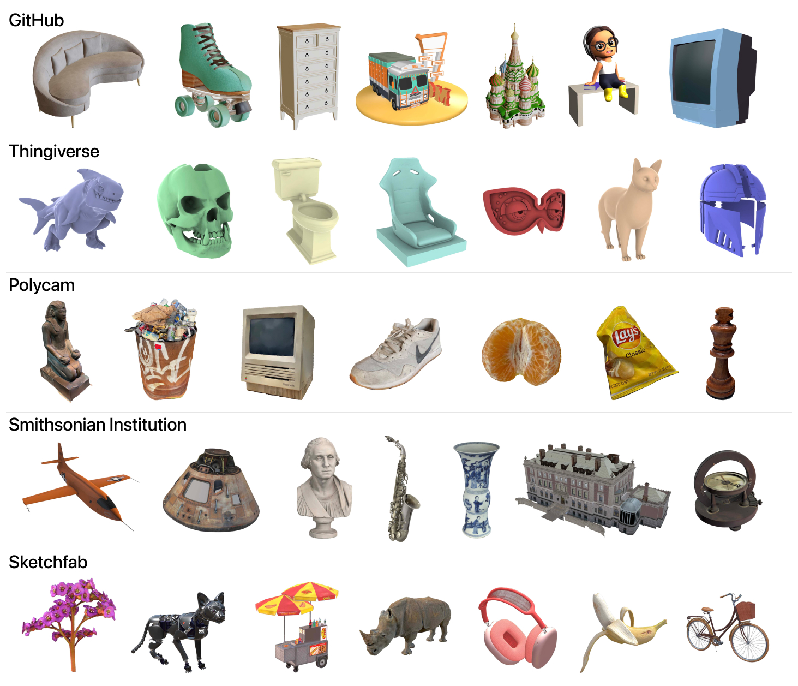
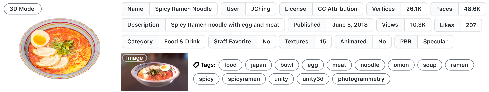
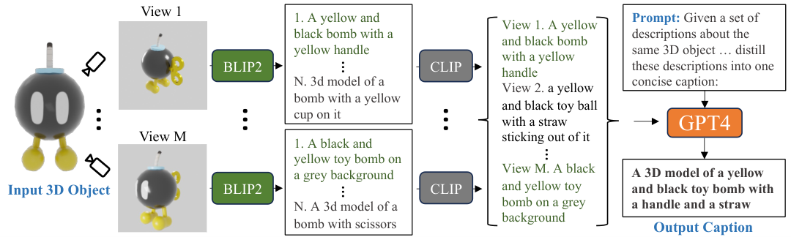
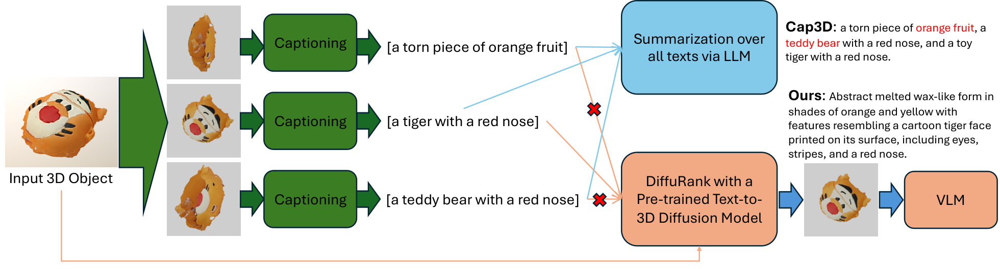
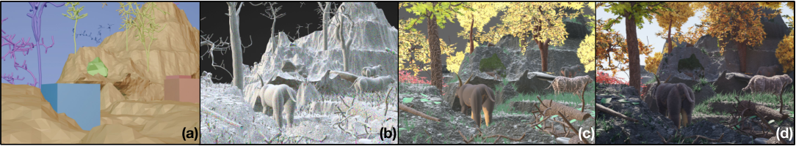
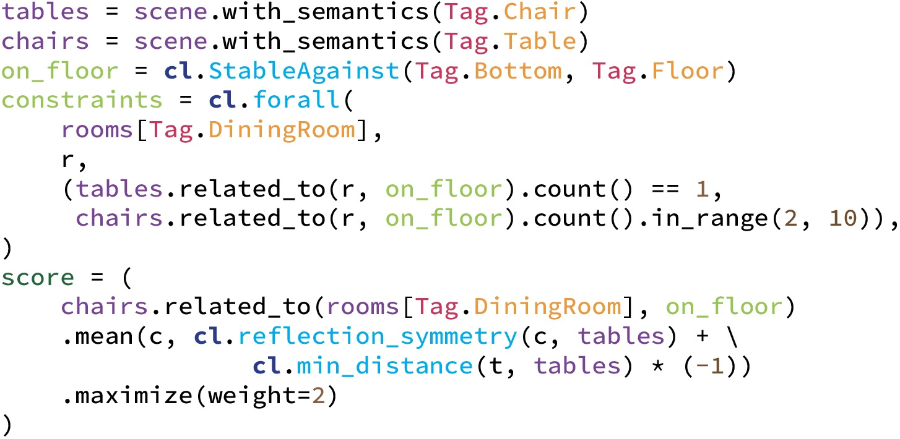

#### Objaverse / Objaverse-XL（2022-12）

- **定位**：原料。给 3D / Blender 代码生成提供海量「可导入 Blender、可渲染」的真实资产（含 `.blend` 源文件），后续的 caption、渲染图、代码反推都从这里取

<figure class="paper-fig">

<b>多源爬取</b>Sketchfab API · GitHub 37M 文件 · Thingiverse · Polycam · Smithsonian
→
<b>许可过滤</b>只收可分发的 CC 许可，排除 restricted
→
<b>hash 去重</b>按文件内容全局去重，砍掉约 23M
→
<b>Blender 导入渲染</b>导入失败即丢，GitHub 剩 5.5M
→
<b>元数据 + CLIP 特征</b>面数 / 材质 / 动画；12 视角 CLIP 驱动质量分类器

<figcaption>Objaverse / Objaverse-XL · 自绘流程图（两篇论文均无管线图，依据正文描述）</figcaption></figure>

<figure class="paper-fig"><figcaption>Objaverse / Objaverse-XL · Fig. 3（XL 论文）：五个爬取来源各自的对象示例，Thingiverse 无颜色，渲染时随机上色</figcaption></figure>

<figure class="paper-fig"><figcaption>Objaverse / Objaverse-XL · Fig. 4（1.0 论文）：每个对象直接继承上传者填写的元数据，没有额外标注</figcaption></figure>

- **自动化构建流程**（对照最上面的自绘流程图；下面两张原图分别是「数据来源」和「单条数据长什么样」）
  1. **Sketchfab**（1.0）：用 Sketchfab 公共 API 批量拉取
     - 规则过滤：只收可分发的 Creative Commons 许可；标为 restricted（成人 / 不良内容）的直接排除
     - 输出：统一的 GLB 文件
  2. **Name / Description / Tags / Category**：标注全部继承自上传者，零人工成本
     - Sketchfab 自带分类只有 18 类，太粗
  3. **Objaverse-LVIS**（图外）：模型召回加众包确认的半自动细分类
     - 每个 LVIS 类别召回 500 个候选：CLIP 看缩略图找外观像的，GloVe 比元数据找名字像的
     - 约 250K 候选交给 MTurk 众包，每次看 9 个、勾选属于该类的
     - 输出：47K 个对象，1156 类
  4. **GitHub / Thingiverse / Polycam / Smithsonian Institution**（XL）：Python 脚本多源爬取
     - **GitHub**：检索 37M 个带 3D 扩展名的公开文件，扩展名按 Blender 支持度选定（`.obj` `.glb` `.gltf` `.usdz` `.usd` `.usda` `.fbx` `.stl` `.dae` `.ply` `.abc` `.blend`），只收非 fork 仓库，来自 500K+ 仓库
     - **Thingiverse**：约 3.5M 个对象，基本是无纹理的 STL
     - **Polycam**：只收标为 savable 且 CC-BY 4.0 的扫描，72K → 去重后 71K
     - **Smithsonian Institution**：2.4K 个 CC0 文物扫描
     - **Sketchfab**：直接复用 Objaverse 1.0
  5. **去重 + 能否导入**（图外）：按文件内容 hash 全局去重，砍掉约 23M 个文件；GitHub 剩余文件中成功导入并渲染的只有 5.5M
     - 失败原因：导入不兼容（FBX ASCII）、文件里没有 mesh、扩展名撞车（`.obj` 其实是 C 编译产物）
  6. **Blender 元数据**（图外）：渲染时顺手抽取 `sha256`、面数 / 顶点数 / 边数、材质数、纹理数、动画数、`linked-files`、`missing-textures` 等；缺纹理的随机上色
  7. **模型元数据**（图外）：每个对象在球面上随机取 12 个视角渲染，取 CLIP ViT-L/14 的平均 embedding，同一份特征驱动下游多个分类器（美学、NSFW、人脸、扫描破洞）
- **质量控制**
  - NSFW：LAION-5B NSFW 分类器，单张分数 > 0.9 且 12 张渲染中至少 3 张命中才判定；10M 个对象里只滤掉 815 个
  - 人脸：同样要求至少 3 张命中，估计有 266K 个对象带人脸（多为玩偶、雕塑、卡通），只做标记
  - 扫描破洞：人工标注 1.2K 张 Polycam 渲染图，在 CLIP 特征上训练两层 MLP，交叉验证准确率 90% 以上（阈值 0.5）；71K 个 Polycam 对象中 38.20% 的渲染图是坏图，58K 个对象至少有 2 张坏图
  - 美学分层：LAION-Aesthetics V2 打分，T1（> 4.5）占 14.2%，T2（4–4.5）占 69.2%，T3（< 4）占 16.6%
  - 对齐子集：按顶点数、面数、来源站点热度、来源等启发式规则，从全集挑出 1.3M 高质量对象，用于二阶段微调
- **关键数字**
  - 规模：1.0 版 818K 个对象（160K 位作者，2.35M 个 tag，其中 170K 个不重复，覆盖约 21K 个 WordNet 概念）；XL 版 10.2M
  - 细分：1.0 含 44K 个动画对象、63K+ 个角色、16K+ 个室内场景；XL 的动画对象从 41K 增至 459K，带骨骼的从 34K 增至 438K
  - 成本：XL 的采集费用在几千美元量级（查找、索引、下载，用的是 AWS CPU 实例），2023 年 Q1–Q2 完成采集
  - 下游效果
    - GET3D 在 Objaverse 上训练，生成结果 91% 的情况下被众包评为比 ShapeNet 版更多样
    - Zero123-XL 用 1 亿+ 张渲染图训练；在 1.3M 对齐子集上微调后，GSO 零样本 PSNR 从 18.225 升到 19.876
    - PixelNeRF 用 XL 预训练：DTU PSNR 15.32 → 17.53，ShapeNet 22.71 → 24.22
- **局限**
  - 文本侧只有用户自填元数据，很多对象的名称和描述很短甚至为空，没法直接当 caption（Cap3D 正是为此而做）
  - 大量 GitHub 文件导不进 Blender，论文认为统一格式转换还能再救回几百万个对象
  - Thingiverse 没有颜色，Polycam 扫描常缺背面；质量方差极大，只能靠后置分类器分层
  - 论文自己也承认：规模仍比十亿级图文数据小几个数量级，而且不一定每个样本都值得训练
- **可借鉴**
  - 用「能被 Blender 导入并成功渲染」作为第一道硬过滤，把格式正确性交给 Blender 判定
  - 爬取范围按目标工具支持的扩展名定；GitHub 上的 `.blend` 本身就是现成的 Blender 工程语料
  - 内容 hash 全局去重放在最前面（XL 一步砍掉约 23M 个文件）
  - 多视角渲染一次，CLIP 平均 embedding 存下来复用给多个轻量分类器；判定要求「多视角一致」（≥ 3/12），避免单视角误杀
  - 人工只标 1.2K 张就能训一个坏图检测 MLP；再用启发式挑出「对齐子集」做二阶段微调

#### Cap3D + DiffuRank（2023-06）

- **定位**：标注。把 Objaverse 的「无文本资产」变成「文本 ↔ 3D」配对，是 text-to-3D / text-to-Blender-code 最常用的 caption 来源；DiffuRank 是它的纠错与扩容版

<figure class="paper-fig"><figcaption>Cap3D + DiffuRank · Fig. 2（Cap3D）：8 视角渲染 → 每视角由 BLIP2 出 5 条 → CLIP 选 1 条 → GPT4 汇总成一句</figcaption></figure>

<figure class="paper-fig"><figcaption>Cap3D + DiffuRank · Fig. 3（DiffuRank）：Cap3D 走蓝色支路（纯文本汇总）；DiffuRank 走橙色支路，先用 text-to-3D 扩散模型给视角排序，再把选中的图交给 VLM</figcaption></figure>

- **自动化构建流程**（先读 Cap3D 图，再读 DiffuRank 图，均从左往右）
  1. **许可与可渲染过滤**（图外）：去掉 CC BY-NC(-SA)，只留 CC BY / CC BY-SA / CC0，798K → 723.7K；再去掉缺少相机信息、无法渲染的，剩 680K
  2. **Input 3D Object**：Blender 渲染
     - 先归一化到单位立方体并居中；3 盏面光（主光 / 补光 / 轮廓光）
     - M = 8 个视角绕物体一圈，其中 2 个略低于物体（为了拍到底部），512×512
  3. **BLIP2**（ViT-G + FlanT5XXL）：每个视角用 nucleus sampling 生成 N = 5 条 caption
     - ABO 几何描述改成两段式 QA：先问「这是什么物体」，再把答案代入第二问「这个 `<object>` 的结构和几何是什么」
  4. **CLIP**（ViT-B/32）：每个视角在 5 条中选与图像余弦相似度最高的 1 条，40 条 → 8 条
     - 顺序是有意安排的：先用 CLIP 纠错再交给 GPT4，GPT4 就不用消化更多错误细节
  5. **GPT4** → **Output Caption**：用固定短 prompt（「Given a set of descriptions about the same 3D object, distill these descriptions into one concise caption…Avoid describing background, surface, and posture.」）把 8 条合成一句
     - 试过更长的 prompt，GPT4 会把推理过程写进输出，所以保留短版本
  6. **Captioning**（DiffuRank）：每个对象渲染 28 张图，再用 BLIP2 为每张出 5 条 caption
     - 8 张沿用 Cap3D 的做法：灰底，CYCLES 光追（16 samples + OPTIX 降噪）
     - 20 张沿用 Shap·E 的做法：归一化后随机视角，透明底，EEVEE 实时渲染；这 20 张同时用来编码 Shap·E latent
  7. **DiffuRank with a Pre-trained Text-to-3D Diffusion Model**：用 Shap·E 给每个视角打「代表性」分
     - 固定同一组 (t, ε) 加噪物体 latent，分别以该视角的每条 caption 为条件去噪；平均去噪 loss 取负就是该视角与 3D 物体的对齐分
     - 直觉：从「意外视角」得到的 caption 描述的是错的物体，对去噪帮助小，loss 高
     - 取 Top-6 视角；灰底 / 透明底哪种更合适也由分数自动决定，不用人工
  8. **VLM**：Top-6 张图交给 GPT-4-1106-vision-preview，prompt 为「Renderings show different angles of the same set of 3D objects. Concisely describe 3D object…」
     - 平均每次输入约 1,867 个 token，输出约 26.72 个 token
  9. **定位旧错 + 扩容**（图外）
     - 纠错：先找出可能出错的旧 caption，只对它们重跑步骤 6–8，共改约 200K 条
     - 扩容：把 Objaverse 剩余对象和 Objaverse-XL 高质量子集纳入，数据集扩到 1.5M 条
- **质量控制**
  - Cap3D 伦理过滤：在正面渲染图上跑人脸检测和 NSFW 分类，分数 ≥ 0.9 就删，分别删掉 18.6K 和 217 个；GPT4 输出再过词表黑名单，删 226 个 → 最终 661K
  - 抽检结果：人脸过滤精度只有 16%，NSFW 为 47%（宁可错杀）；估计仍漏了约 1K 张人脸和不到 1K 个 NSFW 对象
  - 众包对照集：41.4K 条人写 caption（覆盖 39.7K 个对象），标注员表现差会被封号并删除其全部数据
  - DiffuRank 找错的三条规则
    - CLIP 均值 / 最大值双阈值：阈值在人工标注的约 7K 个错例验证集上定（要求全部覆盖），从 660K 条中圈出约 167K 条
    - 全灰图：约 10K 张渲染失败的全灰图，重新渲染后重写 caption
    - 文本规则：caption 里出现「image」「rendering」这类渲染过程用词，约 23,000 条
  - DiffuRank 伦理过滤：沿用 Cap3D 的人脸 / NSFW 流程，再加 GPT-4V 返回的 `content_policy_violation`，共标出约 35K 个对象
- **关键数字**
  - Cap3D 成本（每 1K 个对象）：BLIP2 $3.79 + CLIP $0.38 + GPT4 $4.18 = $8.35；人工 $87.18
    - A40 按 $1.28/hr 计（CoreWeave）；不用 CLIP 过滤时 GPT4 要花 $15.33
  - Cap3D 速度：65K 个对象 / 天（8 张 A40），人工只有 1.4K / 天
  - Cap3D 质量：与人写 caption 做 A/B，胜率 52.3%，人写为 37.8%
  - Cap3D 下游：Point·E 在 350K 条 Cap3D caption 上微调后，CLIP R@1 从 6.0 升到 12.4，FID 从 36.1 降到 32.8
    - 给全部 660K 个对象算点云和 latent 需要约 20K GPU 天，因此只用了 350K
  - DiffuRank 质量：与 Cap3D 做幻觉 A/B，Cap3D 胜 25.8%、负 63.9%；Top-6 视角优于用全部 28 张、水平 6 张和 Bottom-6 张
  - DiffuRank 下游：在 330K 训练集里改掉约 72K 条（约 20%），Shap·E(STF) R@1 从 11.9（Cap3D 版，比预训练的 12.7 还低）升到 13.4；扩到 825K 后为 14.9
  - DiffuRank 人工评测：Hive 上 46 名标注员，约 $35 / 1K 任务
- **局限**
  - Cap3D 的相机放在物体上方或下方，会拍出奇怪视角，BLIP2 在这里犯的错 CLIP 滤不掉；GPT4 只看文本也纠正不了，结果是「一只青蛙、一个泰迪熊和一个怪物」这类拼接幻觉
  - 几何描述弱：在 ABO 上，普通 Cap3D 输给人写 caption（47.3% vs 41.4%），要换成 QA prompt 才能反超
  - DiffuRank 依赖初始 BLIP2 caption：各视角的 caption 都错时，排序也会错（例如全是「a tree in the dark」）；小物体容易漏描述；打分质量受 Shap·E 能力上限约束
  - 人脸过滤精度只有 16%，误删很多
- **可借鉴**
  - 「多采样 → 独立判别模型择优 → 大模型汇总」三段式：生成与判别用不同训练数据的模型，错误不容易叠加
  - 先过滤再汇总：40 条 → 8 条，GPT 花费降到约 1/3.7，同时剔除错误细节
  - 把任意「条件生成模型」的去噪 loss 当作对齐打分器：Blender 代码场景可以用 text-to-3D / text-to-image 模型给「渲染图 ↔ 描述」打分，挑出最有代表性的视角后再让 VLM 写描述或反推代码
  - 视角少而精好过多而杂（6 张好过 28 张）
  - 修旧数据不用全量重跑：CLIP 双阈值 + 小验证集定阈值、全灰图检测、渲染泄漏词规则，三路圈出约 30% 的可疑条目，只重做这部分

#### Infinigen / Infinigen Indoors（2023-06）

- **定位**：程序化生成器。每个资产都是一段在 Blender 中执行的随机化 Python 程序，天然就是「参数化 Blender 代码 ↔ 渲染图 ↔ 精确 3D 真值」三元组的无限来源

<figure class="paper-fig"><figcaption>Infinigen / Infinigen Indoors · Fig. 13（Infinigen）：(a) 程序化场景布局 + 随机相机 → (b) 生成所需资产 → (c) 施加程序化材质与位移 → (d) 渲染照片级图像</figcaption></figure>

<figure class="paper-fig"><figcaption>Infinigen / Infinigen Indoors · Fig. 9（Indoors）：用约束 DSL 声明「餐厅 1 张桌、2–10 把椅子、椅子对称且靠近桌子」，由求解器负责摆放</figcaption></figure>

- **自动化构建流程**（先读 Infinigen 的 (a)→(d)，再读 Indoors 的约束排布；图中只有字母标签，模块名取自图注）
  1. **生成器库**（图外）：182 个概率程序式生成器，共 1070 个可解释自由度（地形 26、材质 50、天气与流体 19、岩石 4、小植物 30、树 3、生物 39、表面散布 11）
     - 参数默认从贴近自然界的分布采样，用户也可以通过 Python API 覆盖任意参数
     - Node Transpiler：把美术在 Blender 里连好的 node graph 自动转成 Python 代码（后序遍历，node group 递归转成函数）；在节点名里写分布注解，转出的代码会自动插入随机数调用
  2. **(a) Scene layout + random camera poses**
     - 布局：先生成低分辨率的全场景地表，用 Poisson-disc 采样放置点，密度由法线、Perlin 噪声、地形属性等掩码调节；11 套场景配置（Arctic、Desert、Forest、Underwater 等）写入「沙漠多仙人掌」这类简单先验
     - 相机：高度从高斯分布采样；与所有物体保持最小距离；要求画面里有特定地形成分（如河流）；随机采 10 个视角，取深度方差最大的那个
  3. **(b) Generate all necessary assets**：按相机位置动态决定分辨率，让每个面在画面上小于 1 px；草、落叶等密集散布物用 instancing 复用；平均每个场景 16M 个多边形
  4. **(c) Procedural materials and displacement**：50 个材质生成器，每个由随机 shader 和对应的局部几何生成器组成
     - 禁用 bump mapping、法线插值、透明贴图等「假细节」技巧，保证几何真值精确
  5. **(d) Render a photo-real image**：Cycles 路径追踪，1920×1080，每像素 10,000 samples
  6. **真值提取**（图外）：不用 Blender 自带的 render pass（半透明、体积、运动模糊时会出错），改为用 OpenGL 直接从 mesh 计算深度、法线、遮挡边界和实例分割；光流和反照率从渲染元数据取
  7. **室内资产与房屋平面**（图外，Indoors）
     - 79 个物体生成器：家电 10 个 / 112 参数，门窗楼梯 14 / 127，家具 17 / 216，装饰 15 / 92，小物件 19 / 194；另有 30 个材质生成器 / 120 参数
     - 平面图：先由房间类型的概率上下文无关文法生成房间邻接图，再用 Mondrian 过程切分随机外轮廓，然后用模拟退火优化到入口的最短路径、房间面积、长宽比、凸性、窄通道等目标
  8. **Constraint Specification API**（Fig. 9）：用 Python DSL 声明「要什么」，不写「怎么摆」
     - 硬约束：`cl.forall(rooms[Tag.DiningRoom], …)` 要求每个餐厅桌子 `count() == 1`，椅子 `count().in_range(2, 10)`，且都满足 `cl.StableAgainst(Tag.Bottom, Tag.Floor)`
     - 软目标：`cl.reflection_symmetry` 加上负的 `cl.min_distance`，用 `.maximize(weight=2)` 加权
     - 整屋约束图有 1058 个节点，含 11 条硬约束和 25 个打分项；平均每种房间约 15 条约束，约 15 行 Python
  9. **Arrangement Solver**（图外）：模拟退火，Metropolis-Hastings 接受准则，温度从 0.25 指数降到 0.001
     - 7 种 move：增加、删除、换依附平面、重采样（重新生成物体参数）、重置位姿、平移、旋转；离散 move 的概率逐步衰减，连续 move 的概率逐步上升
     - 分三阶段求解：大件 → 中件 → 小件；每个物体的自由度由它的依附关系限定（靠墙的书架只能沿墙线移动）
     - 物体尺寸参数也在搜索空间内，求解器会根据可用空间自动调整桌子大小
  10. **导出**（图外）：一键导出 USD，自动 UV 展开并把程序化材质烘焙成标准贴图；单个物体可导出为 OBJ / FBX / STL，并自动生成带碰撞和关节信息的 URDF
- **质量控制**
  - 不做事后过滤，靠「构造即正确」
    - 几何都是真几何，真值直接从 mesh 算，不依赖渲染 pass
    - 相机启发式（最小距离、目标成分覆盖、深度方差择优）拒绝空洞或被遮挡的画面
    - 生物分布校准：手工建模 30 个头部和身体样例，确认随机分布能覆盖它们
  - Indoors：硬约束保证碰撞、稳定性和数量正确；求解器消融显示，去掉碰撞检测或对称项后画面质量下降（论文只给出对比图，没有量化数字）
  - 人工感知评测：在真实感、布局真实感、错误少三项上，受试者都更偏好 Infinigen Indoors，而不是 ATISS 等基线
- **关键数字**
  - 工程量：Infinigen 主分支 40,485 行代码
  - 渲染成本：1000 次试验中，生成一对 1080p 立体图平均耗时 3.5 小时（2 颗 Xeon Silver 4114 + 1 张 GPU），其中约 1 小时用 GPU 渲染，平均内存约 24GB
  - Infinigen 下游：用 30K 对立体图从零训练 RAFT-Stereo，在 Middlebury 上平均 Bad 3.0 为 29.7%（SceneFlow 25.0%、FallingThings 28.6%）；自然物体 Jadeplant 为 35.2%，优于所有对比数据集
  - Indoors 求解器：5K 步平均耗时 2280.68 s，比未优化版快约 3 倍，提速主要来自 BVH 缓存和 plane hashing；与未优化版跑同样时长，得分高 28%
  - Indoors 下游
    - 遮挡边界：1464 张图训练 U-Net，ODS 29.47，高于 Hypersim 的 26.02 和 Infinigen 自然版的 14.38
    - 阴影去除：加入 2K 对合成图后，SRD 零样本 PSNR 从 22.83 升到 24.56
  - 实时性：导出到 UE5 跑 60 FPS，Isaac Sim 开物理跑 50 FPS（RTX 4090）
- **局限**
  - 单张图成本很高（3.5 小时 / 对），规模受算力限制
  - 自然版缺少平面和无纹理表面，在 Middlebury 室内场景上泛化差；场景先验只有简单的密度规则，捕食者和猎物互相回避、阴影处不长植物这类复杂关系都没有
  - Indoors 的约束要人手写（每种房间约 15 条）；加入合成数据后在 ISTD 上反而略降
  - 程序化材质依赖 Blender shader，导出到其他引擎必须先烘焙
  - 生成器代码庞大，每个资产不自带自然语言描述；要做「文本 → Blender 代码」还需另配 caption
- **可借鉴**
  - Node Transpiler 思路：把 Blender node graph 自动转成 Python，美术连节点，产出的就是可执行的 Blender 代码语料；节点名里的分布注解直接变成随机参数
  - 生成器 = 带可解释参数的概率程序：采样参数 → 执行 → 渲染，每条样本都有「参数 / 代码 / 图 / 真值」严格对齐，参数本身就可以作为代码生成的监督目标
  - 用声明式约束 DSL 加通用求解器，把「要什么」和「怎么摆」分开：写约束只需约 15 行 / 房间，适合让 LLM 生成约束程序、再由求解器兜底
  - 相机选择用「随机 10 个取深度方差最大」这种便宜的启发式，自动避开空画面
  - 真值从几何直接算，不依赖渲染 pass；分辨率跟随相机动态调整，控制多边形预算

