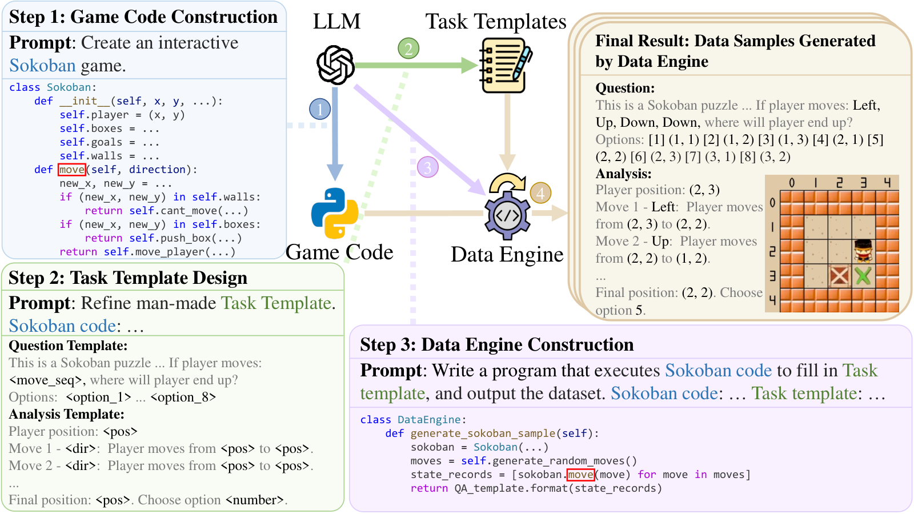
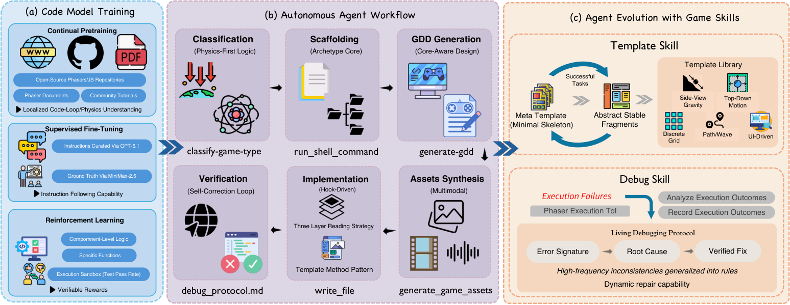
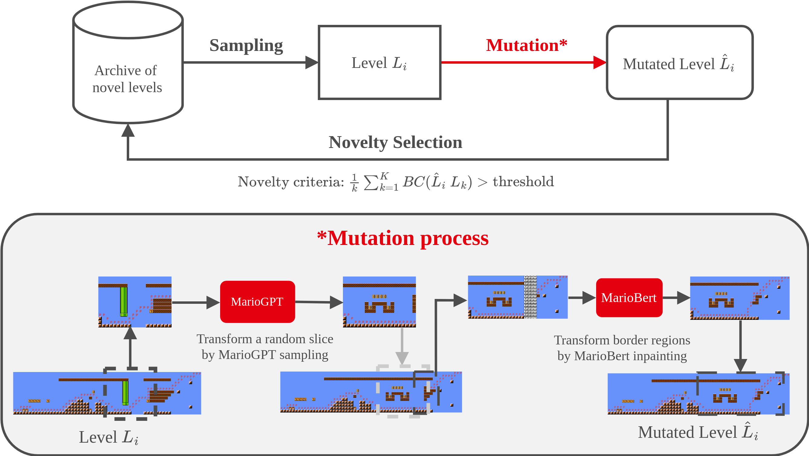

#### Code2Logic / GameQA（2025-05）

- **定位**：把「LLM 写的游戏代码」反过来当成数据引擎，批量产出答案可验证的游戏状态推理 VQA，给 VLM 做 RL；它证明了**游戏代码本身就是可无限复用的标注器**

<figure class="paper-fig"><figcaption>Code2Logic / GameQA · Fig. 1：LLM 先写游戏代码，再抽出问答模板，最后写一个复用游戏逻辑的数据引擎批量出题</figcaption></figure>

- **自动化合成流程**（对照上图，从左往右读）
  1. **Step 1: Game Code Construction**：用一句 prompt 让 LLM（Claude 3.5 / GPT-4o）写出可交互的游戏（如 Sokoban）
     - 输入：游戏名；输出：包含状态空间和状态转移函数（如 `move`）的游戏代码
     - LLM 写不对的复杂玩法，就检索开源实现提供给 LLM 改写（Spider Solitaire、Klondike、Space Invaders）
  2. **Step 2: Task Template Design**：由 LLM 辅助设计、精修 **Question Template** 与 **Analysis Template**
     - 一个模板对应一种推理模式，分三类：Target Perception、State Prediction、Strategy Optimization
     - 输入：游戏代码；输出：带槽位的问题 / 推理过程模板（如 `<move_seq>`、`<pos>`）；LLM 也能直接提出新任务
  3. **Step 3: Data Engine Construction**：LLM 根据「游戏代码 + 模板」写出 `DataEngine` 程序，分四个模块
     - 环境初始化：直接复用 Step 1 的初始化函数，随机生成棋盘
     - 出题：生成一段随机动作序列作为题目实例
     - 解题：用对应算法求解，状态预测任务直接复用游戏的 `move` 逻辑逐步模拟（碰撞、推箱都由代码处理）
     - 填模板：动作序列填进问题模板，状态轨迹填进推理过程模板
  4. **Final Result: Data Samples Generated by Data Engine**：执行引擎，批量产出「游戏截图 + 问题 + 带步骤的推理过程 + 答案」
     - 题型只有选择（平均约 7 个选项）和填空（数字 / 坐标），保证答案可自动判对
     - 难度由代码参数控制：QA Level 与 Plot Level（网格大小）各分 3 档
  5. **推理改写增强**（图外）：InternVL2.5-78B 只看文本（题目、原推理过程、答案）改写推理过程，打破模板化句式
     - 不给图，因为实验发现模型看图会引入视觉错误
- **质量控制**
  - 游戏代码：人工运行游戏，显示或逻辑有错就反馈给 LLM 重写
  - 数据引擎：人工测试首版，不符合模板或答案错误就让 LLM 重写
  - 抽检：STEM 学生检查初始样本；GPT-4o 与 Claude-3.5 Sonnet 检查可理解性；增强后随机子集人工核对推理
  - 自动过滤：按长度、4-gram 重复率 >70%、答案错误过滤，约 150K → 126,760 条（训练集）
- **关键数字**
  - 规模：30 个游戏、158 个任务、约 140K 题；训练集 20 个游戏 / 102 个任务 / 126,760 题，测试集 30 个游戏 / 15,047 题
  - 成本：每个游戏走完主要步骤耗时 4–12 小时，平均 7.5 小时；引擎建好后可无限出题
  - 效果：只用 5K 条 GameQA 做 GRPO，Qwen2.5-VL-7B 在 7 个通用视觉基准上平均 +2.33%；未见过的游戏上提升 1.16%–3.82%
  - 规模律：游戏数越多（4 → 20 个）泛化越好；数据量扩到 20K 条总体仍在上升
- **局限**
  - 每个游戏仍需人工试玩代码、测试引擎，平均 7.5 小时，不是端到端全自动
  - 产物是「看图答题」的推理数据，不是游戏代码本身；游戏代码只是中间产物
  - 只覆盖回合制 / 静态截图可表达的状态，实时动作类玩法被转成静态快照
  - SFT 用这份数据在域外泛化不如 GRPO，推理过程的用法仍待探索
- **可借鉴**
  - 游戏代码的状态转移函数直接当求解器，答案由程序算出而不是模型生成，天然可验证
  - 「模板 = 一种推理模式」：每加一个模板就多一类任务，扩展成本线性可控
  - 难度用代码参数（网格大小、步数）显式控制，便于做课程学习与分档评测
  - 模板化推理过程用纯文本 LLM 改写 + n-gram 去重兜底，兼顾多样性与正确性

#### OpenGame / GameCoder（2026-04）

- **定位**：唯一直接面向「从自然语言生成完整可玩 Phaser 网页游戏」的开源框架，GameCoder-27B 的三段训练数据（CPT 语料 → 合成指令 SFT → 单测奖励 RL）是游戏代码模型训练数据配方的直接参照

<figure class="paper-fig"><figcaption>OpenGame / GameCoder · Fig. 2：左栏是 GameCoder-27B 的三段训练数据管线，中栏是六阶段造游戏 agent，右栏是模板库与调试协议的自我进化</figcaption></figure>

- **自动化合成流程**（对照上图，从左往右读）
  1. **Continual Pretraining**：爬取语料，没有合成环节
     - 来源：**Open-Source Phasers/JS Repositories**（GitHub 上的 Phaser 与 JS/TS 游戏仓库）、**Phaser Documents**、**Community Tutorials**
     - 目标：**Localized Code-Loop/Physics Understanding**，建立游戏循环、物理、资源、状态管理的先验
     - 语料规模、清洗与去重方式：未披露
  2. **Supervised Fine-Tuning**：两个模型分工蒸馏出指令–代码对
     - **Instructions Curated Via GPT-5.1**：生成复杂的多步游戏设计指令（例：「实现一个带二段跳和精灵动画的 2D 平台跳跃角色控制器」）；正文写作 gpt-codex5.1
     - **Ground Truth Via MiniMax-2.5**：由 MiniMax 2.5 为每条指令写目标解答
     - 条数、过滤规则：未披露
  3. **Reinforcement Learning**：组件级、可执行的奖励
     - **Compoment-Level Logic** / **Specific Functions**：只让模型生成单文件玩法逻辑与功能模块（如碰撞检测、状态机转移），不生成整个游戏
     - **Execution Sandbox (Test Pass Rate)**：在沙箱里跑预定义单测，奖励 = 执行成功 + 单测通过率（**Verifiable Rewards**）
     - 单测从哪来、题目数量、RL 算法：未披露
  4. **Autonomous Agent Workflow**（推理时的造游戏流程，不是训练数据）：**Classification** → **Scaffolding** → **GDD Generation** → **Assets Synthesis** → **Implementation** → **Verification**
     - 对应工具：`classify-game-type` → `run_shell_command` → `generate-gdd` → `generate_game_assets` → `write_file` → `debug_protocol.md`
     - 每轮以 `npm run build` + `npm run test`（无头浏览器）为闭环，失败就解析报错、定位文件、修复
  5. **Template Skill / Debug Skill**：agent 的经验在跑任务的过程中自动沉淀
     - Template Skill：从 **Meta Template (Minimal Skeleton)** 出发，**Successful Tasks** 中稳定、通用、可安全复用的片段被 **Abstract Stable Fragments** 并入 **Template Library**，最终长出 5 族：**Side-View Gravity**、**Top-Down Motion**、**Discrete Grid**、**Path/Wave**、**UI-Driven**
     - Debug Skill：每次失败记录一条 **Error Signature** → **Root Cause** → **Verified Fix**，写进 **Living Debugging Protocol**，反复出现的写成规则
- **质量控制**
  - 训练侧：只有 RL 阶段有明确的执行验证（单测通过率）；SFT 数据是否过滤、过滤掉多少：未披露
  - 生成侧：build / test 闭环 + 调试协议里的静态预检（资源 key 不匹配、配置字段缺失、非法场景跳转）
  - 评测侧：OpenGame-Bench 150 个任务，无头浏览器实际运行并截图，按 Build Health / Visual Usability / Intent Alignment 打分，每题跑 3 个随机种子
- **关键数字**
  - 基座：Qwen3.5-27B；训练数据规模、token 数、算力：未披露
  - 训练消融（同一 agent 框架，BH / VU / IA）：基座 62.8 / 53.8 / 49.8 → +CPT 63.2 / 54.7 / 50.6 → +SFT 63.5 / 55.7 / 52.5 → +RL 63.9 / 57.0 / 54.1；SFT 对 IA 贡献最大（+1.9）
  - 框架消融（Claude Sonnet 4.6 后端）：完整版 72.4 / 67.2 / 65.1；去掉 Hook-Driven 实现后 BH −10.1、IA −11.6，是影响最大的一项
  - 作者自己的结论：主要提升来自框架，而不是模型训练
- **局限**
  - 训练数据细节几乎全未披露（语料量、SFT 条数、单测来源、过滤比例），无法复现
  - 数据描述前后不一致：图中写 GPT-5.1，正文写 gpt-codex5.1；README 写成「SFT 用游戏开发轨迹、RL 用可玩性奖励」，与正文「指令–解答对 + 单测奖励」不同
  - RL 奖励只覆盖单文件组件，而项目的主要失败来自跨文件不一致，训练信号和真实失败点错位
  - 仅限 Phaser 2D 网页游戏；评测管线尚未开源
- **可借鉴**
  - SFT 数据「强模型出题 + 另一个模型解题」的两段蒸馏，出题模型专门负责多样性与难度
  - RL 不拿整个游戏当单位，而是拆成可单测的组件（碰撞、状态机），先让奖励可验证
  - 用模板方法模式约束生成：只允许覆写 hook（如 `setupCustomCollisions`），同样的约束也可以用来规范合成数据的代码结构
  - 把 agent 跑任务时沉淀的「报错特征 → 根因 → 已验证修复」三元组收集起来，本身就是现成的调试类训练数据

#### MarioGPT（2023-02）

- **定位**：游戏内容生成里最早的「文本 → 关卡」LLM；用规则自动给关卡打文本标签得到训练对，再用 LLM 当变异算子做新颖性搜索，持续产出新关卡，是「LLM + 进化搜索」自我扩充游戏数据的原型

<figure class="paper-fig"><figcaption>MarioGPT · Fig. 3：从关卡存档采样，用 MarioGPT 重写随机切片、MarioBert 修补接缝，足够新颖的关卡才回存档</figcaption></figure>

- **自动化合成流程**（对照上图，从左往右读）
  1. **关卡转文本**（图外）：VGLC 里带路径标注的 37 个关卡（Super Mario Bros. + The Lost Levels）拼成一个长关卡，每个 tile 表示成一个字符，用 GPT-2 的 BPE 分词
  2. **规则自动写 prompt**（图外）：在 50 列的窗口里数管道、敌人、方块，按分位数映射到 no / little / some / many，按最高不可破坏方块判 low / high elevation
     - 例：管道 0 / 1 / 2 / 5 分别对应 no / little / some / many
     - 纯程序计数，得到「关卡切片 + 文本描述」训练对，无需人工标注
  3. **训练 MarioGPT**（图外）：DistilGPT2 + 交叉注意力接冻结的 BART 文本编码器，随机切片共训练 200,000 个样本
  4. **Archive of novel levels** → **Sampling**：用 30 个关卡初始化存档，每次从精英中采样一个关卡 **Level Lᵢ**
  5. **Mutation\***：两步变异，全部由模型完成
     - **Transform a random slice by MarioGPT sampling**：随机选 40–80 列的切片，用随机 prompt 让 MarioGPT 重新生成
     - **Transform border regions by MarioBert inpainting**：MarioGPT 是单向模型，接缝处的路径可能断，用双向的 MarioBert 做掩码补全，得到 **Mutated Level**
  6. **Novelty Selection**：计算变异关卡与存档中 K 个最近邻的行为特征距离，均值超过阈值（`Novelty criteria`）才入档
     - 行为特征 = 模型同时生成的玩家路径的平滑平均坐标（维度 100），不依赖外部 agent 试玩
- **质量控制**
  - 入档只看新颖度，搜索循环里不跑可玩性检查
  - 可玩性离线评估：Baumgarten A\* agent 对 250 个生成关卡各跑 5 次，88.4% 可通关（LSTM 基线约 31%）
  - 模型生成的路径与 A\* 真实路径的 MAE：可玩关卡 1.15 格、不可玩关卡 4.56 格，可以当作廉价的可玩性代理信号
  - 记忆检查：温度 1.0 几乎照抄训练集，实际生成用 2.4–2.7
- **关键数字**
  - 数据：37 个原始关卡 → 200,000 个训练切片；模型 96M 参数，单张 RTX 2080 Ti 可训
  - 可控性（1,000 个样本）：管道 81%、敌人 68%、方块 92%、高度 76%
  - 多样性：存档到 300 个关卡时覆盖约 78% 的路径坐标，350–400 代后趋于平台期
- **局限**
  - 原始数据只有 37 个关卡，所有敌人共用一个 token，玩法表达很粗
  - 路径标注来自 A\* 求解器而不是真实 agent，模型生成的路径不守重力，导致部分关卡不可玩
  - 循环中没有可玩性过滤，存档里混有不可玩关卡
  - 生成的是关卡数据（tile 文本），不是游戏代码
- **可借鉴**
  - 从数据本身统计出文本标签（计数 → 分位数 → 关键词），零成本造出「描述–内容」对，可以照搬为「从游戏代码 / 截图统计特征 → 生成需求描述」
  - LLM 当变异算子 + 新颖性存档：从少量种子出发不断扩充多样性，适合为游戏代码数据做 evol 式扩充
  - 单向生成 + 双向补全修接缝：局部重写代码后，也可以用补全模型修复上下文衔接
  - 让模型同时输出「内容 + 预期轨迹」，用轨迹偏差当廉价的可玩性信号，替代昂贵的试玩

