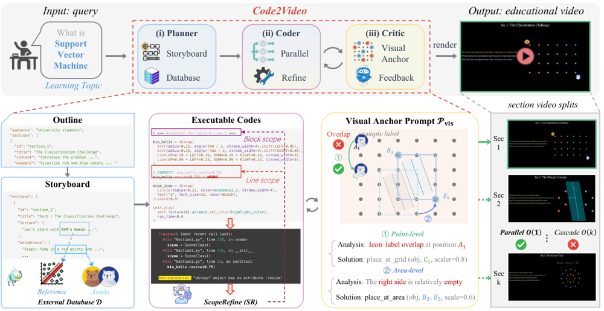
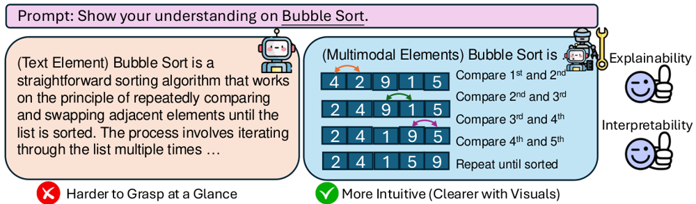
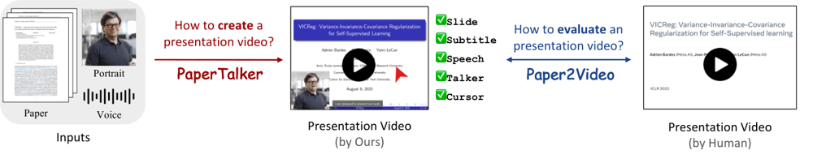
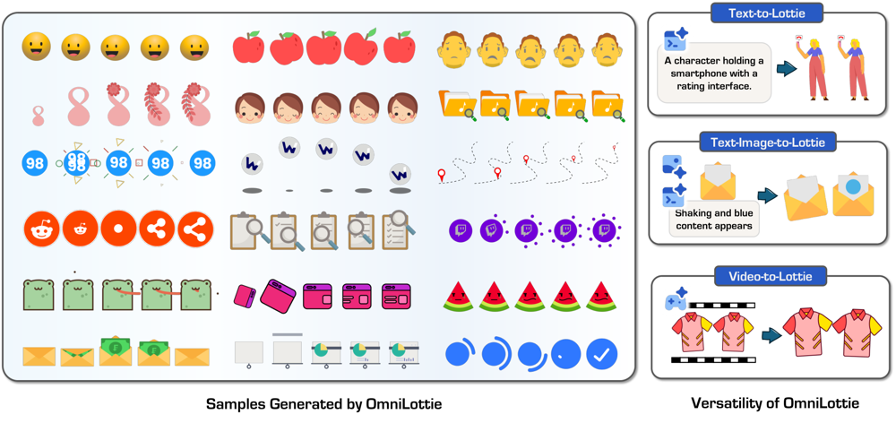
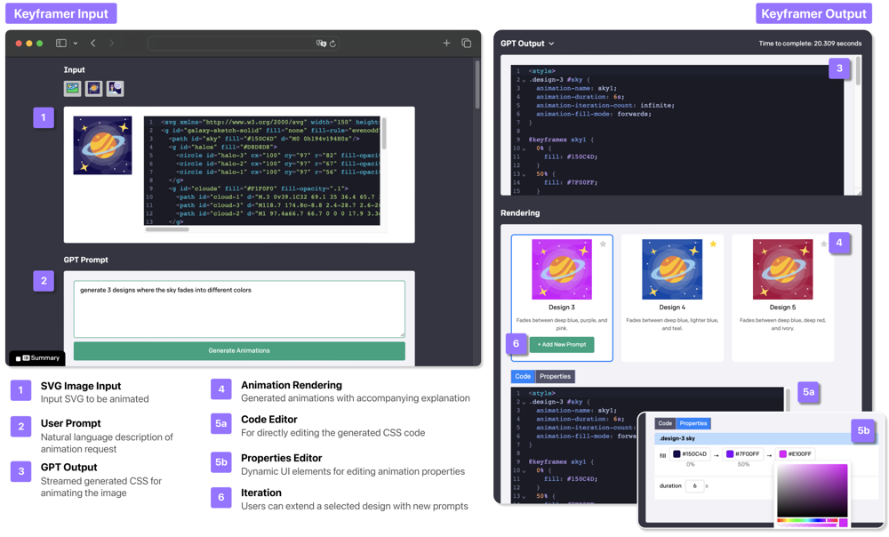
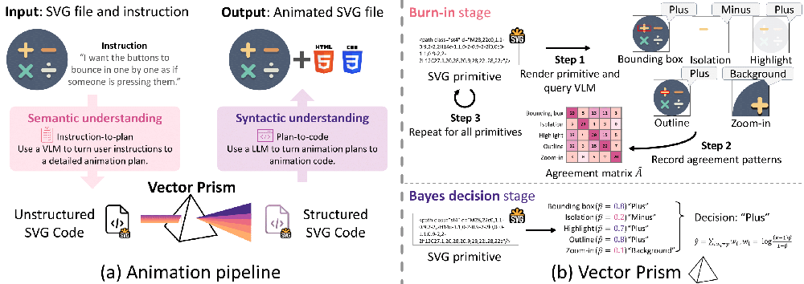
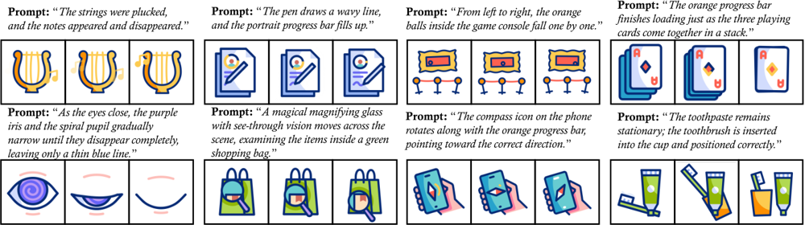
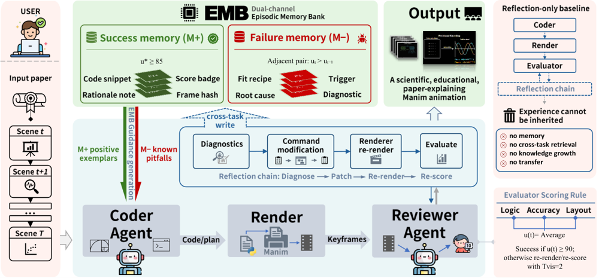

#### Code2Video（2025-10）

- **定位**：代码中心的教学视频生成范式。不走像素级视频扩散，而让 agent 写可执行 Manim 代码产出 3Blue1Brown 风格长讲解视频；配套基准 MMMC 与知识传递指标 TeachQuiz。

<figure class="paper-fig"><figcaption>Code2Video · 方法框架：Planner 出分镜与素材，Coder 分段并行写码并分级自修复，Critic 用锚点栅格对照占用表回修版式</figcaption></figure>

- **自动化流程**（三 agent 协作）
  1. **Planner**：把主题扩成受众感知大纲，再细化为逐段分镜（讲稿加配套动画描述）；按主题检索参考图与图标，建素材库跨段共享，避免每段重复生成。
  2. **Coder**：按分镜分段**并行**生成 Manim 代码；调试器分三级自修复——先改行、再改块、不行就整段重写，把「一处报错拖垮整段」挡在局部。
  3. **Critic**：把画布切成 6 乘 6 的锚点栅格，让视觉语言模型对照「元素到代码行」的占用表判断重叠与出框，给出「某元素该移到哪个格子」的可定位指令，再回改代码。
- **验收**：MMMC 基准 117 主题 / 13 学科 / 339 子片 = 456 单元，全部取自 3Blue1Brown。两大指标——TeachQuiz（让评测模型先屏蔽已有知识得到基线，再只看生成视频答十道选择题，答对率之差即知识传递量）与 VLM 观感 5 轴（元素布局 / 吸引力 / 逻辑流 / 视觉一致 / 准确深度）。
- **关键数字**
  - TeachQuiz：Claude Opus 4.1 从直接写码 40.0 升到 86.0，GPT-4.1 37.0 升到 82.0，GPT-5 36.5 升到 80.0；人类 3Blue1Brown 97.1，扩散基线 Veo3 仅 2.5、OpenSora-v2 为 0.0。
  - 观感均分：Opus 4.1 从 37.8 升到 87.9（人类 99.7）。
  - 消融（GPT-4.1）：去掉 Planner 掉到 38.1 / 40.5（最吃重）；去掉外部图标库 68.1 / 52.0；去掉锚点栅格 69.2 / 55.2；去掉 Critic 72.5 / 60.7。
  - 成本：每主题约 13.8 分钟 / 43.1K token，比直接写码慢 5 到 8 倍、多耗 15 到 20 倍 token。
- **局限**（作者自述）：吸引力与视觉一致性偏弱；叙事与编排仍逊人类；闭源模型的「遗忘」只能靠提示而非改参数；观感与 TeachQuiz 相关 0.971 是人评内部一致性，不是对 VLM 判官的验证；短暂遮挡下视频语言模型常漏检而人眼能看出。

#### TheoremExplainAgent（2025-02）

- **定位**：首个面向定理解释的长视频 agent（超过 5 分钟），配套首个该类基准 TheoremExplainBench；核心主张是多模态视频能暴露文本解释藏不住的推理缺陷。

<figure class="paper-fig"><figcaption>TheoremExplainAgent · 规划器出多场景计划，编码器逐场景写 Manim 代码加 TTS 配音，渲染报错后自纠</figcaption></figure>

- **自动化流程**（两 agent + 检索）
  1. **Planner**：先出多场景的高层视频计划，再把每个场景细化为视觉元素、动画与转场。
  2. **Coder**：逐场景生成可执行 Manim 代码并加 TTS 配音，执行渲染；报错则读错误信息改写，最多重试五次（不重试时成功率极低，五次后可达九成）。
  3. **Agentic RAG**：以 Manim 文档为知识库，在分镜、技术实现、纠错三个阶段各自生成检索查询并缓存。
- **验收**：240 定理，覆盖计算机、化学、数学、物理四科，每科按高中 / 本科 / 研究生三难度各 80；5 项指标——准确与深度、视觉相关性、逻辑流、元素布局、视觉一致性，取几何平均。
- **关键数字**
  - o3-mini（medium）成功率 93.8% / 总分 0.77（成功率最高）；GPT-4o 55.0% / 0.78；Claude-3.5-Sonnet 仅 2.1% / 0.79；Gemini-2.0-Flash 14.6% / 0.76。
  - 普遍弱项是元素布局（各模型 0.57 到 0.73）。
  - 人类实验：15 名参与者先全把一段有错的文字解释判为正确，看完对应动画视频后 9 人（60%）改判为错。
- **局限**：版式错位与元素重叠（化学尤甚）；RAG 检索常不相关且抬高成本；部分自动指标与人评相关弱（只有视觉相关性 0.72、元素布局 0.42 显著，准确深度 0.14、逻辑流 0.16 近乎无关）；代码脆弱，重试五次仍有渲染失败。

#### Paper2Video（2025-10）

- **定位**：本方向唯一端到端产出视频者。把一篇论文自动做成作者风格的演讲视频（幻灯片加字幕加语音加讲者数字人），并给出首个配套基准（101 篇论文配作者本人录制的视频）。

<figure class="paper-fig"><figcaption>Paper2Video · PaperTalker 多 agent：论文编成 Beamer 幻灯片、加光标与字幕、合成语音与讲者头像</figcaption></figure>

- **自动化流程**
  1. 把论文源码编成 Beamer LaTeX 幻灯片，用版式树搜索精修布局，编译报错时按反馈修复。
  2. 做光标 grounding，让讲解有指向动作。
  3. 生成字幕、合成 TTS 语音、渲染讲者数字人。
  4. 逐页并行生成，把单条耗时从约 287 分钟压到约 48 分钟。
- **验收**：四指标对比人类真视频、端到端视频模型 Veo3 与 Wan2.2、以及幻灯片视频类 PresentAgent——Meta Similarity、PresentArena（对人类成对胜率）、PresentQuiz（看视频答题）、IP-Memory。
- **关键数字**
  - PresentQuiz：PaperTalker 0.842 / 0.951，超过人类作者 0.738 / 0.908；端到端视频模型 Veo3 只有 0.367 / 0.585。
  - IP-Memory 50.0%，与人类持平；Veo3 31.3%。
  - 整体观感的成对胜率 PresentArena 仅 17.0%（人类 50%），去掉数字人与光标降到 15.2%。
  - 成本约 48 分钟 / 62K token。
- **局限**：观感离以假乱真尚远，整体呈现仍可辨为机器产物；依赖商业大模型；基准仅 101 对；答题式指标偏向内容召回、对整体呈现不敏感——PresentQuiz 超人类而 Arena 仅 17% 正是这个背离。

#### OmniLottie（2026-03）

- **定位**：把矢量动画生成做成自回归语言建模。关键是一个参数化的 Lottie tokenizer，把冗长的 Lottie JSON 压成紧凑 token 喂给视觉语言模型。

<figure class="paper-fig"><figcaption>OmniLottie · 文本 / 图 / 视频三种输入经参数化 Lottie token 自回归生成可编辑矢量动画</figcaption></figure>

- **自动化流程**
  1. **tokenizer**：把 Lottie 的命令与参数展平、对偏移做量化，单条样本从约 2,562 token 压到 486（省 81%）；裸 JSON 里大量不变的结构元数据正是模型学不动的根源。
  2. **自回归生成**：扩展 Qwen2.5-VL 的 Lottie token 嵌入，按 next-token 训练，支持文本、文本加图、视频三种输入。
- **验收**：数据集 MMLottie-2M 约 200 万条，基准 MMLottieBench 900 条（真 450 加合成 450）；指标为 FVD、CLIP、以及 Claude-3.5 判对象与运动对齐（0 到 10），视频任务另加 PSNR / SSIM / DINO。
- **关键数字**：Text-to-Lottie 成功率 88.3%，而直接吐裸 JSON 的 GPT-5 仅 12.7%；FVD 180 优于优化法 AniClipart 的 266；单条约 31 秒，比优化法快 52 到 530 倍。
- **局限**：成功率口径在正文与附录间有出入（88.3% 对 97.3%），无效生成被从对齐指标里剔除；判对齐仍是用 Claude-3.5 看图打分。

#### Keyframer（2024-02）

- **定位**：这条线最早、被引最多的工作，但它是 HCI 设计研究而非基准——研究设计师如何用自然语言把静态 SVG 做成 CSS 动画。

<figure class="paper-fig"><figcaption>Keyframer · 静态 SVG 加自然语言意图，GPT-4 生成 CSS 动画代码，内联预览并支持直接编辑与分解式提示</figcaption></figure>

- **自动化流程**
  1. 用户给静态 SVG 加自然语言意图，GPT-4 生成 CSS/SVG 动画代码。
  2. 内联渲染预览，用户或直接改代码、或用分解式提示把一个复杂动画拆成多条小提示逐步叠加；全程人在环，无自动验证器。
- **验收**：13 人用户研究（新手与专家混合），90 分钟会话，任务是给土星、火箭两个 SVG 加动画；定性评估为主。
- **关键数字**：归纳出运动语义的提示类型分布（Movement 68.4%、Direction 30.1%、Timing 27.5%、Coordination 19.7% 等）；用户平均每人 15.8 条提示、每条 16.7 词、约 90 行代码；6.7% 有语法错误，69.2% 的用户会手动编辑生成的代码。
- **局限**：无自动化验证、无量化评测、无可复现数据集；生成质量依赖底层模型与用户手动修正；许可是 Apple 自定义样例许可，不是标准开源许可。

#### Vector Prism（2025-12）

- **定位**：把「矢量动画做不好」重新定义为部件语义分组问题，而非代码生成问题。输入是碎片化、无语义分组的 SVG，先恢复语义组，再协调动画。

<figure class="paper-fig"><figcaption>Vector Prism · 多视图下让多个弱视觉语言模型给图元打标签，用统计模型聚合成语义组，再按组写 CSS 动画</figcaption></figure>

- **自动化流程**
  1. 对每个 SVG 图元在多种渲染视图下（叠框、白底隔离、放大、高亮、描边）让视觉语言模型打弱语义标签。
  2. 用 Dawid–Skene 模型估计每个视图的可靠度，再用贝叶斯加权投票得到最终标签（群体智慧式聚合）。
  3. 视觉语言模型出动画计划，大模型按语义组用分道约定迭代写 CSS；并用等价性检查确认重分组后视觉无冲突。
- **验收**：语义聚类质量用 Davies–Bouldin 指数，动画质量用 GPT-T2V / CLIP-T2V / DOVER，并做用户研究；测试集 114 对。
- **关键数字**：聚类 Davies–Bouldin 指数 0.82，远优于原始 SVG 的 33.8 与多数投票的 12.6；GPT-T2V 保真 76.1 对 Sora 2 的 69.1；GPT-T2V 与人评一致率 83.4%（CLIP-T2V 仅 53.4%）；矢量输出文件体积比 Sora 2 视频小 54 倍。
- **局限**：纯测试集、规模小；只验证重分组后视觉等价，没有运动正确性验证器；依赖多视图标注质量；54 倍是相对视频基线的体积优势，不是紧凑表示的压缩比；仓库无许可声明。

#### VAnim（2026-05）

- **定位**：结构保持的开放域文生矢量动画。核心是稀疏状态更新：不生成整帧、也不输出 Lottie，而在一棵持久 SVG DOM 树上只写变化的属性差分，支持非刚性路径编辑。

<figure class="paper-fig"><figcaption>VAnim · 先把文本意图映射到 SVG 元素，再在持久 DOM 树上生成稀疏状态差分，用渲染感知的强化学习训练</figcaption></figure>

- **自动化流程**
  1. **识别优先规划**：先把文本意图映射到具体的 SVG 元素，再规划运动。
  2. **稀疏状态更新**：逐帧只写变化的属性差分（文本序列化的差分加控制标签），而非整帧或整段 Lottie。
  3. **渲染感知强化学习**：基座 Qwen3-VL-8B-Thinking，用 GRPO 训练，奖励来自渲染结果的语义对齐。
- **验收**：数据集 SVGAnim-134k（SFT 123k / RL 10k / 测试 1k）；指标为视频感知编码器的语义对齐、渲染成功率、15 人用户研究，并用另一编码器做交叉检查以减少度量循环。
- **关键数字**：语义对齐 0.281 优于 Gemini 3 Pro 的 0.243、GPT-5.2 的 0.234，成功率 100% 对 86.2%；24 帧序列压缩 9.86 倍（86.0k 到 9.2k token）；用户研究三项均分 4.62 / 4.48 / 4.55，远高于 Gemini 3 Pro 的 3.42 / 3.85 / 3.68。
- **局限**：主评测指标的编码器与训练奖励的编码器同属一家族，不是独立评估器，有度量循环风险，作者仅用另一编码器补充缓解；论文称已开源数据集但未定位到可用仓库。

#### ManimAgent（2026-06）

- **定位**：针对「agent 任务内能纠错、任务间却失忆」的问题，在论文段落转 Manim 动画任务上，给闭环加不改权重、不喂人工样本的跨任务记忆。

<figure class="paper-fig"><figcaption>ManimAgent · 双通道记忆：检索正例作软参考、负例作硬禁区，收敛后由视觉语言模型打分并蒸馏写回</figcaption></figure>

- **自动化流程**
  1. **检索**：用句向量取正通道前两条成功经验、负通道前三条失败模式。
  2. **生成**：编码器写 Manim 脚本，正例注入为参考样例、负例注入为已知陷阱。
  3. **文本反思**：静态检查加沙箱渲染，崩溃则评审给短提示、编码器重试不超过两次。
  4. **视觉反思**：视觉语言模型对四张关键帧按逻辑流、布局遮挡、准确性打分，达标自动通过，否则修脚本不超过两次。
  5. **记忆写回**：高分场景把成功理由写进正通道；崩溃转成功或视觉提升明显的，经蒸馏成失败教训写进负通道。
- **验收**：任务流按建库 39 / 固定探针 33 / 交叉测试 40 切分，记忆快照 0 / 50 / 100 / 200 条；25 任务由 54 名评分者盲评，指标为一次通过率与反思轮数。
- **关键数字**：从空记忆库到满库 200 条，一次通过率 62.0 升到 84.9、反思轮数 12.2 降到 6.5、人评质量 3.26 升到 3.88；打平等预算的代码检索（83.3 / 11.4）；乱序记忆退回 69.6，说明生效的是检索到相关经验而非多塞上下文。
- **局限**：只测 Manim 与五个英文领域；记忆规模仅约百条，更大需去重或层级索引；写回门控依赖当前视觉语言模型，模型升级后可能记忆腐化；该 VLM 评分与人评相关为 −0.17，故仅内部使用，最终质量仍以盲评人评为准。

