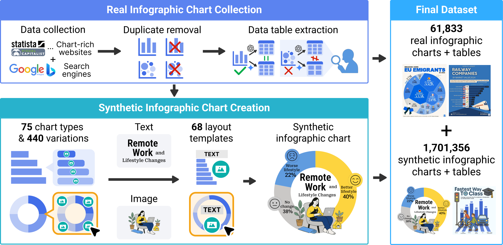
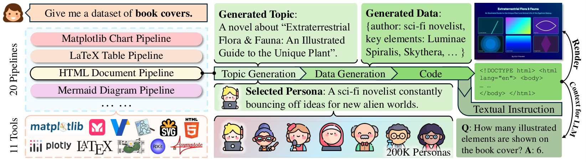
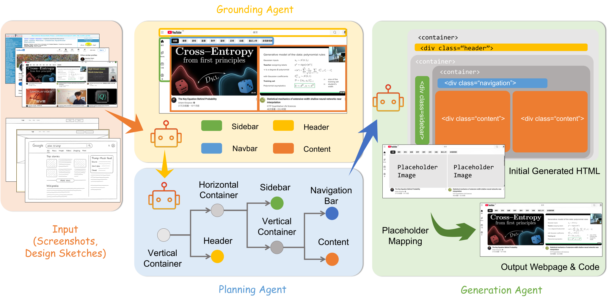
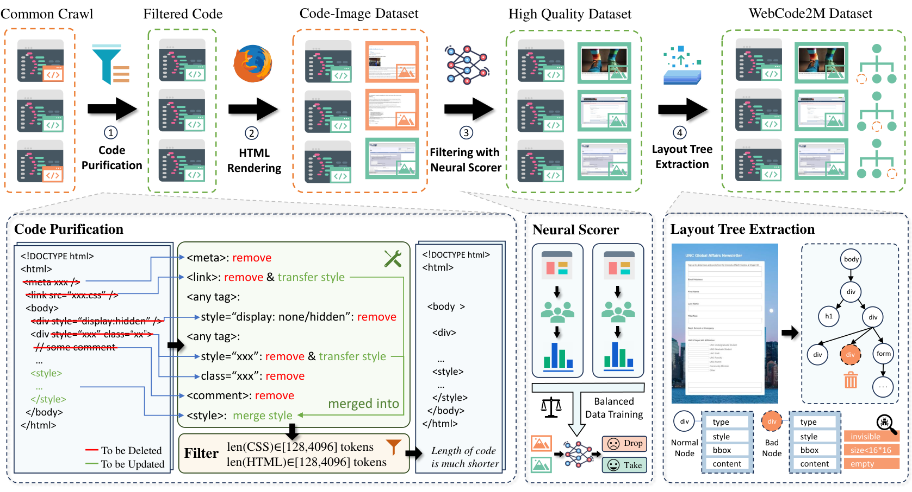

#### ChartGalaxy（2025-05）

- **定位**：百万级「信息图表 + 数据表 + D3.js 代码」数据，给 VLM 补上「设计感强的图表」这一块的理解与 chart-to-code 能力

<figure class="paper-fig"><figcaption>ChartGalaxy · Fig. 2：上半部收集真实信息图并抽表，下半部用归纳出的图型、变体和布局模板程序化合成</figcaption></figure>

- **自动化合成流程**（对照上图，先上排再下排，从左往右读）
  1. **Data collection**：从 18 个允许研究使用的图表网站（Visual Capitalist、Statista 等）爬取，再用 Google / Bing 图片搜索补充，只保留 CC 许可的图；爬虫加平台许可过滤器完成
  2. **Duplicate removal**：用感知哈希加 CLIP 相似度去重（程序）
  3. **Data table extraction**：Gemini-2.0-Flash 和 GPT-4o-mini 并行抽表，两者一致就直接收；不一致时由 GPT-4o 第三票裁决，还不一致才交人工。产出 61,833 张带表的真实图
  4. **75 chart types & 440 variations**：人工参照 Data Viz Project、Datylon 两套分类，归纳出 75 类图型、440 种视觉变体，全部用 D3.js 实现成可参数化的渲染程序
  5. **Text** / **Image**
     - 文字：先检索后生成。Sentence-BERT 按主题和数据事实检索 3 张最相关的真实图作为 in-context 示例，再让 Gemini-2.0-Flash 写标题和副标题
     - 图片：从 Icon645、Noun Project 等来源建图标库，先用启发式规则去掉墨水比低、分辨率差、长宽比极端的图，再由 Gemini-2.0-Flash 给每张图写关键词和描述，剔除过于写实或杂乱的，最后得到 681,459 张。检索时拿 Sentence-BERT 比对关键词和标题
  6. **68 layout templates**：人在环路里扩展模板。3 位作者先在 1,500 张真实图上标框，归纳出 55 个模板 → 用这些模板合成 12 万张带框图，训练 InternImage + DINO 检测器 → 在未标注真实图上检测元素（文字用 PP-OCRv4）→ LTSim 相似度低的布局作为候选 → k-means 聚类后人工看中心，新增 13 个模板，共 68 个
  7. **Synthetic infographic chart**：数据表先按规则映射出候选图型，候选有多个时由 Gemini-2.0-Flash 挑；变体用 adaptive sampling 抽，偏向出现少的变体；配色取自真实图的调色板。布局求解时先滤掉与元素冲突的模板，再对剩下的做网格搜索式紧凑排布（约束问题），选墨水比最高的那个
  - （图外）**数据表来源**：真实表 200,085 张（VizNet、UN data、Our World in Data、Papers with Code），另有 Gemini-2.0-Flash 合成的 98,483 张；每张表都由 Gemini-2.0-Flash 补一个主题和若干数据事实
- **质量控制**
  - 真实图抽表：43.6% 在双模型一致时直接接受；剩下 56.4% 里，GPT-4o 解决了 76.2%。合计 86.6% 全自动完成，13.4% 由人工校正。抽查 200 条完全一致的样本，全部正确
  - 一致性判据：数据点数相同、列名和类别值相同、数值偏差 ≤ 5%
  - 敏感话题：用 Gemini-2.0-Flash 过滤宗教冲突、可识别个人的医疗记录等内容
  - 合成图的配套框标注来自程序本身，不需要人工
- **关键数字**
  - 规模：1,701,356 张合成图 + 61,833 张真实图；75 类图型 / 440 种变体 / 68 个模板
  - 指令集：从 70,248 张图生成 443,455 条 QA
  - 下游：InternVL3-8B 在 InfographicVQA 上 +3.80、ChartQAPro 上 +5.98；Qwen2.5-VL-7B 分别 +4.44、+3.59；在自建评测集上整体 +26.87 / +23.85
  - 消融（InternVL3-8B，自建评测集）：只训真实图 55.74，只训合成图 76.08，两者都训 80.07
  - 代码基准：500 张合成图，测 D3.js 复现；Gemini-2.5-Pro 最高，总分 85.21
- **局限**
  - 只有单图信息图，没有多图叙事（论文自述）
  - 真实图只发布 URL，不发原图
  - 合成图的收益主要体现在自建集上；InternVL3 在 ChartQAPro 上只训真实图（42.58）反而略高于只训合成图（41.76）
  - 模板扩展和抽表的兜底环节仍依赖人工
- **可借鉴**
  - 「归纳 → 程序化」闭环：先从真实数据里抽图型、变体、模板，再用合成数据训检测器反过来挖掘新模板
  - 双模型交叉抽取、第三模型仲裁、最后才人工兜底：把人工比例压到 13.4%
  - 用墨水比加最小间距约束做自动排版，美观度指标可以直接算出来

#### WebSight（2024-03）

- **定位**：第一个百万级、完全合成的「截图 → HTML + Tailwind」配对数据，被 Design2Code 等后续工作当作训练集基线

<figure class="paper-fig">

<b>Website concepts</b>Mistral-7B 批量出网站概念
→
<b>Tailwind only</b>规定只用 Tailwind，HTML 自包含
→
<b>Code LLM</b>Deepseek-Coder-33B 写整页 HTML
→
<b>Filtering</b>去掉空泛 / 配图不符的页面
→
<b>Screenshot</b>Playwright 渲染整页截图

<figcaption>WebSight · 自绘流程图（论文无管线图，依据正文描述）</figcaption></figure>

- **自动化合成流程**（对照上面的自绘图）
  1. **Generating diverse website concepts**：Mistral-7B-Instruct 用一条固定 prompt 批量生成网站概念，每次 10 个，要求公司领域、配色、布局位置各不相同，累计几百万条
  2. **Opting for Tailwind CSS**：规定只用 Tailwind 工具类，让 HTML 自包含、不需要外部样式文件，代码更短、更好学
  3. **Using a code specialized LLM to generate the HTML codes**：Deepseek-Coder-33b-instruct 把概念写成完整页面。prompt 禁止出现 Lorem ipsum；图片一律写成 `source.unsplash.com/random/WxH/?keyword`，按关键词动态取图
  4. **Filtering**：丢掉文字太少、内容空泛、配图与主题不符的页面，剩下 200 万
  5. **Screenshot capture process**：Playwright 渲染并截取整页，所以截图分辨率不固定
- **质量控制**
  - 只有第 4 步这一道过滤，标准如上；论文没给过滤掉多少
  - 训练时发现验证 loss 不能反映真实效果，改为人工看生成样例来选 checkpoint
- **关键数字**
  - 规模：v0.1 有 823K 对（HTML + 传统 CSS，图片是色块占位）；v0.2 有 200 万对，是 v0.1 的 2.5 倍，换成真实图片和 Tailwind
  - 训练：自家 8B VLM（Mistral-7B + SigLIP-SO400M）用 DoRA（rank 64）微调，每步 2016 个样本，共 1100 步，不到 1 个 epoch，得到 Sightseer
  - 下游：论文只做了定性评测，没有给量化指标
- **局限**
  - 页面结构简单，复杂布局、长文本、和训练分布差异大的设计都复现不好（论文自述）
  - Tailwind 在基座预训练语料里出现得少，模型偶尔写出错误语法，或者文字和背景同色
  - 图片 URL 是随机取图，同一段代码再渲染一次，得到的图可能不同（推断）
- **可借鉴**
  - 两段式生成：小模型负责发散主题，大的代码模型负责落地，多样性和代码质量分开控制
  - 选输出格式时优先考虑「单文件自包含」，这样训练目标更干净
  - 用带关键词的图库 URL 当图片占位，既省掉生图步骤，又让截图里有和主题相关的真实图片

#### pix2code（2017-05）

- **定位**：最早的截图转代码工作，第一次公开发布「GUI 截图 ↔ 代码」合成配对数据（iOS / Android / Web 三个平台）

<figure class="paper-fig">

<b>DSL</b>人工设计布局 / 组件 DSL
→
<b>Stochastic UI generator</b>按语法随机组合 GUI
→
<b>DSL compiler</b>编译成 iOS / Android / HTML
→
<b>渲染截图</b>各平台渲染得到截图
→
<b>滑窗切样本</b>48 token 窗口配整张截图

<figcaption>pix2code · 自绘流程图（论文无数据管线图，依据正文描述）</figcaption></figure>

- **自动化合成流程**（对照上面的自绘图）
  1. **DSL 设计**：人工设计一套轻量的类标记语言 DSL，只描述布局、组件和层级，不管标签里的文字，所以词表很小
  2. **Stochastic user interface generator**：随机生成器按 DSL 语法随机组合出 GUI 描述（纯程序，不用模型）
  3. **DSL compiler**：编译器把 DSL 编译成目标平台代码（iOS Storyboard、Android XML、HTML/CSS），标签文字随机填
  4. **渲染截图**：在对应平台渲染编译出的代码并截图，得到（截图，代码）对
  5. **滑窗切样本**：DSL 按 48 个 token 的滑窗切开，每个窗口和整张截图配成一个训练样本
- **质量控制**
  - 数据由语法和编译器生成，天然保证正确，论文没有另设过滤或去重步骤
- **关键数字**
  - 生成器可产出的不同配置数：iOS 26×10⁵、Android 21×10⁶、Web 31×10⁴
  - 实际使用：每个平台 1,500 对训练、250 对测试；训练样本（图-序列对）分别为 93,672 / 85,756 / 143,850
  - 效果：greedy 解码的 token 错误率 iOS 22.73%、Android 22.34%、Web 12.14%；模型约 109×10⁶ 参数
- **局限**
  - DSL 只表达布局，不管真实文本，离真实代码很远
  - 生成器组合空间有限，数据量很小，界面风格单一
  - 输入统一缩放到 256×256，不保长宽比
- **可借鉴**
  - 先定义「DSL + 编译器」，再用随机文法采样造数据：配对天然正确、零标注成本，而且同一份 DSL 可以编译到多个平台
  - 训练目标用中间 DSL 而不是原始代码，能缩小词表和搜索空间

#### CoSyn-400K（2025-02）

- **定位**：用纯文本 LLM 写渲染代码来批量造「富文本图 + 指令」，一套框架覆盖图表、文档、表格、图示、乐谱、电路、化学结构等 9 类

<figure class="paper-fig"><figcaption>CoSyn-400K · Fig. 2：一句查询选中渲染管线，persona 驱动主题，LLM 依次写数据和代码，渲染出图，再以代码为上下文生成问答</figcaption></figure>

- **自动化合成流程**（对照上图，从左往右读）
  1. **20 Pipelines / 11 Tools**：根据用户查询（如 "book covers"）选一条管线。11 种渲染工具包括 Matplotlib、Plotly、Vega-Lite、LaTeX、HTML、Mermaid、Graphviz、SVG、Asymptote、LilyPond、RDKit；每种工具都有对应的执行函数
  2. **Selected Persona**：从 Ge et al. 发布的 20 万个 persona 里采样一个，塞进 prompt，用来打散 LLM 的输出分布
  3. **Topic Generation**：LLM 以 persona 为条件，一次生成若干个不重叠的主题
  4. **Data Generation**：Claude-3.5-Sonnet 按主题生成 JSON 格式的具体内容，prompt 要求用真实实体名，禁止 xxA、[Name] 这类占位
  5. **Code**：Claude-3.5-Sonnet 把数据硬编码进单文件渲染代码，prompt 要求单页、不重叠、不引用外部文件
  6. **Render**：执行代码，得到图片
  7. **Textual Instruction**（Context for LLM）：只把数据和代码给 GPT-4o-mini（不给图），让它生成「问题 | 解释 | 短答案」三元组，每张图 5–10 条，天然带 CoT
  - （图外）**Pointing 数据**：让 LLM 读源码，提一个指点类问题，并改代码在答案位置画上指定颜色的点；再从像素里读出 (x, y)，归一化到 0–100
- **质量控制**
  - 论文没有单独的过滤、去重或打分环节，也没给丢弃比例；质量主要靠三点：代码必须能执行出图、prompt 约束、选用强代码模型
  - 生成模型对比：各造 10 万张图表后，用 Claude-3.5-Sonnet 数据训出的模型 ChartQA 77.2，用 GPT-4o 的只有 72.4；GPT-4o 在冷门库上的代码失败率更高
  - 多样性量化：图像用 CLIP、文本用 Sentence-BERT 算平均两两余弦距离；图表子集的图像多样性 0.596，ChartQA 是 0.340
- **关键数字**
  - 规模：40 万张图、270 万条指令、9 类图像；文档一类就用了 100 多个查询
  - 成本：40 万张图约 8,000 美元
  - 下游：7B 模型（CLIP ViT-L/14 + Mistral-7B，沿用 Molmo 训练流程）在 7 个富文本基准上平均 80.9，比 Llama 3.2 11B 高 3.9；不看任何评测集训练数据的 zero-shot 版本也有 74.7
  - 工具多样性：同样 45K 张图，只用 Matplotlib 时 ChartQA 73.9，换成 5 种工具混合后 75.2
  - 新任务：只合成 7K 张营养成分表样本，就在 NutritionQA 上超过大多数开源 VLM
  - Pointing：65K 张合成图的效果接近 155K 张人工标注图（ScreenSpot 68.0 vs 68.5）；两者合并 74.9，超过用 130 万张截图训练的 UGround（73.3）
  - 去偏：ChartQA 上人写问题与机器生成问题之间的分差，从 21.8 降到 14.2
- **局限**
  - 效果高度依赖 prompt 和渲染管线的设计；小众领域要单独做 prompt 工程（论文自述）
  - 只有英文
  - 缺少显式质检，渲染成功但画面有瑕疵（比如文字重叠）的样本可能混进来（推断）
- **可借鉴**
  - 把代码当图文之间的桥：问答只看源码生成，答案可以做到精确，不依赖 VLM 去读图
  - persona 条件采样是低成本的多样性开关
  - 同一类图用多种渲染工具生成，本身就是有效的增强
  - 改源码画点来造 grounding 数据，坐标可以从像素里读出来，不用人标

#### ScreenCoder（2025-07）

- **定位**：模块化多 agent 的截图转 HTML 框架，同时当作数据引擎，产出 Screen-10K，用于 SFT + RL 两阶段后训练

<figure class="paper-fig"><figcaption>ScreenCoder · Fig. 3：Grounding 标出组件区域，Planning 建布局树，Generation 写带占位符的 HTML，最后用原图素材回填占位</figcaption></figure>

- **自动化合成流程**（对照上图，从左往右读）
  1. **Input (Screenshots, Design Sketches)**：网页截图或设计草图；做数据时的输入是爬到的 5 万个网页
  2. **Grounding Agent**：用 MLLM 按文字提问定位 Sidebar / Header / Navbar / Content，返回框和标签。后处理全靠规则：类内 NMS 去重；漏检时按空间先验兜底（顶部又宽又矮的框视为 header）；把不与任何组件重叠的最大矩形推断为主内容区
  3. **Planning Agent**：一个确定性算法（Visual-to-Structural Tree Mapping），把框转成 DOM 式布局树。像素坐标换成百分比并用绝对定位；带子区域的节点设为 CSS Grid 容器。整个过程不调用模型
  4. **Generation Agent**：遍历布局树，每个节点用一个自适应 prompt（包含语义标签、树上下文和可选的用户指令）让 LLM 写代码，再按树结构拼成 **Initial Generated HTML**，图片先放占位符
  5. **Placeholder Mapping**：用 UIED 检测原图里的图标和图片，按规划得到的区域分组；以负 CIoU 作代价、Hungarian 算法一对一匹配占位框，然后从原图裁图回填
  6. **Output Webpage & Code**：得到最终页面和代码
  - （图外）**Screen-10K**：爬取 5 万个网页，经过自动过滤留下 1 万对高质量图-码对；其中 9K 用于 SFT，1K 用于 RL
  - （图外）**RL 奖励**：把生成的代码渲染出来，和原图算 −MSE，用 GRPO 优化
- **质量控制**
  - 50K → 10K，只保留 20%；论文只说是「严格的自动化过滤」，没有公开过滤标准
  - grounding 阶段有规则后处理（NMS、兜底、主内容推断）
  - RL 阶段用像素级渲染对比当奖励，相当于在线的执行校验
- **关键数字**
  - 规模：Screen-10K 共 10,000 对；ScreenBench 有 1,000 个网页
  - 训练：基座 Qwen2.5-VL-32B，LLaMA-Factory，16 张 A100
  - 后训练收益（ScreenBench）：Block 0.723 → SFT 0.741 → RL 0.758；Position 0.613 → 0.705 → 0.742；CLIP 0.762 → 0.784 → 0.791
  - 人评：与 GPT-4o 两两对比，ScreenCoder 胜 65%、负 11%、平 24%
- **局限**
  - 过滤规则、数据引擎用的具体 MLLM 都没在正文写明（prompt 只以图片形式放在附录）
  - 规划器输出的是百分比 + 绝对定位的代码，响应式能力和代码风格都被锁死（推断）
  - v1 和 v2 口径不一致：v1 写的是 5 万对数据集、3,000 对评测集、「块 + 文本 + 位置」组合奖励；v2 改成 1 万对、1,000 对、−MSE
- **可借鉴**
  - 把感知、规划、生成拆开：规划用确定性算法，结构不会跑偏，数据更干净
  - 图片占位加上「检测 + Hungarian 匹配 + 裁原图回填」，截图里的真实素材就能进到代码里
  - 渲染 −MSE 奖励最简单，拿同一批数据接着做 RL 就行

#### Vision2UI → WebCode2M（2024-04）

- **定位**：来自真实网页的大规模「设计图 → HTML/CSS + 布局树」数据，用来弥补 WebSight 这类合成数据结构过于简单的问题

<figure class="paper-fig"><figcaption>Vision2UI → WebCode2M · Fig. 1：Common Crawl 网页经过代码净化、渲染截图、神经打分器过滤、布局树抽取，得到三元组数据</figcaption></figure>

- **自动化合成流程**（对照上图，从左往右读）
  1. **Common Crawl**：从 CC-MAIN-2023-50 第一段（约 33.5 亿网页）里随机抽约 5 亿个网页
  2. **Code Purification**（规则程序）
     - 按长度快筛：HTML 限 [128×5, 2048×5] 字符，CSS 限 [128×5, 4096×5] 字符（图中写的是按 token 算：CSS 和 HTML 都在 [128, 4096]）
     - 删除注释、`<meta>` / `<script>`、隐藏元素（hidden、零尺寸、出界），属性只保留 class / id / width / height / style / src
     - 删掉不生效的 CSS；外链 CSS 和行内 CSS 全部合并进一个 `<style>`
  3. **HTML Rendering**：用 Playwright 无头浏览器渲染截图，占总处理时间约 80%，整个流程跑了约一个月
  4. **Filtering with Neural Scorer**
     - 6 名有 3 年以上前端经验的标注员分 2 组做共识标注，按 5 条标准各给 1 分：布局正常、样式正常、没有大片空白、配色丰富、整体美观。约两周标完 1 万条
     - 用这些标注训 ResNet-50 打分器，删掉得分 < 2 的样本
  5. **Layout Tree Extraction**：从渲染后的 DOM 抽出每个元素的类型、样式、框和内容，组成布局树；图中标出的坏节点是 invisible、`size<16*16`、empty，会被删掉
  6. **WebCode2M Dataset**：每条是（代码，设计图，布局）三元组
  - （图外）**合规过滤**：截图过一遍 NSFW 图像分类器，文本过一遍脏词表，两者都通过才保留
  - （图外）**去重与划分**：先用截图哈希去重；再挑约 2K 条得分 > 4 的作为测试候选，用 CLIP 相似度再去一次重并人工检查；按 2048 / 4096 两个长度阈值切成 Short / Mid / Long，每档 256 条
- **质量控制**
  - 人工标注的子集里 80% 得分只有 0–1，说明原始网页大多是低质
  - 打分器 5 分类准确率 75%，「是否 ≥ 2」的二分类约 90%
  - 按分数删掉的样本占原始数据的 52.5%
- **关键数字**
  - 规模：训练集 2,563,905 条；测试集 3×256 条
  - 复杂度（训练集）：平均 5,366 token、184 个标签、DOM 深度 15；WebSight 只有 647 token、19 个标签、深度 5
  - 下游：Pix2Struct-1.3B 全量微调得到 WebCoder。在 Short 集上 Visual 0.78、TreeBLEU 0.35；Design2Code-18B 是 0.75 / 0.04；同一个基座改训 WebSight，只有 0.42 / 0.06
  - 训练资源：4 张 A800 80GB
- **局限**
  - 净化后代码仍然很长，训练和推理成本都高（论文自述）
  - 打分器准确率约 90%，仍有低质样本混入；而且标准偏主观
  - 所有模型都复现不了图片元素
  - 正文引言写的平均长度是 31,216 token、158 个标签、深度 13，其实是表 2 里 Design2Code 那一列；WebCode2M 训练集的实际值是 5,366 token、184 个标签、深度 15，原文前后不一致
- **可借鉴**
  - 真实网页的净化规则可以直接照搬：删隐藏元素、白名单属性、合并 CSS、按长度卡阈值
  - 「少量人工多维打分 → 训小 CNN 打分器 → 按阈值批量过滤」的审美门控，成本低、能扩到百万级
  - 渲染后顺手从 DOM 导出布局树，给数据额外加一个结构监督信号

